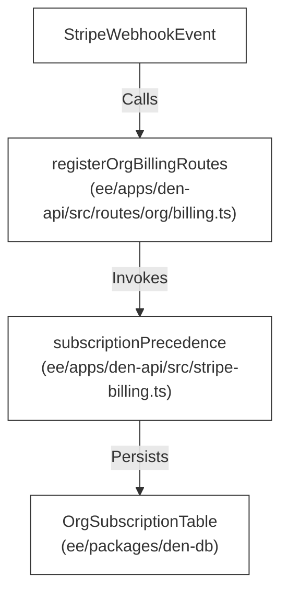
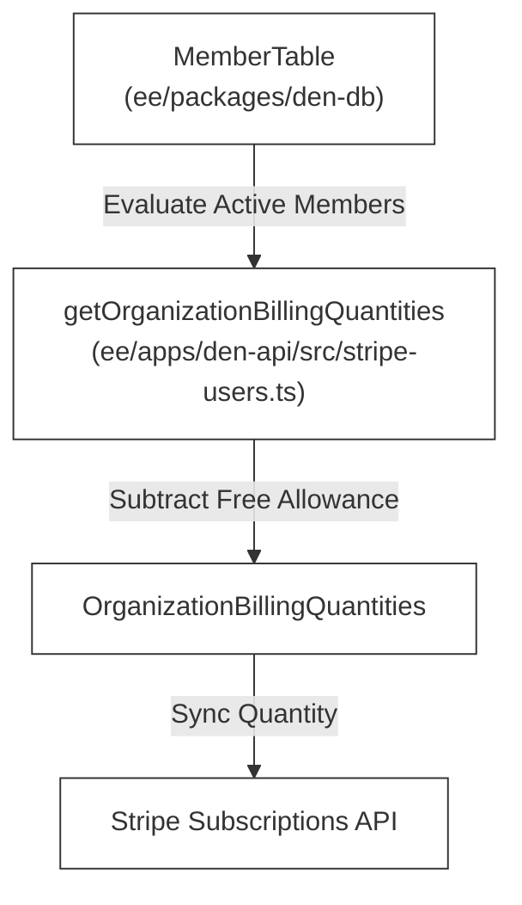
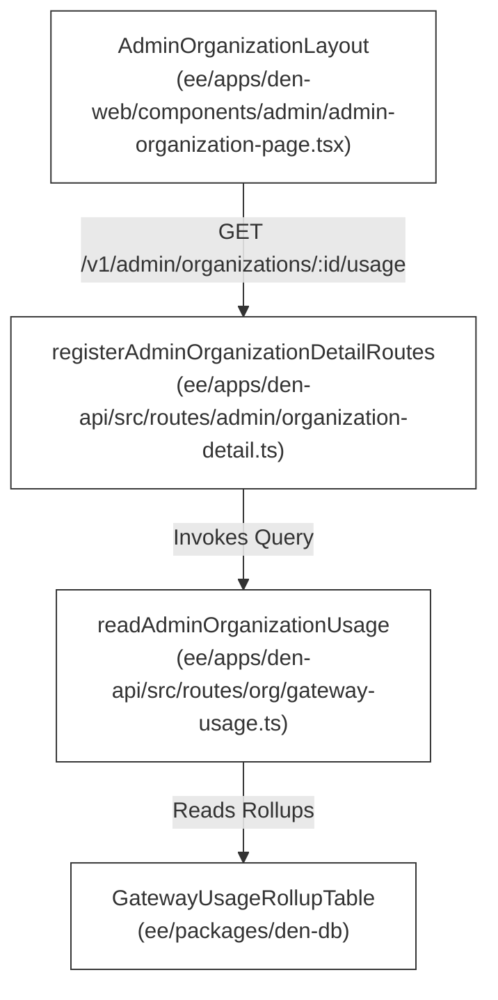

<!-- source: DeepWiki mcp.deepwiki.com · repo different-ai/openwork · extra page Billing and Usage · fetched 2026-10-26 -->

# Billing and Usage

Relevant source files

The following files were used as context for generating this wiki page:

- [ee/apps/den-api/src/routes/admin/organization-detail.ts](ee/apps/den-api/src/routes/admin/organization-detail.ts)
- [ee/apps/den-api/src/routes/org/billing.ts](ee/apps/den-api/src/routes/org/billing.ts)
- [ee/apps/den-api/src/routes/org/gateway-usage.ts](ee/apps/den-api/src/routes/org/gateway-usage.ts)
- [ee/apps/den-api/src/stripe-billing.ts](ee/apps/den-api/src/stripe-billing.ts)
- [ee/apps/den-web/app/(den)/_lib/inference-status.ts](ee/apps/den-web/app/(den)/_lib/inference-status.ts)
- [ee/apps/den-web/app/(den)/dashboard/(admin)/billing/stripe/checking/page.tsx](ee/apps/den-web/app/(den)/dashboard/(admin)/billing/stripe/checking/page.tsx)
- [ee/apps/den-web/app/(den)/dashboard/_components/billing-dashboard-screen.tsx](ee/apps/den-web/app/(den)/dashboard/_components/billing-dashboard-screen.tsx)
- [ee/apps/den-web/app/(den)/dashboard/_components/gateway-usage-section.tsx](ee/apps/den-web/app/(den)/dashboard/_components/gateway-usage-section.tsx)
- [ee/apps/den-web/app/(den)/dashboard/_components/inference-screen.tsx](ee/apps/den-web/app/(den)/dashboard/_components/inference-screen.tsx)
- [ee/apps/den-web/app/admin/organizations/[organizationId]/layout.tsx](ee/apps/den-web/app/admin/organizations/[organizationId]/layout.tsx)
- [ee/apps/den-web/components/admin/admin-access-screen.tsx](ee/apps/den-web/components/admin/admin-access-screen.tsx)
- [ee/apps/den-web/components/admin/admin-dashboard.tsx](ee/apps/den-web/components/admin/admin-dashboard.tsx)
- [ee/apps/den-web/components/admin/admin-data-page.tsx](ee/apps/den-web/components/admin/admin-data-page.tsx)
- [ee/apps/den-web/components/admin/admin-organization-page.tsx](ee/apps/den-web/components/admin/admin-organization-page.tsx)
- [ee/apps/den-web/components/admin/admin-recent-organizations.tsx](ee/apps/den-web/components/admin/admin-recent-organizations.tsx)
- [ee/apps/den-web/components/admin/admin-request.ts](ee/apps/den-web/components/admin/admin-request.ts)
- [ee/apps/den-web/components/admin/admin-shell.tsx](ee/apps/den-web/components/admin/admin-shell.tsx)
- [ee/packages/den-db/drizzle/0125_gateway_usage_route_indexes.sql](ee/packages/den-db/drizzle/0125_gateway_usage_route_indexes.sql)
- [ee/packages/den-db/drizzle/meta/0125_snapshot.json](ee/packages/den-db/drizzle/meta/0125_snapshot.json)
- [evals/proofs/admin-access.proof.test.ts](evals/proofs/admin-access.proof.test.ts)
- [evals/proofs/admin-organizations-list.proof.test.ts](evals/proofs/admin-organizations-list.proof.test.ts)
- [evals/worlds/admin-access.ts](evals/worlds/admin-access.ts)
- [packages/docs/ai-gateway/counting-usage.mdx](packages/docs/ai-gateway/counting-usage.mdx)
- [packages/docs/ai-gateway/token-costs.mdx](packages/docs/ai-gateway/token-costs.mdx)

This page documents the billing, seat enforcement, inference limits, telemetry event pipelines, and analytics infrastructure in the OpenWork Enterprise control plane (`ee/`). It details the integration with Stripe, subscription precedence rules, organizational seat limits, client-side telemetry reporting, and enterprise-gated analytics tables.

---

## 1. Stripe Billing and Subscriptions

The Den API integrates with Stripe via `ee/apps/den-api/src/stripe-billing.ts` and `ee/apps/den-api/src/routes/org/billing.ts` to manage organizational subscriptions across primary types: `inference`, `seat`, `web`, and `enterprise` [ee/apps/den-api/src/stripe-billing.ts:28-53]().

Subscriptions are tracked per organization in the database via `OrgSubscriptionTable`. Because Stripe can hold multiple subscription records for a single organization (such as during re-purchases after failed renewals or concurrent checkouts), the module enforces strict precedence logic (`subscriptionPrecedence()`, `shouldReplaceTrackedSubscription()`). Access-granting statuses (`active`, `trialing`) outrank recoverable statuses (`past_due`, `incomplete`), which outrank terminal states (`canceled`, `unpaid`).

Sources: `ee/apps/den-api/src/stripe-billing.ts`, `ee/apps/den-api/src/routes/org/billing.ts` [ee/apps/den-api/src/stripe-billing.ts:1-166](), [ee/apps/den-api/src/routes/org/billing.ts:1-136]()

---

## 2. Seat Enforcement and Pricing Tiers

Organizations are provisioned with a default tier and a fixed allowance of free seats before billable seat counts apply. Defined in `ee/apps/den-api/src/stripe-billing.ts`, the default free tier allows a fixed seat threshold [ee/apps/den-api/src/stripe-billing.ts:31-35](). 

Seat billing calculations inspect active member counts (`joined_non_removed_members`) and subtract the free allowance to calculate billable quantities [ee/apps/den-api/src/stripe-billing.ts:40-42](). Setup and demo seeding scripts update organization metadata and trigger synchronization routines to reconcile billable quantities against Stripe subscriptions.

Sources: `ee/apps/den-api/src/stripe-billing.ts`, `ee/apps/den-api/src/routes/org/billing.ts` [ee/apps/den-api/src/stripe-billing.ts:1-43](), [ee/apps/den-api/src/routes/org/billing.ts:1-511]()

---

## 3. Billing Dashboard and Checkout Flow

The organization billing interface is rendered by `BillingDashboardScreen` in `ee/apps/den-web/app/(den)/dashboard/_components/billing-dashboard-screen.tsx` [ee/apps/den-web/app/(den)/dashboard/_components/billing-dashboard-screen.tsx:1-40](). 

This component inspects billing state variables—including configured price IDs, unit amounts, currencies, interval definitions, portal URLs, and active subscription status metrics—to render state-specific cards and action triggers. When initiating a checkout or opening the Stripe billing portal, components invoke authorized actions that communicate with backend endpoints defined in `ee/apps/den-api/src/routes/org/billing.ts` [ee/apps/den-api/src/routes/org/billing.ts:1-165](). Returning from Stripe checkout routes through `StripeCheckingPage` (`ee/apps/den-web/app/(den)/dashboard/(admin)/billing/stripe/checking/page.tsx`), which polls session sync verification endpoints before redirecting the user back to the dashboard [ee/apps/den-web/app/(den)/dashboard/(admin)/billing/stripe/checking/page.tsx:59-130]().

Sources: `ee/apps/den-web/app/(den)/dashboard/_components/billing-dashboard-screen.tsx`, `ee/apps/den-api/src/routes/org/billing.ts`, `ee/apps/den-web/app/(den)/dashboard/(admin)/billing/stripe/checking/page.tsx` [ee/apps/den-web/app/(den)/dashboard/_components/billing-dashboard-screen.tsx:1-165](), [ee/apps/den-api/src/routes/org/billing.ts:1-165](), [ee/apps/den-web/app/(den)/dashboard/(admin)/billing/stripe/checking/page.tsx:59-130]()

---

## 4. Inference Usage and Limits

Model inference management is exposed through `InferenceScreen` in `ee/apps/den-web/app/(den)/dashboard/_components/inference-screen.tsx` [ee/apps/den-web/app/(den)/dashboard/_components/inference-screen.tsx:109-141](). 

The UI checks organization permissions via `getOrgAccessFlags()` and `getGatewayDashboardAccess()` to verify whether the caller holds permissions for model settings [ee/apps/den-web/app/(den)/dashboard/_components/inference-screen.tsx:112-119](). It renders an editorial lineup of supported models sourced from `INFERENCE_MODEL_ALIASES` [ee/apps/den-web/app/(den)/dashboard/_components/inference-screen.tsx:7-57](), detailing each model's primary capability (`bestFor`) and vendor monogram.

Sources: `ee/apps/den-web/app/(den)/dashboard/_components/inference-screen.tsx` [ee/apps/den-web/app/(den)/dashboard/_components/inference-screen.tsx:1-141]()

---

## 5. Telemetry Events Architecture

Telemetry collection follows a two-tier architecture:
1. **Client-side collection**: The desktop application collects lightweight usage signals via `apps/app/src/app/lib/den-telemetry.ts` (`trackTelemetryEvent`, `trackSessionActive`, `trackTaskStarted`) [apps/app/src/app/lib/den-telemetry.ts:1-180](). Events are batched in memory and flushed periodically via `POST /v1/telemetry/ingest` [apps/app/src/app/lib/den-telemetry.ts:73-118]().
2. **Server-side ingestion**: `ee/apps/den-api/src/routes/telemetry/index.ts` receives event batches, filters valid event types via `isKnownTelemetryEventType()`, and writes records to `TelemetryEventTable` and `TelemetrySessionDimensionTable` [ee/packages/den-db/src/schema/telemetry.ts:1-105]().

Schema definitions in `ee/packages/den-db/src/schema/telemetry.ts` establish covering indexes such as `TELEMETRY_EVENT_ORG_WINDOW_INDEX` to optimize org analytics window scans (`org_id = ? and event_timestamp >= ?`) without scanning unindexed rows [ee/packages/den-db/src/schema/telemetry.ts:29-65]().

Sources: `ee/apps/den-api/src/routes/telemetry/index.ts`, `ee/packages/den-db/src/schema/telemetry.ts`, `apps/app/src/app/lib/den-telemetry.ts` [ee/apps/den-api/src/routes/telemetry/index.ts:51-124](), [ee/packages/den-db/src/schema/telemetry.ts:1-105](), [apps/app/src/app/lib/den-telemetry.ts:1-180]()

---

## 6. Analytics Tables and Entitlements

Advanced usage analytics, gateway rollup metrics, and administrative organization usage screens are governed by backend entitlement checks and database rollups. 

Usage data is queried via `readAdminOrganizationUsage` and `readAdminOrganizationInsights` in `ee/apps/den-api/src/routes/org/gateway-usage.ts`, which aggregate data from `GatewayRequestLogTable` and `GatewayUsageRollupTable` [ee/apps/den-api/src/routes/org/gateway-usage.ts:1-60](). Administrative endpoints (`registerAdminOrganizationDetailRoutes` in `ee/apps/den-api/src/routes/admin/organization-detail.ts`) restrict these metrics to platform administrators and authorized roles [ee/apps/den-api/src/routes/admin/organization-detail.ts:47-78]().

Sources: `ee/apps/den-api/src/routes/org/gateway-usage.ts`, `ee/apps/den-api/src/routes/admin/organization-detail.ts`, `ee/apps/den-web/components/admin/admin-organization-page.tsx` [ee/apps/den-api/src/routes/org/gateway-usage.ts:1-60](), [ee/apps/den-api/src/routes/admin/organization-detail.ts:47-78](), [ee/apps/den-web/components/admin/admin-organization-page.tsx:1-118]()

---

