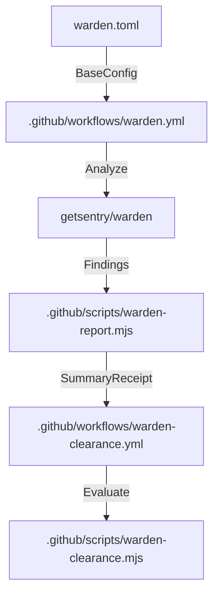
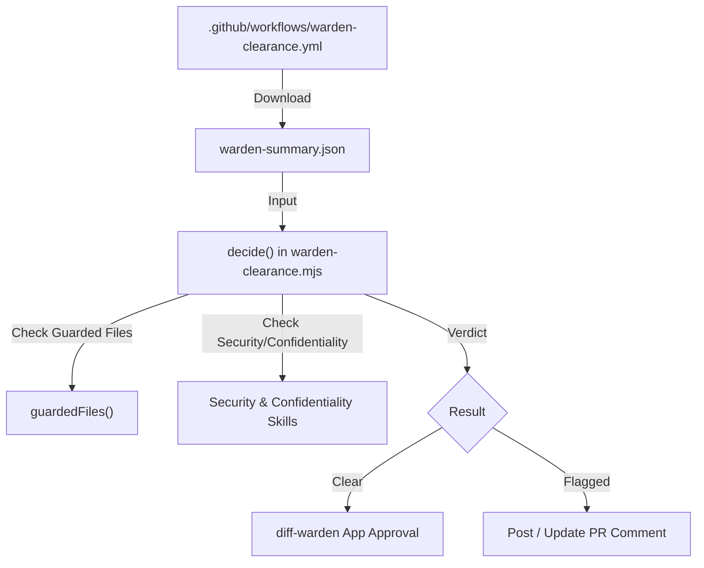

<!-- source: DeepWiki mcp.deepwiki.com · repo different-ai/openwork · extra page Warden Security Review · fetched 2026-10-26 -->

# Warden Security Review

<details>
<summary>Relevant source files</summary>

The following files were used as context for generating this wiki page:

- [.githooks/pre-push](.githooks/pre-push)
- [.github/scripts/warden-clearance.mjs](.github/scripts/warden-clearance.mjs)
- [.github/scripts/warden-fast.mjs](.github/scripts/warden-fast.mjs)
- [.github/scripts/warden-fast.test.mjs](.github/scripts/warden-fast.test.mjs)
- [.github/scripts/warden-report.mjs](.github/scripts/warden-report.mjs)
- [.github/scripts/warden-report.test.mjs](.github/scripts/warden-report.test.mjs)
- [.github/workflows/warden-clearance.yml](.github/workflows/warden-clearance.yml)
- [.github/workflows/warden-quick.yml](.github/workflows/warden-quick.yml)
- [.github/workflows/warden.yml](.github/workflows/warden.yml)
- [.gitignore](.gitignore)
- [.warden/README.md](.warden/README.md)
- [.warden/reporting.md](.warden/reporting.md)
- [.warden/scripts/measure-chunks.mjs](.warden/scripts/measure-chunks.mjs)
- [.warden/skills/confidentiality-review/SKILL.md](.warden/skills/confidentiality-review/SKILL.md)
- [.warden/skills/desktop-den-sync-review/SKILL.md](.warden/skills/desktop-den-sync-review/SKILL.md)
- [.warden/skills/diff-security-review/SKILL.md](.warden/skills/diff-security-review/SKILL.md)
- [.warden/skills/spec-provenance-review/SKILL.md](.warden/skills/spec-provenance-review/SKILL.md)
- [.warden/tests/chunking.test.mjs](.warden/tests/chunking.test.mjs)
- [scripts/install-git-hooks.mjs](scripts/install-git-hooks.mjs)
- [warden.toml](warden.toml)

</details>


This page details the OpenWork project's security review system, primarily driven by the Warden tool. It covers the configuration in `warden.toml`, the custom Warden skills used for security and confidentiality, the GitHub Actions workflows that integrate Warden into the CI/CD pipeline, and the mechanisms for handling internal pull requests, clearance scripts, and reporting.

## Warden Configuration (`warden.toml`)

The `warden.toml` file defines the core configuration for Warden's operation within the OpenWork repository. It specifies default behaviors, scan limits, chunking options, and the skills to be executed.

```toml
# warden.toml
version = 1

[defaults]
defaultBranch = "dev"
reportOn = "low"
ignorePaths = ["**/node_modules/**", "**/pnpm-lock.yaml", "**/dist/**", "**/*.min.js"]

[defaults.scan]
maxFileLines = 5000
maxFiles = 400
maxChangedLines = 60000

[defaults.chunking.coalesce]
enabled = true
maxGapLines = 30
maxChunkSize = 12000

[defaults.agent]
model = "openai/gpt-6-luna"

[defaults.auxiliary]
model = "openai/gpt-6-luna"
```

Key configuration aspects include:
*   **`defaultBranch`**: Set to `dev`, indicating the base branch for comparisons [warden.toml:6]().
*   **`reportOn`**: Configured to report findings of "low" severity and above [warden.toml:7]().
*   **`ignorePaths`**: Excludes common build artifacts and dependency directories from scans [warden.toml:8]().
*   **Scan Limits**: `maxFiles` (400) and `maxChangedLines` (60,000) accommodate larger pull requests, though PRs exceeding these limits will result in an incomplete review [warden.toml:15-16]().
*   **Chunking Coalesce**: Configured with `maxChunkSize = 12000` to amortize prompt extraction across slightly larger chunks while keeping nearby hunks within 30 lines [warden.toml:20-23]().
*   **Agent Models**: Both the primary and auxiliary agents are configured to use `openai/gpt-6-luna` [warden.toml:25-29](). This can be overridden by the `WARDEN_MODEL` repository variable [reference .github/workflows/warden.yml:53-60]().

Title: Warden Configuration and Workflow Execution


Sources:
* [warden.toml:1-47]()
* [.github/workflows/warden.yml:53-60]()

## Warden Skills

OpenWork utilizes specific Warden skills to enforce security and confidentiality policies. These skills are defined in the `.warden/skills` directory and configured in `warden.toml`.

### `diff-security-review`

This skill focuses on identifying new security regressions introduced in a pull request [warden.toml:31-32](). It is triggered on pull request events such as `opened`, `synchronize`, `reopened`, and `ready_for_review` [warden.toml:34-36](). Locally, it fails on "info" level findings with "low" confidence [warden.toml:38-41](). The skill's detailed instructions are found in [.warden/skills/diff-security-review/SKILL.md](). It looks for concrete security impacts including injection, XSS, SSRF, path traversal, authn/authz bypass, secret exposure, insecure deserialization, and unsafe Electron patterns [.warden/skills/diff-security-review/SKILL.md:31-39]().

### `confidentiality-review`

This skill ensures that no confidential information, such as customer, prospect, partner, or outside-person identities, is inadvertently committed to the public repository [warden.toml:44-45](), [.warden/skills/confidentiality-review/SKILL.md:24-26](). It operates under the same trigger conditions as `diff-security-review` for pull requests and local runs [warden.toml:47-54](). It flags added lines identifying outside parties while ignoring technology vendors and fictional fixtures [.warden/skills/confidentiality-review/SKILL.md:24-26]().

### `spec-provenance-review`

This advisory skill reviews changes under `evals/specs/**` and `evals/worlds/**` to flag concrete false-positive proofs introduced by changed specs [.warden/skills/spec-provenance-review/SKILL.md:7-9](). It is advisory only and never gates Warden clearance [.warden/skills/spec-provenance-review/SKILL.md:3]().

Sources:
* [warden.toml:31-54]()
* [.warden/skills/diff-security-review/SKILL.md:1-90]()
* [.warden/skills/confidentiality-review/SKILL.md:1-32]()
* [.warden/skills/spec-provenance-review/SKILL.md:1-55]()

## Warden Workflows

Warden is integrated into the CI/CD pipeline through GitHub Actions workflows, primarily `warden.yml` and `warden-clearance.yml`.

### `warden.yml`

This workflow [.github/workflows/warden.yml:1-116]() is responsible for running the Warden analysis on pull requests originating from within the repository.

**Workflow Trigger**:
*   `pull_request` events: `opened`, `synchronize`, `reopened`, `ready_for_review` [.github/workflows/warden.yml:6-7]().

**Key Steps**:
1.  **Checkout Source**: The PR's head SHA is checked out for analysis [.github/workflows/warden.yml:30-34]().
2.  **Checkout Trusted Policy**: The Warden policy (`warden.toml`, `.warden` skills, `.github/scripts`) is checked out from the *base branch* to ensure analysis logic cannot be tampered with by the PR itself [.github/workflows/warden.yml:38-47]().
3.  **Apply Model Variable**: If the `WARDEN_MODEL` repository variable is set, it validates the format and overrides the model specified in `warden.toml` [.github/workflows/warden.yml:52-62]().
4.  **Analyze Security**: The `getsentry/warden` action executes in `analyze` mode using the trusted base configuration [.github/workflows/warden.yml:68-82]().
5.  **Security Summary and Timing**: A Node.js script (`.warden-policy/.github/scripts/warden-report.mjs`) generates a summary of findings and timing metrics [.github/workflows/warden.yml:84-96]().
6.  **Save Artifacts**: Uploads `warden-summary.json` and `warden-findings.json` as GitHub Actions artifacts [.github/workflows/warden.yml:98-116]().

Sources:
* [.github/workflows/warden.yml:1-116]()

### `warden-clearance.yml`

This workflow [.github/workflows/warden-clearance.yml:1-84]() runs after `warden.yml` completes and automatically approves or withdraws approval for same-repository PRs using the `diff-warden` App.

**Workflow Trigger**:
*   `workflow_run` event: triggered when the `Warden` workflow completes [.github/workflows/warden-clearance.yml:13-16]().

**Key Steps**:
1.  **Checkout Trusted Script**: Checks out `.github/scripts/warden-clearance.mjs` from the default branch [.github/workflows/warden-clearance.yml:37-42]().
2.  **Download Artifacts**: Downloads `warden-summary.json` and `warden-findings.json` [.github/workflows/warden-clearance.yml:45-62]().
3.  **Mint Clearance Token**: Uses a GitHub App token to interact with the PR [.github/workflows/warden-clearance.yml:64-70]().
4.  **Grant or Withdraw Clearance**: Executes `.github/scripts/warden-clearance.mjs` to evaluate findings against strict criteria (no major security findings, no confidentiality findings, complete review) [.github/workflows/warden-clearance.yml:71-84]().

Title: Clearance Decision Flow


Sources:
* [.github/workflows/warden-clearance.yml:1-84]()
* [.github/scripts/warden-clearance.mjs:25-65]()

## Clearance and Reporting Scripts

### `warden-clearance.mjs`

This script [.github/scripts/warden-clearance.mjs:1-275]() executes the core clearance logic.

*   `guardedFiles(files)`: Filters files to verify if any modified files match guarded patterns (`warden.yml`, `warden-clearance.yml`, `warden.toml`, `.warden/`, etc.) which prevent automated clearance [.github/scripts/warden-clearance.mjs:21-27]().
*   `decide(receipt, expected)`: Evaluates review receipts for completeness, size limits, and finding counts [.github/scripts/warden-clearance.mjs:38-65](). Returns a verdict of `clear` or `flagged`.
*   `safe(value, max)`: Escapes model-written text and breaks `@mentions` and `#references` to prevent prompt injection or accidental pings in PR comments [.github/scripts/warden-clearance.mjs:78-81]().

### `warden-report.mjs`

This script [.github/scripts/warden-report.mjs:1-212]() validates analysis output and builds the structured receipt (`warden-summary.json` schema version 2) [.github/scripts/warden-report.mjs:44-114](). It calculates skip counts for files exceeding size limits (`limitSkips`) [.github/scripts/warden-report.mjs:28-40]() and formats markdown summaries [.github/scripts/warden-report.mjs:116-126]().

Sources:
* [.github/scripts/warden-clearance.mjs:1-113]()
* [.github/scripts/warden-report.mjs:1-126]()
* [.github/scripts/warden-report.test.mjs:1-97]()

---

