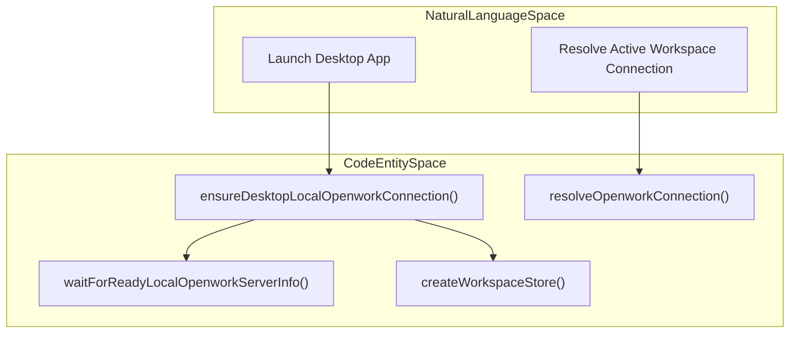
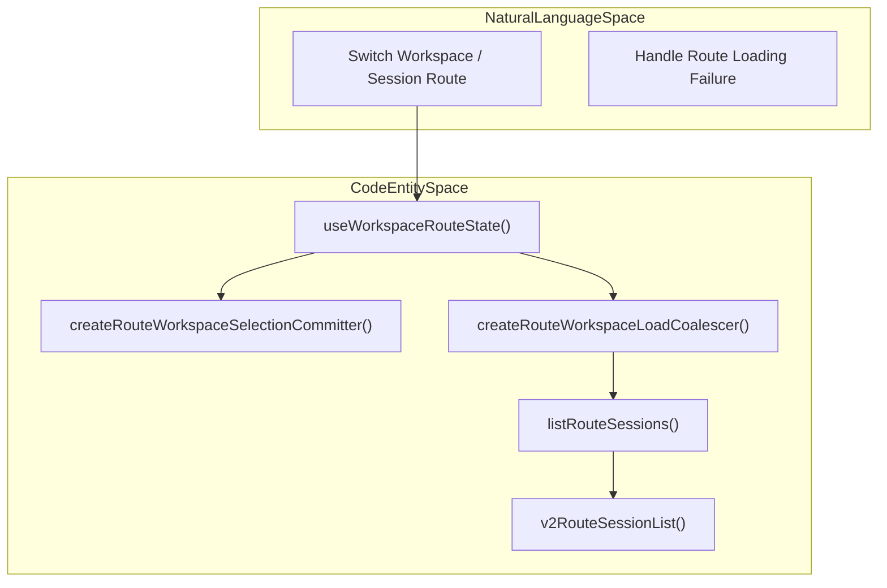

<!-- source: DeepWiki mcp.deepwiki.com · repo different-ai/openwork · extra page Workspaces and Routing · fetched 2026-10-26 -->

# Workspaces and Routing

Relevant source files

The following files were used as context for generating this wiki page:

- [apps/app/src/react-app/shell/desktop-local-openwork.ts](apps/app/src/react-app/shell/desktop-local-openwork.ts)
- [apps/app/src/react-app/shell/openwork-connection.ts](apps/app/src/react-app/shell/openwork-connection.ts)
- [apps/app/src/react-app/shell/route-refresh-control.ts](apps/app/src/react-app/shell/route-refresh-control.ts)
- [apps/app/src/react-app/shell/route-workspaces.ts](apps/app/src/react-app/shell/route-workspaces.ts)
- [apps/app/src/react-app/shell/use-workspace-route-state.ts](apps/app/src/react-app/shell/use-workspace-route-state.ts)
- [apps/app/tests/archived-session-sort.test.ts](apps/app/tests/archived-session-sort.test.ts)
- [apps/app/tests/use-workspace-route-state.test.tsx](apps/app/tests/use-workspace-route-state.test.tsx)
- [apps/desktop/electron/workspace-store.mjs](apps/desktop/electron/workspace-store.mjs)
- [docs/features/archived-session-ordering.md](docs/features/archived-session-ordering.md)
- [packages/docs/start-here/do-work-with-it/workflows.mdx](packages/docs/start-here/do-work-with-it/workflows.mdx)

This page details the technical implementation of workspaces, routing state management, desktop runtime booting, connection resolution, and session lifecycle operations (archive, pin, and ordering) within OpenWork.

---

## 1. Workspace Types and Data Structures

A **workspace** in OpenWork defines a working directory context and configuration boundary for AI sessions. Workspaces maintain lists of active sessions, local tool definitions, and engine configuration bindings.

There are two primary workspace classifications:
- **Local Workspaces**: Filesystem directories managed via local OpenWork server instances and OpenCode engines.
- **Remote / Cloud Workspaces**: Connected remote endpoints (such as cloud workers hosted in the Den control plane) accessed via a remote client proxy.

Workspaces are mapped into normalized types within route helper modules (`RouteWorkspace` and `RouteSession`) [apps/app/src/react-app/shell/route-workspaces.ts:21-34](). The desktop client persists workspace configurations via `workspace-store.mjs` into `openwork-workspaces.json` [apps/desktop/electron/workspace-store.mjs:18-23]() through user data path resolvers [apps/desktop/electron/workspace-store.mjs:167-171]().

Sources: [apps/desktop/electron/workspace-store.mjs:18-23](), [apps/desktop/electron/workspace-store.mjs:167-171](), [apps/app/src/react-app/shell/route-workspaces.ts:21-34]()

---

## 2. Desktop Runtime Boot and Connection Resolution

When running in an Electron or desktop environment, the client initializes through connection resolver modules and local instance guards. 

The following diagram bridges high-level desktop startup intents (Natural Language Space) to exact runtime initialization functions (Code Entity Space):

Title: "Desktop Runtime Boot and Connection Flow"

Sources: [apps/app/src/react-app/shell/openwork-connection.ts:61-136](), [apps/app/src/react-app/shell/desktop-local-openwork.ts:129-185](), [apps/desktop/electron/workspace-store.mjs:135-153]()

### Connection Resolution Mechanics
`resolveOpenworkConnection` inspects gateway origins, local server settings overrides, and active workspace parameters to compute a `ResolvedOpenworkConnection` containing the target normalized base URL and authentication tokens [apps/app/src/react-app/shell/openwork-connection.ts:61-136](). Local desktop-hosted servers expose ephemeral loopback ports and freshly minted tokens on every boot, handled by `ensureDesktopLocalOpenworkConnection` [apps/app/src/react-app/shell/desktop-local-openwork.ts:129-185]().

Sources: [apps/app/src/react-app/shell/openwork-connection.ts:61-136](), [apps/app/src/react-app/shell/desktop-local-openwork.ts:129-185]()

---

## 3. Workspace Route State and Coalescing

The frontend manages route-level synchronization using `useWorkspaceRouteState`, which coordinates active workspace selection, URL-derived session loading, endpoint resolution, and error classification [apps/app/src/react-app/shell/use-workspace-route-state.ts:142-169]().

To prevent race conditions between rapid workspace switches or parallel background synchronization, route updates use deterministic transaction committers (`createRouteWorkspaceSelectionCommitter`) and request coalescers (`createRouteWorkspaceLoadCoalescer`) [apps/app/src/react-app/shell/route-refresh-control.ts:85-174]().

The diagram below maps route-navigation concepts to their underlying state management and refresh logic entities:

Title: "Route Coalescing and State Management"

Sources: [apps/app/src/react-app/shell/use-workspace-route-state.ts:142-169](), [apps/app/src/react-app/shell/route-refresh-control.ts:85-174](), [apps/app/src/react-app/shell/route-workspaces.ts:46-58]()

Sources: [apps/app/src/react-app/shell/use-workspace-route-state.ts:142-169](), [apps/app/src/react-app/shell/route-refresh-control.ts:85-174](), [apps/app/src/react-app/shell/route-workspaces.ts:46-58]()

---

## 4. Session Archive, Pinning, and Ordering

Sidebar session inventory management is governed by organizing rules across workspaces, groups, and global archive buckets [packages/docs/start-here/do-work-with-it/workflows.mdx:1-89]().

### Operational Rules for Session State
- **Pinning**: Pinned chats appear in the **Pinned** section at the top of the sidebar, across all workspaces [packages/docs/start-here/do-work-with-it/workflows.mdx:12-20]().
- **Groups**: Groups act as folders within a workspace for staging active work or filtering topics [packages/docs/start-here/do-work-with-it/workflows.mdx:27-57]().
- **Archive and Ordering**: Archived chats are moved to the global **Archived** section at the bottom of the sidebar. Global archive ordering relies on most recently archived first (`time.archived` descending), followed by workspace ID and session ID ascending for deterministic ties [docs/features/archived-session-ordering.md:35-37](). Restoring removes the item from the archive, while rearchiving assigns a new archive timestamp [docs/features/archived-session-ordering.md:35-37]().

Sources: [packages/docs/start-here/do-work-with-it/workflows.mdx:1-89](), [docs/features/archived-session-ordering.md:35-37](), [apps/app/tests/archived-session-sort.test.ts:26-38]()

---

