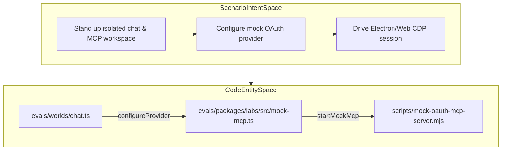
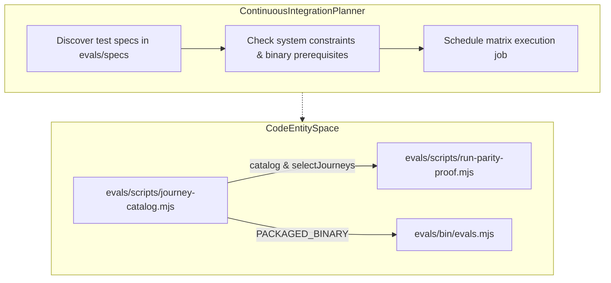

<!-- source: DeepWiki mcp.deepwiki.com · repo different-ai/openwork · extra page Worlds and Specs · fetched 2026-10-26 -->

# Worlds and Specs

<details>
<summary>Relevant source files</summary>

The following files were used as context for generating this wiki page:

- [apps/app/src/app/index.css](apps/app/src/app/index.css)
- [apps/app/src/app/lib/opencode-v2-adapter.ts](apps/app/src/app/lib/opencode-v2-adapter.ts)
- [apps/app/src/components/chat/image-attachment-badge.tsx](apps/app/src/components/chat/image-attachment-badge.tsx)
- [apps/app/src/components/chat/image-lightbox.tsx](apps/app/src/components/chat/image-lightbox.tsx)
- [apps/app/src/components/markdown/link-action-menu.tsx](apps/app/src/components/markdown/link-action-menu.tsx)
- [apps/app/src/components/markdown/markdown-primitive.ts](apps/app/src/components/markdown/markdown-primitive.ts)
- [apps/app/src/components/markdown/markdown.tsx](apps/app/src/components/markdown/markdown.tsx)
- [apps/app/src/components/ui/image.tsx](apps/app/src/components/ui/image.tsx)
- [apps/app/src/lib/target-provider.ts](apps/app/src/lib/target-provider.ts)
- [apps/app/src/react-app/domains/session/surface/markdown.tsx](apps/app/src/react-app/domains/session/surface/markdown.tsx)
- [apps/server/src/opencode-plugins/openwork-title-recovery.ts](apps/server/src/opencode-plugins/openwork-title-recovery.ts)
- [apps/server/test/session-title-sigv4.vitest.test.ts](apps/server/test/session-title-sigv4.vitest.test.ts)
- [docs/testing.md](docs/testing.md)
- [evals/package.json](evals/package.json)
- [evals/packages/hosts/src/index.ts](evals/packages/hosts/src/index.ts)
- [evals/packages/labs/src/mock-mcp.ts](evals/packages/labs/src/mock-mcp.ts)
- [evals/packages/testkit/src/fixture.ts](evals/packages/testkit/src/fixture.ts)
- [evals/packages/testkit/src/spec/index.ts](evals/packages/testkit/src/spec/index.ts)
- [evals/pnpm-lock.yaml](evals/pnpm-lock.yaml)
- [evals/pnpm-workspace.yaml](evals/pnpm-workspace.yaml)
- [evals/scripts/journey-catalog.mjs](evals/scripts/journey-catalog.mjs)
- [evals/scripts/run-parity-proof.mjs](evals/scripts/run-parity-proof.mjs)
- [evals/scripts/run-parity-proof.test.mjs](evals/scripts/run-parity-proof.test.mjs)
- [evals/tsconfig.json](evals/tsconfig.json)
- [evals/vitest.config.ts](evals/vitest.config.ts)
- [evals/worlds/chat.ts](evals/worlds/chat.ts)
- [packages/enterprise-mcp-client/package.json](packages/enterprise-mcp-client/package.json)
- [scripts/mock-oauth-mcp-server.mjs](scripts/mock-oauth-mcp-server.mjs)

</details>


## Purpose and Scope
This page details the testing infrastructure powering OpenWork's end-to-end evaluation and spec framework under the `evals/` directory [evals/package.json:1-50](). It covers how `evals/worlds/` fixtures stand up isolated scenario environments, how `evals/specs/`, `evals/core/`, and `evals/proofs/` implement end-to-end test suites [evals/vitest.config.ts:53-61](), how journeys are registered and classified in `evals/scripts/journey-catalog.mjs` [evals/scripts/journey-catalog.mjs:1-35](), and how parity proofs validate behavioral consistency across OpenCode engine versions v1 and v2 via `evals/scripts/run-parity-proof.mjs` [evals/scripts/run-parity-proof.mjs:1-42]().

---

## 1. Worlds Architecture and Fixtures
Worlds provide the runtime fixture state required to initialize complex evaluation scenarios. They coordinate local/remote placement (e.g., local process, Daytona sandboxes, or Electron shells), mock server dependencies (such as OAuth MCP servers and simulated LLM inference providers via `evals/packages/labs/src/mock-mcp.ts`), and browser automation handles using Chrome DevTools Protocol (`@openwork/cdp`) [evals/worlds/chat.ts:1-12]().

Key files governing world setup and mock service orchestration include:
- `evals/worlds/chat.ts`: Sets up chat provider configurations, local mock servers, and workspace engine injection [evals/worlds/chat.ts:71-130]().
- `evals/packages/labs/src/mock-mcp.ts`: Implements programmatic control handles (`MockMcpHandle`) for mock MCP servers, tool call recording, and agent workload step execution [evals/packages/labs/src/mock-mcp.ts:98-136]().
- `scripts/mock-oauth-mcp-server.mjs`: Standalone HTTP/MCP loopback server providing OAuth grant flows, token rotation mechanics, and synthetic tool catalogs [scripts/mock-oauth-mcp-server.mjs:1-96]().


*Diagram 1: Bridging Scenario Intent to World Fixture Entities*

Sources:
- `evals/worlds/chat.ts` [evals/worlds/chat.ts:71-130]()
- `evals/packages/labs/src/mock-mcp.ts` [evals/packages/labs/src/mock-mcp.ts:98-136]()
- `scripts/mock-oauth-mcp-server.mjs` [scripts/mock-oauth-mcp-server.mjs:1-96]()

---

## 2. Specs and End-to-End Test Suites
Test suites under `evals/core/`, `evals/proofs/`, and scenario directories exercise discrete user journeys, edge cases, and regression scenarios [evals/vitest.config.ts:53-61](). Each spec runs against an instantiated world using the testkit driver framework under Vitest projects (`pr` vs `e2e`) [evals/vitest.config.ts:33-64]().

The test runner architecture is configured via `evals/vitest.config.ts`, which sets up global setup hooks (`evals/runner/prepare-stack.ts`) and isolates unit testing from end-to-end browser workflows [evals/vitest.config.ts:53-61]().

Sources:
- `evals/vitest.config.ts` [evals/vitest.config.ts:1-64]()
- `evals/package.json` [evals/package.json:1-50]()

---

## 3. Journey Catalog Registration
The central registry for CI test grouping, execution requirements, and human-readable names lives in `evals/scripts/journey-catalog.mjs` [evals/scripts/journey-catalog.mjs:1-35](). Unlisted specs are automatically discovered as full-regression journeys [evals/scripts/journey-catalog.mjs:5-13](). 

The catalog maps spec files to specific configuration constraints:
- **`needs`**: System-level prerequisites (e.g., packaged Electron binary availability via `PACKAGED_BINARY`, target platforms like `darwin`) [evals/scripts/journey-catalog.mjs:14-30]().
- **`placement`**: Execution placement configuration (`local`, `--daytona`) [evals/scripts/journey-catalog.mjs:27-54]().
- **`cases`**: Fine-grained case identifiers, engine matrix bindings (`v1`, `v2`), and feature flag opt-ins [evals/scripts/journey-catalog.mjs:16-23]().


*Diagram 2: Journey Catalog Mapping to CI Execution Pipeline*

| Spec Identifier | Placement | Required Environment / Needs | Engine Support |
| :--- | :--- | :--- | :--- |
| `v2-chat-recovery.proof.test.ts` | `--local` | `OPENWORK_EVAL_E2E_TESTS` | `v2` |
| `agent-connection-journey.e2e.test.ts` | `--local` | `OPENWORK_EVAL_E2E_TESTS` | `v1`, `v2` |
| `app-smoke.e2e.test.ts` | `local` | None | `v1`, `v2` |
| `packaged-update-install.e2e.test.ts` | `local` | `darwin`, `OPENWORK_EVAL_ELECTRON_BINARY`, `OPENWORK_EVAL_UPDATE_FEED_DIR` | `v1`, `v2` |

Sources:
- `evals/scripts/journey-catalog.mjs` [evals/scripts/journey-catalog.mjs:1-76]()

---

## 4. Engine Parity Proofs (v1 vs v2)
OpenWork maintains backward and forward behavioral parity between OpenCode engine versions v1 and v2. Parity proofs execute identical spec suites against both engine runtimes to guarantee regression-free migration paths [evals/scripts/run-parity-proof.mjs:1-42]().

The parity check workflow is managed via `evals/scripts/run-parity-proof.mjs`:
- **`parityProofName(spec)`**: Validates whether a given spec basename is supported under parity verification [evals/scripts/run-parity-proof.mjs:27-32]().
- **`parityProofPlan(spec)`**: Returns the execution matrix of required engines (`v1`, `v2`) for a given spec [evals/scripts/run-parity-proof.mjs:34-41]().
- **`runParityProof(spec, dependencies)`**: Prepares necessary parity binaries, executes each engine target sequentially via `spawn`, and aggregates test exit codes [evals/scripts/run-parity-proof.mjs:43-59]().

```typescript
// Example conceptual execution plan generated by parityProofPlan
export function parityProofPlan(spec) {
  const name = parityProofName(spec);
  if (!name) throw new Error(`Unsupported parity proof: ${spec}`);
  const engines = v2Only.has(name) ? ["v2"] : ["v1", "v2"];
  return engines.map(engine => ({ engine, args: ["evals/bin/evals.mjs", testName(file), "--local", "--engine", engine] }));
}
```

Sources:
- `evals/scripts/run-parity-proof.mjs` [evals/scripts/run-parity-proof.mjs:1-66]()

---

