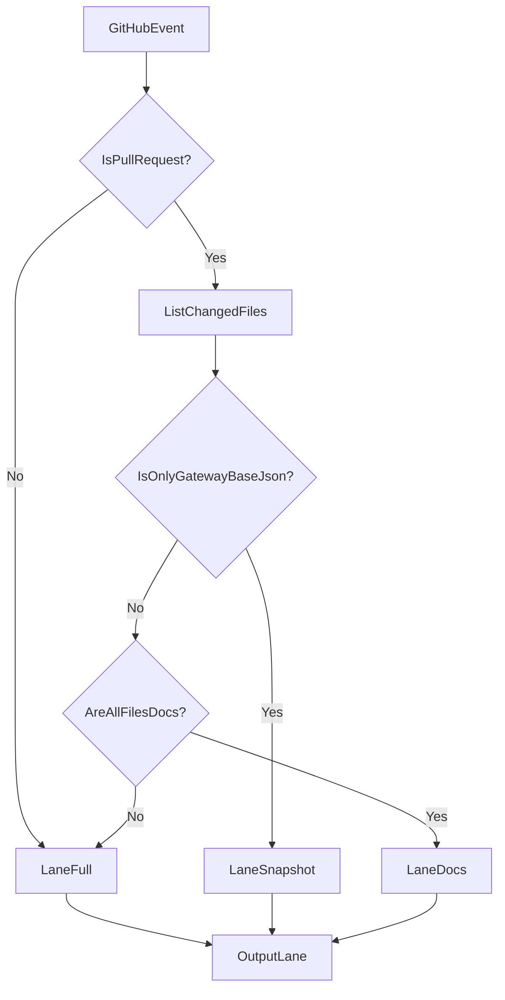
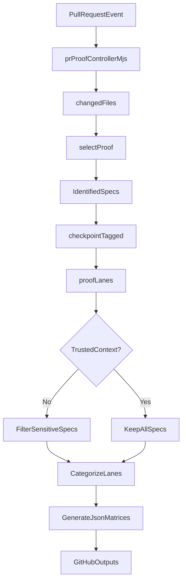

<!-- source: DeepWiki mcp.deepwiki.com · repo different-ai/openwork · extra page CI Tests and PR Proof · fetched 2026-10-26 -->

# CI Tests and PR Proof

Relevant source files

The following files were used as context for generating this wiki page:

- [.github/actions/den-deps/action.yml](.github/actions/den-deps/action.yml)
- [.github/codeql/codeql-config.yml](.github/codeql/codeql-config.yml)
- [.github/scripts/evidence-presentation.md](.github/scripts/evidence-presentation.md)
- [.github/scripts/evidence-presentation.mjs](.github/scripts/evidence-presentation.mjs)
- [.github/scripts/evidence-presentation.test.mjs](.github/scripts/evidence-presentation.test.mjs)
- [.github/scripts/evidence-preview-card.mjs](.github/scripts/evidence-preview-card.mjs)
- [.github/scripts/evidence-preview-card.test.mjs](.github/scripts/evidence-preview-card.test.mjs)
- [.github/scripts/pr-proof-controller.mjs](.github/scripts/pr-proof-controller.mjs)
- [.github/scripts/pr-proof.mjs](.github/scripts/pr-proof.mjs)
- [.github/workflows/codeql-result-coverage.yml](.github/workflows/codeql-result-coverage.yml)
- [.github/workflows/codeql.yml](.github/workflows/codeql.yml)
- [.github/workflows/core-journeys.yml](.github/workflows/core-journeys.yml)
- [.github/workflows/evidence-review-checks.yml](.github/workflows/evidence-review-checks.yml)
- [.github/workflows/evidence-review.yml](.github/workflows/evidence-review.yml)
- [.github/workflows/pr-proof.yml](.github/workflows/pr-proof.yml)
- [apps/review/README.md](apps/review/README.md)
- [docs/codeql-results.md](docs/codeql-results.md)
- [evals/packages/test-artifacts/src/publish-pr.ts](evals/packages/test-artifacts/src/publish-pr.ts)
- [evals/packages/test-evidence/src/vitest.ts](evals/packages/test-evidence/src/vitest.ts)
- [evals/scripts/publish-review.mjs](evals/scripts/publish-review.mjs)
- [scripts/ci/check-codeql-results.mjs](scripts/ci/check-codeql-results.mjs)
- [scripts/ci/check-codeql-results.test.mjs](scripts/ci/check-codeql-results.test.mjs)

This page details the Continuous Integration (CI) testing infrastructure, focusing on the `ci-tests.yml` and `pr-proof.yml` GitHub Actions workflows. It covers how changes are classified to determine which tests run, the selection controller for PR proofs, packaged smoke jobs on Linux and macOS, CodeQL result coverage, and evidence review publication.

## CI Tests (`ci-tests.yml`)

The `ci-tests.yml` workflow is the primary CI pipeline for the OpenWork repository. It runs on pull requests to `dev`, pushes to `dev`, on a daily schedule, and manually via `workflow_dispatch` [`.github/workflows/ci-tests.yml:4-15`](). The workflow uses a concurrency group to manage parallel runs and cancel in-progress runs for pull requests [`.github/workflows/ci-tests.yml:16-18`]().

### Change Classification

A crucial first step in `ci-tests.yml` is the `classify-changes` job [`.github/workflows/ci-tests.yml:28-72`](). This job determines the "lane" for the CI run based on the files changed in a pull request.

**Lane Classification Logic:**
*   **`full`**: If the event is not a pull request (e.g., a push to `dev` or a scheduled run), or if the changes are not exclusively `snapshot` or `docs`, the lane is `full` [`.github/workflows/ci-tests.yml:39-42`, `.github/workflows/ci-tests.yml:59`](). This triggers a comprehensive suite of tests.
*   **`snapshot`**: If only one file is modified, and that file is `ee/apps/gateway/src/models/base.json` [`.github/workflows/ci-tests.yml:53-55`](), the lane is `snapshot`. This indicates a change to the API gateway model snapshot.
*   **`docs`**: If all changed files are within `packages/docs/` [`.github/workflows/ci-tests.yml:56-58`](), the lane is `docs`. This allows for faster CI runs for documentation-only changes.

The `classify-changes` job also determines if a "den contract" check is required [`.github/workflows/ci-tests.yml:63-71`](). This check is triggered if files related to the Den API, shared packages (`ee/packages/`, `packages/types/`, `packages/features/`, `packages/sdk/`), or the contract generation scripts are modified.

**Diagram: CI Lane Classification Data Flow**

Sources:
- `.github/workflows/ci-tests.yml:28-72`

### `openwork-tests-core` and `openwork-tests-build` Jobs

The `openwork-tests-core` job runs unit tests and various checks conditional on a `full` lane [`.github/workflows/ci-tests.yml:74-134`](). It utilizes a self-hosted runner `blacksmith-16vcpu-ubuntu-2204` [`.github/workflows/ci-tests.yml:77`]() to execute checks across Den web hooks, headless runners, shared calendar logic, authorization policies, and native MCP readiness.

The `openwork-tests-build` job prepares a virtual display and builds/boots the desktop application [`.github/workflows/ci-tests.yml:136-145`]().

Sources:
- `.github/workflows/ci-tests.yml:74-145`

## PR Proof (`pr-proof.yml`) and Selection Controller

The `pr-proof.yml` workflow provides targeted proof of changes for pull requests on the `dev` branch [.github/workflows/pr-proof.yml:1-45](). 

### Proof Selection Controller (`pr-proof-controller.mjs`)

The `select` job executes `.github/scripts/pr-proof-controller.mjs` [`.github/scripts/pr-proof-controller.mjs:1-48`](), which interfaces with `.github/scripts/pr-proof.mjs` [`.github/scripts/pr-proof.mjs:1-113`]() to perform the following operations:
1. Fetch changed files via `changedFiles()` using the GitHub API [`.github/scripts/pr-proof.mjs:101-111`]().
2. Invoke `selectProof()` to extract matching E2E specifications matching `SPEC` regex (`evals/(specs|core)/*.e2e.test.ts` or `evals/proofs/*.proof.test.ts`) [`.github/scripts/pr-proof.mjs:7-8`, `.github/scripts/pr-proof.mjs:59-69`]().
3. Run `proofLanes()` to categorize specs into `coreSpecs`, `normalSpecs`, `packagedSpecs`, and `checkpointSpecs` based on trusted PR contexts and tags (`checkpointTagged()`) [`.github/scripts/pr-proof.mjs:14-16`, `.github/scripts/pr-proof.mjs:71-89`]().
4. Output JSON matrices (`coreMatrix`, `matrix`, `packagedMatrix`, `checkpointMatrix`) to `$GITHUB_OUTPUT` [`.github/scripts/pr-proof-controller.mjs:33-34`]().

**Diagram: PR Proof Selection Data Flow**

Sources:
- `.github/workflows/pr-proof.yml:16-29`
- `.github/scripts/pr-proof-controller.mjs:1-48`
- `.github/scripts/pr-proof.mjs:1-113`

### Core and Proof Execution Jobs

*   **`core` job**: Runs core journeys (`CORE_SPECS`) on `blacksmith-2vcpu-ubuntu-2404` runners when conditions for internal trusted contributors are met [`.github/workflows/pr-proof.yml:45-128`](). Prepares an evidence world via `scripts/prepare-evidence-web.ts` [`.github/workflows/pr-proof.yml:107`]() and executes tests via `evals/bin/evals.mjs` [`.github/workflows/pr-proof.yml:116`]().
*   **`proof` job**: Evaluates `normalSpecs` and other non-core matrix legs on `blacksmith-4vcpu-ubuntu-2404` runners, installing the locked Electron runtime and setting up test runners [`.github/workflows/pr-proof.yml:129-154`]().

Sources:
- `.github/workflows/pr-proof.yml:45-160`

## Packaged Smoke Jobs on Linux and macOS

Packaged proof specs rely on pre-built application binaries:
*   **Linux Packaged Smoke**: Executed via `apps/desktop/scripts/packaged-smoke.mjs` using `xvfb-run` for headless display simulation.
*   **macOS Packaged Smoke**: Managed via `packagedProofOs()` which routes journeys like `packaged-update-install` to macOS runners [`.github/scripts/pr-proof.mjs:19-32`]().

Sources:
- `.github/scripts/pr-proof.mjs:19-32`
- `apps/desktop/scripts/packaged-smoke.mjs:1-157`

## CodeQL Result Coverage and Advanced Setup

OpenWork replaces GitHub's default CodeQL setup with an advanced setup defined in `.github/workflows/codeql.yml` [`.github/workflows/codeql.yml:1-145`]() and `.github/codeql/codeql-config.yml` [`.github/codeql/codeql-config.yml:1-43`]() to optimize analysis time and handle Swift builds.

### Key Advanced Setup Mechanics:
*   **No-build Analyses**: `actions`, `javascript-typescript`, and `python` are analyzed without a build on every PR, push, and schedule [docs/codeql-results.md:10-11]().
*   **Conditional Swift Build**: Swift is analyzed via `swift build` for the `ComputerUse` product only when `packages/computer-use/native/` or the workflow changes [docs/codeql-results.md:12-15](). When skipped, an empty SARIF placeholder result is uploaded to satisfy merge requirements [`.github/workflows/codeql.yml:102-125`]().
*   **Path Exclusions**: `.github/codeql/codeql-config.yml` ignores `evals/`, test directories, and extension-independent test filenames (`*.test.*`, `*.spec.*`, `*.e2e.*`) while keeping production files intact [`.github/codeql/codeql-config.yml:4-43`]() [docs/codeql-results.md:42-54]().
*   **Coverage Auditing**: `scripts/ci/check-codeql-results.mjs` verifies open PR language coverage against the latest default-branch baseline [scripts/ci/check-codeql-results.mjs:1-95]() [docs/codeql-results.md:83-87]().

Sources:
- `.github/workflows/codeql.yml:1-145`
- `.github/codeql/codeql-config.yml:1-43`
- `docs/codeql-results.md:1-138`
- `scripts/ci/check-codeql-results.mjs:1-96`

## Evidence Review and PR Proof Publication

The `evidence-review.yml` workflow [`.github/workflows/evidence-review.yml:1-104`]() processes completed PR proofs and publishes evidence reports via `evals/scripts/publish-review.mjs` [evals/scripts/publish-review.mjs:1-170]() to Vercel-backed private storage [apps/review/README.md:1-295]().

*   **Association Validation**: `association()` checks that run IDs, workflow paths, repository IDs, and pull request head SHAs match securely before downloading artifacts [evals/scripts/publish-review.mjs:23-42]().
*   **Evidence Collection**: `publishCompletedEvidence()` downloads test artifacts, parses `test-run.json` outputs, verifies git SHAs, and triggers `publishReviewPr()` [evals/scripts/publish-review.mjs:50-117]().

Sources:
- `.github/workflows/evidence-review.yml:1-104`
- `evals/scripts/publish-review.mjs:1-171`
- `apps/review/README.md:1-134`

## Actionlint

The `.github/actionlint.yaml` file configures `actionlint` for workflow validation, mapping custom runner labels such as `blacksmith-2vcpu-ubuntu-2404`, `blacksmith-4vcpu-ubuntu-2404`, `blacksmith-16vcpu-ubuntu-2204`, and `blacksmith-12vcpu-macos-15` [`.github/actionlint.yaml:1-7`]().

Sources:
- `.github/actionlint.yaml:1-7`

---

