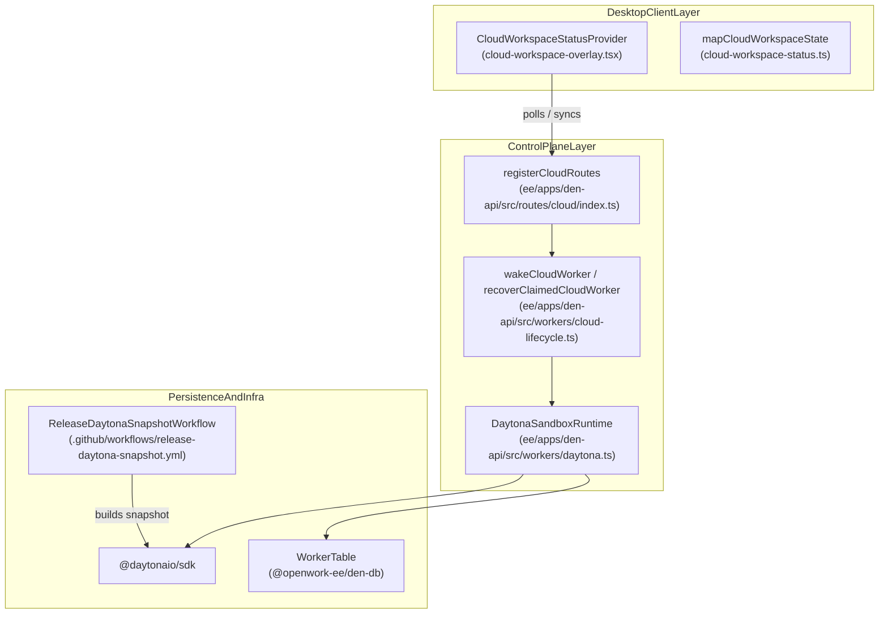
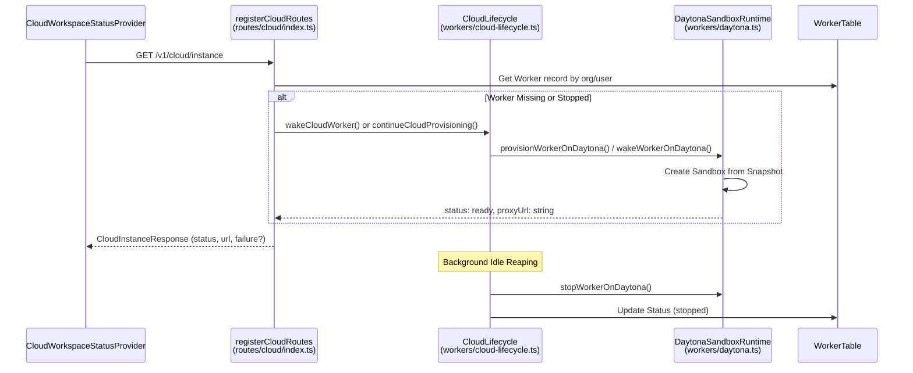

<!-- source: DeepWiki mcp.deepwiki.com · repo different-ai/openwork · extra page Cloud Workers Lifecycle · fetched 2026-10-26 -->

# Cloud Workers Lifecycle

Relevant source files

The following files were used as context for generating this wiki page:

- [.github/workflows/aur-validate.yml](.github/workflows/aur-validate.yml)
- [.github/workflows/daytona-snapshot-drift.yml](.github/workflows/daytona-snapshot-drift.yml)
- [.github/workflows/dev-daytona-snapshot.yml](.github/workflows/dev-daytona-snapshot.yml)
- [.github/workflows/download-stats.yml](.github/workflows/download-stats.yml)
- [.github/workflows/opencode-agents.yml](.github/workflows/opencode-agents.yml)
- [.github/workflows/release-daytona-snapshot.yml](.github/workflows/release-daytona-snapshot.yml)
- [STATS.md](STATS.md)
- [STATS_V2.md](STATS_V2.md)
- [apps/app/src/app/lib/gateway-runtime.ts](apps/app/src/app/lib/gateway-runtime.ts)
- [apps/app/src/react-app/shell/cloud-workspace-overlay.tsx](apps/app/src/react-app/shell/cloud-workspace-overlay.tsx)
- [apps/app/src/react-app/shell/cloud-workspace-status.ts](apps/app/src/react-app/shell/cloud-workspace-status.ts)
- [ee/apps/den-api/src/capability-sources/cloud-hosting.ts](ee/apps/den-api/src/capability-sources/cloud-hosting.ts)
- [ee/apps/den-api/src/routes/cloud/index.ts](ee/apps/den-api/src/routes/cloud/index.ts)
- [ee/apps/den-api/test/cloud-hosting.test.ts](ee/apps/den-api/test/cloud-hosting.test.ts)
- [ee/apps/den-gateway/build.mjs](ee/apps/den-gateway/build.mjs)
- [ee/apps/den-gateway/package.json](ee/apps/den-gateway/package.json)
- [ee/apps/den-gateway/src/app.ts](ee/apps/den-gateway/src/app.ts)
- [ee/apps/den-gateway/src/env.ts](ee/apps/den-gateway/src/env.ts)
- [ee/apps/den-gateway/src/load-env.ts](ee/apps/den-gateway/src/load-env.ts)
- [ee/apps/den-gateway/tsconfig.json](ee/apps/den-gateway/tsconfig.json)
- [ee/apps/enterprise-mock-lab/package.json](ee/apps/enterprise-mock-lab/package.json)
- [packaging/aur/.SRCINFO](packaging/aur/.SRCINFO)
- [packaging/aur/PKGBUILD](packaging/aur/PKGBUILD)
- [packaging/aur/README.md](packaging/aur/README.md)
- [packaging/docker/Dockerfile.den-gateway](packaging/docker/Dockerfile.den-gateway)
- [scripts/aur/publish-aur.sh](scripts/aur/publish-aur.sh)
- [scripts/aur/update-aur.sh](scripts/aur/update-aur.sh)
- [scripts/prune-daytona-dev-snapshots.mjs](scripts/prune-daytona-dev-snapshots.mjs)
- [scripts/stats.mjs](scripts/stats.mjs)
- [scripts/update-daytona-snapshot-pin.mjs](scripts/update-daytona-snapshot-pin.mjs)

## Purpose and Scope

This page documents the technical implementation of creating and managing cloud-hosted OpenWork worker instances within the Den enterprise control plane (`ee/apps/den-api`). It covers backend worker routes (`registerWorkerCoreRoutes` and cloud routes), cloud-lifecycle management (`cloud-lifecycle.ts`), Daytona sandbox provisioning and snapshots (`daytona.ts` and workflow definitions), worker runtimes (`den-worker-runtime`), and the cloud workspace overlay in the desktop and web clients (`cloud-workspace-overlay.tsx`).

**Sources:** [ee/apps/den-api/src/routes/workers/core.ts:144](), [ee/apps/den-api/src/routes/cloud/index.ts:1-25](), [apps/app/src/react-app/shell/cloud-workspace-overlay.tsx:1-40]()

---

## System Architecture

The cloud worker management architecture connects web dashboard actions, gateway proxying (`ee/apps/den-gateway`), and desktop handoffs to the Den control plane (`den-api`), which interfaces with Daytona for sandbox execution, snapshot management, and state persistence via Drizzle ORM models.

### Diagram: Cloud Worker Management Architecture (Code Entity Space)

**Sources:** [ee/apps/den-api/src/routes/cloud/index.ts:1-30](), [ee/apps/den-api/src/workers/daytona.ts:100-120](), [apps/app/src/react-app/shell/cloud-workspace-overlay.tsx:150-165](), [.github/workflows/release-daytona-snapshot.yml:41-48]()

---

## Worker Provisioning and Lifecycle

Worker provisioning transitions instances from initial request placement to a running, healthy container environment. The lifecycle is driven by explicit state transitions managed by `den-api` and monitored by automated background loops.

### Diagram: Worker Lifecycle Sequence

**Sources:** [ee/apps/den-api/src/routes/cloud/index.ts:15-55](), [ee/apps/den-api/src/workers/daytona.ts:196-220](), [ee/apps/den-api/src/workers/cloud-lifecycle.ts:48-97]()

### Provisioning Implementation and Runtime Initialization
The backend provisions cloud workers using `continueCloudProvisioning` linked from `registerWorkerCoreRoutes` [ee/apps/den-api/src/routes/workers/core.ts:144]() and exposed via `registerCloudRoutes` [ee/apps/den-api/src/routes/cloud/index.ts:1-30](). The `DaytonaSandboxRuntime` creates a deterministic sandbox instance identifier combined with snapshot versioning [ee/apps/den-api/src/workers/daytona.ts:196-220](). 

The container initialization script executed via `buildOpenWorkStartCommand` guarantees:
- Persistent volume mapping for `/tmp/openwork-data` and `/tmp/openwork-workspace`.
- Execution of `PRAGMA wal_checkpoint(TRUNCATE)` prior to state synchronization or checkpointing [ee/apps/den-api/test/daytona-checkpoint-command.test.ts:31-69]().
- Background periodic flushing loops to persist remote workspace state.

**Sources:** [ee/apps/den-api/src/workers/daytona.ts:196-220](), [ee/apps/den-api/test/daytona-checkpoint-command.test.ts:31-69](), [ee/apps/den-api/src/routes/workers/core.ts:144](), [ee/apps/den-api/src/routes/cloud/index.ts:1-50]()

---

## Daytona Snapshots and Infrastructure Management

Cloud worker environments depend on pre-built Daytona snapshots. These snapshots are published through CI/CD pipelines defined in [.github/workflows/release-daytona-snapshot.yml]() and [.github/workflows/dev-daytona-snapshot.yml](), utilizing the Daytona CLI and authenticated API tokens.

### Idle Management and State Transitions
To control cloud resource consumption, `startCloudIdleStopLoop` evaluates worker inactivity [ee/apps/den-api/src/workers/cloud-lifecycle.ts:48-50](). Workers exceeding the idle threshold trigger container teardown routines.

| State Transition | Trigger Mechanism | Associated Code Reference |
|------------------|-------------------|---------------------------|
| **Idle Stop** | `last_active_at < idleBefore` | `[ee/apps/den-api/src/workers/cloud-lifecycle.ts:116-118]()` |
| **Wake Trigger** | Accessing `/v1/cloud/instance` when stopped | `[ee/apps/den-api/src/routes/cloud/index.ts:16-20]()` |
| **Reprovisioning** | Missing sandbox recovery during wake | `[ee/apps/den-api/src/workers/cloud-lifecycle.ts:170-176]()` |

**Sources:** [.github/workflows/release-daytona-snapshot.yml:1-50](), [.github/workflows/dev-daytona-snapshot.yml:1-60](), [ee/apps/den-api/src/workers/cloud-lifecycle.ts:82-130](), [ee/apps/den-api/src/routes/cloud/index.ts:16-20]()

---

## Desktop Cloud Workspace Overlay and Handoff

Once a cloud worker is active, the OpenWork desktop client links to the instance via desktop handoff tokens and presents remote status through the cloud workspace overlay (`CloudWorkspaceStatusProvider` in `apps/app/src/react-app/shell/cloud-workspace-overlay.tsx`).

### Handoff and Authentication Flow
Desktop authentication is handled via temporary handoff grants managed by `desktop-handoff.ts`. Users exchange a secure grant token for session credentials that authorize desktop communication with the remote runner or cloud worker proxy.

- **Grant Creation**: Handled via POST requests that generate short-lived tokens and redirect or return an `openwork://` URI [ee/apps/den-api/src/routes/auth/desktop-handoff.ts:22-42]().
- **Overlay Synchronization**: The React component `CloudWorkspaceStatusProvider` (`apps/app/src/react-app/shell/cloud-workspace-overlay.tsx`) polls or streams status changes using view models mapped by `cloud-workspace-status.ts` to notify users of worker provisioning progress, sleep states, update availability, or reconnection prompts.

**Sources:** [ee/apps/den-api/src/routes/auth/desktop-handoff.ts:22-61](), [apps/app/src/react-app/shell/cloud-workspace-overlay.tsx:1-100](), [apps/app/src/react-app/shell/cloud-workspace-status.ts:1-50]()

---

