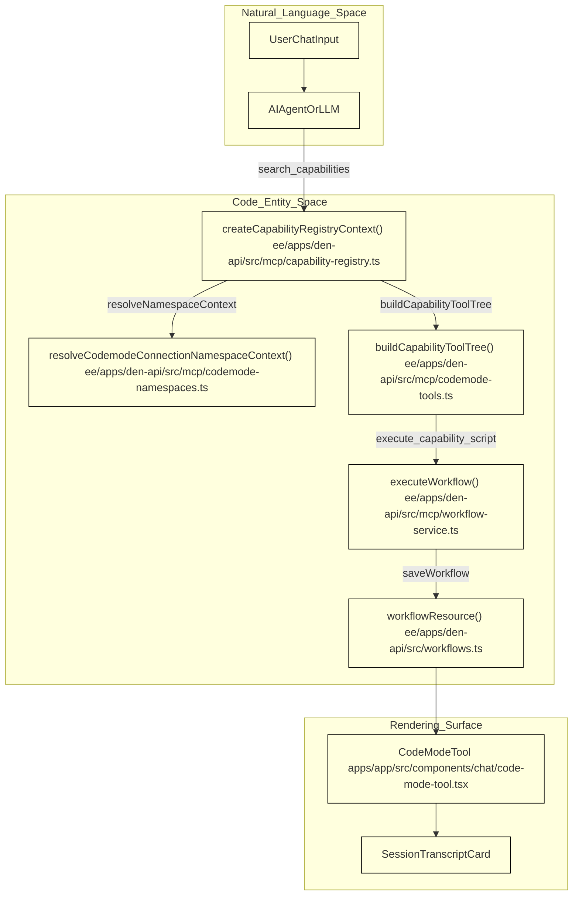
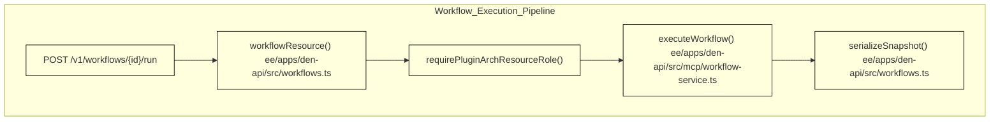
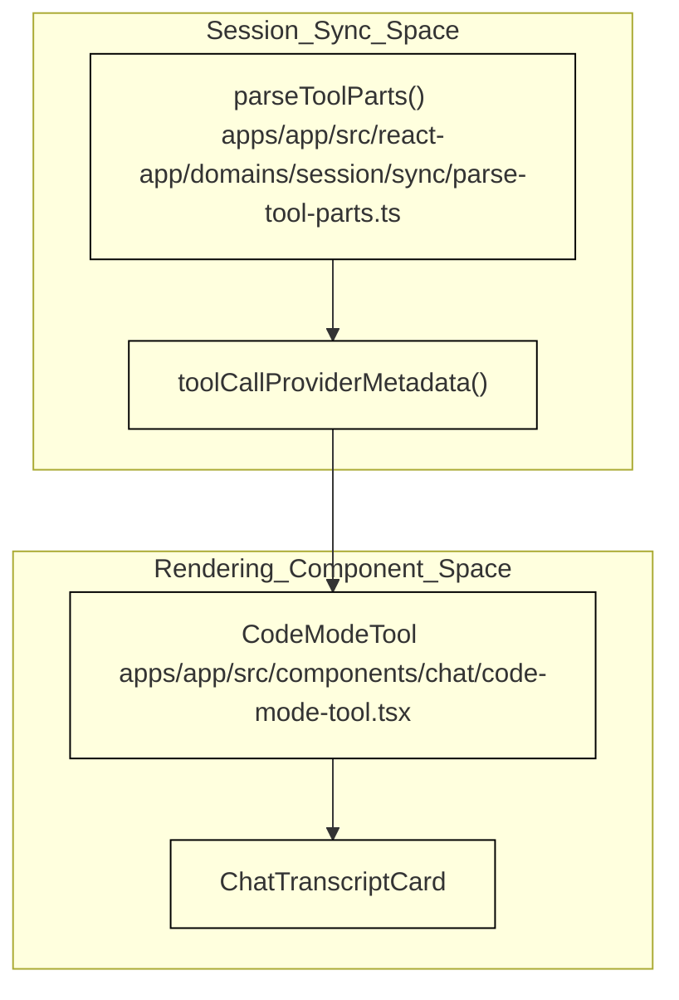

<!-- source: DeepWiki mcp.deepwiki.com · repo different-ai/openwork · extra page Codemode and Saved Scripts · fetched 2026-10-26 -->

# Codemode and Saved Scripts

Relevant source files

The following files were used as context for generating this wiki page:

- [apps/app/src/app/lib/workflow-run-access.ts](apps/app/src/app/lib/workflow-run-access.ts)
- [apps/app/tests/workflow-run-access.test.ts](apps/app/tests/workflow-run-access.test.ts)
- [ee/apps/den-api/src/artifact-views.ts](ee/apps/den-api/src/artifact-views.ts)
- [ee/apps/den-api/src/mcp/generated-artifact-views.ts](ee/apps/den-api/src/mcp/generated-artifact-views.ts)
- [ee/apps/den-api/src/mcp/workflow-artifact-app.ts](ee/apps/den-api/src/mcp/workflow-artifact-app.ts)
- [ee/apps/den-api/src/routes/org/codemode-scripts.ts](ee/apps/den-api/src/routes/org/codemode-scripts.ts)
- [ee/apps/den-api/src/saved-apps.ts](ee/apps/den-api/src/saved-apps.ts)
- [ee/apps/den-api/src/workflow-library.ts](ee/apps/den-api/src/workflow-library.ts)
- [ee/apps/den-api/src/workflow-projections.ts](ee/apps/den-api/src/workflow-projections.ts)
- [ee/apps/den-api/src/workflows.ts](ee/apps/den-api/src/workflows.ts)
- [ee/apps/den-api/test/api/workflow-latest-result.api.test.ts](ee/apps/den-api/test/api/workflow-latest-result.api.test.ts)
- [ee/apps/den-api/test/api/workflow-viewer-execution.api.test.ts](ee/apps/den-api/test/api/workflow-viewer-execution.api.test.ts)
- [ee/packages/den-db/src/schema/artifact-views.ts](ee/packages/den-db/src/schema/artifact-views.ts)
- [packages/types/src/workflows.ts](packages/types/src/workflows.ts)

This page details the implementation, architecture, and data flows for Codemode, the Den capability registry, saved script (workflow) management, execution and library routes, generated artifact views, and chat rendering components within OpenWork.

---

## 1. Overview and Purpose

`packages/codemode` and the corresponding Den API routes (`ee/apps/den-api/src/routes/org/codemode-scripts.ts` [ee/apps/den-api/src/routes/org/codemode-scripts.ts](), `ee/apps/den-api/src/workflows.ts` [ee/apps/den-api/src/workflows.ts]()) empower AI agents to discover, construct, and execute programmatic multi-tool workflows. This subsystem transforms complex orchestrations into reusable scripts, automated server-side routines, and dynamic MCP Apps with custom UI revisions (`ee/apps/den-api/src/mcp/generated-artifact-views.ts` [ee/apps/den-api/src/mcp/generated-artifact-views.ts]()).

Sources:
- `ee/apps/den-api/src/routes/org/codemode-scripts.ts` [ee/apps/den-api/src/routes/org/codemode-scripts.ts]()
- `ee/apps/den-api/src/workflows.ts` [ee/apps/den-api/src/workflows.ts]()
- `ee/apps/den-api/src/mcp/generated-artifact-views.ts` [ee/apps/den-api/src/mcp/generated-artifact-views.ts]()

---

## 2. Architecture and Data Flow

The Codemode subsystem bridges natural language tool selection with deterministic code execution spaces and UI rendering surfaces.

Sources:
- `ee/apps/den-api/src/mcp/capability-registry.ts` [ee/apps/den-api/src/mcp/capability-registry.ts]()
- `ee/apps/den-api/src/mcp/codemode-namespaces.ts` [ee/apps/den-api/src/mcp/codemode-namespaces.ts]()
- `ee/apps/den-api/src/mcp/codemode-tools.ts` [ee/apps/den-api/src/mcp/codemode-tools.ts]()
- `ee/apps/den-api/src/workflows.ts` [ee/apps/den-api/src/workflows.ts]()

---

## 3. packages/codemode and Capability Registry

The underlying execution definitions for Codemode reside in `packages/codemode` and are surfaced via the Den capability registry (`ee/apps/den-api/src/mcp/capability-registry.ts` [ee/apps/den-api/src/mcp/capability-registry.ts]()). Tools are grouped into namespaces (such as `den`, native connectors, and external MCP connections) managed by `ee/apps/den-api/src/mcp/codemode-namespaces.ts` [ee/apps/den-api/src/mcp/codemode-namespaces.ts]() and transformed into executable definitions via `ee/apps/den-api/src/mcp/codemode-tools.ts` [ee/apps/den-api/src/mcp/codemode-tools.ts]().

Input payloads, draft structures, and runtime configuration parameters are validated using Zod schemas defined in `ee/apps/den-api/src/routes/org/codemode-scripts.ts` [ee/apps/den-api/src/routes/org/codemode-scripts.ts:53-136]():
- `saveSchema`: Requires either `code` or an authoring `receiptId` within 15 minutes, validating name, description, input/output schemas, and plugin membership.
- `runSchema`: Accepts `pluginId`, `configObjectVersionId`, optional `input`, execution `mode` (`adhoc` or `live`), and an optional `timeZone` (in `live` mode).
- `draftSchema` / `testSchema`: Validates script compilation, required capabilities (`workflowCapabilitySchema`), and example inputs.

Sources:
- `ee/apps/den-api/src/routes/org/codemode-scripts.ts` [ee/apps/den-api/src/routes/org/codemode-scripts.ts:53-136]()
- `packages/types/src/workflows.ts` [packages/types/src/workflows.ts:23-27]()

---

## 4. Codemode and Saved Scripts Routes & Workflows

Saved scripts (workflows) and their execution endpoints are defined under `ee/apps/den-api/src/routes/org/codemode-scripts.ts` [ee/apps/den-api/src/routes/org/codemode-scripts.ts](). The core workflow engine functions (`ee/apps/den-api/src/workflows.ts` [ee/apps/den-api/src/workflows.ts]()) manage persistence, access control checks, and result serialization.

### Key Workflow Management Functions
- `workflowResource()`: Resolves a config object ID against `ConfigObjectTable` and `PluginConfigObjectTable`, enforcing member organization boundaries and resource roles (`viewer` or `manager`) (`ee/apps/den-api/src/workflows.ts` [ee/apps/den-api/src/workflows.ts:87-134]()).
- `serializeSnapshot()`: Transforms a `WorkflowRunRow` into a standardized `WorkflowArtifactSnapshot` (`ee/apps/den-api/src/workflows.ts` [ee/apps/den-api/src/workflows.ts:157-172]()).
- `normalizedPayload()`: Validates script payloads against `codemode-js` compilation constraints and schema definitions (`ee/apps/den-api/src/workflows.ts` [ee/apps/den-api/src/workflows.ts:136-147]()).

Sources:
- `ee/apps/den-api/src/routes/org/codemode-scripts.ts` [ee/apps/den-api/src/routes/org/codemode-scripts.ts]()
- `ee/apps/den-api/src/workflows.ts` [ee/apps/den-api/src/workflows.ts:87-172]()

---

## 5. Workflow Library and Generated Artifact Views

Workflows integrate with enterprise plugins and custom views through the workflow library (`ee/apps/den-api/src/workflow-library.ts` [ee/apps/den-api/src/workflow-library.ts]()) and generated artifact views (`ee/apps/den-api/src/mcp/generated-artifact-views.ts` [ee/apps/den-api/src/mcp/generated-artifact-views.ts](), `ee/apps/den-api/src/artifact-views.ts` [ee/apps/den-api/src/artifact-views.ts]()).

### Workflow Library and App State
- `WorkflowLibraryItem`: Combines workflow metadata, access edges (`MePluginAccessEdge`), readiness states (`ready`, `needs_signin`, `needs_admin_setup`), freshness state, and view lifecycle status (`ee/apps/den-api/src/workflow-library.ts` [ee/apps/den-api/src/workflow-library.ts:28-43]()).
- `registerGeneratedArtifactResource`: Registers immutable server-built React MCP App resources for workflow results with Content Security Policy (CSP) enforcement (`ee/apps/den-api/src/mcp/generated-artifact-views.ts` [ee/apps/den-api/src/mcp/generated-artifact-views.ts:56-87]()).
- `registerRenderTool`: Dynamically registers `render_`, `preview_`, or `run_` tools on the MCP server, passing structured payloads and freshness metrics to clients (`ee/apps/den-api/src/mcp/generated-artifact-views.ts` [ee/apps/den-api/src/mcp/generated-artifact-views.ts:89-164]()).

Sources:
- `ee/apps/den-api/src/workflow-library.ts` [ee/apps/den-api/src/workflow-library.ts:28-49]()
- `ee/apps/den-api/src/mcp/generated-artifact-views.ts` [ee/apps/den-api/src/mcp/generated-artifact-views.ts:56-164]()
- `ee/apps/den-api/src/artifact-views.ts` [ee/apps/den-api/src/artifact-views.ts]()

---

## 6. Codemode Tool Rendering in Chat

During chat streaming and session state synchronization, code-mode tool calls are intercepted, sanitized, and structured for UI presentation.

### Rendering Pipeline
1. `apps/app/src/react-app/domains/session/sync/parse-tool-parts.ts` processes tool execution results, extracting `openworkToolDetails` and preserved MCP payloads (`apps/server/src/opencode-plugins/openwork-mcp-results-v2.ts`).
2. `apps/app/src/components/chat/code-mode-tool.tsx` renders code execution summaries, interactive inputs, inner tool calls, and error states inside the session transcript.

Sources:
- `apps/app/src/react-app/domains/session/sync/parse-tool-parts.ts` [apps/app/src/react-app/domains/session/sync/parse-tool-parts.ts]()
- `apps/app/src/components/chat/code-mode-tool.tsx` [apps/app/src/components/chat/code-mode-tool.tsx]()

---

## 7. Saved Script Automations

Saved scripts support unattended execution through Cloud Automations. End-to-end specifications and integration tests verify automated script triggers and artifact generation (`evals/specs/saved-script-automations.e2e.test.ts`).

### Automation Workflow
- Automations invoke saved workflows via `executeWorkflow` (`ee/apps/den-api/src/mcp/workflow-service.ts`).
- Execution results are recorded in the `AutomationRunTable` and `WorkflowRunTable` (`ee/apps/den-api/src/workflows.ts` [ee/apps/den-api/src/workflows.ts:18-26]()).
- Generated artifacts and views are snapshotted and made accessible across organization dashboards (`ee/apps/den-api/src/saved-apps.ts` [ee/apps/den-api/src/saved-apps.ts:62-69]()).

Sources:
- `ee/apps/den-api/src/workflows.ts` [ee/apps/den-api/src/workflows.ts:18-26]()
- `ee/apps/den-api/src/saved-apps.ts` [ee/apps/den-api/src/saved-apps.ts:62-69]()
- `evals/specs/saved-script-automations.e2e.test.ts` [evals/specs/saved-script-automations.e2e.test.ts]()

---

