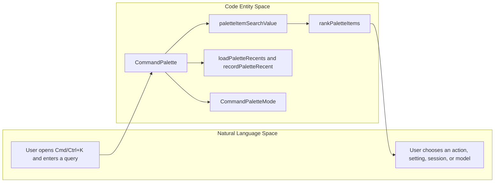
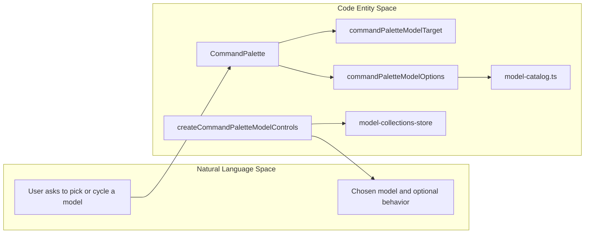
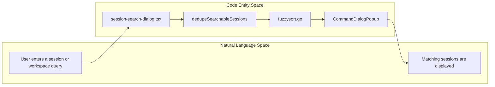
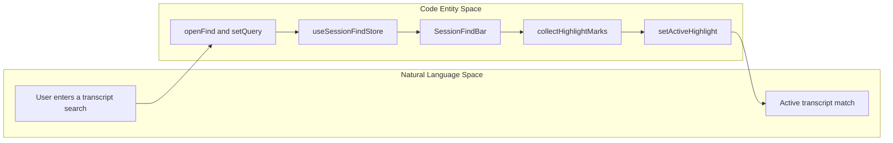
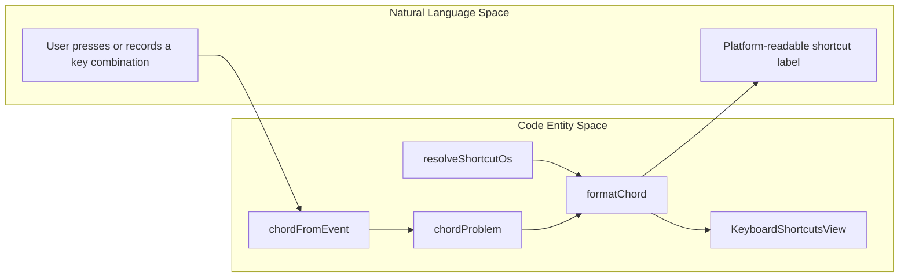

<!-- source: DeepWiki mcp.deepwiki.com · repo different-ai/openwork · extra page Command Palette, Search and Shortcuts · fetched 2026-10-26 -->

# Command Palette, Search and Shortcuts

Relevant source files

The following files were used as context for generating this wiki page:

- [apps/app/src/react-app/domains/models/catalog.ts](apps/app/src/react-app/domains/models/catalog.ts)
- [apps/app/src/react-app/domains/models/model-catalog.ts](apps/app/src/react-app/domains/models/model-catalog.ts)
- [apps/app/src/react-app/domains/models/model-picker-list.tsx](apps/app/src/react-app/domains/models/model-picker-list.tsx)
- [apps/app/src/react-app/domains/models/model-picker-panel.tsx](apps/app/src/react-app/domains/models/model-picker-panel.tsx)
- [apps/app/src/react-app/domains/models/model-search.ts](apps/app/src/react-app/domains/models/model-search.ts)
- [apps/app/src/react-app/domains/models/use-chat-engine-client.ts](apps/app/src/react-app/domains/models/use-chat-engine-client.ts)
- [apps/app/src/react-app/domains/settings/pages/keyboard-shortcuts-view.tsx](apps/app/src/react-app/domains/settings/pages/keyboard-shortcuts-view.tsx)
- [apps/app/src/react-app/shell/command-palette-models.ts](apps/app/src/react-app/shell/command-palette-models.ts)
- [apps/app/src/react-app/shell/command-palette.tsx](apps/app/src/react-app/shell/command-palette.tsx)
- [apps/app/tests/chat-engine-routing.test.ts](apps/app/tests/chat-engine-routing.test.ts)
- [apps/app/tests/command-palette-model-target.test.ts](apps/app/tests/command-palette-model-target.test.ts)
- [apps/app/tests/composer-caret-refocus.test.tsx](apps/app/tests/composer-caret-refocus.test.tsx)
- [apps/app/tests/free-auto-openwork-models.test.ts](apps/app/tests/free-auto-openwork-models.test.ts)
- [apps/app/tests/model-groups-recent.test.ts](apps/app/tests/model-groups-recent.test.ts)
- [apps/app/tests/model-search.test.ts](apps/app/tests/model-search.test.ts)
- [docs/images/model-picker.png](docs/images/model-picker.png)
- [ee/apps/gateway/src/models/openwork-models.json](ee/apps/gateway/src/models/openwork-models.json)

## Purpose and Scope

This page describes the desktop and web UI surfaces for command-palette actions, model selection, session search, in-session find, keyboard shortcuts, and sidebar chrome. The available implementation detail is strongest for the command palette and model picker; the session-search, find-bar, shortcut-engine, and sidebar sections retain the previous page’s implementation references. [apps/app/src/react-app/shell/command-palette.tsx:144-158]()

Sources: [apps/app/src/react-app/shell/command-palette.tsx:144-158]()

---

## 1. Command Palette Architecture & Search Algorithm

`CommandPalette` is the React component for the `Cmd/Ctrl+K` surface. Its props define the inputs and callbacks for opening sessions, creating sessions, navigating to settings or extensions, toggling the sidebar, and selecting models or agents. Its mode state includes `root`, `split-sessions`, `accessible-items`, `agents`, `groups`, and `models`. [apps/app/src/react-app/shell/command-palette.tsx:93-142]()[apps/app/src/react-app/shell/command-palette.tsx:144-158]()[apps/app/src/react-app/shell/command-palette-models.ts:59-69]()

The component tracks the current mode, query, palette recents, and lazily loaded agents. Closing the palette resets the mode and query; switching away from `root` clears the query. When open, it schedules focus on the search input using animation frames. The agent list is requested only when the `agents` submode is active. [apps/app/src/react-app/shell/command-palette.tsx:149-187]()

The root mode is documented as searching actions and settings rather than conversations. Palette item search text is assembled from an item’s `title`, `detail`, and `searchText` fields. Ranking is delegated to `rankPaletteItems`; recents are loaded with `loadPaletteRecents` and recorded with `recordPaletteRecent`. [apps/app/src/react-app/shell/command-palette.tsx:47-67]()[apps/app/src/react-app/shell/command-palette.tsx:144-148]()

**Command-palette query flow**

Sources: [apps/app/src/react-app/shell/command-palette.tsx:47-67]()[apps/app/src/react-app/shell/command-palette.tsx:144-187]()[apps/app/src/react-app/shell/command-palette-models.ts:59-69]()

### Palette model controls

Model controls for the palette are factored into `command-palette-models.ts`. `commandPaletteModelTarget` selects the primary session unless the secondary pane is focused; an unsent secondary draft maps to `null`, indicating the new-task model target. `commandPaletteModelOptions` uses options published by the focused composer when available, otherwise it falls back to the shared catalog. [apps/app/src/react-app/shell/command-palette-models.ts:4-17]()

`createCommandPaletteModelControls` computes ordered pins and the next pinned model or model source. Its cycle operation skips missing or disabled options, preserves the current behavior only when the destination model supports it, and clears inherited behavior for Auto. It returns the palette’s model options, selected model and behavior, selection callback, and cycling callbacks. [apps/app/src/react-app/shell/command-palette-models.ts:25-57]()

**Natural-language model choice mapped to code entities**

Sources: [apps/app/src/react-app/shell/command-palette.tsx:33-45]()[apps/app/src/react-app/shell/command-palette.tsx:117-123]()[apps/app/src/react-app/shell/command-palette-models.ts:4-57]()

### Model catalog and picker list

The model catalog is shared across the composer picker, “All models” dialog, command palette, and shortcuts. `runtimeModelOptions` converts connected provider model data into `ModelOption` entries, including display names, provider descriptions, behavior metadata, and source information. `buildModelCatalog` merges runtime, fallback, and pending options; applies policy and disabled-provider filtering; and returns both known options and the selectable list. [apps/app/src/react-app/domains/models/catalog.ts:13-16]()[apps/app/src/react-app/domains/models/catalog.ts:24-41]()[apps/app/src/react-app/domains/models/catalog.ts:69-87]()

`ModelPickerList` renders a standard model list or an Auto-aware variant, depending on whether Auto is selected, present, or syncing. It accepts query state and a selection callback, and can also receive catalog state, retained-selection details, and provider-management callbacks. [apps/app/src/react-app/domains/models/model-picker-list.tsx:46-75]()

Model labels and source presentation are centralized in `model-catalog.ts`: `modelTitle` avoids exposing opaque gateway IDs, `modelSource` classifies gateway, organization, and local options, and `modelMakerId` infers a maker from the model name. The picker uses those helpers to render source and provider marks. [apps/app/src/react-app/domains/models/model-catalog.ts:73-99]()[apps/app/src/react-app/domains/models/model-catalog.ts:106-119]()[apps/app/src/react-app/domains/models/model-picker-list.tsx:19-32]()

### Model-picker search semantics

The model picker delegates query interpretation and ranking to `model-search.ts`. Search distinguishes model-name words, provider hints, and option words such as `fast` or `high`: provider words prioritize a provider without necessarily hiding other providers’ matches, while option words express behavior intent rather than filtering the model list. [apps/app/src/react-app/domains/models/model-search.ts:5-17]()

The search implementation normalizes names, tokenizes model names and versions, supports bounded typo matching for words, recognizes provider aliases, and represents Fast and effort choices as `ModelSearchIntent`. The picker’s search results therefore combine a ranked model match with the behavior intent that can be applied to that model. [apps/app/src/react-app/domains/models/model-search.ts:19-62]()[apps/app/src/react-app/domains/models/model-search.ts:64-104]()[apps/app/src/react-app/domains/models/model-search.ts:112-139]()

| Query intent | Resulting behavior |
|---|---|
| Model words, such as `opus 5.5` | Match model names; version words are matched with version-aware rules. [apps/app/src/react-app/domains/models/model-search.ts:54-62]()[apps/app/src/react-app/domains/models/model-search.ts:89-104]() |
| Provider words, such as `openrouter` | Prefer matching providers while allowing matching models from other providers to remain available. [apps/app/src/react-app/domains/models/model-search.ts:14-16]()[apps/app/src/react-app/domains/models/model-search.ts:112-139]() |
| Option words, such as `fast` or `high` | Express a behavior intent; models without the requested option remain in results, with the intent applied only where supported. [apps/app/src/react-app/domains/models/model-search.ts:14-16]()[apps/app/tests/model-search.test.ts:79-89]() |

The tests cover provider-first ranking, provider names with no connected match, exact version matching, typo tolerance, provider aliases, and behavior intent application or omission based on each model’s offered options. [apps/app/tests/model-search.test.ts:25-96]()

Sources: [apps/app/src/react-app/domains/models/model-search.ts:5-17]()[apps/app/src/react-app/domains/models/model-search.ts:19-62]()[apps/app/src/react-app/domains/models/model-search.ts:64-139]()[apps/app/tests/model-search.test.ts:25-96]()

---

## 2. Cross-Workspace Session Search Dialog

The session search dialog (`Cmd/Ctrl+Shift+F`) allows users to search session titles across all workspaces. It is implemented in `session-search-dialog.tsx` and relies on session deduplication utilities defined in `session-search.ts`. [apps/app/src/react-app/shell/session-search-dialog.tsx:55-168]()[apps/app/src/react-app/domains/session/search/session-search.ts:14-22]()

**Session search: user query to results**

Sources: [apps/app/src/react-app/shell/session-search-dialog.tsx:55-168]()[apps/app/src/react-app/domains/session/search/session-search.ts:14-22]()

`dedupeSearchableSessions` maps sessions by the `workspaceId` and `sessionId` identity and resolves duplicate entries using the latest `updatedAt`. With an empty query, the dialog lists up to 15 recent sessions; with a query, it searches session and workspace titles and limits results to 50. [apps/app/src/react-app/domains/session/search/session-search.ts:14-22]()[apps/app/src/react-app/shell/session-search-dialog.tsx:80-88]()

Sources: [apps/app/src/react-app/shell/session-search-dialog.tsx:1-168]()[apps/app/src/react-app/domains/session/search/session-search.ts:1-22]()

---

## 3. Session Find Bar and Text Highlighting

The session find bar provides in-page text search within an active chat transcript. It is controlled by Zustand state in `find-store.ts` and rendered by `find-bar.tsx`. [apps/app/src/react-app/domains/session/surface/find-store.ts:21-49]()[apps/app/src/react-app/domains/session/surface/find-bar.tsx:72-179]()

**Find state to transcript highlights**

Sources: [apps/app/src/react-app/domains/session/surface/find-store.ts:21-49]()[apps/app/src/react-app/domains/session/surface/find-bar.tsx:72-179]()

The find bar debounces query inputs and searches container DOM nodes matching `SEARCH_HIGHLIGHT_SELECTOR`. It tracks the active match index, wraps navigation using `wrappedIndex`, and scrolls the target element into view centered in the viewport. [apps/app/src/react-app/domains/session/surface/find-bar.tsx:1-366]()

Sources: [apps/app/src/react-app/domains/session/surface/find-bar.tsx:1-366]()[apps/app/src/react-app/domains/session/surface/find-store.ts:1-49]()

---

## 4. Keyboard Shortcuts & Platform-Neutral Chords

OpenWork uses a platform-neutral chord resolution engine for keyboard shortcuts across macOS, Linux, and Windows. The shortcut helper functions are defined in `shortcut-keys.ts`. The command palette and model picker use `resolveShortcutOs` and `formatChord` to present platform-appropriate shortcut labels. [apps/app/src/react-app/domains/shortcuts/shortcut-keys.ts:23-114]()[apps/app/src/react-app/shell/command-palette.tsx:150-153]()[apps/app/src/react-app/domains/models/model-picker-list.tsx:16-17]()

**Keyboard input to displayed shortcut**

Sources: [apps/app/src/react-app/domains/shortcuts/shortcut-keys.ts:23-114]()[apps/app/src/react-app/domains/settings/pages/keyboard-shortcuts-view.tsx:53-73]()

Key helpers in `shortcut-keys.ts`:
- `resolveShortcutOs` determines which platform convention to use. [apps/app/src/react-app/domains/shortcuts/shortcut-keys.ts:23-29]()
- `chordFromEvent` normalizes modifier keys and extracts a key from a keyboard event. [apps/app/src/react-app/domains/shortcuts/shortcut-keys.ts:48-63]()
- `chordProblem` validates user-defined model shortcuts against reserved chords and modifier requirements. [apps/app/src/react-app/domains/shortcuts/shortcut-keys.ts:106-114]()
- `formatChord` renders the chord using macOS symbols or text labels for other platforms. [apps/app/src/react-app/domains/shortcuts/shortcut-keys.ts:75-82]()

The Keyboard Shortcuts settings view is centered on saved model shortcuts. Its editor uses the model picker, shortcut store, chord-recording helpers, and platform-aware formatting; it also provides row states for blocked, disconnected, or no-longer-offered models. [apps/app/src/react-app/domains/settings/pages/keyboard-shortcuts-view.tsx:1-5]()[apps/app/src/react-app/domains/settings/pages/keyboard-shortcuts-view.tsx:19-43]()[apps/app/src/react-app/domains/settings/pages/keyboard-shortcuts-view.tsx:105-134]()[apps/app/src/react-app/domains/settings/pages/keyboard-shortcuts-view.tsx:138-160]()

Sources: [apps/app/src/react-app/domains/shortcuts/shortcut-keys.ts:23-114]()[apps/app/src/react-app/domains/settings/pages/keyboard-shortcuts-view.tsx:1-5]()[apps/app/src/react-app/domains/settings/pages/keyboard-shortcuts-view.tsx:19-43]()[apps/app/src/react-app/domains/settings/pages/keyboard-shortcuts-view.tsx:105-160]()

---

## 5. Sidebar Chrome & Titlebar Actions

The sidebar chrome integrates navigation, workspace management, and native Electron titlebar controls, including traffic-light bounds on macOS. Sidebar and titlebar behavior is covered by E2E test worlds and specs. [evals/worlds/sidebar-chrome.ts:1-35]()[evals/specs/sidebar-chrome.e2e.test.ts:1-113]()

The sidebar layout supports collapse toggles (`sidebar-sidebar-toggle` and `main-sidebar-toggle`), unread notification indicators (`data-notification-unread`), and quick actions for search and activity panels. When the sidebar is hidden, titlebar controls remain accessible; overlay close behavior includes returning focus to the notification bell after `Escape`. [evals/worlds/sidebar-chrome.ts:1-35]()[evals/specs/sidebar-chrome.e2e.test.ts:1-113]()

Sources: [evals/worlds/sidebar-chrome.ts:1-35]()[evals/specs/sidebar-chrome.e2e.test.ts:1-113]()

---

