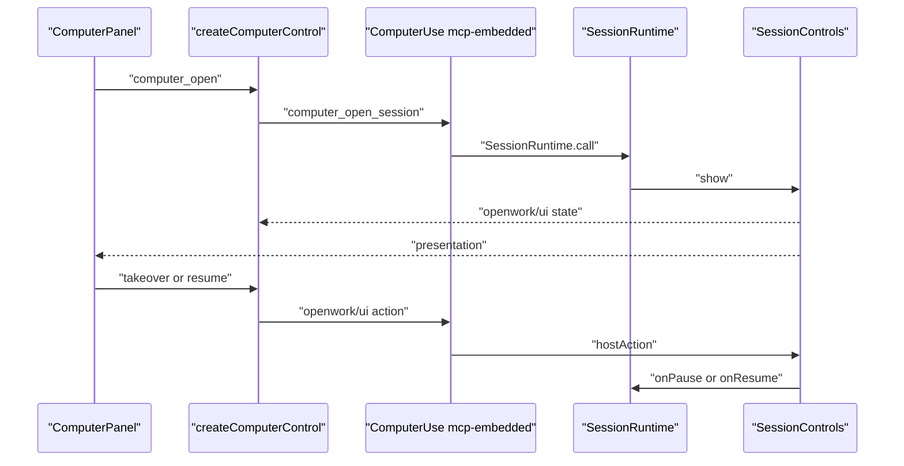

<!-- source: DeepWiki mcp.deepwiki.com · repo different-ai/openwork · extra page Computer Use and Native Control · fetched 2026-10-26 -->

# Computer Use and Native Control

Relevant source files

The following files were used as context for generating this wiki page:

- [apps/app/src/react-app/domains/session/computer/computer-panel.tsx](apps/app/src/react-app/domains/session/computer/computer-panel.tsx)
- [apps/app/src/react-app/domains/session/computer/computer-popout.ts](apps/app/src/react-app/domains/session/computer/computer-popout.ts)
- [apps/app/src/react-app/domains/session/computer/computer-setup.tsx](apps/app/src/react-app/domains/session/computer/computer-setup.tsx)
- [apps/app/src/react-app/domains/session/computer/computer-store.ts](apps/app/src/react-app/domains/session/computer/computer-store.ts)
- [apps/desktop/electron/computer-control.test.mjs](apps/desktop/electron/computer-control.test.mjs)
- [apps/desktop/electron/computer-permission-entry.mjs](apps/desktop/electron/computer-permission-entry.mjs)
- [packages/computer-use/README.md](packages/computer-use/README.md)
- [packages/computer-use/computer-control.mjs](packages/computer-use/computer-control.mjs)
- [packages/computer-use/native/Sources/ComputerUse/MacAccessibility.swift](packages/computer-use/native/Sources/ComputerUse/MacAccessibility.swift)
- [packages/computer-use/native/Sources/ComputerUse/PermissionCoach.swift](packages/computer-use/native/Sources/ComputerUse/PermissionCoach.swift)
- [packages/computer-use/native/Sources/ComputerUse/Responsibility.swift](packages/computer-use/native/Sources/ComputerUse/Responsibility.swift)
- [packages/computer-use/native/Sources/ComputerUse/SessionControls.swift](packages/computer-use/native/Sources/ComputerUse/SessionControls.swift)
- [packages/computer-use/native/Sources/ComputerUse/SessionRuntime.swift](packages/computer-use/native/Sources/ComputerUse/SessionRuntime.swift)
- [packages/computer-use/native/Sources/ComputerUse/main.swift](packages/computer-use/native/Sources/ComputerUse/main.swift)

## Purpose and scope

This page describes OpenWork’s computer-use path: the macOS native helper, its session and permission boundaries, the Electron computer-control broker and permission-entry resolver, and the app’s computer panel. It also explains the exposed browser-task integration point without assuming behavior not established by the available source excerpts. [packages/computer-use/README.md:1-13]()

Sources: `packages/computer-use/README.md`, `packages/computer-use/native/Sources/ComputerUse/SessionRuntime.swift`, `apps/desktop/electron/computer-permission-entry.mjs`

## Overview

Computer Use lets the agent work with a selected application window through a native helper. The helper is a Swift executable packaged as **OpenWork Computer Use.app**; its documented interface includes an embedded MCP mode for the desktop host and a standalone MCP mode with native controls. The helper has no model, API key, network listener, or clipboard access. [packages/computer-use/README.md:1-6]()

The desktop-side `createComputerControl` broker mediates tool access and owns per-chat control, the native session lease, observations, receipts, and handoff. Adapters are main-process dependencies; the broker’s documented adapter contract includes `connect`, `callTool`, `notifyUi`, and `close`. [packages/computer-use/computer-control.mjs:1-3]()[packages/computer-use/computer-control.mjs:78-107]()

The native runtime centers on `SessionRuntime`. It owns a `MacAccessibility` instance, input and control collaborators, runtime policy, and the active session and lease. Opening a session checks permissions, reserves the control lease, resolves an application and window, validates the target, creates a session, and displays presence controls. [packages/computer-use/native/Sources/ComputerUse/SessionRuntime.swift:4-19]()[packages/computer-use/native/Sources/ComputerUse/SessionRuntime.swift:68-110]()

Sources: `packages/computer-use/README.md`, `packages/computer-use/computer-control.mjs`, `packages/computer-use/native/Sources/ComputerUse/SessionRuntime.swift`

### Natural-language workflow mapped to code entities

The labels below connect user-visible concepts to searchable implementation symbols. [packages/computer-use/README.md:15-43]()[packages/computer-use/computer-control.mjs:7-23]()[packages/computer-use/native/Sources/ComputerUse/SessionRuntime.swift:52-110]()

**Diagram: Computer-use workflow and code entities**

```mermaid
flowchart LR
  Person["Person selects computer use"] --> Setup["ComputerSetup"]
  Setup --> Probe["--check"]
  Probe --> Broker["createComputerControl"]
  Broker --> Adapter["ComputerAdapter.connect"]
  Adapter --> Entry["ComputerUse mcp-embedded"]
  Entry --> Runtime["SessionRuntime.call"]
  Runtime --> Discover["computer_discover"]
  Discover --> Open["computer_open_session"]
  Open --> Observe["computer_observe"]
  Observe --> Act["computer_act"]
  Act --> Verify["computer_observe"]
  Runtime --> Controls["SessionControls.show"]
  Controls --> Panel["ComputerPanel"]
```

Sources: `packages/computer-use/README.md`, `packages/computer-use/computer-control.mjs`, `packages/computer-use/native/Sources/ComputerUse/SessionRuntime.swift`, `packages/computer-use/native/Sources/ComputerUse/main.swift`, `packages/computer-use/native/Sources/ComputerUse/SessionControls.swift`, `apps/app/src/react-app/domains/session/computer/computer-panel.tsx`, `apps/app/src/react-app/domains/session/computer/computer-setup.tsx`

### Desktop-to-helper boundary

In `mcp-embedded` mode, the helper and desktop exchange UI notifications over the private `openwork/ui` channel. `SessionControls` publishes state, frames, and input feedback through that method and accepts host actions such as `takeover`, `resume`, `watch`, and `stop`. The helper checks that the host is trusted before serving MCP, and the README describes this as requiring a same-team signed desktop host. [packages/computer-use/README.md:61-74]()[packages/computer-use/native/Sources/ComputerUse/SessionControls.swift:36-62]()[packages/computer-use/native/Sources/ComputerUse/SessionControls.swift:67-81]()[packages/computer-use/native/Sources/ComputerUse/main.swift:45-54]()

**Diagram: Embedded host protocol mapped to implementation**

Sources: `packages/computer-use/computer-control.mjs`, `packages/computer-use/native/Sources/ComputerUse/main.swift`, `packages/computer-use/native/Sources/ComputerUse/SessionRuntime.swift`, `packages/computer-use/native/Sources/ComputerUse/SessionControls.swift`, `apps/app/src/react-app/domains/session/computer/computer-panel.tsx`

## Native helper and session lifecycle

### Launch modes and permission checks

`main.swift` dispatches commands including `--check`, `permissions`, `permissions-guide`, `mcp`, and `mcp-embedded`. The permission command requests Accessibility or Screen Recording access and opens the matching System Settings pane. The source explicitly treats opening Settings as distinct from evidence that the person granted permission. [packages/computer-use/native/Sources/ComputerUse/main.swift:18-44]()

For MCP modes, the helper sets whether `SessionControls` is embedded, checks host trust, configures nonblocking output for embedded mode, and starts the MCP server. Its stdin reader runs in a detached task and shuts down the server when input ends. [packages/computer-use/native/Sources/ComputerUse/main.swift:45-86]()

The README documents `--check` as returning permission and support status, including protocol version `openwork.computer-use/1`. It also describes the helper relaunching with macOS responsibility disclaimed so System Settings can list **OpenWork Computer Use** as the permission entry. [packages/computer-use/README.md:8-13]()[packages/computer-use/README.md:15-23]()

Sources: `packages/computer-use/native/Sources/ComputerUse/main.swift`, `packages/computer-use/README.md`

### Target selection and validation

`SessionRuntime.call` handles `computer_discover` and `computer_open_session`. Opening accepts `app_id`, optional `pid` and `window_id`, an access `mode`, and a `purpose`. It checks permissions, creates a `ControlLease`, opens or resolves the app, obtains candidate windows, selects a target, validates it, and stores the resulting session. In `control` mode it focuses the target as part of startup. [packages/computer-use/native/Sources/ComputerUse/SessionRuntime.swift:52-110]()

`AppIdentity.resolve` filters running applications by bundle ID, regular activation policy, and optional PID. It requires exactly one match and captures the executable and process start time. `validate()` later verifies that the process is still running and that its bundle ID, executable, and start time still match. [packages/computer-use/native/Sources/ComputerUse/MacAccessibility.swift:6-35]()[packages/computer-use/native/Sources/ComputerUse/MacAccessibility.swift:75-80]()

`AppIdentity.open` checks the target against the protected-app policy. It resolves an existing instance when one is already running or a PID was specified; otherwise, it opens the installed app and retries resolution while the app starts. The helper’s allow-list policy excludes terminals, credential and system surfaces, automation tools, OpenWork-related bundles, and other protected targets. [packages/computer-use/native/Sources/ComputerUse/MacAccessibility.swift:36-58]()[packages/computer-use/native/Sources/ComputerUse/MacAccessibility.swift:82-102]()

Sources: `packages/computer-use/native/Sources/ComputerUse/SessionRuntime.swift`, `packages/computer-use/native/Sources/ComputerUse/MacAccessibility.swift`

### Session state, tools, and access modes

A `SessionRuntime.Session` records the selected app, window, access mode, purpose, timing, pause state, observation state, action count, receipts, and focus. The runtime rejects concurrent operations while `busy` and rejects a second session on the same connection. [packages/computer-use/native/Sources/ComputerUse/SessionRuntime.swift:11-40]()[packages/computer-use/native/Sources/ComputerUse/SessionRuntime.swift:52-75]()

The documented modes are `observe` (read-only), `assist` (accessibility press or set-value actions), and `control` (also targeted mouse and keyboard input). The README describes the tool surface: discovery, session opening, observation, zoom, action, status, and session close. [packages/computer-use/README.md:25-43]()

The README describes an observation as authorizing one `computer_act` within 60 seconds. Before input, the helper rechecks the app, window, geometry, structural content, and element identity. Coordinate actions additionally require an unchanged screenshot and live hit test; `request_id` supports retrying without repeating input. A dispatched receipt is not proof of task success, so the caller should observe again. [packages/computer-use/README.md:45-53]()

Sources: `packages/computer-use/native/Sources/ComputerUse/SessionRuntime.swift`, `packages/computer-use/README.md`

### Control lease and human handoff

`ControlLease` creates an application-support directory with restrictive permissions and obtains a nonblocking exclusive file lock. If another session holds the lock, it reports `computer_busy`; the lease releases the lock when deinitialized. [packages/computer-use/native/Sources/ComputerUse/SessionControls.swift:5-20]()

`SessionRuntime` wires `SessionControls` callbacks for pause, availability, resume, stop, ticking, and watch visibility. `SessionControls.hostAction` accepts matching-host-ID actions and routes `takeover`, permitted `resume`, `watch`, and `stop` to those callbacks. [packages/computer-use/native/Sources/ComputerUse/SessionRuntime.swift:41-48]()[packages/computer-use/native/Sources/ComputerUse/SessionControls.swift:67-81]()

The documented handoff rule is human-controlled: person input in the selected app or a deliberate app switch pauses the session and releases held input; only the person’s Continue resumes it. Sleep or temporary desktop unavailability invalidates observations and releases held input without constituting a human handoff. [packages/computer-use/README.md:55-59]()

Sources: `packages/computer-use/native/Sources/ComputerUse/SessionControls.swift`, `packages/computer-use/native/Sources/ComputerUse/SessionRuntime.swift`, `packages/computer-use/README.md`

## Permissions and setup guidance

### Permission entry resolution in Electron

`resolvePermissionEntry` determines which macOS application entry the setup UI should name. If a helper bundle is supplied, it resolves that bundle directly. Otherwise it starts from the known executable path and walks parent processes, using `ps` to obtain parent PIDs and commands; it extracts `.app` paths and reads display name and bundle ID from `Info.plist`. [apps/desktop/electron/computer-permission-entry.mjs:17-53]()[apps/desktop/electron/computer-permission-entry.mjs:56-68]()

The resolver marks an entry as OpenWork-owned when its bundle ID starts with `com.differentai.openwork`. `resetPermissionEntry` refuses to reset another app’s entry; for an OpenWork-owned entry it invokes `tccutil` for Accessibility or ScreenCapture. [apps/desktop/electron/computer-permission-entry.mjs:12-15]()[apps/desktop/electron/computer-permission-entry.mjs:63-78]()

The reason for resolving the helper entry is tied to macOS responsibility: the helper’s documented design makes System Settings list **OpenWork Computer Use** for Accessibility and Screen Recording. Raw development builds can instead fall back to the outermost app that started the process. [packages/computer-use/README.md:8-13]()[apps/desktop/electron/computer-permission-entry.mjs:1-6]()

Sources: `apps/desktop/electron/computer-permission-entry.mjs`, `packages/computer-use/README.md`

### `PermissionCoach` and `ComputerSetup`

`PermissionCoach.swift` defines `GuidePermission` for Accessibility and Screen Recording, including their user-facing titles and System Settings pane identifiers. Its `CoachMessage` decoder accepts `status`, `request`, and `close` messages. `PermissionCoachPanel` is an `NSPanel` that handles close and keyboard navigation. [packages/computer-use/native/Sources/ComputerUse/PermissionCoach.swift:6-44]()[packages/computer-use/native/Sources/ComputerUse/PermissionCoach.swift:47-61]()

The app’s `ComputerSetup` renders a live checklist for Accessibility and Screen Recording. It derives verified permissions from the current snapshot, offers a button to open each permission flow, and shows a stale-entry recovery option after the permission has remained off for the configured delay. The component’s documentation says permission status comes from a fresh helper probe and that guidance itself does not grant access. [apps/app/src/react-app/domains/session/computer/computer-setup.tsx:10-16]()[apps/app/src/react-app/domains/session/computer/computer-setup.tsx:35-59]()[apps/app/src/react-app/domains/session/computer/computer-setup.tsx:91-109]()

The README describes the permission guide as a floating guide driven by line-delimited JSON. The guide sends readiness, request, refresh, visibility, and return events; the host supplies readiness and permission status. The guide exits on close, stdin EOF, SIGTERM, timeout, or return. [packages/computer-use/README.md:93-108]()

Sources: `packages/computer-use/native/Sources/ComputerUse/PermissionCoach.swift`, `apps/app/src/react-app/domains/session/computer/computer-setup.tsx`, `packages/computer-use/README.md`

## App computer panel, store, and popout

`ComputerPanel` is a React watch surface that consumes `ComputerPresentation` and imports `useComputerStore`, `openComputerPopout`, and the desktop bridge. It keeps presentation and screen-frame state, tracks minimized and fullscreen modes, and maintains a popout reference. [apps/app/src/react-app/domains/session/computer/computer-panel.tsx:1-20]()[apps/app/src/react-app/domains/session/computer/computer-panel.tsx:48-88]()

When the panel clears its screen, it resets frame-related state and removes inputs from the displayed presentation. Minimize clears the screen and wakes the monitor; expand changes fullscreen state. `popOut` opens a separate window, retains the popout handle, and handles the popout closing by returning the view to the app. [apps/app/src/react-app/domains/session/computer/computer-panel.tsx:90-116]()[apps/app/src/react-app/domains/session/computer/computer-panel.tsx:118-140]()

The panel’s available code excerpt shows that the store and popout are explicit module dependencies, but does not include their implementations. Therefore, this page treats `computer-store.ts` and `computer-popout.ts` as the relevant navigation points rather than inferring their internal behavior. [apps/app/src/react-app/domains/session/computer/computer-panel.tsx:5-11]()

Sources: `apps/app/src/react-app/domains/session/computer/computer-panel.tsx`

| Surface | Responsibility visible in the available source | Source |
|---|---|---|
| `ComputerSetup` | Permission checklist, status display, permission actions, and stale-entry recovery UI. [apps/app/src/react-app/domains/session/computer/computer-setup.tsx:35-59]()[apps/app/src/react-app/domains/session/computer/computer-setup.tsx:91-109]() | `apps/app/src/react-app/domains/session/computer/computer-setup.tsx` |
| `ComputerPanel` | Session presentation and screen-view controls, including minimize, fullscreen, and popout state. [apps/app/src/react-app/domains/session/computer/computer-panel.tsx:48-88]()[apps/app/src/react-app/domains/session/computer/computer-panel.tsx:90-140]() | `apps/app/src/react-app/domains/session/computer/computer-panel.tsx` |
| `useComputerStore` | Store imported by the panel; its implementation is not included in the available source excerpt. [apps/app/src/react-app/domains/session/computer/computer-panel.tsx:10-11]() | `apps/app/src/react-app/domains/session/computer/computer-panel.tsx` |
| `openComputerPopout` | Popout factory imported and called by the panel; its implementation is not included in the available source excerpt. [apps/app/src/react-app/domains/session/computer/computer-panel.tsx:10]()[apps/app/src/react-app/domains/session/computer/computer-panel.tsx:118-125]() | `apps/app/src/react-app/domains/session/computer/computer-panel.tsx` |

Sources: `apps/app/src/react-app/domains/session/computer/computer-panel.tsx`

## Broker behavior and browser-task integration point

### Broker contract and safety boundaries

`computer-control.mjs` defines the seven computer tool names and protocol identifier `openwork.computer-use/1`. Its adapter documentation specifies that adapters are trusted main-process dependencies rather than renderer or model input, and that `close()` must confirm session revocation rather than merely disconnect. [packages/computer-use/computer-control.mjs:7-16]()[packages/computer-use/computer-control.mjs:101-107]()

The broker’s documented inputs distinguish the chat `sessionId` from model arguments. Its per-tool argument allowlists enumerate the arguments accepted for opening, observing, acting, and zooming; the comments describe control as scoped per chat and adapter connection. [packages/computer-use/computer-control.mjs:1-3]()[packages/computer-use/computer-control.mjs:18-23]()

The provided broker excerpt also defines `browserTask` as an input to `createComputerControl`, and the desktop test fixture passes `options.browserTask` into the broker. This establishes an integration point, but the available excerpt does not show the implementation of browser-task takeover or enough call sites to describe its behavior. [packages/computer-use/computer-control.mjs:101-110]()[apps/desktop/electron/computer-control.test.mjs:63-66]()

Sources: `packages/computer-use/computer-control.mjs`, `apps/desktop/electron/computer-control.test.mjs`

### Verified broker-test behavior

The available Electron tests verify that a disabled rollout blocks tools before connecting, and that enabling the rollout allows discovery without a consent request. They also verify that opening a local or configured remote computer can proceed without an approval exchange, and that interaction from a different chat is rejected for not owning the session. [apps/desktop/electron/computer-control.test.mjs:69-93]()

Additional tests in the provided excerpt verify follow-up observation after a turn, idle cleanup requiring a fresh observation rather than replaying an old action, and human takeover surviving end-of-turn and idle cleanup until Continue. [apps/desktop/electron/computer-control.test.mjs:95-118]()

These tests document broker expectations; they should not be read as proof of implementation details beyond the exercised assertions. In particular, the available excerpt does not show the remainder of the test file or the broker’s implementation after line 110. [apps/desktop/electron/computer-control.test.mjs:69-118]()[packages/computer-use/computer-control.mjs:101-110]()

Sources: `apps/desktop/electron/computer-control.test.mjs`, `packages/computer-use/computer-control.mjs`

## Operational reference

| Concern | Code-level reference |
|---|---|
| Native MCP entry points | `ComputerUse mcp-embedded` is the desktop-hosted mode; `ComputerUse mcp` is the standalone mode. [packages/computer-use/README.md:15-23]() |
| Permission probe and request | `--check`, `permissions`, and `permissions-guide` are dispatched in `main.swift`. [packages/computer-use/native/Sources/ComputerUse/main.swift:18-44]() |
| Session creation | `SessionRuntime.call` handles `computer_open_session`, checks permissions, selects and validates a target, and records session state. [packages/computer-use/native/Sources/ComputerUse/SessionRuntime.swift:68-110]() |
| Session exclusivity | `ControlLease` uses a nonblocking exclusive lock and reports `computer_busy` if another session holds it. [packages/computer-use/native/Sources/ComputerUse/SessionControls.swift:5-20]() |
| Permission entry | `resolvePermissionEntry` resolves the helper or outermost app bundle; reset is restricted to OpenWork-owned entries. [apps/desktop/electron/computer-permission-entry.mjs:39-53]()[apps/desktop/electron/computer-permission-entry.mjs:71-78]() |
| App view | `ComputerPanel` owns the visible presentation state and the minimize, fullscreen, and popout transitions shown in the excerpt. [apps/app/src/react-app/domains/session/computer/computer-panel.tsx:48-88]()[apps/app/src/react-app/domains/session/computer/computer-panel.tsx:90-140]() |
| Browser-task handoff | `browserTask` is passed into `createComputerControl`; implementation details are not present in the supplied excerpt. [apps/desktop/electron/computer-control.test.mjs:63-66]()[packages/computer-use/computer-control.mjs:101-110]() |

Sources: `packages/computer-use/README.md`, `packages/computer-use/native/Sources/ComputerUse/main.swift`, `packages/computer-use/native/Sources/ComputerUse/SessionRuntime.swift`, `packages/computer-use/native/Sources/ComputerUse/SessionControls.swift`, `apps/desktop/electron/computer-permission-entry.mjs`, `apps/app/src/react-app/domains/session/computer/computer-panel.tsx`, `apps/desktop/electron/computer-control.test.mjs`, `packages/computer-use/computer-control.mjs`

---

