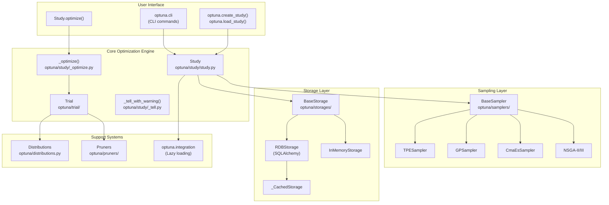

<!-- source: DeepWiki mcp.deepwiki.com · repo optuna/optuna · page 1 Overview · fetched 2026-10-21 -->

# Overview

<details>
<summary>Relevant source files</summary>

The following files were used as context for generating this wiki page:

- [.pre-commit-config.yaml](.pre-commit-config.yaml)
- [CONTRIBUTING.md](CONTRIBUTING.md)
- [optuna/integration/chainermn.py](optuna/integration/chainermn.py)
- [optuna/storages/_heartbeat.py](optuna/storages/_heartbeat.py)
- [optuna/study/_dataframe.py](optuna/study/_dataframe.py)
- [optuna/study/_optimize.py](optuna/study/_optimize.py)
- [optuna/study/_tell.py](optuna/study/_tell.py)
- [optuna/study/study.py](optuna/study/study.py)
- [optuna/testing/objectives.py](optuna/testing/objectives.py)
- [pyproject.toml](pyproject.toml)
- [tests/samplers_tests/test_samplers.py](tests/samplers_tests/test_samplers.py)
- [tests/storages_tests/test_heartbeat.py](tests/storages_tests/test_heartbeat.py)
- [tests/study_tests/test_dataframe.py](tests/study_tests/test_dataframe.py)
- [tests/study_tests/test_optimize.py](tests/study_tests/test_optimize.py)
- [tests/study_tests/test_study.py](tests/study_tests/test_study.py)
- [tests/study_tests/test_study_summary.py](tests/study_tests/test_study_summary.py)
- [tests/test_callbacks.py](tests/test_callbacks.py)

</details>


## Purpose and Scope

This page provides a high-level introduction to Optuna, an open-source hyperparameter optimization framework. It covers Optuna's architectural design, core components, and optimization workflow. For detailed information about specific subsystems, refer to:

- Core components: [Core Components](#2)
- Sampling algorithms: [Sampling Algorithms](#3)
- Storage backends: [Storage Architecture](#2.4)
- Integration with ML frameworks: [Integration System](#4)
- Development setup: [Development and Deployment](#6)

**Sources:** [pyproject.toml:6-7](), [CONTRIBUTING.md:1-15]()

---

## What is Optuna?

Optuna is a Python-based hyperparameter optimization framework designed for machine learning applications. It provides:

| Feature | Description |
|---------|-------------|
| **Flexible Interface** | Define-by-run API allowing dynamic search spaces |
| **Multiple Algorithms** | TPE, CMA-ES, GP, NSGA-II/III samplers |
| **Distributed Optimization** | Parallel trial execution via shared storage |
| **Pruning** | Early stopping of unpromising trials |
| **Multi-Objective** | Support for optimizing multiple objectives simultaneously |
| **Persistence** | SQL databases, Redis, in-memory, or file-based storage |

The framework is production-ready (Development Status: 5 - Production/Stable) and supports Python 3.9-3.14 across Ubuntu, macOS, and Windows platforms.

**Sources:** [pyproject.toml:12-31](), [README overview in CONTRIBUTING.md:6-11]()

---

## System Architecture

The following diagram shows Optuna's layered architecture, mapping conceptual components to concrete code entities:



**Architecture Principles:**

1. **Pluggable Components**: `BaseSampler` and `BaseStorage` define abstract interfaces, allowing users to swap algorithms and persistence backends
2. **Define-by-Run**: The `Trial` object suggests parameters during execution, enabling dynamic search spaces
3. **Separation of Concerns**: Optimization logic (`_optimize()`), parameter suggestion (`BaseSampler`), and persistence (`BaseStorage`) are decoupled
4. **Lazy Integration**: The `optuna.integration` module uses `_IntegrationModule` for lazy imports, avoiding unnecessary dependencies

**Sources:** [optuna/study/study.py:67-98](), [optuna/study/_optimize.py:39-49](), [pyproject.toml:33-41]()

---

## Core Optimization Workflow

The optimization lifecycle follows a consistent pattern orchestrated by `Study.optimize()`:

```mermaid
sequenceDiagram
    participant User
    participant Study["Study<br/>(study.py)"]
    participant Optimize["_optimize()<br/>(_optimize.py)"]
    participant Storage["BaseStorage"]
    participant Sampler["BaseSampler"]
    participant Trial["Trial"]
    participant Objective["User's Objective<br/>Function"]
    
    User->>Study: study.optimize(objective, n_trials=100)
    Study->>Optimize: _optimize(study, func, n_trials, ...)
    
    loop For each trial
        Optimize->>Study: study.ask()
        Study->>Storage: create_new_trial(study_id)
        Storage-->>Study: trial_id
        Study->>Trial: Create Trial(study, trial_id)
        
        Study->>Sampler: infer_relative_search_space(study, trial)
        Sampler-->>Study: search_space
        
        alt Relative sampling
            Study->>Sampler: sample_relative(study, trial, search_space)
            Sampler-->>Trial: Set parameters
        end
        
        Optimize->>Objective: objective(trial)
        
        loop Parameter suggestion
            Objective->>Trial: trial.suggest_float("x", 0, 1)
            Trial->>Sampler: sample_independent(...) or use cached
            Sampler-->>Trial: parameter value
        end
        
        Objective-->>Optimize: return value
        
        Optimize->>Study: study.tell(trial, value)
        Study->>Sampler: after_trial(study, trial, state, values)
        Study->>Storage: set_trial_state_values(trial_id, state, values)
    end
```

**Workflow Stages:**

1. **Trial Creation** (`Study.ask()`): Allocates a new trial in storage, returns a `Trial` object ([optuna/study/study.py:502-586]())
2. **Parameter Sampling**: Sampler provides parameter suggestions via `sample_relative()` or `sample_independent()` 
3. **Objective Execution**: User function runs with the `Trial` object, calling `trial.suggest_*()` methods
4. **Result Recording** (`Study.tell()`): Stores trial state and objective values ([optuna/study/study.py:588-679]())
5. **Post-Processing**: Sampler's `after_trial()` hook updates internal state

**Sources:** [optuna/study/_optimize.py:39-124](), [optuna/study/_optimize.py:186-264](), [optuna/study/_tell.py:81-176]()

---

## Key Components Overview

### Study Management

The `Study` class is the primary entry point for optimization:

- **Creation**: `optuna.create_study()` initializes a study with storage, sampler, and pruner
- **Execution**: `Study.optimize(objective, n_trials)` runs the optimization loop
- **Results**: Properties like `best_params`, `best_value`, `best_trial` provide optimization results
- **Persistence**: All data is stored via the `BaseStorage` interface

**Sources:** [optuna/study/study.py:67-98](), [optuna/study/study.py:388-500]()

### Sampling Algorithms

Optuna includes sophisticated Bayesian optimization algorithms:

| Sampler | Purpose | Key Features |
|---------|---------|--------------|
| `TPESampler` | Tree-structured Parzen Estimator | Default sampler, multivariate support, MOTPE for multi-objective |
| `GPSampler` | Gaussian Process | Matern 5/2 kernel, LogEI/LogEHVI acquisition functions |
| `CmaEsSampler` | CMA-ES evolutionary strategy | Covariance matrix adaptation, SepCMA variant |
| `NSGAIISampler` | NSGA-II genetic algorithm | Multi-objective, Pareto front optimization |
| `RandomSampler` | Random sampling | Baseline comparison |

All samplers inherit from `BaseSampler` and implement `sample_independent()` and optionally `sample_relative()` for correlated parameters.

For details, see [Sampling Algorithms](#3).

**Sources:** [optuna/study/study.py:93](), [tests/samplers_tests/test_samplers.py:44-78]()

### Storage Backends

The storage layer provides persistence and distributed coordination:

| Storage | Use Case | Implementation |
|---------|----------|----------------|
| `RDBStorage` | Production deployment | SQLAlchemy-based, supports MySQL, PostgreSQL, SQLite |
| `InMemoryStorage` | Testing, single-process | No persistence, fastest performance |
| `JournalStorage` | Append-only workloads | File or Redis backend |
| `_CachedStorage` | Performance optimization | Write-through cache wrapper |

`RDBStorage` includes heartbeat monitoring for detecting stale trials in distributed environments.

For details, see [Storage Architecture](#2.4).

**Sources:** [pyproject.toml:34-38](), Diagram 3 from high-level architecture

### Trial System

The `Trial` object provides the interface for parameter suggestion:

```python
# User code example
def objective(trial: Trial) -> float:
    x = trial.suggest_float("x", -10, 10)
    y = trial.suggest_int("y", 0, 100)
    z = trial.suggest_categorical("z", ["a", "b", "c"])
    return x**2 + y - len(z)
```

Each `suggest_*()` method delegates to the sampler and records the distribution in storage. The `FrozenTrial` class represents immutable completed trials.

For details, see [Trial System and Parameter Suggestion](#2.2).

**Sources:** [tests/study_tests/test_study.py:53-57]()

### Pruning System

Pruners enable early stopping of unpromising trials:

- `MedianPruner`: Stops trials performing worse than the median
- `HyperbandPruner`: Successive halving with adaptive resource allocation
- Trials report intermediate values via `trial.report(value, step)`
- Pruners decide via `trial.should_prune()`

For details, see [Other Samplers and Pruning](#3.6).

**Sources:** [optuna/study/study.py:94]()

---

## Project Structure

The codebase follows a modular organization:

```
optuna/
├── study/              # Study, optimization loop, tell/ask
│   ├── study.py        # Study class (267.75 importance)
│   ├── _optimize.py    # Core optimization loop
│   └── _tell.py        # Result reporting logic
├── samplers/           # Sampling algorithms
│   ├── _tpe/           # TPE implementation
│   ├── _gp/            # Gaussian Process
│   └── _cmaes/         # CMA-ES
├── storages/           # Persistence layer
│   ├── _rdb/           # SQL database backend
│   └── _heartbeat.py   # Distributed trial monitoring
├── distributions.py    # Parameter distributions
├── pruners/            # Early stopping algorithms
├── integration/        # ML framework integrations
├── cli.py              # Command-line interface
└── trial/              # Trial object implementation

tests/                  # Comprehensive test suite
├── study_tests/        # Study functionality tests
├── samplers_tests/     # Sampler tests
└── storages_tests/     # Storage backend tests
```

**Build and Configuration:**

- `pyproject.toml`: Defines dependencies, optional features, and build configuration ([pyproject.toml:1-193]())
- `.pre-commit-config.yaml`: Enforces code quality via Ruff (linting/formatting) and MyPy (type checking) ([.pre-commit-config.yaml:9-48]())
- Core dependencies: SQLAlchemy, Alembic (migrations), NumPy, tqdm, PyYAML
- Optional dependencies: CMA-ES library, Plotly (visualization), Redis, scikit-learn, PyTorch

**Sources:** [pyproject.toml:112-124](), [CONTRIBUTING.md:51-90]()

---

## Development and Testing Infrastructure

Optuna maintains high code quality through:

| Component | Purpose | Tools |
|-----------|---------|-------|
| **CI/CD** | Cross-platform testing | GitHub Actions: Ubuntu, macOS, Windows |
| **Python versions** | Compatibility testing | 3.9, 3.10, 3.11, 3.12, 3.13, 3.14 |
| **Storage testing** | Backend validation | MySQL, PostgreSQL, SQLite, Redis |
| **Code quality** | Linting and formatting | Ruff, MyPy with strict type checking |
| **Test execution** | Parallel test running | pytest with `-n 8` parallelization |

The test suite includes unit tests ([tests/study_tests/test_study.py]()), integration tests, and storage-specific tests ([tests/storages_tests/test_heartbeat.py]()).

For details, see [Testing Infrastructure and CI/CD](#6.2).

**Sources:** [pyproject.toml:90-101](), [pyproject.toml:167-172](), [CONTRIBUTING.md:144-170]()

---

## Next Steps

- For core optimization mechanics, see [Study and Optimization Loop](#2.1)
- For parameter handling, see [Distributions and Search Space](#2.3)
- For algorithm details, see [Sampling Algorithms](#3)
- For production deployment, see [Storage Architecture](#2.4)
- For extending Optuna, see [Integration System](#4)

---

