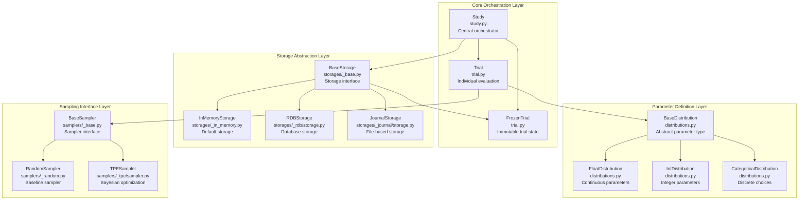
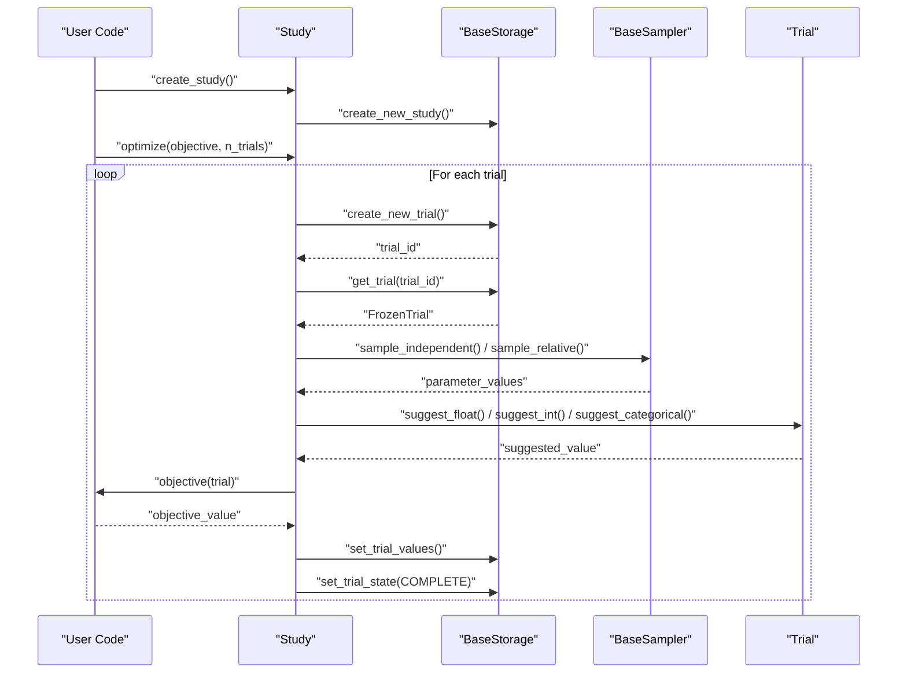
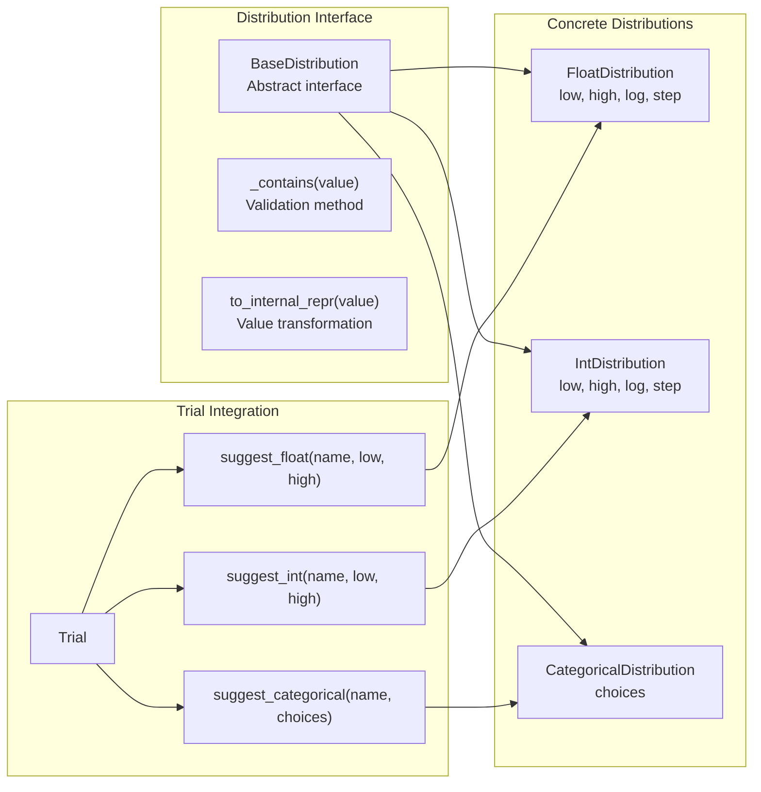
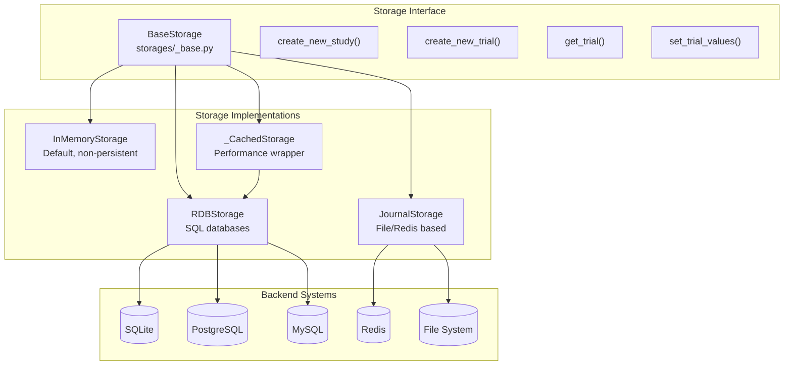
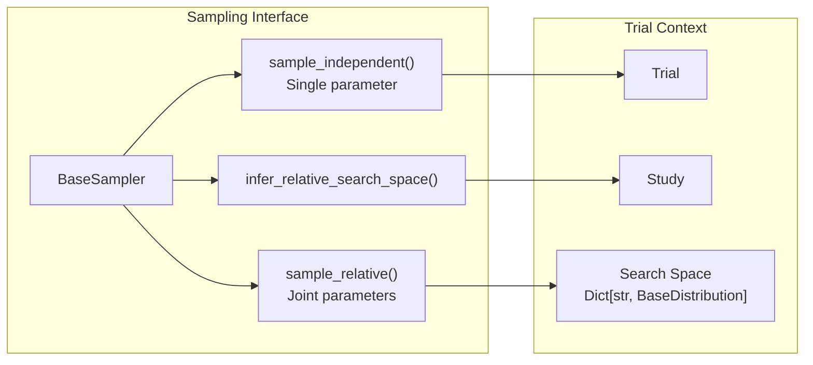
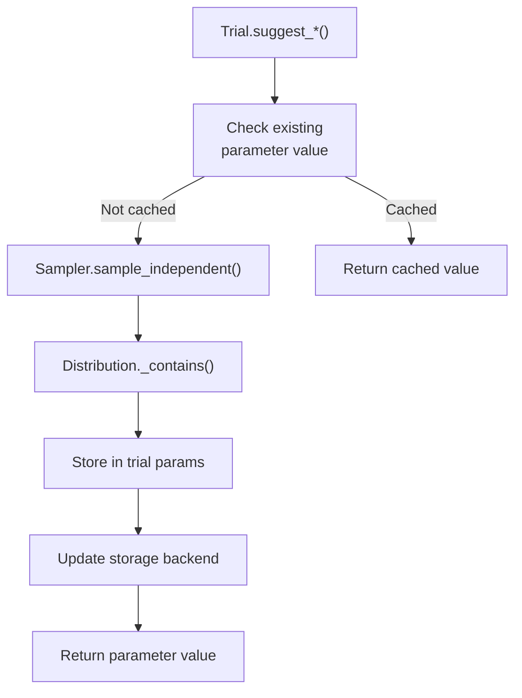

<!-- source: DeepWiki mcp.deepwiki.com · repo optuna/optuna · page 2 Core Components · fetched 2026-10-21 -->

# Core Components

Relevant source files

The following files were used as context for generating this wiki page:

- [optuna/distributions.py](optuna/distributions.py)
- [optuna/integration/pytorch_distributed.py](optuna/integration/pytorch_distributed.py)
- [optuna/storages/_heartbeat.py](optuna/storages/_heartbeat.py)
- [optuna/study/_dataframe.py](optuna/study/_dataframe.py)
- [optuna/study/_optimize.py](optuna/study/_optimize.py)
- [optuna/study/_tell.py](optuna/study/_tell.py)
- [optuna/study/study.py](optuna/study/study.py)
- [optuna/testing/objectives.py](optuna/testing/objectives.py)
- [optuna/trial/_base.py](optuna/trial/_base.py)
- [optuna/trial/_fixed.py](optuna/trial/_fixed.py)
- [optuna/trial/_frozen.py](optuna/trial/_frozen.py)
- [optuna/trial/_trial.py](optuna/trial/_trial.py)
- [tests/storages_tests/rdb_tests/test_storage.py](tests/storages_tests/rdb_tests/test_storage.py)
- [tests/storages_tests/test_cached_storage.py](tests/storages_tests/test_cached_storage.py)
- [tests/storages_tests/test_heartbeat.py](tests/storages_tests/test_heartbeat.py)
- [tests/storages_tests/test_storages.py](tests/storages_tests/test_storages.py)
- [tests/study_tests/test_dataframe.py](tests/study_tests/test_dataframe.py)
- [tests/study_tests/test_optimize.py](tests/study_tests/test_optimize.py)
- [tests/study_tests/test_study.py](tests/study_tests/test_study.py)
- [tests/study_tests/test_study_summary.py](tests/study_tests/test_study_summary.py)
- [tests/test_callbacks.py](tests/test_callbacks.py)
- [tests/test_distributions.py](tests/test_distributions.py)

This document covers the fundamental building blocks that form Optuna's hyperparameter optimization framework. These components work together to orchestrate the optimization process, manage parameter spaces, and persist optimization data. For information about specific sampling algorithms, see [Sampling Algorithms](#3). For user-facing tools and interfaces, see [Tools and User Interfaces](#5).

## System Overview

Optuna's core architecture consists of four primary components that collaborate to execute hyperparameter optimization:

**Study and Trial Management System**
The `Study` class serves as the central orchestrator that manages the optimization process and coordinates trials. Each `Trial` represents an individual evaluation of the objective function with specific parameter values.

**Parameter Distribution System**
The `distributions` module defines how parameter spaces are structured, supporting continuous, discrete, and categorical parameters with various constraints and transformations.

**Storage Architecture**
The storage layer provides a pluggable persistence system with multiple backends, enabling both local and distributed optimization scenarios.

**Sampling Integration**
The core components integrate with sampling algorithms through well-defined interfaces, allowing different optimization strategies to be plugged in seamlessly.

## Core Component Architecture

Sources: [tests/samplers_tests/test_samplers.py:18-31]()

## Study and Trial Lifecycle

The study-trial relationship forms the core execution model where studies manage the optimization process and trials represent individual parameter evaluations.

The `Study` class coordinates the optimization loop by:
- Managing trial creation through storage backends
- Delegating parameter sampling to configured samplers  
- Executing user-defined objective functions
- Persisting trial results and state changes

Sources: [tests/samplers_tests/test_samplers.py:478-480](), [tests/samplers_tests/test_samplers.py:526-543]()

## Parameter Distribution System

The distribution system defines the parameter search space through a hierarchy of distribution classes that handle different parameter types and constraints.

| Distribution Class | Parameter Type | Key Features |
|-------------------|----------------|--------------|
| `FloatDistribution` | Continuous | Support for log-scale, step quantization |
| `IntDistribution` | Integer | Support for log-scale, step constraints |  
| `CategoricalDistribution` | Discrete choices | Arbitrary choice types |

The distribution system validates parameter bounds and handles transformations between user-space and internal representations used by optimization algorithms.

Sources: [tests/samplers_tests/test_samplers.py:224-258](), [tests/samplers_tests/test_samplers.py:289-310](), [tests/samplers_tests/test_samplers.py:263-287]()

## Storage Architecture

The storage system provides a pluggable persistence layer that abstracts different storage backends through the `BaseStorage` interface.

The storage architecture supports:
- **Study Management**: Creating, retrieving, and modifying studies
- **Trial Lifecycle**: Managing trial states from creation to completion
- **Parameter Persistence**: Storing suggested parameters and objective values
- **Concurrent Access**: Thread-safe operations for parallel optimization

Sources: [tests/samplers_tests/test_samplers.py:478-480]()

## Component Integration Patterns

The core components integrate through well-defined interfaces that enable flexible composition of optimization strategies.

**Sampler Integration Pattern**

The sampling integration allows different optimization algorithms to be plugged in by implementing the `BaseSampler` interface methods:
- `sample_independent()`: Suggests individual parameters independently
- `sample_relative()`: Suggests parameters considering their relationships
- `infer_relative_search_space()`: Determines which parameters to optimize jointly

Sources: [tests/samplers_tests/test_samplers.py:44-78](), [tests/samplers_tests/test_samplers.py:494-512]()

**Parameter Suggestion Flow**

This flow ensures parameter consistency within trials while allowing samplers to influence parameter selection based on optimization history.

Sources: [tests/samplers_tests/test_samplers.py:514-544]()

---

