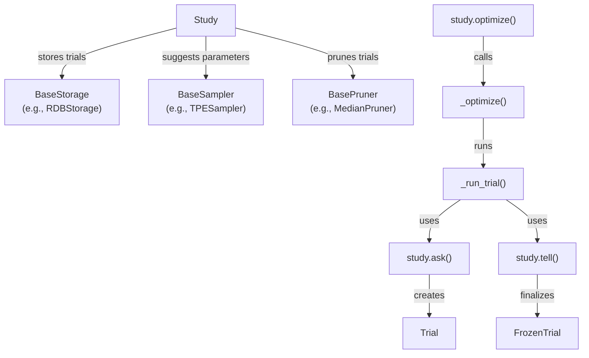
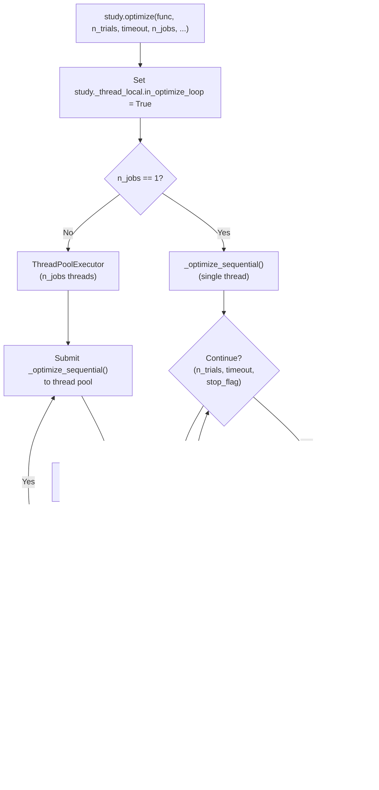
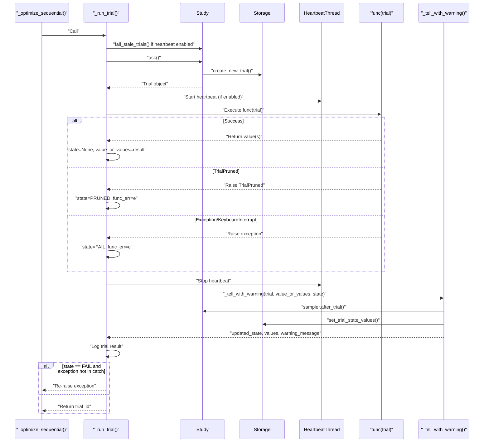

<!-- source: DeepWiki mcp.deepwiki.com · repo optuna/optuna · page 2.1 Study and Optimization Loop · fetched 2026-10-21 -->

# Study and Optimization Loop

<details>
<summary>Relevant source files</summary>

The following files were used as context for generating this wiki page:

- [optuna/integration/chainermn.py](optuna/integration/chainermn.py)
- [optuna/storages/_heartbeat.py](optuna/storages/_heartbeat.py)
- [optuna/study/_dataframe.py](optuna/study/_dataframe.py)
- [optuna/study/_optimize.py](optuna/study/_optimize.py)
- [optuna/study/_tell.py](optuna/study/_tell.py)
- [optuna/study/study.py](optuna/study/study.py)
- [optuna/testing/objectives.py](optuna/testing/objectives.py)
- [tests/samplers_tests/test_samplers.py](tests/samplers_tests/test_samplers.py)
- [tests/storages_tests/test_heartbeat.py](tests/storages_tests/test_heartbeat.py)
- [tests/study_tests/test_dataframe.py](tests/study_tests/test_dataframe.py)
- [tests/study_tests/test_optimize.py](tests/study_tests/test_optimize.py)
- [tests/study_tests/test_study.py](tests/study_tests/test_study.py)
- [tests/study_tests/test_study_summary.py](tests/study_tests/test_study_summary.py)
- [tests/test_callbacks.py](tests/test_callbacks.py)

</details>


This page explains the `Study` class, the optimization loop lifecycle in `_optimize.py`, and how trials are coordinated between storage, sampling, and pruning components. For information about trial objects and parameter suggestion, see [Trial System and Parameter Suggestion](#2.2). For storage backends, see [Storage Architecture](#2.4). For sampling algorithms, see [Sampling Algorithms](#3).

## Overview

The `Study` class in [optuna/study/study.py]() is the primary interface for hyperparameter optimization. It orchestrates the optimization loop by:

1. Creating and managing trials via the storage backend
2. Delegating parameter suggestion to the sampler
3. Coordinating pruning decisions with the pruner
4. Executing the objective function with proper error handling
5. Recording trial results and managing study-level metadata

The optimization loop in [optuna/study/_optimize.py]() handles both sequential and parallel trial execution, with support for callbacks, garbage collection, progress bars, and distributed trial management via heartbeat.

## Study Class and Initialization

### Study Initialization

The `Study` class is initialized with references to key components:

```python
# From optuna/study/study.py:79-96
def __init__(
    self,
    study_name: str,
    storage: str | storages.BaseStorage,
    sampler: samplers.BaseSampler | None = None,
    pruner: pruners.BasePruner | None = None,
) -> None:
    self.study_name = study_name
    self._storage = storages.get_storage(storage)
    self._study_id = storage.get_study_id_from_name(study_name)
    self._directions = storage.get_study_directions(study_id)
    
    self.sampler = sampler or samplers.TPESampler()
    self.pruner = pruner or pruners.MedianPruner()
    
    self._thread_local = _ThreadLocalStudyAttribute()
    self._stop_flag = False
```

The study maintains a thread-local object for optimization state:

```python
# From optuna/study/study.py:62-64
class _ThreadLocalStudyAttribute(threading.local):
    in_optimize_loop: bool = False
    cached_all_trials: list[FrozenTrial] | None = None
```

Sources: [optuna/study/study.py:62-97]()

### Study Component Coordination

Title: Study Component Coordination Diagram



Sources: [optuna/study/study.py:79-96](), [optuna/study/_optimize.py:39-49]()

### Key Study Methods

| Method | Purpose | Key Operations |
|--------|---------|----------------|
| `optimize(func, n_trials, timeout, n_jobs, ...)` | Execute optimization loop | Calls `_optimize()` which manages trial execution |
| `ask(fixed_distributions)` | Create new trial for manual control | Creates trial ID, invalidates cache, returns `Trial` |
| `tell(trial, values, state)` | Finalize trial with results | Validates values, calls `_tell_with_warning()` |
| `get_trials(deepcopy, states)` | Retrieve trials | Fetches from storage, optionally from cache |
| `enqueue_trial(params)` | Queue trial with fixed parameters | Stores as `WAITING` trial with `fixed_params` |
| `add_trial(trial)` | Add pre-evaluated trial | Validates and stores `FrozenTrial` |
| `stop()` | Exit current optimization loop | Sets `_stop_flag = True` |

Sources: [optuna/study/study.py:388-500](), [optuna/study/study.py:502-586](), [optuna/study/study.py:588-679](), [optuna/study/study.py:808-843]()

### Study Properties

| Property | Purpose | Single/Multi-Objective |
|----------|---------|------------------------|
| `best_params` | Parameters of best trial | Single-objective only |
| `best_value` | Best objective value | Single-objective only |
| `best_trial` | Best trial | Single-objective only |
| `best_trials` | Pareto front trials | Multi-objective (returns list) |
| `direction` | Optimization direction | Single-objective only |
| `directions` | List of optimization directions | Both (always returns list) |
| `trials` | All trials | Both |
| `user_attrs` | User-defined study attributes | Both |

Sources: [optuna/study/study.py:109-207](), [optuna/study/study.py:210-225]()

## Optimization Loop Architecture

### The `_optimize()` Function

The main optimization entry point in [optuna/study/_optimize.py:39-124]() orchestrates trial execution:

Title: Optimization Loop Flow



Sources: [optuna/study/_optimize.py:39-124](), [optuna/study/_optimize.py:127-183]()

### Sequential Optimization: `_optimize_sequential()`

The [optuna/study/_optimize.py:127-183]() function executes trials in a loop:

1. **Set optimization flag**: `study._thread_local.in_optimize_loop = True`
2. **Reseed sampler** (if parallel): `study.sampler.reseed_rng()`
3. **Loop until termination**:
   - Check `study._stop_flag`
   - Check `n_trials` limit
   - Check `timeout` duration
   - Call `_run_trial(study, func, catch)`
   - Execute callbacks with `copy.deepcopy(frozen_trial)`
   - Update progress bar
   - Optionally run `gc.collect()` if `gc_after_trial=True`
4. **Cleanup**: `study._storage.remove_session()`

Sources: [optuna/study/_optimize.py:127-183]()

### Trial Execution: `_run_trial()`

Each trial follows this lifecycle in [optuna/study/_optimize.py:186-264]():

Title: Trial Execution Flow in `_run_trial()`



Sources: [optuna/study/_optimize.py:186-264]()

### Error Handling in `_run_trial()`

| Exception/Condition | Resulting State | Behavior |
|-------------------|----------------|----------|
| `exceptions.TrialPruned` | `PRUNED` | Caught, trial finalized with pruned state |
| `Exception` or `KeyboardInterrupt` | `FAIL` | Caught, trial finalized with fail state |
| Invalid return value (NaN, None, etc.) | `FAIL` | Detected in `_tell_with_warning()`, auto-failed |
| Exception in `catch` parameter | `FAIL` | Trial marked failed, optimization continues |
| Exception not in `catch` | `FAIL` | Trial marked failed, exception re-raised |

Sources: [optuna/study/_optimize.py:204-263]()

## Parallel Optimization with ThreadPoolExecutor

When `n_jobs != 1`, the optimization uses [optuna/study/_optimize.py:67-121]() with a `ThreadPoolExecutor`:

1. **Worker pool creation**: `ThreadPoolExecutor(max_workers=n_jobs)`
2. **Trial submission loop**:
   - Check `study._stop_flag`
   - Check `timeout` against `time_start`
   - Check `n_trials` limit
   - Wait for completion when pool is full using `wait(futures, return_when=FIRST_COMPLETED)`
   - Submit new `_optimize_sequential(study, func, 1, ...)` tasks
3. **RNG reseeding**: Each worker thread calls `study.sampler.reseed_rng()` for thread-safety

### Thread Safety Considerations

- **Storage synchronization**: All storage operations are atomic via the storage backend
- **Sampler reseeding**: Each worker reseeds the sampler's RNG via `reseed_rng=True`
- **Trial cache invalidation**: Cache is thread-local and invalidated per-trial
- **Stop flag**: `study._stop_flag` is a simple boolean flag checked by all workers

Sources: [optuna/study/_optimize.py:67-121](), [optuna/study/_optimize.py:142-143]()

### Progress Bar and Logging

Progress bar support in [optuna/study/_optimize.py:58-62]():

- **Enabled when**: `show_progress_bar=True` and `n_trials` is set
- **Disabled when**: `timeout` is set with `n_jobs != 1` (cannot estimate progress)
- **Updates after each trial**: Shows best trial, best value, elapsed time
- **Implementation**: `pbar_module._ProgressBar` class

Sources: [optuna/study/_optimize.py:58-62](), [optuna/study/_optimize.py:179-181]()

## Ask and Tell Pattern

The ask-and-tell pattern in [optuna/study/study.py:502-679]() provides manual control over trial lifecycle, as an alternative to `optimize()`.

### Ask Method: `study.ask()`

The [optuna/study/study.py:502-586]() method creates a new trial:

1. **Check heartbeat warning**: Warns if heartbeat is enabled but not using `optimize()`
2. **Convert distributions**: Converts old distribution formats to new format
3. **Invalidate cache**: `self._thread_local.cached_all_trials = None`
4. **Get or create trial**: 
   - Calls `self._pop_waiting_trial_id()` to check for enqueued trials
   - If none, calls `self._storage.create_new_trial(self._study_id)`
5. **Create Trial object**: `optuna.Trial(self, trial_id)`
6. **Apply fixed distributions**: Calls `trial._suggest(name, param)` for each
7. **Return mutable Trial**: User can now call `suggest_*()` methods

### Tell Method: `study.tell()`

The [optuna/study/study.py:588-679]() method finalizes a trial:

1. **Delegate to `_tell_with_warning()`**: Main logic in [optuna/study/_tell.py:81-176]()
2. **Return deep copy**: `copy.deepcopy(_get_frozen_trial(study, trial))`

The `_tell_with_warning()` function in [optuna/study/_tell.py:81-176]():

1. **Invalidate cache**: `study._thread_local.cached_all_trials = None`
2. **Get frozen trial**: Retrieves from storage, validates state is `RUNNING`
3. **Validate state and values**: Checks consistency via `_check_state_and_values()`
4. **Handle special cases**:
   - If `state=None`, attempt to auto-determine from values
   - If `state=PRUNED`, use last intermediate value if available
   - If values invalid, auto-fail with `state=FAIL`
5. **Cast values to floats**: Ensures type consistency
6. **Post-processing**:
   - Call `study.sampler.after_trial(study, frozen_trial, state, values)`
   - Call `study._storage.set_trial_state_values(trial_id, state, values)`
7. **Return**: `(state, values, warning_message)`

Sources: [optuna/study/study.py:502-679](), [optuna/study/_tell.py:23-176]()

### Ask and Tell Usage Example

```python
# Manual optimization loop
for _ in range(100):
    trial = study.ask()
    
    # Get parameters
    x = trial.suggest_float("x", -10, 10)
    y = trial.suggest_int("y", 0, 100)
    
    # Evaluate objective
    value = x**2 + y
    
    # Report result
    study.tell(trial, value)
```

### Fixed Distributions in Ask

The `ask()` method supports pre-suggesting parameters via `fixed_distributions`:

```python
distributions = {
    "lr": FloatDistribution(0.001, 0.1, log=True),
    "batch_size": CategoricalDistribution([32, 64, 128])
}

trial = study.ask(fixed_distributions=distributions)
# trial.params already contains "lr" and "batch_size"
```

Sources: [optuna/study/study.py:555-584]()

## Trial Enqueuing and Pre-evaluation

### Enqueuing Trials with Fixed Parameters

The [optuna/study/study.py:845-908]() method queues trials with specific parameter values:

```python
study.enqueue_trial(params={"x": 5, "lr": 0.001})
```

Implementation:
1. **Validate params**: Must be a dictionary
2. **Check skip condition**: If `skip_if_exists=True`, checks for duplicate trials
3. **Create waiting trial**: Calls `study.add_trial()` with:
   - `state=TrialState.WAITING`
   - `system_attrs={"fixed_params": params}`
   - `user_attrs=user_attrs` (if provided)

When `ask()` is called, it checks for waiting trials via `_pop_waiting_trial_id()` before creating new trials.

Sources: [optuna/study/study.py:845-908]()

### Adding Pre-evaluated Trials

The [optuna/study/study.py:910-980]() method adds completed trials to a study:

```python
from optuna.trial import create_trial

trial = create_trial(
    params={"x": 2.0},
    distributions={"x": FloatDistribution(0, 10)},
    value=4.0
)
study.add_trial(trial)
```

This is useful for:
- Importing results from other optimization runs
- Warm-starting optimization with known good parameters
- Transferring trials between studies

Sources: [optuna/study/study.py:910-980]()

## Heartbeat Mechanism for Distributed Trials

When the storage backend supports heartbeat (e.g., `RDBStorage` with `heartbeat_interval` set), the system monitors trial liveness:

### Heartbeat Thread

The [optuna/storages/_heartbeat.py:105-133]() class runs in the background during trial execution:

1. **Started by `_run_trial()`**: Via `get_heartbeat_thread(trial_id, storage)` context manager
2. **Periodic updates**: Calls `storage.record_heartbeat(trial_id)` every `heartbeat_interval` seconds
3. **Stopped after trial**: When the objective function returns or raises

### Stale Trial Detection

The [optuna/storages/_heartbeat.py:143-181]() function:

1. **Called before each trial**: In `_run_trial()` via `fail_stale_trials(study)`
2. **Identifies stale trials**: Trials whose heartbeat has not updated within `grace_period`
3. **Marks as failed**: Sets `state=TrialState.FAIL`
4. **Executes callback**: Calls `failed_trial_callback` if configured

This enables automatic recovery from worker crashes in distributed optimization.

Sources: [optuna/storages/_heartbeat.py:105-181](), [optuna/study/_optimize.py:191-195]()

## Callbacks and Extensibility

### Optimization Callbacks

The optimization loop supports callbacks that are invoked after each trial:

```python
def callback(study: Study, trial: FrozenTrial) -> None:
    if trial.number >= 10:
        study.stop()

study.optimize(objective, callbacks=[callback])
```

### Study Termination

The optimization can be stopped via:
- `study.stop()` method (sets internal flag)
- Reaching `n_trials` limit
- Reaching `timeout` duration
- Unhandled exceptions (depending on `catch` parameter)

Sources: [optuna/study/study.py:807-842](), [optuna/study/_optimize.py:170-172](), [optuna/study/_optimize.py:146-158]()

---

