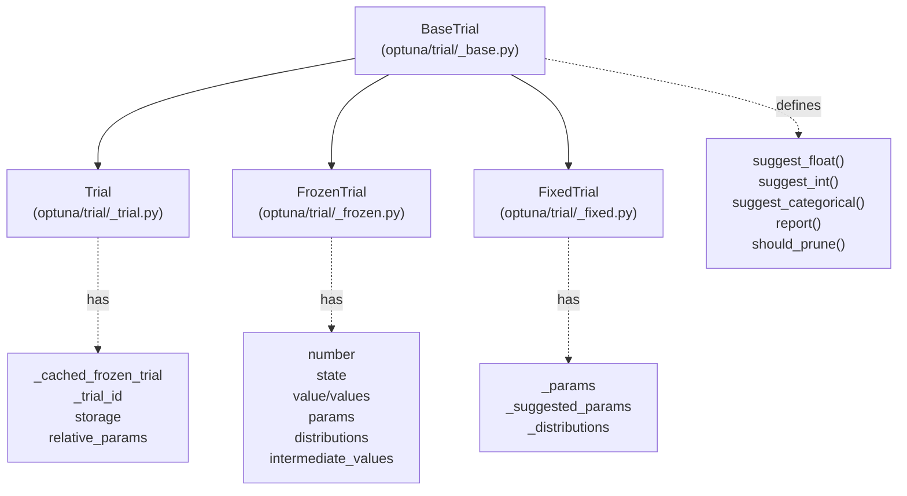
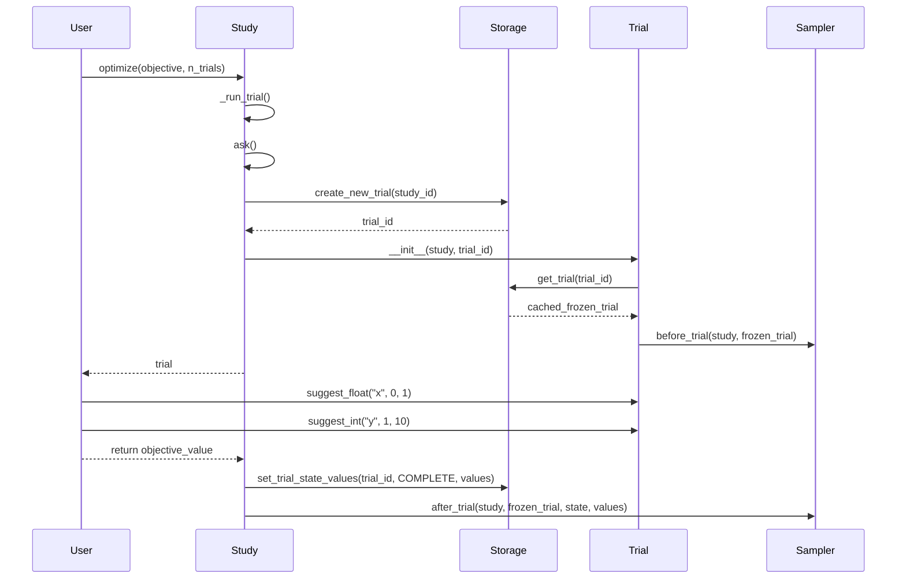
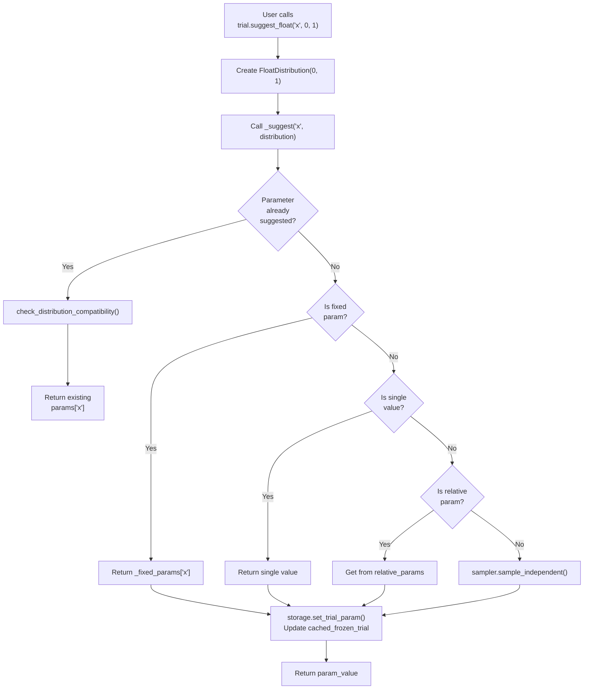
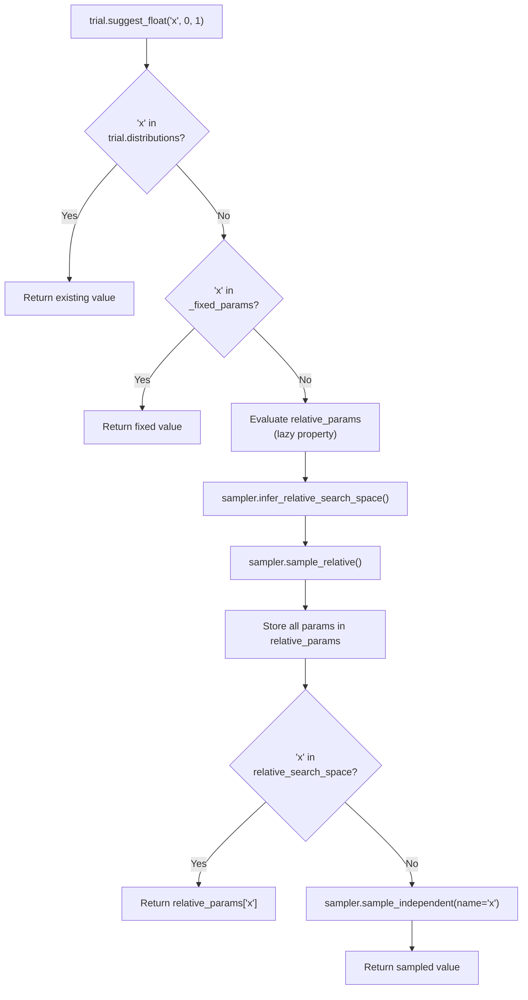
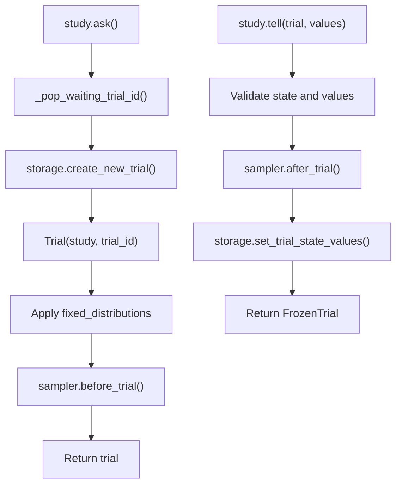

<!-- source: DeepWiki mcp.deepwiki.com · repo optuna/optuna · page 2.2 Trial System and Parameter Suggestion · fetched 2026-10-21 -->

# Trial Objects and Parameter Suggestion

<details>
<summary>Relevant source files</summary>

The following files were used as context for generating this wiki page:

- [optuna/distributions.py](optuna/distributions.py)
- [optuna/integration/pytorch_distributed.py](optuna/integration/pytorch_distributed.py)
- [optuna/storages/_heartbeat.py](optuna/storages/_heartbeat.py)
- [optuna/study/_dataframe.py](optuna/study/_dataframe.py)
- [optuna/study/_optimize.py](optuna/study/_optimize.py)
- [optuna/study/_tell.py](optuna/study/_tell.py)
- [optuna/study/study.py](optuna/study/study.py)
- [optuna/testing/objectives.py](optuna/testing/objectives.py)
- [optuna/trial/_base.py](optuna/trial/_base.py)
- [optuna/trial/_fixed.py](optuna/trial/_fixed.py)
- [optuna/trial/_frozen.py](optuna/trial/_frozen.py)
- [optuna/trial/_trial.py](optuna/trial/_trial.py)
- [tests/storages_tests/test_heartbeat.py](tests/storages_tests/test_heartbeat.py)
- [tests/study_tests/test_dataframe.py](tests/study_tests/test_dataframe.py)
- [tests/study_tests/test_optimize.py](tests/study_tests/test_optimize.py)
- [tests/study_tests/test_study.py](tests/study_tests/test_study.py)
- [tests/study_tests/test_study_summary.py](tests/study_tests/test_study_summary.py)
- [tests/test_callbacks.py](tests/test_callbacks.py)
- [tests/test_distributions.py](tests/test_distributions.py)

</details>


This page documents the trial objects in Optuna and how parameter suggestion works. It covers the `Trial`, `FrozenTrial`, and `FixedTrial` classes, the `suggest_*` methods for defining search spaces, and the interaction between trials and samplers through relative and independent sampling strategies.

For information about the Study orchestration and optimization loop, see [Study and Optimization Loop](#2.1). For details about distribution objects and search space definition, see [Distributions and Parameter Space](#2.3). For sampler algorithms, see [Sampling Algorithms](#3).

## Trial Class Hierarchy

Optuna provides three main trial classes that share a common interface defined by `BaseTrial`:

| Class | Purpose | Mutability | Use Case |
|-------|---------|------------|----------|
| `Trial` | Active trial during optimization | Mutable | Passed to objective functions in `study.optimize()` |
| `FrozenTrial` | Immutable snapshot of completed trial | Immutable | Historical trial records, returned by `study.trials` |
| `FixedTrial` | Trial with pre-defined parameters | Mutable | Deploying optimization results, testing objective functions |

### Class Hierarchy Diagram



**Sources:** [optuna/trial/_base.py:17-133](), [optuna/trial/_trial.py:31-48](), [optuna/trial/_frozen.py:33-139](), [optuna/trial/_fixed.py:24-60]()

## Trial Object Creation and Lifecycle

### Trial Creation Flow

Trials are created through the `Study.ask()` method, which is called internally by `Study.optimize()` or explicitly by users in the ask-and-tell interface.



**Sources:** [optuna/study/study.py:502-586](), [optuna/trial/_trial.py:50-60](), [optuna/study/_optimize.py:186-264]()

### Trial States

Trials progress through various states during their lifecycle:

- **RUNNING**: Trial is actively being evaluated
- **COMPLETE**: Trial finished successfully with a value
- **PRUNED**: Trial was stopped early by a pruner
- **FAIL**: Trial raised an exception
- **WAITING**: Trial is queued but not started (used by `enqueue_trial`)

**Sources:** [optuna/trial/_state.py]()

## Parameter Suggestion Mechanism

### The suggest_* Methods

The `Trial` class provides three main methods for suggesting hyperparameters:

1. **`suggest_float(name, low, high, *, step=None, log=False)`**: Suggests a floating-point value
2. **`suggest_int(name, low, high, *, step=1, log=False)`**: Suggests an integer value  
3. **`suggest_categorical(name, choices)`**: Suggests a categorical value from choices

Each method:
- Creates a `Distribution` object to define the parameter space
- Calls the internal `_suggest()` method to get the value
- Validates the distribution compatibility if the parameter was already suggested
- Returns the suggested value

### Parameter Suggestion Workflow



**Sources:** [optuna/trial/_trial.py:78-165](), [optuna/trial/_trial.py:618-648]()

### Internal _suggest() Implementation

The `_suggest()` method at [optuna/trial/_trial.py:618-648]() implements the core parameter suggestion logic:

1. **Check if already suggested**: If `name in trial.distributions`, return existing value after compatibility check
2. **Check fixed params**: If parameter was fixed via `enqueue_trial()`, return `_fixed_params[name]`
3. **Check single-value distribution**: If distribution has only one possible value, return it
4. **Check relative sampling**: If parameter is in `relative_search_space`, return `relative_params[name]`
5. **Fall back to independent sampling**: Call `sampler.sample_independent(study, trial, name, distribution)`

After obtaining the value, the method:
- Converts to internal representation via `distribution.to_internal_repr()`
- Stores in storage via `storage.set_trial_param()`
- Updates `_cached_frozen_trial` for consistency

**Sources:** [optuna/trial/_trial.py:618-648]()

## Relative vs Independent Sampling

Samplers can suggest parameters using two strategies:

### Relative Sampling

Relative sampling suggests **all parameters together** as a single vector, allowing the sampler to model dependencies between parameters.

**How it works:**
1. Sampler inspects past trials via `infer_relative_search_space()`
2. Returns a search space dictionary mapping parameter names to distributions
3. Samples all parameters at once via `sample_relative()`
4. Trial stores results in `relative_params` property

**When used:**
- TPESampler uses relative sampling for parameters in the relative search space
- CmaEsSampler always uses relative sampling (continuous optimization)
- Parameters must be consistent across trials (same distributions)

### Independent Sampling

Independent sampling suggests **one parameter at a time**, treating each as independent.

**When used:**
- Parameters not in the relative search space
- First occurrence of a parameter (no history)
- Samplers that don't support relative sampling (e.g., RandomSampler)
- Conditional parameters that appear only in some trials

### Decision Flow



**Sources:** [optuna/trial/_trial.py:67-76](), [optuna/trial/_trial.py:618-648](), [optuna/trial/_trial.py:667-673]()

### Relative Params Lazy Evaluation

The `relative_params` property at [optuna/trial/_trial.py:67-76]() is evaluated lazily:

```python
@property
def relative_params(self) -> dict[str, Any]:
    if self._relative_params is None:
        study = pruners._filter_study(self.study, self._cached_frozen_trial)
        self.relative_search_space = self.study.sampler.infer_relative_search_space(
            study, self._cached_frozen_trial
        )
        self._relative_params = self.study.sampler.sample_relative(
            study, self._cached_frozen_trial, self.relative_search_space
        )
    return self._relative_params
```

This ensures that:
- Relative sampling happens only when needed
- The search space is as up-to-date as possible
- Multiple parameters can be accessed without recomputing

**Sources:** [optuna/trial/_trial.py:67-76]()

## Trial State Management

### Reporting Intermediate Values

The `report(value, step)` method allows trials to report intermediate objective values during evaluation, typically for pruning decisions:

```python
def objective(trial):
    for epoch in range(100):
        # Train model
        intermediate_value = evaluate_model()
        trial.report(intermediate_value, step=epoch)
        
        if trial.should_prune():
            raise optuna.TrialPruned()
```

**Implementation details:**
- Converts value to `float` (supports numpy types)
- Validates step is non-negative integer
- Ignores duplicate reports for same step (warns user)
- Stores via `storage.set_trial_intermediate_value(trial_id, step, value)`
- Updates `_cached_frozen_trial.intermediate_values[step]`

**Sources:** [optuna/trial/_trial.py:410-509]()

### Pruning Decision

The `should_prune()` method at [optuna/trial/_trial.py:511-541]() asks the pruner whether to stop the trial:

1. Gets latest trial state via `_get_latest_trial()`
2. Calls `study.pruner.prune(study, trial)`
3. Returns boolean indicating whether to prune

Users typically raise `TrialPruned` exception when `should_prune()` returns `True`.

**Sources:** [optuna/trial/_trial.py:511-541]()

### User and System Attributes

Trials support setting custom metadata:

- **User attributes**: `set_user_attr(key, value)` - for user-defined metadata
- **System attributes**: `set_system_attr(key, value)` - for internal Optuna use (deprecated for users)

Both methods:
- Store via storage backend
- Update `_cached_frozen_trial` for local access
- Require JSON-serializable values

**Sources:** [optuna/trial/_trial.py:543-616]()

## FrozenTrial: Immutable Trial Records

`FrozenTrial` represents an immutable snapshot of a trial, used for:
- Accessing historical trials via `study.trials`
- Returning from `study.best_trial`
- Passing to callbacks and samplers

### Key Attributes

| Attribute | Type | Description |
|-----------|------|-------------|
| `number` | int | Unique trial number (zero-based) |
| `state` | TrialState | Trial state (RUNNING, COMPLETE, etc.) |
| `value` | float \| None | Single-objective value |
| `values` | list[float] \| None | Multi-objective values |
| `params` | dict[str, Any] | Suggested parameter values |
| `distributions` | dict[str, BaseDistribution] | Parameter distributions |
| `user_attrs` | dict[str, Any] | User-defined attributes |
| `system_attrs` | dict[str, Any] | System attributes |
| `intermediate_values` | dict[int, float] | Reported intermediate values |
| `datetime_start` | datetime | Trial start time |
| `datetime_complete` | datetime \| None | Trial completion time |

### Suggest Methods Return Pre-defined Values

Unlike `Trial`, `FrozenTrial.suggest_*()` methods return values from the `params` dictionary:

```python
def _suggest(self, name: str, distribution: BaseDistribution) -> Any:
    if name not in self._params:
        raise ValueError(
            "The value of the parameter '{}' is not found. Please set it at "
            "the construction of the FrozenTrial object.".format(name)
        )
    
    value = self._params[name]
    # Validate and warn if out of range
    # Update distributions
    return value
```

This allows objective functions to accept both `Trial` and `FrozenTrial` objects, enabling re-evaluation of past trials.

**Sources:** [optuna/trial/_frozen.py:348-368]()

### Pruning Behavior

`FrozenTrial` never prunes:
- `report(value, step)` does nothing (no-op)
- `should_prune()` always returns `False`

This makes sense because `FrozenTrial` represents already-completed trials that cannot be pruned.

**Sources:** [optuna/trial/_frozen.py:266-299]()

### Creating FrozenTrials

The `create_trial()` function at [optuna/trial/_frozen.py:482-592]() creates `FrozenTrial` objects manually:

```python
trial = optuna.trial.create_trial(
    params={"x": 1.0, "y": 0},
    distributions={
        "x": FloatDistribution(0, 10),
        "y": CategoricalDistribution([-1, 0, 1]),
    },
    value=5.0,
)
```

Used with `study.add_trial()` to import external optimization results.

**Sources:** [optuna/trial/_frozen.py:482-592]()

## FixedTrial: Deployment and Testing

`FixedTrial` provides a lightweight trial object for deploying optimization results or testing objective functions with specific parameters.

### Constructor

```python
trial = optuna.trial.FixedTrial(
    params={"x": 1.0, "y": "option_a"},
    number=42
)
```

### Suggest Behavior

Unlike `FrozenTrial`, `FixedTrial`:
- Accepts any parameter name (not limited to pre-defined set)
- Warns if value is outside distribution range
- Tracks which parameters were actually suggested via `_suggested_params`
- Updates `_distributions` as parameters are suggested

### Use Cases

1. **Deployment**: Run objective function with best trial parameters
2. **Testing**: Verify objective function with specific parameter combinations
3. **Analysis**: Evaluate objective at multiple fixed points

**Example:**
```python
def objective(trial):
    x = trial.suggest_float("x", -1, 1)
    return x**2

study = optuna.create_study()
study.optimize(objective, n_trials=10)

# Deploy best parameters
best_trial = optuna.trial.FixedTrial(study.best_params)
result = objective(best_trial)
```

**Sources:** [optuna/trial/_fixed.py:24-188]()

## Integration with Study and Samplers

### Trial Creation in Study.ask()

The `Study.ask()` method at [optuna/study/study.py:502-586]() creates trials:

1. Checks for waiting trials (from `enqueue_trial`)
2. Creates new trial via `storage.create_new_trial(study_id)`
3. Constructs `Trial` object
4. Applies fixed distributions if provided
5. Calls `sampler.before_trial()`

### Trial Completion in Study.tell()

The `Study.tell()` method at [optuna/study/study.py:588-679]() completes trials:

1. Validates trial state and values
2. Converts values to list of floats
3. Calls `sampler.after_trial()` for sampler cleanup
4. Stores final state via `storage.set_trial_state_values()`

**Sources:** [optuna/study/study.py:502-586](), [optuna/study/study.py:588-679](), [optuna/study/_tell.py:81-176]()

### Ask-and-Tell Interface Diagram



**Sources:** [optuna/study/study.py:502-586](), [optuna/study/study.py:588-679]()

## Summary

The trial system in Optuna provides a flexible interface for parameter suggestion and trial management:

- **Trial**: Active, mutable trial object with full sampler integration
- **FrozenTrial**: Immutable snapshot for historical records and analysis
- **FixedTrial**: Lightweight object for deployment and testing

Parameter suggestion flows through a priority system:
1. Existing parameters (avoid re-suggestion)
2. Fixed parameters (from `enqueue_trial`)
3. Single-value distributions
4. Relative sampling (all parameters together)
5. Independent sampling (one parameter at a time)

The distinction between relative and independent sampling allows samplers to choose the appropriate strategy based on their algorithm and the optimization context.

---

