<!-- source: DeepWiki mcp.deepwiki.com · repo optuna/optuna · page 2.3 Distributions and Search Space · fetched 2026-10-21 -->

# Distributions and Search Space

<details>
<summary>Relevant source files</summary>

The following files were used as context for generating this wiki page:

- [optuna/distributions.py](optuna/distributions.py)
- [optuna/integration/pytorch_distributed.py](optuna/integration/pytorch_distributed.py)
- [optuna/trial/_base.py](optuna/trial/_base.py)
- [optuna/trial/_fixed.py](optuna/trial/_fixed.py)
- [optuna/trial/_frozen.py](optuna/trial/_frozen.py)
- [optuna/trial/_trial.py](optuna/trial/_trial.py)
- [tests/test_distributions.py](tests/test_distributions.py)

</details>


## Purpose and Scope

This document explains Optuna's distribution system, which defines the search space for hyperparameter optimization. Distributions specify the type, range, and structure of parameters that samplers can suggest during optimization trials.

For information about how trials use distributions to suggest parameter values, see [Trial System and Parameter Suggestion](#2.2). For details on sampling algorithms that operate over these distributions, see [BaseSampler Interface and Sampling Strategies](#3.1).

---

## Distribution Class Hierarchy

Optuna provides a type-safe distribution system based on an abstract base class. All distributions implement the `BaseDistribution` interface and specify how parameter values are represented, validated, and stored.

### Distribution Type Overview

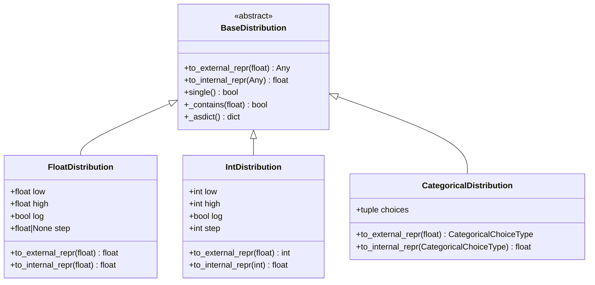

**Sources:** [optuna/distributions.py:31-107]()

### Distribution Instantiation Flow

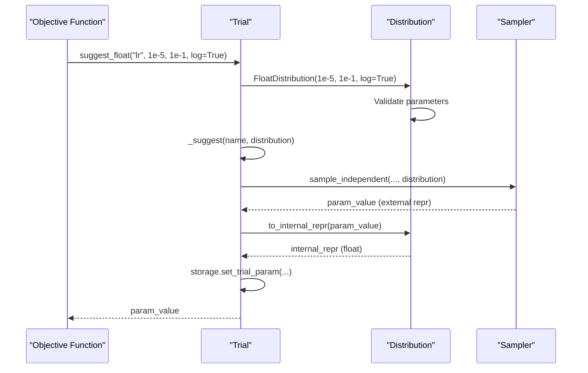

**Sources:** [optuna/trial/_trial.py:78-165](), [optuna/trial/_trial.py:618-647]()

---

## FloatDistribution

The `FloatDistribution` class defines continuous parameter spaces over floating-point values.

### Parameters

| Parameter | Type | Description | Constraints |
|-----------|------|-------------|-------------|
| `low` | float | Lower bound (inclusive) | Must be ≤ `high`. If `log=True`, must be > 0 |
| `high` | float | Upper bound (inclusive) | Must be ≥ `low` |
| `log` | bool | Sample in log domain | Cannot be used with `step` |
| `step` | float \| None | Discretization step | Must be > 0. Cannot be used with `log` |

### Domain Types

**Linear Domain** (`log=False`):
- Samples uniformly from `[low, high]`
- Example: `FloatDistribution(0.0, 1.0)` samples from uniform distribution

**Log Domain** (`log=True`):
- Samples uniformly in log space
- Example: `FloatDistribution(1e-5, 1e-1, log=True)` for learning rates
- Constraint: `low > 0`

**Discretized** (`step` specified):
- Samples from `{low, low+step, low+2*step, ..., high}`
- If range not divisible by step, `high` is adjusted down
- Example: `FloatDistribution(0.0, 1.0, step=0.1)` samples {0.0, 0.1, ..., 1.0}

### Validation and Range Adjustment

When `step` is specified and the range `[low, high]` is not evenly divisible, Optuna automatically adjusts the upper bound:

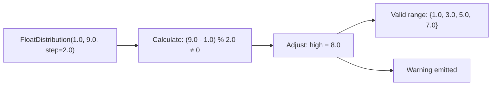

**Sources:** [optuna/distributions.py:109-198](), [optuna/distributions.py:661-676]()

---

## IntDistribution

The `IntDistribution` class defines discrete parameter spaces over integer values.

### Parameters

| Parameter | Type | Description | Constraints |
|-----------|------|-------------|-------------|
| `low` | int | Lower bound (inclusive) | Must be ≤ `high`. If `log=True`, must be ≥ 1 |
| `high` | int | Upper bound (inclusive) | Must be ≥ `low` |
| `log` | bool | Sample in log domain | Requires `step=1` |
| `step` | int | Discretization step | Must be > 0. Must be 1 if `log=True` |

### Log-Scale Integer Sampling

When `log=True`, integer values are sampled using a special process:

1. The range `[low, high]` is divided into grid points of width 1
2. Values are sampled uniformly in log domain
3. The sampled value is rounded to the nearest grid point
4. Lower values are sampled more frequently than higher values

Example: `IntDistribution(2, 8, log=True)` samples from `{2, 3, 4, 5, 6, 7, 8}` with bias toward lower values.

### Step Parameter Behavior

The `step` parameter allows sampling with larger intervals:

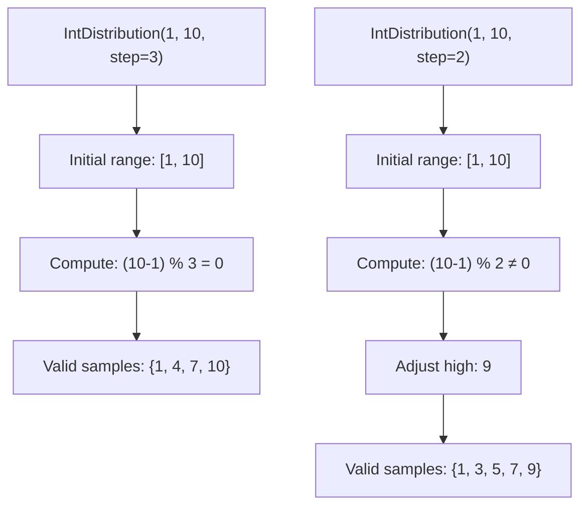

**Sources:** [optuna/distributions.py:310-393](), [optuna/distributions.py:679-688]()

---

## CategoricalDistribution

The `CategoricalDistribution` class defines discrete parameter spaces over arbitrary choices.

### Choice Types

Supported choice types (for persistent storage compatibility):
- `None`
- `bool`
- `int`
- `float`
- `str`

Other types can be used but may not work with all storage backends.

### Internal Representation

Categorical values are stored internally as indices:

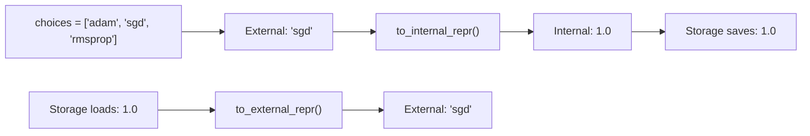

**Key Implementation Detail:** The internal representation is the index as a float, which allows categorical parameters to use the same storage schema as continuous parameters.

### NaN Handling

Categorical distributions support `float('nan')` as a choice and handle it specially:

```python
# When checking equality, NaN is handled correctly
choices = [1.0, float('nan'), 3.0]
dist = CategoricalDistribution(choices)
# Both NaN values are considered equal in this context
```

**Sources:** [optuna/distributions.py:470-551](), [optuna/distributions.py:457-467]()

---

## Internal vs External Representation

Distributions maintain two representations of parameter values to enable efficient storage and sampling.

### Representation Conversion

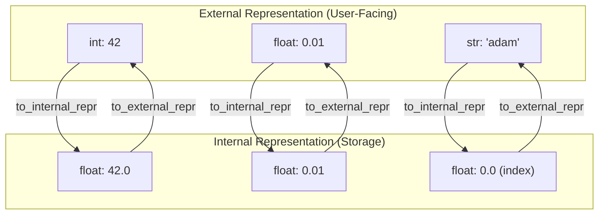

### Why Two Representations?

| Aspect | External Representation | Internal Representation |
|--------|------------------------|-------------------------|
| **Purpose** | User-facing API | Storage and sampling |
| **Type** | Matches distribution type | Always `float` |
| **Usage** | Objective function parameters | Database storage, sampler input |
| **Examples** | `int`, `str`, `float` | `float` |

### Conversion Methods

**`to_internal_repr(param_value_in_external_repr: Any) -> float`**
- Converts user-provided values to internal float representation
- Validates the value (e.g., rejects NaN for non-categorical)
- Used when storing parameter values

**`to_external_repr(param_value_in_internal_repr: float) -> Any`**
- Converts internal float to user-facing type
- Used when retrieving parameter values
- For `IntDistribution`: `int(internal_repr)`
- For `CategoricalDistribution`: `choices[int(internal_repr)]`

**Sources:** [optuna/distributions.py:38-63](), [optuna/distributions.py:182-198](), [optuna/distributions.py:362-380](), [optuna/distributions.py:506-522]()

---

## Distribution Validation

### Single-Value Distributions

A distribution is considered "single" if it contains only one valid value. The `single()` method determines this:

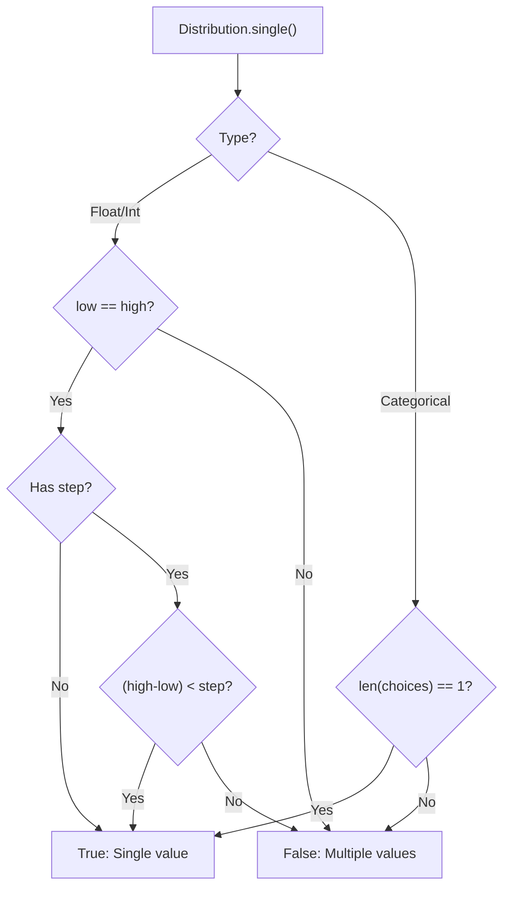

When a distribution is single-valued, samplers skip sampling and directly return the only valid value.

### Contains Check

The `_contains(param_value_in_internal_repr: float) -> bool` method validates whether a value is within the distribution's range:

**FloatDistribution:**
```python
# Without step
return low <= value <= high

# With step
k = (value - low) / step
return low <= value <= high and abs(k - round(k)) < 1e-8
```

**IntDistribution:**
```python
return low <= value <= high and (value - low) % step == 0
```

**CategoricalDistribution:**
```python
index = int(param_value_in_internal_repr)
return 0 <= index < len(choices)
```

**Sources:** [optuna/distributions.py:66-89](), [optuna/distributions.py:163-181](), [optuna/distributions.py:382-392](), [optuna/distributions.py:524-529]()

---

## Distribution Compatibility

Distribution compatibility checking ensures that parameter names are used consistently across trials in a study.

### Compatibility Rules

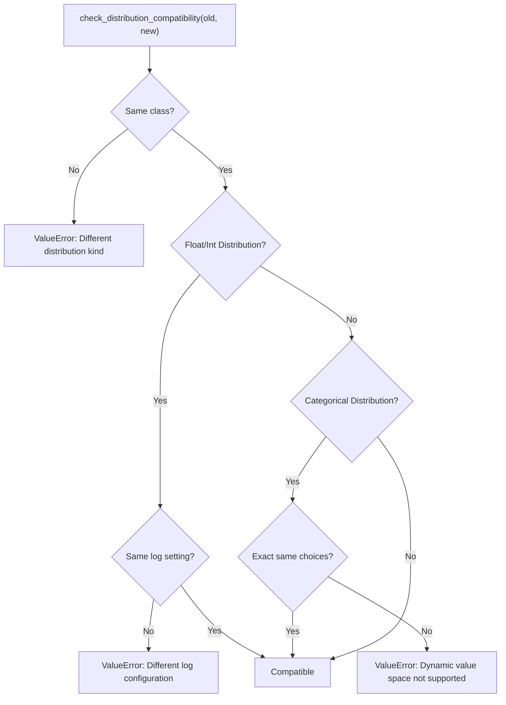

### Dynamic Value Ranges

For `FloatDistribution` and `IntDistribution`, the range bounds (`low`, `high`) can vary between trials:

```python
# Trial 1
suggest_float("x", 0.0, 1.0)  # OK

# Trial 2
suggest_float("x", -1.0, 2.0)  # OK - different range, same log setting
```

However, `CategoricalDistribution` does **not** support dynamic choices:

```python
# Trial 1
suggest_categorical("optimizer", ["adam", "sgd"])  # OK

# Trial 2
suggest_categorical("optimizer", ["adam", "rmsprop"])  # ValueError!
```

### Compatibility Validation in Practice

When a parameter is suggested multiple times in the same trial with different distribution settings, a warning is issued:

**Sources:** [optuna/distributions.py:623-658](), [optuna/trial/_trial.py:684-696]()

---

## Search Space Definition

The search space is the set of all valid parameter combinations that can be suggested during optimization.

### Search Space Composition

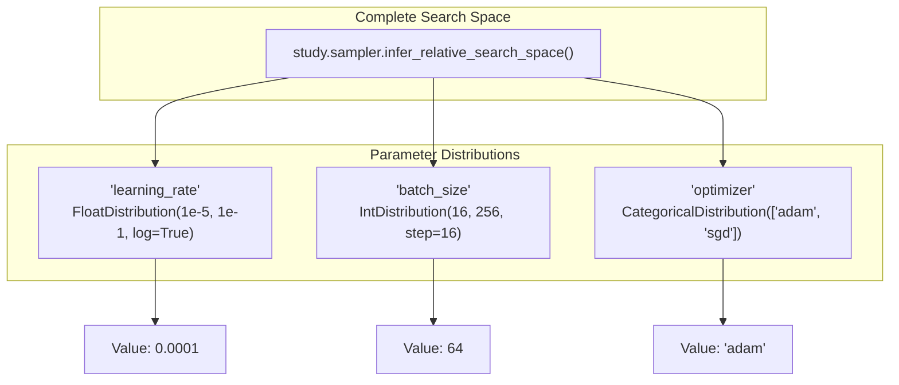

### Relative vs Independent Search Space

The sampler can infer a **relative search space** containing parameters that should be sampled jointly (considering correlations), while remaining parameters are sampled independently.

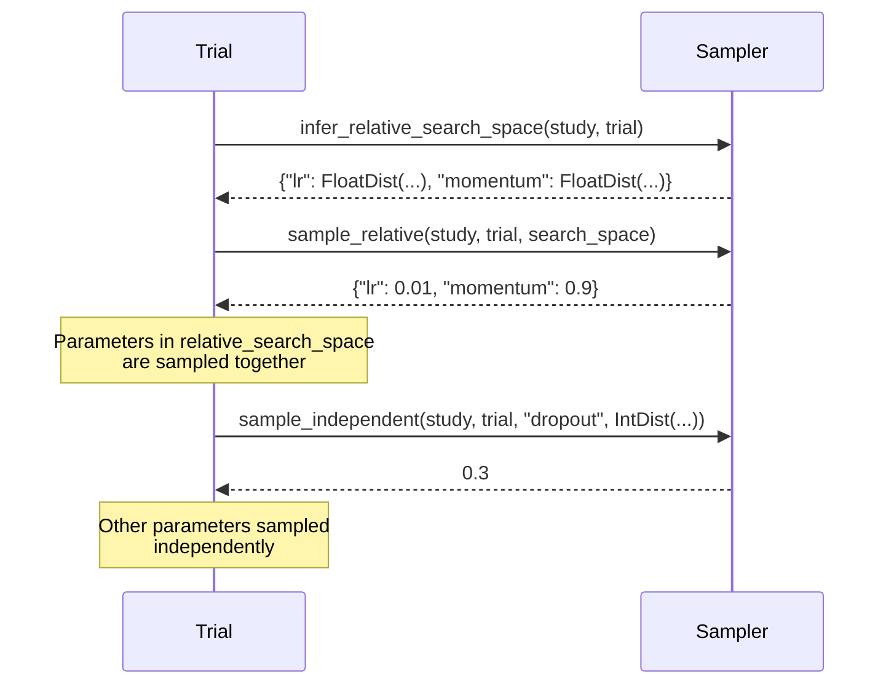

The relative search space inference is sampler-dependent. For example, TPE's multivariate mode groups correlated parameters together for joint sampling.

**Sources:** [optuna/trial/_trial.py:62-76](), [optuna/trial/_trial.py:665-682]()

---

## JSON Serialization

Distributions can be serialized to JSON for storage and network transmission.

### Full Format

The full JSON format includes the class name and all attributes:

```json
{
  "name": "FloatDistribution",
  "attributes": {
    "low": 0.001,
    "high": 100.0,
    "log": true,
    "step": null
  }
}
```

### Abbreviated Format

An abbreviated format omits the class name for more compact representation:

```json
{
  "type": "float",
  "low": 0.001,
  "high": 100.0,
  "log": true
}
```

### Serialization Functions

**`distribution_to_json(dist: BaseDistribution) -> str`**
- Converts a distribution object to JSON string
- Uses full format with class name

**`json_to_distribution(json_str: str) -> BaseDistribution`**
- Deserializes JSON to distribution object
- Supports both full and abbreviated formats
- Reconstructs the appropriate distribution class

### Format Comparison

| Format | Size | Use Case |
|--------|------|----------|
| Full | Larger | Database storage, exact class preservation |
| Abbreviated | Smaller | API responses, configuration files |

**Sources:** [optuna/distributions.py:565-620](), [tests/test_distributions.py:35-71]()

---

## Deprecated Distribution Classes

Optuna 3.0 introduced unified `FloatDistribution` and `IntDistribution` classes to replace specialized variants. The old classes are maintained for backward compatibility but deprecated.

### Deprecated Classes Mapping

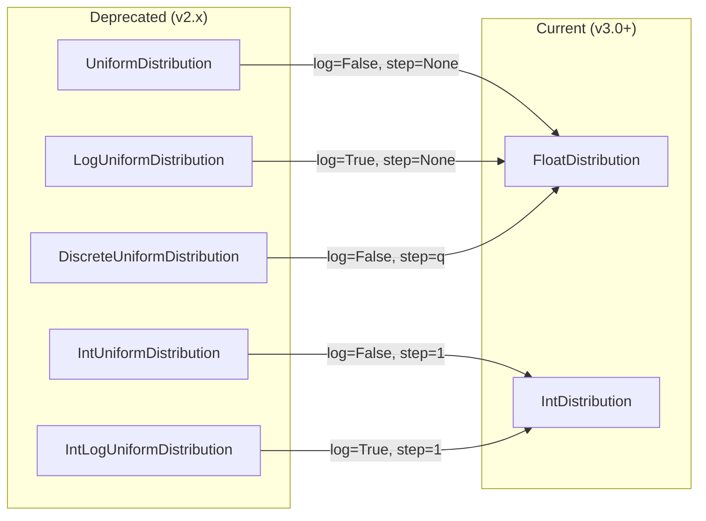

### Automatic Conversion

The `_convert_old_distribution_to_new_distribution()` function transparently converts deprecated distributions:

```python
# Old code (deprecated)
dist = UniformDistribution(low=0.0, high=1.0)

# Automatically converted to
dist = FloatDistribution(low=0.0, high=1.0, log=False, step=None)
```

This conversion ensures that studies created with older Optuna versions remain compatible with new code.

**Sources:** [optuna/distributions.py:200-252](), [optuna/distributions.py:254-308](), [optuna/distributions.py:395-454](), [optuna/distributions.py:709-765]()

---

## Usage in Trial Objects

All three trial types (`Trial`, `FrozenTrial`, `FixedTrial`) use distributions identically through the `suggest_*` methods.

### Suggestion Flow

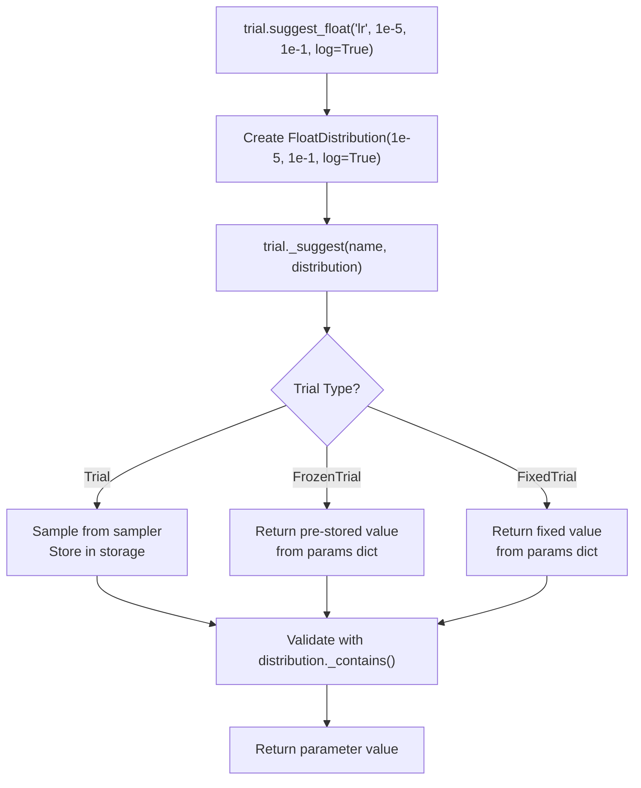

### Distribution Storage in Trials

Each trial maintains a `distributions` dictionary mapping parameter names to their distribution objects:

```python
trial.distributions = {
    "learning_rate": FloatDistribution(1e-5, 1e-1, log=True),
    "batch_size": IntDistribution(16, 256, step=16),
    "optimizer": CategoricalDistribution(["adam", "sgd"])
}
```

This dictionary is:
- Populated as parameters are suggested
- Stored persistently in the storage backend
- Used for parameter validation in subsequent trials
- Checked for compatibility when the same parameter is suggested again

**Sources:** [optuna/trial/_trial.py:618-647](), [optuna/trial/_frozen.py:347-367](), [optuna/trial/_fixed.py:142-163](), [optuna/trial/_base.py:110-113]()

---

