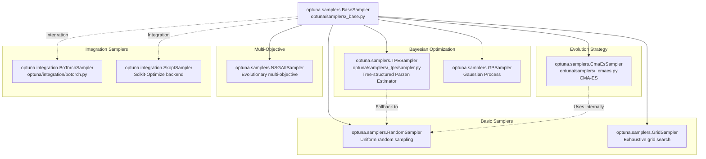
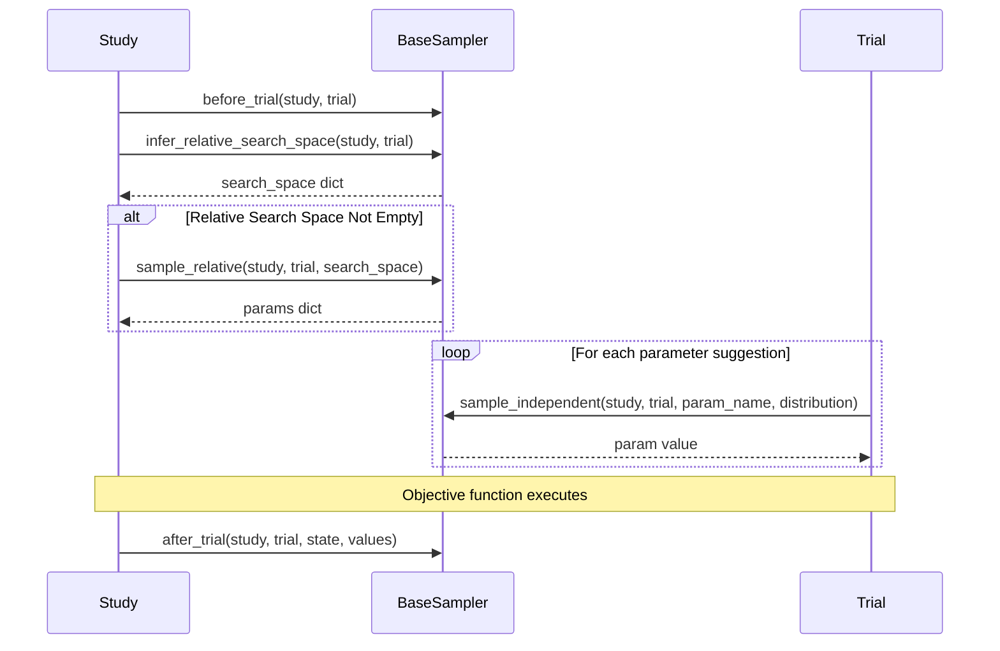
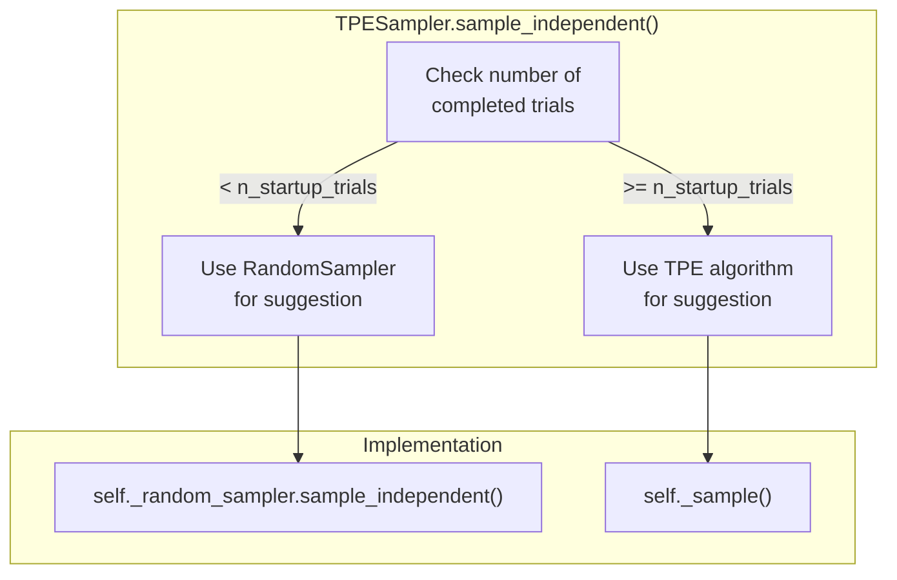
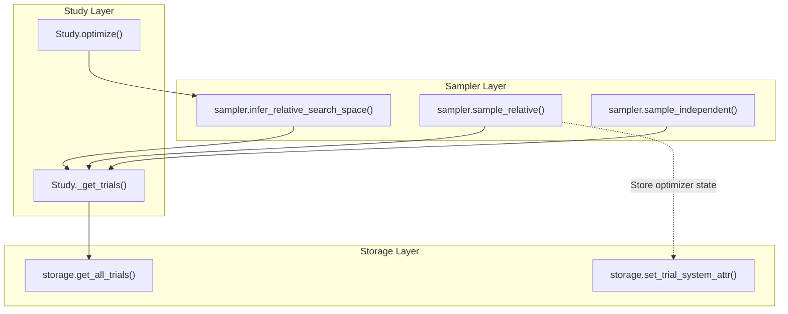

<!-- source: DeepWiki mcp.deepwiki.com · repo optuna/optuna · page 3 Sampling Algorithms · fetched 2026-10-21 -->

# Sampling Algorithms

<details>
<summary>Relevant source files</summary>

The following files were used as context for generating this wiki page:

- [optuna/_gp/acqf.py](optuna/_gp/acqf.py)
- [optuna/_gp/batched_lbfgsb.py](optuna/_gp/batched_lbfgsb.py)
- [optuna/_gp/gp.py](optuna/_gp/gp.py)
- [optuna/_gp/optim_mixed.py](optuna/_gp/optim_mixed.py)
- [optuna/_gp/optim_sample.py](optuna/_gp/optim_sample.py)
- [optuna/_gp/prior.py](optuna/_gp/prior.py)
- [optuna/_gp/search_space.py](optuna/_gp/search_space.py)
- [optuna/integration/chainermn.py](optuna/integration/chainermn.py)
- [optuna/integration/cma.py](optuna/integration/cma.py)
- [optuna/samplers/_cmaes.py](optuna/samplers/_cmaes.py)
- [optuna/samplers/_gp/sampler.py](optuna/samplers/_gp/sampler.py)
- [optuna/samplers/_tpe/parzen_estimator.py](optuna/samplers/_tpe/parzen_estimator.py)
- [optuna/samplers/_tpe/sampler.py](optuna/samplers/_tpe/sampler.py)
- [optuna/terminator/improvement/emmr.py](optuna/terminator/improvement/emmr.py)
- [optuna/terminator/improvement/evaluator.py](optuna/terminator/improvement/evaluator.py)
- [tests/gp_tests/test_acqf.py](tests/gp_tests/test_acqf.py)
- [tests/gp_tests/test_batched_lbfgsb.py](tests/gp_tests/test_batched_lbfgsb.py)
- [tests/gp_tests/test_gp.py](tests/gp_tests/test_gp.py)
- [tests/gp_tests/test_search_space.py](tests/gp_tests/test_search_space.py)
- [tests/samplers_tests/test_cmaes.py](tests/samplers_tests/test_cmaes.py)
- [tests/samplers_tests/test_gp.py](tests/samplers_tests/test_gp.py)
- [tests/samplers_tests/test_samplers.py](tests/samplers_tests/test_samplers.py)
- [tests/samplers_tests/tpe_tests/test_multi_objective_sampler.py](tests/samplers_tests/tpe_tests/test_multi_objective_sampler.py)
- [tests/samplers_tests/tpe_tests/test_parzen_estimator.py](tests/samplers_tests/tpe_tests/test_parzen_estimator.py)
- [tests/samplers_tests/tpe_tests/test_sampler.py](tests/samplers_tests/tpe_tests/test_sampler.py)

</details>


This document provides an overview of Optuna's sampling algorithms system, which forms the core intelligence behind hyperparameter optimization. Sampling algorithms determine how to suggest new parameter values for each trial based on the history of previous trials and their objective values.

For detailed information about specific sampling algorithms, see:
- Page 3.1: BaseSampler Interface and Sampling Strategies
- Page 3.2: Tree-structured Parzen Estimator (TPE)
- Page 3.3: Gaussian Process Sampler
- Page 3.4: CMA-ES Sampler
- Page 3.5: Multi-Objective Optimization
- Page 3.6: Pruning and Other Samplers

For information about trial management and parameter suggestions, see Page 2.2 (Trial Objects and Parameter Suggestion).

## Architecture Overview

The sampling system in Optuna is built around a pluggable architecture where different sampling algorithms can be used interchangeably through a common interface. All samplers inherit from the `BaseSampler` abstract class [optuna/samplers/_base.py:31-62]() and implement standardized methods for parameter suggestion.

### Sampler Class Hierarchy

The following diagram shows the main sampler implementations in Optuna:



Sources: [optuna/samplers/_base.py:31-62](), [optuna/samplers/_tpe/sampler.py:72-287](), [optuna/samplers/_cmaes.py:47-246](), [optuna/integration/botorch.py:1-10]()

## Core Sampling Interface: BaseSampler

The `BaseSampler` class [optuna/samplers/_base.py:31-236]() defines the fundamental interface that all sampling algorithms must implement. Optuna combines two types of sampling strategies: **relative sampling** and **independent sampling**.

### Relative vs Independent Sampling

**Relative Sampling** determines values of multiple parameters simultaneously, allowing samplers to exploit relationships between parameters (e.g., correlation). This is used by advanced algorithms like TPE and CMA-ES when operating in multivariate mode.

**Independent Sampling** determines a value of a single parameter without considering relationships with other parameters. This is used for parameters outside the relative search space or as a fallback.

### Parameter Suggestion Flow

The following diagram shows how the Study orchestrates sampling during a trial:



Sources: [optuna/samplers/_base.py:31-236]()

### Key BaseSampler Methods

| Method | Returns | Purpose |
|--------|---------|---------|
| `infer_relative_search_space(study, trial)` | `dict[str, BaseDistribution]` | Determines which parameters to sample jointly [optuna/samplers/_base.py:68-93]() |
| `sample_relative(study, trial, search_space)` | `dict[str, Any]` | Samples multiple parameters jointly [optuna/samplers/_base.py:95-125]() |
| `sample_independent(study, trial, param_name, param_distribution)` | `Any` | Samples a single parameter independently [optuna/samplers/_base.py:127-163]() |
| `before_trial(study, trial)` | `None` | Pre-processing hook before trial execution [optuna/samplers/_base.py:165-185]() |
| `after_trial(study, trial, state, values)` | `None` | Post-processing hook after trial completion [optuna/samplers/_base.py:187-216]() |
| `reseed_rng()` | `None` | Reseeds the random number generator [optuna/samplers/_base.py:218-228]() |

Sources: [optuna/samplers/_base.py:31-236]()

## Available Sampling Algorithms

Optuna provides a diverse set of sampling algorithms, each optimized for different types of optimization problems.

### Algorithm Comparison

| Algorithm | Class | Primary Use Case | Default `n_startup_trials` | Distribution Support |
|-----------|--------|------------------|----------------|----------------------|
| Random Sampling | `RandomSampler` | Baseline exploration | 0 | All distributions |
| Tree-structured Parzen Estimator | `TPESampler` | General-purpose Bayesian optimization | 10 | All distributions |
| CMA-ES | `CmaEsSampler` | Continuous/integer optimization | 1 | Float, Int only |
| Gaussian Process | `GPSampler` | Small-scale optimization with acquisition functions | Varies | Float, Int only |
| Grid Search | `GridSampler` | Exhaustive deterministic search | N/A | All distributions |
| NSGA-II | `NSGAIISampler` | Multi-objective evolutionary | 0 | All distributions |

Sources: [optuna/samplers/_tpe/sampler.py:72-287](), [optuna/samplers/_cmaes.py:47-246](), [tests/samplers_tests/tpe_tests/test_sampler.py:22-28](), [tests/samplers_tests/test_cmaes.py:24-36]()

### Startup Trials and Fallback Behavior

Many advanced samplers use a two-phase approach controlled by the `n_startup_trials` parameter:

**Phase 1 - Random Exploration**: For the first `n_startup_trials` completed trials, the sampler delegates to `RandomSampler` for parameter suggestions.

**Phase 2 - Model-Based Exploitation**: After collecting sufficient data, the sampler uses its algorithm-specific intelligence.

The following diagram illustrates this behavior for `TPESampler`:



Sources: [optuna/samplers/_tpe/sampler.py:455-489](), [tests/samplers_tests/tpe_tests/test_sampler.py:452-472]()

### CmaEsSampler Specifics

`CmaEsSampler` has unique characteristics:
- Does **not** support `CategoricalDistribution` [optuna/samplers/_cmaes.py:73-80]()
- Uses `IntersectionSearchSpace` to determine relative search space [optuna/samplers/_cmaes.py:339-355]()
- Requires `n_startup_trials` before starting CMA-ES optimization [optuna/samplers/_cmaes.py:369-370]()
- Stores optimizer state in trial system attributes for persistence [optuna/samplers/_cmaes.py:408-428]()

Sources: [optuna/samplers/_cmaes.py:47-246](), [optuna/samplers/_cmaes.py:339-433]()

## Distribution System Integration

Samplers interact with Optuna's distribution system (see Page 2.3: Distributions and Parameter Space) to handle different parameter types. The `BaseDistribution` interface provides methods for converting between internal and external representations.

### Distribution Support by Sampler

| Sampler | FloatDistribution | IntDistribution | CategoricalDistribution | Notes |
|---------|-------------------|-----------------|-------------------------|-------|
| `RandomSampler` | ✓ | ✓ | ✓ | Supports all distributions and constraints |
| `TPESampler` | ✓ | ✓ | ✓ | Supports all distributions including `log=True` and `step` |
| `CmaEsSampler` | ✓ | ✓ | ✗ | No categorical support; requires numeric distributions |
| `GPSampler` | ✓ | ✓ | ✗ | Continuous/discrete only; no categorical |
| `GridSampler` | ✓ | ✓ | ✓ | Deterministic grid over all distribution types |

Sources: [optuna/samplers/_tpe/sampler.py:72-287](), [optuna/samplers/_cmaes.py:73-80](), [optuna/samplers/_cmaes.py:350-353]()

### Internal Representation Conversion

Samplers work with distributions' internal representations (floating-point values) through the `to_internal_repr()` and `to_external_repr()` methods. This allows uniform handling of all parameter types:

**TPESampler Example**:
```python
# In TPESampler._get_internal_repr()
for trial in trials:
    params = self._get_params(trial)
    for param_name, distribution in search_space.items():
        param = params[param_name]
        # Convert to internal representation (float)
        values[param_name].append(distribution.to_internal_repr(param))

# Later, in TPESampler._sample()
for param_name, dist in search_space.items():
    # Convert back to external representation
    ret[param_name] = dist.to_external_repr(ret[param_name])
```

Sources: [optuna/samplers/_tpe/sampler.py:509-519](), [optuna/samplers/_tpe/sampler.py:558-560]()

## Multi-Objective Optimization

Several samplers support multi-objective optimization where trials have multiple objective values. This is covered in detail in Page 3.5: Multi-Objective Optimization.

### Multi-Objective Sampler Support

| Sampler | Multi-Objective Support | Approach |
|---------|------------------------|----------|
| `TPESampler` | ✓ | Pareto-based trial splitting with hypervolume contribution weighting |
| `NSGAIISampler` | ✓ | Dedicated evolutionary multi-objective algorithm |
| `RandomSampler` | ✓ | Uniform random sampling (baseline) |
| `CmaEsSampler` | ✗ | Raises error if used with multi-objective study |
| `GPSampler` | ✓ | Multi-output GP with EHVI acquisition function |

The `BaseSampler._raise_error_if_multi_objective()` method [optuna/samplers/_base.py:230-235]() is used by samplers that don't support multi-objective optimization:

```python
def _raise_error_if_multi_objective(self, study: Study) -> None:
    if study._is_multi_objective():
        raise ValueError(
            "If the study is being used for multi-objective optimization, "
            f"{self.__class__.__name__} cannot be used."
        )
```

**CmaEsSampler** explicitly checks this [optuna/samplers/_cmaes.py:363](), [optuna/samplers/_cmaes.py:576]().

Sources: [optuna/samplers/_base.py:230-235](), [optuna/samplers/_cmaes.py:363](), [optuna/samplers/_tpe/sampler.py:571-590](), [tests/samplers_tests/tpe_tests/test_multi_objective_sampler.py:1-502]()

## Reproducibility and Random State

All samplers implement reproducibility through the `seed` parameter and the `reseed_rng()` method [optuna/samplers/_base.py:218-228]().

### Seed Management

**TPESampler** uses `LazyRandomState` for delayed initialization:
```python
class TPESampler(BaseSampler):
    def __init__(self, ..., seed: int | None = None, ...):
        self._rng = LazyRandomState(seed)
        self._random_sampler = RandomSampler(seed=seed)
    
    def reseed_rng(self) -> None:
        self._rng.rng.seed()
        self._random_sampler.reseed_rng()
```

**CmaEsSampler** manages its own RNG and delegates to `independent_sampler`:
```python
class CmaEsSampler(BaseSampler):
    def __init__(self, ..., seed: int | None = None, ...):
        self._independent_sampler = independent_sampler or optuna.samplers.RandomSampler(seed=seed)
        self._cma_rng = LazyRandomState(seed)
    
    def reseed_rng(self) -> None:
        # _cma_rng doesn't require reseeding because relative sampling reseeds in each trial
        self._independent_sampler.reseed_rng()
```

Sources: [optuna/samplers/_tpe/sampler.py:348-349](), [optuna/samplers/_tpe/sampler.py:381-383](), [optuna/samplers/_cmaes.py:278-282](), [optuna/samplers/_cmaes.py:335-337]()

### Deterministic Behavior

When a `seed` is specified, samplers produce identical suggestions across runs:
- TPESampler uses the seed for both its internal RNG and the fallback `RandomSampler`
- CmaEsSampler uses the seed for initializing the CMA-ES algorithm and its independent sampler
- The `reseed_rng()` method is called during parallel optimization to ensure different workers don't suggest identical parameters

Sources: [tests/samplers_tests/tpe_tests/test_sampler.py:22-28](), [tests/samplers_tests/test_cmaes.py:45-74]()

## Integration with Study and Storage

Samplers integrate with Optuna's Study and Storage systems through well-defined interfaces. The Study orchestrates the optimization loop and provides samplers with access to trial history and storage.

### Study-Sampler-Storage Integration

The following diagram shows how samplers interact with the Study and Storage systems:



Sources: [optuna/samplers/_tpe/sampler.py:447-453](), [optuna/samplers/_cmaes.py:368-432]()

### Sampler State Persistence

Advanced samplers like `CmaEsSampler` and `TPESampler` store state in trial system attributes for distributed optimization:

**CmaEsSampler** serializes the optimizer:
- Stores pickled optimizer in `system_attrs` with keys like `"cma:optimizer:0"`, `"cma:optimizer:1"`, etc.
- Stores generation number in `"cma:generation"` attribute
- Splits optimizer string into chunks to respect the 2046 character limit [optuna/samplers/_cmaes.py:43-44]()
- Restores optimizer from previous trials in `_restore_optimizer()` [optuna/samplers/_cmaes.py:456-472]()

**TPESampler** with `constant_liar=True`:
- Stores relative sampling parameters in `system_attrs` with keys like `"tpe:relative_params:0"`, etc.
- Also respects the 2046 character limit by splitting the JSON string [optuna/samplers/_tpe/sampler.py:48-50]()
- Uses stored parameters when evaluating running trials [optuna/samplers/_tpe/sampler.py:491-507]()

Sources: [optuna/samplers/_cmaes.py:408-428](), [optuna/samplers/_cmaes.py:447-472](), [optuna/samplers/_tpe/sampler.py:430-439](), [optuna/samplers/_tpe/sampler.py:491-507]()

## Testing and Validation

The sampling system includes comprehensive testing across multiple dimensions:

### Test Coverage Areas

| Test Category | Purpose | Key Validations |
|---------------|---------|----------------|
| Distribution Handling | Verify parameter bounds and constraints | Range validation, type checking, quantization |
| Reproducibility | Ensure deterministic behavior | Seed consistency, cross-process stability |
| Multi-objective Support | Validate multi-objective capabilities | Pareto front handling, value processing |
| Lifecycle Hooks | Test before/after trial callbacks | State validation, error handling |
| Error Conditions | Validate error handling | Invalid parameters, constraint violations |
| Performance | Check sampling efficiency | Large-scale optimization, parallel execution |

### Comprehensive Sampler Testing

The test suite validates all samplers against a common set of scenarios:
- Single parameter optimization
- Multi-parameter optimization with correlations
- Conditional parameter spaces
- Dynamic parameter ranges
- Mixed distribution types
- Edge cases and boundary conditions

Sources: [tests/samplers_tests/test_samplers.py:808-890](), [tests/samplers_tests/test_samplers.py:892-919]()

---

