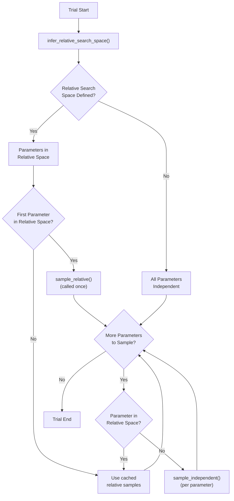
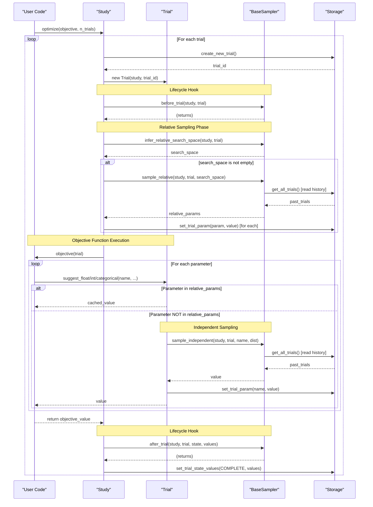
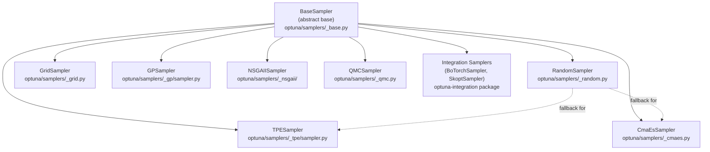

<!-- source: DeepWiki mcp.deepwiki.com · repo optuna/optuna · page 3.1 BaseSampler Interface and Sampling Strategies · fetched 2026-10-21 -->

# BaseSampler Interface and Sampling Strategies

<details>
<summary>Relevant source files</summary>

The following files were used as context for generating this wiki page:

- [docs/source/reference/integration.rst](docs/source/reference/integration.rst)
- [optuna/integration/botorch.py](optuna/integration/botorch.py)
- [optuna/integration/chainermn.py](optuna/integration/chainermn.py)
- [optuna/integration/sklearn.py](optuna/integration/sklearn.py)
- [optuna/samplers/_base.py](optuna/samplers/_base.py)
- [tests/samplers_tests/test_samplers.py](tests/samplers_tests/test_samplers.py)

</details>


## Purpose and Scope

This document describes the `BaseSampler` abstract class, which defines the interface that all sampling algorithms in Optuna must implement. It covers the distinction between **relative sampling** and **independent sampling**, the core sampling methods (`infer_relative_search_space`, `sample_relative`, `sample_independent`), lifecycle hooks (`before_trial`, `after_trial`, `reseed_rng`), and how samplers integrate with the optimization loop.

For documentation of specific sampler implementations, see:
- Tree-structured Parzen Estimator (TPE): [3.2](#3.2)
- Gaussian Process Sampler: [3.3](#3.3)
- CMA-ES Sampler: [3.4](#3.4)
- Other samplers (Random, Grid, integration samplers): [3.6](#3.6)

For information about how the Study orchestrates the optimization loop, see [2.1](#2.1).

---

## BaseSampler Abstract Class

The `BaseSampler` class is the base interface for all sampling algorithms in Optuna. It defines the contract that samplers must follow to suggest parameter values during optimization.

### Class Definition

```python
# Location: optuna/samplers/_base.py:31-236
class BaseSampler(abc.ABC):
    """Base class for samplers."""
```

All samplers in Optuna inherit from `BaseSampler` and must implement its abstract methods. The class provides both abstract methods that must be overridden and optional lifecycle hooks that can be overridden.

**Sources:** [optuna/samplers/_base.py:31-236]()

---

## Relative vs Independent Sampling

Optuna uses a dual sampling strategy that allows algorithms to leverage parameter relationships when beneficial while maintaining flexibility for dynamic search spaces.

### Sampling Strategy Overview



**Relative Sampling** (methods: `infer_relative_search_space`, `sample_relative`):
- Determines multiple parameter values **simultaneously**
- Allows algorithms to exploit correlations between parameters
- Called **once** at the beginning of a trial
- Used by algorithms like CMA-ES, Gaussian Process, multivariate TPE

**Independent Sampling** (method: `sample_independent`):
- Determines a **single** parameter value in isolation
- Does not consider relationships between parameters
- Called **per parameter** not in the relative search space
- Used by algorithms like random sampling, univariate TPE, GridSampler

**Sources:** [optuna/samplers/_base.py:31-62](), [optuna/samplers/_tpe/sampler.py:385-489]()

---

## Core Sampling Methods

### infer_relative_search_space

```python
# optuna/samplers/_base.py:68-93
@abc.abstractmethod
def infer_relative_search_space(
    study: Study, trial: FrozenTrial
) -> dict[str, BaseDistribution]:
```

**Purpose:** Determines which parameters will be sampled using `sample_relative` in the current trial.

**When Called:** Once at the beginning of each trial, before any parameter sampling occurs.

**Return Value:** A dictionary mapping parameter names to their distributions. Parameters not in this dictionary will be sampled independently.

**Implementation Patterns:**

| Sampler Type | Return Value | Reasoning |
|--------------|--------------|-----------|
| RandomSampler | Empty dict `{}` | All parameters sampled independently |
| TPESampler (univariate) | Empty dict `{}` | Each parameter sampled independently |
| TPESampler (multivariate) | Intersection search space | All parameters sampled jointly |
| CmaEsSampler | Intersection search space | Population-based algorithm requires joint sampling |
| GPSampler | Intersection search space | Gaussian Process models parameter correlations |

**Example from TPESampler:**

```python
# optuna/samplers/_tpe/sampler.py:385-412
def infer_relative_search_space(
    self, study: Study, trial: FrozenTrial
) -> dict[str, BaseDistribution]:
    if not self._multivariate:
        return {}  # Independent sampling only
    
    search_space: dict[str, BaseDistribution] = {}
    # Calculate intersection of search spaces across trials
    for name, distribution in self._search_space.calculate(study, use_trial_cache).items():
        if distribution.single():
            continue
        search_space[name] = distribution
    
    return search_space
```

**Sources:** [optuna/samplers/_base.py:68-93](), [optuna/samplers/_tpe/sampler.py:385-412]()

---

### sample_relative

```python
# optuna/samplers/_base.py:95-125
@abc.abstractmethod
def sample_relative(
    study: Study, trial: FrozenTrial, search_space: dict[str, BaseDistribution]
) -> dict[str, Any]:
```

**Purpose:** Samples values for multiple parameters simultaneously, exploiting relationships between them.

**When Called:** Once per trial, immediately after `infer_relative_search_space`, only if the search space is non-empty.

**Arguments:**
- `study`: The Study object containing trial history
- `trial`: The current trial being executed
- `search_space`: The dictionary returned by `infer_relative_search_space`

**Return Value:** Dictionary mapping parameter names to their sampled values.

**Key Characteristics:**
- Called exactly **once** per trial (if relative search space exists)
- All parameters in the search space must be returned
- Can access past trial data to inform sampling decisions
- Failed trials are typically ignored by built-in samplers

**Example from TPESampler:**

```python
# optuna/samplers/_tpe/sampler.py:414-439
def sample_relative(
    self, study: Study, trial: FrozenTrial, search_space: dict[str, BaseDistribution]
) -> dict[str, Any]:
    if search_space == {}:
        return {}
    
    # Get completed/pruned trials
    states = (TrialState.COMPLETE, TrialState.PRUNED)
    trials = study._get_trials(deepcopy=False, states=states, use_cache=True)
    
    # Check if enough trials for TPE
    if len(trials) < self._n_startup_trials:
        return {}  # Fall back to random sampling
    
    return self._sample(study, trial, search_space, use_trial_cache=True)
```

**Sources:** [optuna/samplers/_base.py:95-125](), [optuna/samplers/_tpe/sampler.py:414-453]()

---

### sample_independent

```python
# optuna/samplers/_base.py:127-163
@abc.abstractmethod
def sample_independent(
    study: Study,
    trial: FrozenTrial,
    param_name: str,
    param_distribution: BaseDistribution,
) -> Any:
```

**Purpose:** Samples a value for a single parameter without considering relationships with other parameters.

**When Called:** For each parameter **not** in the relative search space, during objective function execution when `trial.suggest_*()` is called.

**Arguments:**
- `study`: The Study object
- `trial`: The current trial
- `param_name`: Name of the parameter to sample
- `param_distribution`: The distribution for this parameter

**Return Value:** A single parameter value matching the distribution type.

**Key Characteristics:**
- Called **per parameter** not in relative search space
- Can be called multiple times per trial (for different parameters)
- Must handle dynamic search spaces (parameters appearing/disappearing across trials)
- Failed trials are typically ignored by built-in samplers

**Example from TPESampler:**

```python
# optuna/samplers/_tpe/sampler.py:455-489
def sample_independent(
    self,
    study: Study,
    trial: FrozenTrial,
    param_name: str,
    param_distribution: BaseDistribution,
) -> Any:
    states = (TrialState.COMPLETE, TrialState.PRUNED)
    trials = study._get_trials(deepcopy=False, states=states, use_cache=True)
    
    # If insufficient trials, delegate to random sampler
    if len(trials) < self._n_startup_trials:
        return self._random_sampler.sample_independent(
            study, trial, param_name, param_distribution
        )
    
    # Sample single parameter
    search_space = {param_name: param_distribution}
    return self._sample(study, trial, search_space, use_trial_cache=not self._constant_liar)[
        param_name
    ]
```

**Sources:** [optuna/samplers/_base.py:127-163](), [optuna/samplers/_tpe/sampler.py:455-489]()

---

## Lifecycle Hooks

### before_trial

```python
# optuna/samplers/_base.py:165-185
def before_trial(self, study: Study, trial: FrozenTrial) -> None:
```

**Purpose:** Performs pre-processing before the objective function is called.

**When Called:** After trial instantiation, **before** `infer_relative_search_space`.

**Use Cases:**
- Initialize per-trial state
- Validate study configuration
- Set up trial-specific resources
- Delegate to nested samplers (e.g., RandomSampler fallback)

**Example from TPESampler:**

```python
# optuna/samplers/_tpe/sampler.py:664-665
def before_trial(self, study: Study, trial: FrozenTrial) -> None:
    self._random_sampler.before_trial(study, trial)
```

**Sources:** [optuna/samplers/_base.py:165-185](), [optuna/samplers/_tpe/sampler.py:664-665]()

---

### after_trial

```python
# optuna/samplers/_base.py:187-216
def after_trial(
    self,
    study: Study,
    trial: FrozenTrial,
    state: TrialState,
    values: Sequence[float] | None,
) -> None:
```

**Purpose:** Performs post-processing after the objective function returns.

**When Called:** After objective function execution, **before** the trial state is stored.

**Arguments:**
- `state`: The resulting trial state (COMPLETE, PRUNED, or FAIL)
- `values`: The objective values (guaranteed non-None if state is COMPLETE)

**Use Cases:**
- Update sampler-internal state
- Process constraint functions
- Log trial outcomes
- Clean up trial-specific resources

**Example from TPESampler with Constraints:**

```python
# optuna/samplers/_tpe/sampler.py:667-677
def after_trial(
    self,
    study: Study,
    trial: FrozenTrial,
    state: TrialState,
    values: Sequence[float] | None,
) -> None:
    assert state in [TrialState.COMPLETE, TrialState.FAIL, TrialState.PRUNED]
    if self._constraints_func is not None:
        _process_constraints_after_trial(self._constraints_func, study, trial, state)
    self._random_sampler.after_trial(study, trial, state, values)
```

**Sources:** [optuna/samplers/_base.py:187-216](), [optuna/samplers/_tpe/sampler.py:667-677]()

---

### reseed_rng

```python
# optuna/samplers/_base.py:218-228
def reseed_rng(self) -> None:
```

**Purpose:** Reseeds the sampler's random number generator to prevent duplicate suggestions in parallel optimization.

**When Called:** By the Study when `n_jobs > 1` (parallel execution).

**Why Needed:** When trials run in parallel, sampler instances are replicated (pickled/unpickled), which copies the RNG state. Without reseeding, parallel workers would generate identical suggestions.

**Example from TPESampler:**

```python
# optuna/samplers/_tpe/sampler.py:381-383
def reseed_rng(self) -> None:
    self._rng.rng.seed()
    self._random_sampler.reseed_rng()
```

**Sources:** [optuna/samplers/_base.py:218-228](), [optuna/samplers/_tpe/sampler.py:381-383]()

---

## Sampling Workflow in Trial Execution

### Complete Sequence Diagram



**Key Observations:**

1. **before_trial** is called once before search space inference
2. **infer_relative_search_space** determines the sampling strategy
3. **sample_relative** is called at most once (if search space is non-empty)
4. **sample_independent** is called per parameter not in relative search space
5. **after_trial** is called once after objective function returns
6. Storage access patterns differ: relative sampling typically reads trial history once, independent sampling may read per parameter

**Sources:** [optuna/samplers/_base.py:31-236](), [optuna/samplers/_tpe/sampler.py:385-489]()

---

## Search Space Concepts

### IntersectionSearchSpace

Many samplers use `IntersectionSearchSpace` to compute the relative search space:

```python
# optuna/samplers/_tpe/sampler.py:355
self._search_space = IntersectionSearchSpace(include_pruned=True)
```

**Purpose:** Computes the intersection of search spaces across all trials. Only parameters that appear in **all** trials (with compatible distributions) are included.

**Why Needed:** Relative sampling algorithms (TPE multivariate, CMA-ES, GP) require a fixed set of parameters to model correlations. Dynamic parameters (appearing conditionally) cannot be included.

### Group Decomposed Search Space

TPESampler with `group=True` uses a more sophisticated approach:

```python
# optuna/samplers/_tpe/sampler.py:370
self._group_decomposed_search_space = _GroupDecomposedSearchSpace(True)
```

**Purpose:** Partitions the search space into independent subspaces where each subspace's parameters appear together consistently across trials.

**Use Case:** Handles conditional search spaces where parameters appear in groups (e.g., `x` and `y` always appear together, `z` and `w` always appear together, but the two groups never overlap).

**Sources:** [optuna/samplers/_tpe/sampler.py:355-370](), [optuna/search_space/group_decomposed.py:1-600]()

---

## Sampler Hierarchy

### Class Hierarchy Diagram



**Sampling Strategy by Sampler:**

| Sampler | Relative Sampling | Independent Sampling | Notes |
|---------|-------------------|----------------------|-------|
| RandomSampler | Never | Always | Baseline sampler |
| GridSampler | Always | Never | Exhaustive search |
| TPESampler (univariate) | Never | Always | Default mode |
| TPESampler (multivariate) | Always | Fallback only | `multivariate=True` |
| GPSampler | Always | Fallback only | Requires numeric parameters |
| CmaEsSampler | Always | Never | Evolution strategy |
| NSGAIISampler | Always | Never | Multi-objective genetic algorithm |
| QMCSampler | Always | Never | Quasi-random sequences |

**Sources:** [optuna/samplers/_base.py:31-236](), [optuna/samplers/_tpe/sampler.py:72-288]()

---

## Common Implementation Patterns

### Pattern 1: Delegating to RandomSampler

Many advanced samplers delegate to `RandomSampler` during the initial "warm-up" phase:

```python
# optuna/samplers/_tpe/sampler.py:349
self._random_sampler = RandomSampler(seed=seed)

# optuna/samplers/_tpe/sampler.py:466-469
if len(trials) < self._n_startup_trials:
    return self._random_sampler.sample_independent(
        study, trial, param_name, param_distribution
    )
```

**Why:** Advanced algorithms (TPE, GP, CMA-ES) require a minimum number of observations to build models. Random sampling provides diverse initial data.

### Pattern 2: Empty Relative Search Space

Samplers that only use independent sampling return an empty dictionary:

```python
# Simple pattern
def infer_relative_search_space(self, study: Study, trial: FrozenTrial) -> dict[str, BaseDistribution]:
    return {}
```

### Pattern 3: Trial State Filtering

Most samplers filter trials by state when reading history:

```python
# optuna/samplers/_tpe/sampler.py:447-448
states = (TrialState.COMPLETE, TrialState.PRUNED)
trials = study._get_trials(deepcopy=False, states=states, use_cache=True)
```

**Typical Pattern:**
- **COMPLETE** and **PRUNED**: Used for modeling (have objective values or intermediate values)
- **RUNNING**: Sometimes included with "constant liar" strategy to avoid duplicate suggestions
- **FAIL** and **WAITING**: Typically ignored

**Sources:** [optuna/samplers/_tpe/sampler.py:349-489](), [optuna/samplers/_random.py:1-200]()

---

## Independent Sampling Warning

When a sampler with `multivariate=True` falls back to independent sampling, it may emit a warning:

```python
# optuna/samplers/_base.py:21-28
_INDEPENDENT_SAMPLING_WARNING_TEMPLATE = (
    "The parameter `{param_name}` in Trial#{trial_number} is sampled independently "
    "using `{independent_sampler_name}` instead of `{sampler_name}`, potentially "
    "degrading the optimization performance. This fallback happend because "
    "{fallback_reason}. You can suppress this warning by setting "
    "`warn_independent_sampling` to `False` in the constructor of `{sampler_name}` if "
    "this independent sampling is intended behavior."
)
```

**Common Reasons for Independent Sampling:**
- Dynamic search space (parameters appearing conditionally)
- New parameter introduced mid-study
- Distribution incompatibility across trials
- Parameter excluded from intersection search space

**Example from TPESampler:**

```python
# optuna/samplers/_tpe/sampler.py:471-484
if self._warn_independent_sampling and self._multivariate:
    # Avoid independent warning at the first sampling of `param_name`.
    if any(param_name in trial.params for trial in trials):
        _logger.warning(
            _INDEPENDENT_SAMPLING_WARNING_TEMPLATE.format(
                param_name=param_name,
                trial_number=trial.number,
                independent_sampler_name=self._random_sampler.__class__.__name__,
                sampler_name=self.__class__.__name__,
                fallback_reason=(
                    "dynamic search space is not supported for `multivariate=True`"
                ),
            )
        )
```

**Sources:** [optuna/samplers/_base.py:21-28](), [optuna/samplers/_tpe/sampler.py:471-484]()

---

## Constraints Support

The `BaseSampler` provides infrastructure for constraint handling:

```python
# optuna/samplers/_base.py:238
_CONSTRAINTS_KEY = "constraints"

# optuna/samplers/_base.py:241-267
def _process_constraints_after_trial(
    constraints_func: Callable[[FrozenTrial], Sequence[float]],
    study: Study,
    trial: FrozenTrial,
    state: TrialState,
) -> None:
```

**Constraint Convention:**
- Constraints are evaluated via a user-provided function
- Return value is a sequence of floats
- **Feasible**: All values ≤ 0
- **Infeasible**: Any value > 0
- Stored in trial system attributes with key `"constraints"`

**Usage in Samplers:**

Samplers like TPESampler accept a `constraints_func` parameter and process constraints in `after_trial`:

```python
# optuna/samplers/_tpe/sampler.py:675-676
if self._constraints_func is not None:
    _process_constraints_after_trial(self._constraints_func, study, trial, state)
```

**Sources:** [optuna/samplers/_base.py:238-267](), [optuna/samplers/_tpe/sampler.py:357-380]()

---

## Code Entity Reference

### Key Classes and Files

| Entity | Location | Purpose |
|--------|----------|---------|
| `BaseSampler` | [optuna/samplers/_base.py:31-236]() | Abstract base class for all samplers |
| `infer_relative_search_space` | [optuna/samplers/_base.py:68-93]() | Abstract method for search space inference |
| `sample_relative` | [optuna/samplers/_base.py:95-125]() | Abstract method for joint parameter sampling |
| `sample_independent` | [optuna/samplers/_base.py:127-163]() | Abstract method for single parameter sampling |
| `before_trial` | [optuna/samplers/_base.py:165-185]() | Lifecycle hook (optional) |
| `after_trial` | [optuna/samplers/_base.py:187-216]() | Lifecycle hook (optional) |
| `reseed_rng` | [optuna/samplers/_base.py:218-228]() | RNG reseeding hook (optional) |
| `_CONSTRAINTS_KEY` | [optuna/samplers/_base.py:238]() | System attribute key for constraints |
| `_process_constraints_after_trial` | [optuna/samplers/_base.py:241-267]() | Helper for constraint processing |
| `_INDEPENDENT_SAMPLING_WARNING_TEMPLATE` | [optuna/samplers/_base.py:21-28]() | Warning message template |

### Sampler Implementations

| Sampler | File | Relative | Independent |
|---------|------|----------|-------------|
| RandomSampler | [optuna/samplers/_random.py]() | No | Yes |
| GridSampler | [optuna/samplers/_grid.py]() | Yes | No |
| TPESampler | [optuna/samplers/_tpe/sampler.py:72-678]() | Optional | Yes |
| GPSampler | [optuna/samplers/_gp/sampler.py]() | Yes | Fallback |
| CmaEsSampler | [optuna/samplers/_cmaes.py]() | Yes | No |
| NSGAIISampler | [optuna/samplers/_nsgaii/]() | Yes | No |
| QMCSampler | [optuna/samplers/_qmc.py]() | Yes | No |

**Sources:** [optuna/samplers/_base.py:1-267](), [optuna/samplers/_tpe/sampler.py:1-678]()

---

