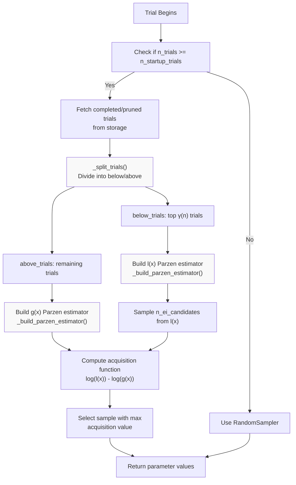
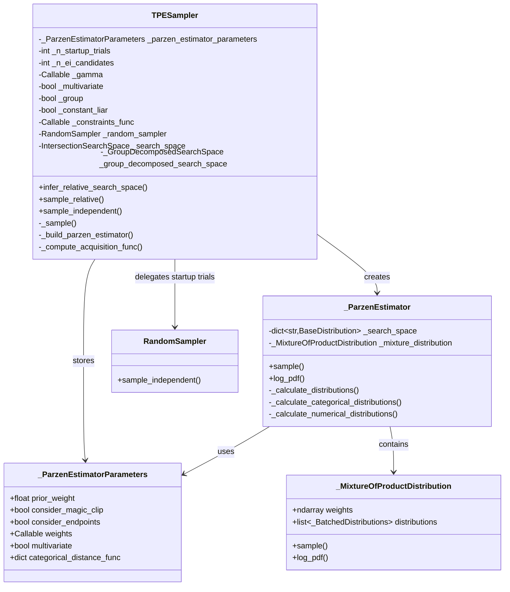
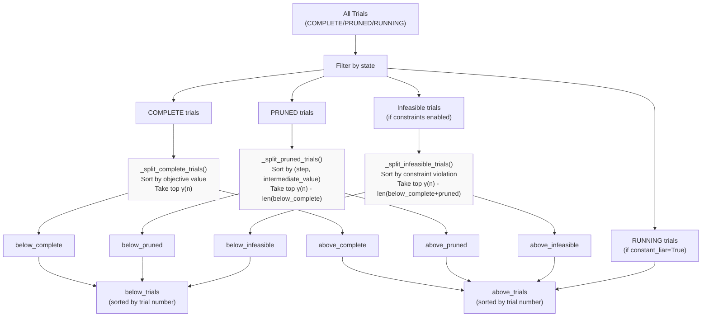
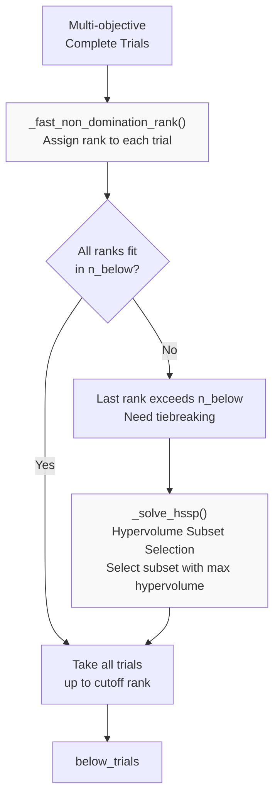
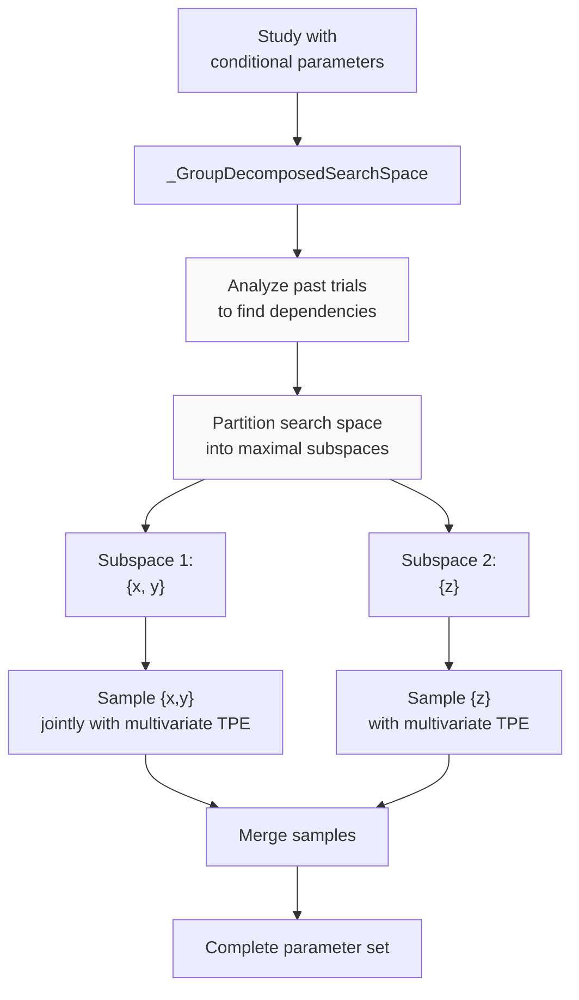

<!-- source: DeepWiki mcp.deepwiki.com · repo optuna/optuna · page 3.2 Tree-structured Parzen Estimator (TPE) · fetched 2026-10-21 -->

# Tree-structured Parzen Estimator (TPE)

<details>
<summary>Relevant source files</summary>

The following files were used as context for generating this wiki page:

- [optuna/samplers/_tpe/parzen_estimator.py](optuna/samplers/_tpe/parzen_estimator.py)
- [optuna/samplers/_tpe/sampler.py](optuna/samplers/_tpe/sampler.py)
- [tests/samplers_tests/tpe_tests/test_multi_objective_sampler.py](tests/samplers_tests/tpe_tests/test_multi_objective_sampler.py)
- [tests/samplers_tests/tpe_tests/test_parzen_estimator.py](tests/samplers_tests/tpe_tests/test_parzen_estimator.py)
- [tests/samplers_tests/tpe_tests/test_sampler.py](tests/samplers_tests/tpe_tests/test_sampler.py)

</details>


This page documents the Tree-structured Parzen Estimator (TPE) sampling algorithm, Optuna's default optimizer for single-objective optimization and a sophisticated option for multi-objective problems. TPE models the search space using Gaussian Mixture Models (GMMs) to iteratively propose promising parameter configurations.

For information about the base sampler interface and sampling strategies, see [BaseSampler Interface and Sampling Strategies](#3.1). For multi-objective optimization algorithms more broadly, see [Multi-Objective Optimization](#3.5).

## Overview

TPE is a sequential model-based optimization algorithm that maintains two Gaussian Mixture Models:
- **l(x)**: Models parameter values associated with good objective values (below trials)
- **g(x)**: Models parameter values associated with poor objective values (above trials)

On each trial, TPE samples from `l(x)` and selects the configuration that maximizes the acquisition function `l(x)/g(x)`, effectively favoring regions where good trials are dense and poor trials are sparse.

**Sources:** [optuna/samplers/_tpe/sampler.py:73-99]()

## Core Algorithm Flow



**Sources:** [optuna/samplers/_tpe/sampler.py:521-561]()

## Implementation Architecture

### Class Structure



**Sources:** [optuna/samplers/_tpe/sampler.py:72-384](), [optuna/samplers/_tpe/parzen_estimator.py:27-252]()

### Key Methods and Responsibilities

| Method | Class | Responsibility |
|--------|-------|----------------|
| `sample_relative()` | `TPESampler` | Samples multiple correlated parameters using multivariate TPE |
| `sample_independent()` | `TPESampler` | Samples a single parameter independently |
| `_sample()` | `TPESampler` | Core TPE logic: split trials, build estimators, compute acquisition |
| `_build_parzen_estimator()` | `TPESampler` | Constructs `_ParzenEstimator` from trial observations |
| `_split_trials()` | Module function | Divides trials into below/above based on objective values |
| `_calculate_distributions()` | `_ParzenEstimator` | Creates GMM kernels for a parameter |
| `sample()` | `_ParzenEstimator` | Generates candidate samples from the mixture model |
| `log_pdf()` | `_ParzenEstimator` | Evaluates log probability density |

**Sources:** [optuna/samplers/_tpe/sampler.py:414-619](), [optuna/samplers/_tpe/parzen_estimator.py:80-130]()

## Parzen Estimator Construction

The `_ParzenEstimator` class builds a Gaussian Mixture Model by placing a kernel at each observed parameter value, plus a prior kernel.

### GMM Construction Process


### Variance Calculation

For numerical parameters, kernel bandwidth (sigma) is computed based on parameter locality:

**Univariate Mode** (default):
```
sigma[i] = max(sorted_values[i+1] - sorted_values[i-1])
```
This ensures each kernel width spans to its neighboring observations.

**Multivariate Mode**:
```
sigma = 0.2 * n^(-1/(d+4)) * (high - low)
```
Where `n` is the number of observations and `d` is the search space dimensionality.

**Magic Clip**: When enabled, clamps sigma to `[range/min(100, n_kernels+1), range]` to prevent overly narrow or wide kernels.

**Sources:** [optuna/samplers/_tpe/parzen_estimator.py:168-232]()

### Distribution Types

| Distribution Type | Batched Implementation | Parameters |
|-------------------|------------------------|------------|
| `FloatDistribution` | `_BatchedTruncNormDistributions` | mu, sigma, low, high |
| `FloatDistribution(log=True)` | `_BatchedTruncLogNormDistributions` | mu, sigma, low, high |
| `FloatDistribution(step=x)` | `_BatchedDiscreteTruncNormDistributions` | mu, sigma, low, high, step |
| `IntDistribution` | `_BatchedDiscreteTruncNormDistributions` | mu, sigma, low, high, step=1 |
| `IntDistribution(log=True)` | `_BatchedDiscreteTruncLogNormDistributions` | mu, sigma, low, high, step=1 |
| `CategoricalDistribution` | `_BatchedCategoricalDistributions` | weights[n_kernels, n_choices] |

**Sources:** [optuna/samplers/_tpe/parzen_estimator.py:117-251]()

## Trial Splitting Strategy

The `_split_trials()` function divides completed trials into "below" (good) and "above" (poor) sets based on objective values and trial states.



### Gamma Function

The `gamma` parameter controls how many trials form the "below" group. Default implementations:

- **Optuna default**: `gamma(n) = min(ceil(0.1 * n), 25)`
- **Hyperopt default**: `gamma(n) = min(ceil(0.25 * sqrt(n)), 25)`

**Sources:** [optuna/samplers/_tpe/sampler.py:53-58](), [optuna/samplers/_tpe/sampler.py:687-823]()

### Pruned Trial Scoring

Pruned trials are ranked by their last intermediate value and the step at which they were pruned:

```
score = (-step, intermediate_value)  # if direction=minimize
score = (-step, -intermediate_value) # if direction=maximize
```

Earlier pruning indicates worse performance, so trials are sorted with step priority.

**Sources:** [optuna/samplers/_tpe/sampler.py:783-801]()

## Multi-Objective TPE (MOTPE)

For multi-objective optimization, TPE uses non-dominated sorting and hypervolume contribution to weight trials in the "below" group.

### Below Trial Selection



### Hypervolume-Based Weighting

For trials in the "below" group, weights are computed based on hypervolume contribution:

```
weight[i] = max(contrib[i] / max(contribs), EPS)
```

Where `contrib[i]` is the hypervolume lost by removing trial `i` from the Pareto front.

**Algorithm**:
1. Compute reference point: `ref = max(1.1 * worst, 0.9 * worst)`
2. Identify Pareto front trials using `_is_pareto_front()`
3. For each Pareto trial, compute leave-one-out hypervolume
4. Contribution = `HV(all) - HV(all \ {trial_i})`
5. Normalize weights and assign `EPS` to non-Pareto trials

For objectives > 3, an approximation is used to avoid computational cost.

**Sources:** [optuna/samplers/_tpe/sampler.py:825-864](), [optuna/samplers/_tpe/sampler.py:746-780]()

## Multivariate and Group Sampling

### Multivariate TPE

When `multivariate=True`, TPE models the joint distribution of parameters rather than treating them independently. This captures correlations between parameters.

**Differences from Independent TPE**:
- Uses `sample_relative()` to suggest all parameters at once
- Computes sigma based on dimensionality: `sigma = 0.2 * n^(-1/(d+4)) * (high - low)`
- Returns empty dict from `infer_relative_search_space()` when disabled

**Sources:** [optuna/samplers/_tpe/sampler.py:385-412](), [optuna/samplers/_tpe/parzen_estimator.py:186-194]()

### Group Decomposition

When `group=True` (requires `multivariate=True`), the search space is decomposed into independent subspaces based on conditional dependencies.



**Decomposition Logic**: A subspace is maximal if, for each completed trial, the intersection of the subspace with the trial's search space equals either the subspace itself or the empty set. This ensures parameters are only grouped if they consistently appear together.

**Sources:** [optuna/samplers/_tpe/sampler.py:394-426](), [optuna/search_space/group_decomposed.py]()

## Special Features

### Constant Liar Strategy

When `constant_liar=True`, running trials are included in the "above" group to discourage parallel workers from sampling nearby configurations.

**Mechanism**:
1. Include `RUNNING` trials in `_split_trials()` states
2. Place all running trials in the "above" group
3. Store sampled parameters in trial system attributes for other workers to access

**Use Case**: Distributed optimization where multiple workers run simultaneously and objective evaluations are expensive.

**Sources:** [optuna/samplers/_tpe/sampler.py:528-539](), [optuna/samplers/_tpe/sampler.py:430-439]()

### Constraint Handling

When `constraints_func` is provided, infeasible trials (constraint violation > 0) are handled specially:

1. Infeasible trials are separated during splitting
2. Sorted by total constraint violation: `sum(v for v in constraints if v > 0)`
3. Assigned weight `EPS` in multi-objective below group weighting
4. Constraints evaluated via `_process_constraints_after_trial()` in `after_trial()`

**Sources:** [optuna/samplers/_tpe/sampler.py:700-716](), [optuna/samplers/_tpe/sampler.py:804-823]()

### Categorical Distance Function

The `categorical_distance_func` parameter allows users to provide domain knowledge about relationships between categorical choices.

**Default Behavior**: All categories treated equally (discrete distribution).

**With Distance Function**:
```python
categorical_distance_func = {
    "optimizer": lambda x, y: {"adam": 0, "sgd": 1, "rmsprop": 2}[x] - ...
}
```

Weights are computed using:
```
weight[choice] = exp(-((dist[choice] / max_dist)^2) * coef)
```

Where `coef = log(n_kernels/prior_weight) * log(n_choices) / log(6)`.

**Sources:** [optuna/samplers/_tpe/parzen_estimator.py:152-162]()

## Configuration Parameters

| Parameter | Type | Default | Description |
|-----------|------|---------|-------------|
| `consider_prior` | `bool` | `True` | Always `True` as of v4.3.0 (deprecated parameter) |
| `prior_weight` | `float` | `1.0` | Weight of the prior kernel in GMM |
| `consider_magic_clip` | `bool` | `True` | Clamp kernel widths to prevent extreme values |
| `consider_endpoints` | `bool` | `False` | Include domain endpoints in sigma calculation |
| `n_startup_trials` | `int` | `10` | Use random sampling for first N trials |
| `n_ei_candidates` | `int` | `24` | Number of candidates to sample from `l(x)` |
| `gamma` | `Callable` | `default_gamma` | Function to compute number of below trials |
| `weights` | `Callable` | `default_weights` | Function to compute kernel weights |
| `seed` | `int \| None` | `None` | Random seed for reproducibility |
| `multivariate` | `bool` | `False` | Enable multivariate TPE |
| `group` | `bool` | `False` | Enable group-decomposed multivariate TPE |
| `warn_independent_sampling` | `bool` | `True` | Warn when falling back to independent sampling |
| `constant_liar` | `bool` | `False` | Penalize running trials for distributed optimization |
| `constraints_func` | `Callable \| None` | `None` | Function to compute constraint violations |
| `categorical_distance_func` | `dict \| None` | `None` | Distance functions for categorical parameters |

**Sources:** [optuna/samplers/_tpe/sampler.py:289-379]()

### Default Weight Function

```python
def default_weights(x: int) -> np.ndarray:
    if x == 0:
        return np.asarray([])
    elif x < 25:
        return np.ones(x)
    else:
        ramp = np.linspace(1.0 / x, 1.0, num=x - 25)
        flat = np.ones(25)
        return np.concatenate([ramp, flat], axis=0)
```

This gives recent observations higher weight while maintaining some influence from older trials.

**Sources:** [optuna/samplers/_tpe/sampler.py:61-69]()

## Hyperopt Compatibility

TPE originates from the Hyperopt library. Optuna provides a `hyperopt_parameters()` static method to replicate Hyperopt's default configuration:

```python
TPESampler.hyperopt_parameters() == {
    "consider_prior": True,
    "prior_weight": 1.0,
    "consider_magic_clip": True,
    "consider_endpoints": False,
    "n_startup_trials": 20,
    "n_ei_candidates": 24,
    "gamma": hyperopt_default_gamma,
    "weights": default_weights,
}
```

The main difference: `n_startup_trials=20` (vs. Optuna's default of 10) and `gamma` uses the square-root formula.

**Sources:** [optuna/samplers/_tpe/sampler.py:622-662]()

## Performance Optimizations

1. **Trial Caching**: The `use_trial_cache` parameter controls whether to use cached trial data, reducing storage queries.

2. **Relative Params Storage**: When `constant_liar=True` and `multivariate=True`, sampled parameters are stored in trial system attributes (chunked to respect 2046 character limit) for access by parallel workers.

3. **Fast Non-Domination Rank**: Multi-objective splitting uses optimized non-dominated sorting with early termination at rank boundaries.

4. **LRU Cache for HSSP**: The `_solve_hssp_with_cache()` function uses `@lru_cache` to avoid recomputing hypervolume subset selections for identical trial sets.

**Sources:** [optuna/samplers/_tpe/sampler.py:430-439](), [optuna/samplers/_tpe/sampler.py:769-775]()

---

