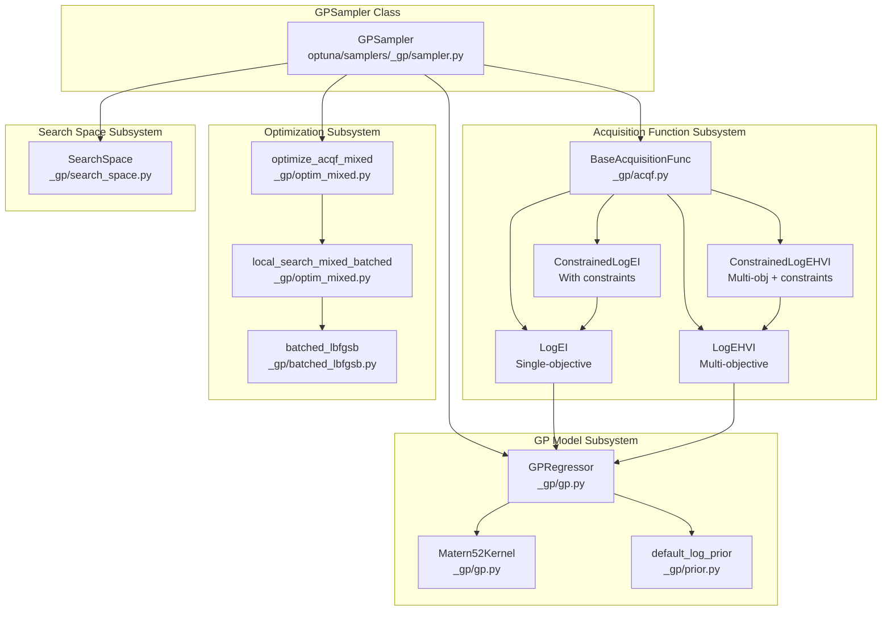
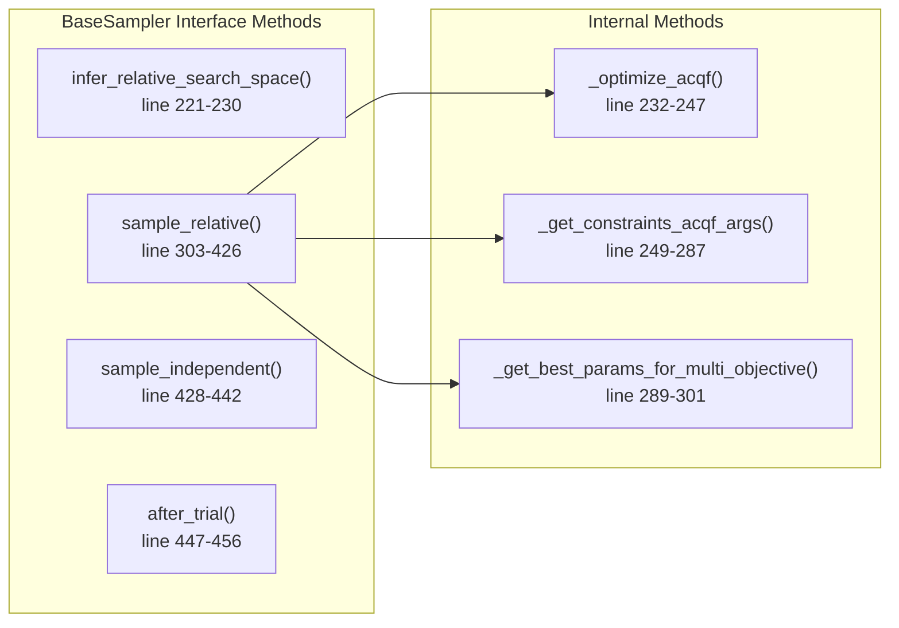
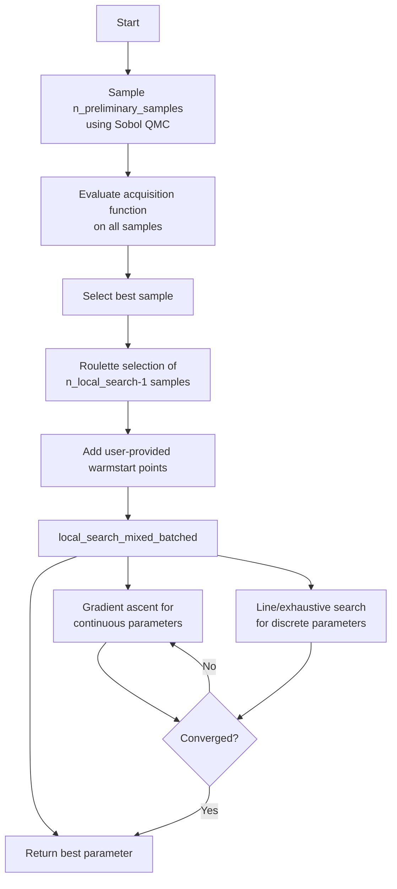
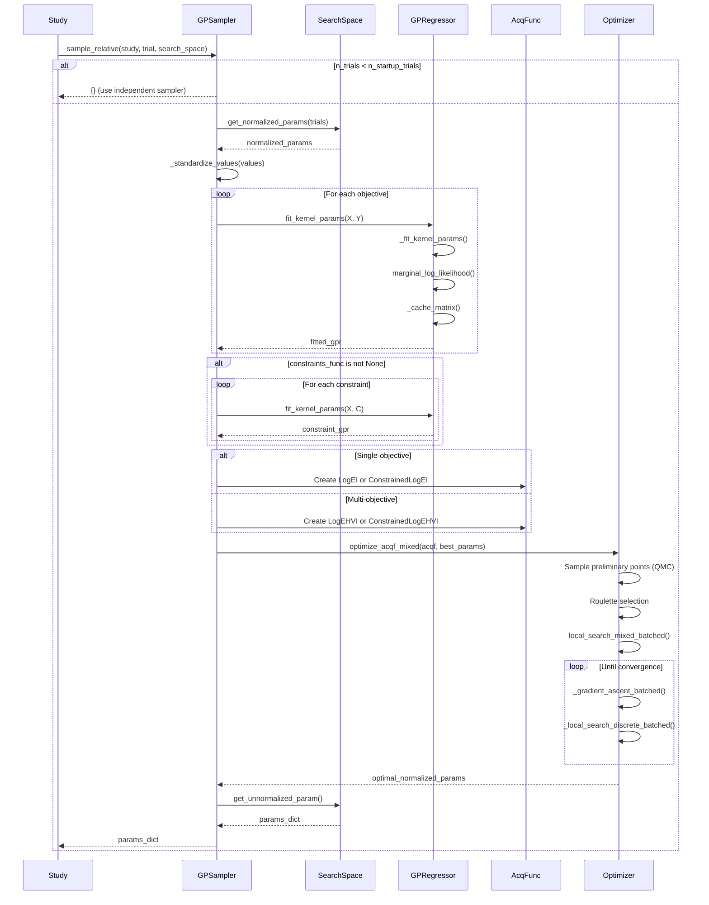

<!-- source: DeepWiki mcp.deepwiki.com · repo optuna/optuna · page 3.3 Gaussian Process Sampler · fetched 2026-10-21 -->

# Gaussian Process Sampler

<details>
<summary>Relevant source files</summary>

The following files were used as context for generating this wiki page:

- [optuna/_gp/acqf.py](optuna/_gp/acqf.py)
- [optuna/_gp/batched_lbfgsb.py](optuna/_gp/batched_lbfgsb.py)
- [optuna/_gp/gp.py](optuna/_gp/gp.py)
- [optuna/_gp/optim_mixed.py](optuna/_gp/optim_mixed.py)
- [optuna/_gp/optim_sample.py](optuna/_gp/optim_sample.py)
- [optuna/_gp/prior.py](optuna/_gp/prior.py)
- [optuna/_gp/search_space.py](optuna/_gp/search_space.py)
- [optuna/samplers/_gp/sampler.py](optuna/samplers/_gp/sampler.py)
- [optuna/terminator/improvement/emmr.py](optuna/terminator/improvement/emmr.py)
- [optuna/terminator/improvement/evaluator.py](optuna/terminator/improvement/evaluator.py)
- [tests/gp_tests/test_acqf.py](tests/gp_tests/test_acqf.py)
- [tests/gp_tests/test_batched_lbfgsb.py](tests/gp_tests/test_batched_lbfgsb.py)
- [tests/gp_tests/test_gp.py](tests/gp_tests/test_gp.py)
- [tests/gp_tests/test_search_space.py](tests/gp_tests/test_search_space.py)
- [tests/samplers_tests/test_gp.py](tests/samplers_tests/test_gp.py)

</details>


## Purpose and Scope

This document describes the Gaussian Process (GP) based Bayesian optimization sampler implementation in Optuna. The GPSampler uses a Gaussian process as a surrogate model of the objective function and optimizes an acquisition function to suggest the next set of parameters. This document covers the GP model, acquisition functions, optimization algorithms, and the complete sampling workflow.

For information about the BaseSampler interface that GPSampler implements, see [BaseSampler Interface and Sampling Strategies](#3.1). For multi-objective optimization specifics including NSGA-II/III, see [Multi-Objective Optimization](#3.5). For the Tree-structured Parzen Estimator (TPE) sampler, an alternative Bayesian optimization approach, see [Tree-structured Parzen Estimator](#3.2).

---

## Architecture Overview

The GPSampler consists of four main subsystems:

1. **GP Model** (`GPRegressor`): Fits a Gaussian process to past trial data
2. **Acquisition Functions**: Compute expected utility of candidate parameters
3. **Mixed Optimization**: Optimizes acquisition functions over continuous and discrete parameters
4. **Search Space Management**: Normalizes and transforms parameters



**Sources:** [optuna/samplers/_gp/sampler.py:1-474](), [optuna/_gp/gp.py:1-374](), [optuna/_gp/acqf.py:1-316](), [optuna/_gp/optim_mixed.py:1-330]()

---

## GPSampler Class

The `GPSampler` class at [optuna/samplers/_gp/sampler.py:62-457]() is the main entry point implementing the `BaseSampler` interface.

### Key Attributes

| Attribute | Type | Purpose |
|-----------|------|---------|
| `_rng` | `LazyRandomState` | Random number generator |
| `_independent_sampler` | `BaseSampler` | Fallback sampler for startup trials |
| `_n_startup_trials` | `int` | Number of random trials before GP fitting (default: 10) |
| `_deterministic` | `bool` | Whether objective is deterministic |
| `_constraints_func` | `Callable` | Optional constraint function |
| `_gprs_cache_list` | `list[GPRegressor]` | Cached GP models for objectives |
| `_constraints_gprs_cache_list` | `list[GPRegressor]` | Cached GP models for constraints |
| `_n_preliminary_samples` | `int` | QMC samples for acquisition optimization (default: 2048) |
| `_n_local_search` | `int` | Number of local search starting points (default: 10) |

**Sources:** [optuna/samplers/_gp/sampler.py:174-206]()

### Main Methods



**Sources:** [optuna/samplers/_gp/sampler.py:221-456]()

---

## Gaussian Process Model

### GPRegressor Class

The `GPRegressor` class at [optuna/_gp/gp.py:93-316]() implements the Gaussian process surrogate model.

#### Initialization Parameters

| Parameter | Type | Description |
|-----------|------|-------------|
| `is_categorical` | `torch.Tensor` | Boolean mask for categorical parameters |
| `X_train` | `torch.Tensor` | Training parameter values (normalized) |
| `y_train` | `torch.Tensor` | Training objective values (standardized) |
| `inverse_squared_lengthscales` | `torch.Tensor` | Kernel lengthscale parameters (1/l²) |
| `kernel_scale` | `torch.Tensor` | Kernel amplitude parameter |
| `noise_var` | `torch.Tensor` | Observation noise variance |

**Sources:** [optuna/_gp/gp.py:94-116]()

### Matern 5/2 Kernel

The kernel function at [optuna/_gp/gp.py:149-177]() computes:

```
k(x₁, x₂) = kernel_scale × exp(-√5d) × (1 + √5d + 5d²/3)
```

where `d² = Σᵢ (x₁ᵢ - x₂ᵢ)² × inverse_squared_lengthscales[i]`.

For categorical parameters, the squared difference is replaced with the Hamming distance: `(x₁ᵢ ≠ x₂ᵢ)`.

The `Matern52Kernel` class at [optuna/_gp/gp.py:63-91]() implements custom forward/backward passes for numerical stability at `squared_distance = 0`.

**Sources:** [optuna/_gp/gp.py:63-177]()

### Hyperparameter Optimization

The `_fit_kernel_params` method at [optuna/_gp/gp.py:251-315]() optimizes kernel hyperparameters by maximizing the marginal log-likelihood:

```
log p(y|X, θ) = -½ log|C| - ½ yᵀC⁻¹y - N/2 log(2π)
```

where `C = K(X,X) + noise_var × I` and `θ = {lengthscales, kernel_scale, noise_var}`.

**Optimization Process:**

1. Apply log transform to enforce positivity: `raw_params = log(θ)`
2. Minimize negative log-likelihood using L-BFGS-B at [optuna/_gp/gp.py:295-302]()
3. Add prior regularization from [optuna/_gp/prior.py:19-33]()
4. Cache Cholesky decomposition for posterior inference at [optuna/_gp/gp.py:122-147]()

**Sources:** [optuna/_gp/gp.py:216-315](), [optuna/_gp/prior.py:1-34]()

### Posterior Inference

The `posterior` method at [optuna/_gp/gp.py:179-214]() computes the predictive distribution:

```
μ(x) = k(x, X)ᵀ C⁻¹ y
σ²(x) = k(x, x) - k(x, X)ᵀ C⁻¹ k(x, X)
```

using the cached Cholesky factorization `C = LLᵀ`.

**Sources:** [optuna/_gp/gp.py:179-214]()

---

## Acquisition Functions

All acquisition functions inherit from `BaseAcquisitionFunc` at [optuna/_gp/acqf.py:95-114]().

### Single-Objective: LogEI

The `LogEI` class at [optuna/_gp/acqf.py:116-137]() implements log expected improvement:

```
logEI(x) = log E[max(0, f(x) - f_best)]
```

where the expectation is over the GP posterior. The implementation uses the numerically stable formulation from [Ament et al. (2023)](https://arxiv.org/abs/2310.20708).

The `standard_logei` function at [optuna/_gp/acqf.py:65-87]() computes:

```
logEI(z) = log(z × Φ(z) + φ(z))
```

where `z = (μ(x) - f_best) / σ(x)`, `Φ` is the standard normal CDF, and `φ` is the PDF.

**Sources:** [optuna/_gp/acqf.py:65-137]()

### Multi-Objective: LogEHVI

The `LogEHVI` class at [optuna/_gp/acqf.py:223-278]() implements log expected hypervolume improvement using quasi-Monte Carlo integration:

```
logEHVI(x) = log E[HVI(x)] ≈ log(1/M Σₘ HVI(f(x) + εₘ))
```

where `εₘ ~ N(0, Σ(x))` are sampled from a Sobol sequence at [optuna/_gp/acqf.py:33-42]().

The `logehvi` function at [optuna/_gp/acqf.py:45-62]() computes the log hypervolume improvement by:

1. Partitioning non-dominated space into boxes
2. Computing volume contributions for each box
3. Aggregating via log-sum-exp for numerical stability

**Sources:** [optuna/_gp/acqf.py:33-62](), [optuna/_gp/acqf.py:223-278]()

### Constrained Optimization

#### ConstrainedLogEI

The `ConstrainedLogEI` class at [optuna/_gp/acqf.py:195-220]() combines objective and constraint acquisition:

```
acqf(x) = logEI(x) + Σᵢ logPI_i(x)
```

where `logPI_i(x) = log P(cᵢ(x) ≤ 0)` is the log probability of satisfying constraint `i`.

**Sources:** [optuna/_gp/acqf.py:195-220]()

#### ConstrainedLogEHVI

The `ConstrainedLogEHVI` class at [optuna/_gp/acqf.py:281-315]() extends EHVI with constraints:

```
acqf(x) = logEHVI(x) + Σᵢ logPI_i(x)
```

When all trials are infeasible, only the constraint satisfaction is optimized.

**Sources:** [optuna/_gp/acqf.py:281-315]()

---

## Acquisition Function Optimization

### Mixed Optimization Strategy

The `optimize_acqf_mixed` function at [optuna/_gp/optim_mixed.py:280-329]() optimizes acquisition functions over mixed search spaces:



**Sources:** [optuna/_gp/optim_mixed.py:280-329]()

### Local Search

The `local_search_mixed_batched` function at [optuna/_gp/optim_mixed.py:232-277]() alternates between:

1. **Continuous optimization** via `_gradient_ascent_batched` at [optuna/_gp/optim_mixed.py:29-94]()
2. **Discrete optimization** via `_local_search_discrete_batched` at [optuna/_gp/optim_mixed.py:208-229]()

#### Gradient Ascent with Preconditioning

The gradient ascent applies preconditioning by scaling parameters by lengthscales:

```
z = x / l  where l = lengthscales
```

This equalizes variance across dimensions and improves convergence. The optimization domain becomes `[0, 1/l]` instead of `[0, 1]`.

**Sources:** [optuna/_gp/optim_mixed.py:29-94]()

#### Discrete Parameter Optimization

For discrete parameters, the optimization strategy at [optuna/_gp/optim_mixed.py:189-206]() depends on the number of choices:

| Condition | Method | Implementation |
|-----------|--------|----------------|
| ≤ 16 choices OR categorical | Exhaustive search | `_exhaustive_search` at [line 97-118]() |
| > 16 choices AND integer | Line search with interpolation | `_discrete_line_search` at [line 121-186]() |

**Sources:** [optuna/_gp/optim_mixed.py:97-229]()

### Batched L-BFGS-B

The `batched_lbfgsb` function at [optuna/_gp/batched_lbfgsb.py:89-168]() performs multiple L-BFGS-B optimizations simultaneously:

**With greenlet (parallel execution):**
- Uses coroutines to interleave multiple optimizations at [optuna/_gp/batched_lbfgsb.py:34-86]()
- Batches gradient evaluations for efficiency
- Falls back to sequential if greenlet unavailable

**Sequential fallback:**
- Runs L-BFGS-B for each starting point sequentially at [optuna/_gp/batched_lbfgsb.py:141-167]()

**Sources:** [optuna/_gp/batched_lbfgsb.py:1-169]()

---

## Search Space Management

### SearchSpace Class

The `SearchSpace` class at [optuna/_gp/search_space.py:36-110]() handles parameter transformations:

```mermaid
graph LR
    subgraph "Parameter Types"
        Float[FloatDistribution]
        Int[IntDistribution]
        Cat[CategoricalDistribution]
    end
    
    subgraph "Scale Types"
        Linear[LINEAR]
        Log[LOG]
        Categorical[CATEGORICAL]
    end
    
    subgraph "Normalization"
        Normalize[Normalize to [0,1]]
        Denormalize[Denormalize]
    end
    
    Float --> Linear
    Float --> Log
    Int --> Linear
    Int --> Log
    Cat --> Categorical
    
    Linear --> Normalize
    Log --> Normalize
    Categorical --> Normalize
    
    Normalize --> GPModel[GP Model]
    GPModel --> Denormalize
```

**Sources:** [optuna/_gp/search_space.py:30-110]()

### Normalization Functions

**`_normalize_one_param`** at [optuna/_gp/search_space.py:127-140]():

For linear scale:
```
normalized = (value - low) / (high - low)
```

For log scale:
```
normalized = (log(value) - log(low)) / (log(high) - log(low))
```

For categorical:
```
normalized = category_index
```

**`_unnormalize_one_param`** at [optuna/_gp/search_space.py:112-124]() performs the inverse transformation.

**Sources:** [optuna/_gp/search_space.py:112-140]()

### Sampling

The `sample_normalized_params` method at [optuna/_gp/search_space.py:87-90]() wraps `_sample_normalized_params` at [line 160-183]() which uses Sobol quasi-random sampling:

1. Generate Sobol sequence in `[0,1]^d`
2. Round integer parameters to nearest grid point
3. Sample categorical uniformly from choices

**Sources:** [optuna/_gp/search_space.py:160-183]()

---

## Complete Sampling Workflow



**Sources:** [optuna/samplers/_gp/sampler.py:303-426]()

---

## Data Standardization and Caching

### Value Standardization

The `_standardize_values` function at [optuna/samplers/_gp/sampler.py:53-58]() standardizes objective and constraint values:

```
standardized = (values - mean) / max(std, EPS)
```

This prevents numerical issues in GP fitting and ensures comparable scales across objectives.

**Sources:** [optuna/samplers/_gp/sampler.py:53-58]()

### GP Model Caching

The GPSampler caches fitted GP models in:
- `_gprs_cache_list`: Objective function GPs at [line 192]()
- `_constraints_gprs_cache_list`: Constraint function GPs at [line 193]()

Caching provides warm-start hyperparameters for the next trial, speeding up optimization. The cache is cleared when the search space changes at [lines 258-263]() and [lines 324-329]().

**Sources:** [optuna/samplers/_gp/sampler.py:192-193](), [optuna/samplers/_gp/sampler.py:258-263](), [optuna/samplers/_gp/sampler.py:324-329]()

---

## Configuration Parameters

### GPSampler Constructor

| Parameter | Default | Description |
|-----------|---------|-------------|
| `seed` | `None` | Random seed |
| `independent_sampler` | `RandomSampler` | Sampler for startup trials |
| `n_startup_trials` | `10` | Number of random trials before GP fitting |
| `deterministic_objective` | `False` | Fix noise variance to minimum value |
| `constraints_func` | `None` | Constraint evaluation function |
| `warn_independent_sampling` | `True` | Warn when falling back to independent sampling |

**Sources:** [optuna/samplers/_gp/sampler.py:174-196]()

### Internal Control Parameters

| Parameter | Value | Purpose |
|-----------|-------|---------|
| `_n_preliminary_samples` | `2048` | Number of QMC samples for initialization |
| `_n_local_search` | `10` | Number of local search starting points |
| `_tol` | `1e-4` | Convergence tolerance for local search |
| `_log_prior` | `default_log_prior` | Prior for kernel hyperparameters |
| `_minimum_noise` | `1e-6` | Minimum noise variance |

**Sources:** [optuna/samplers/_gp/sampler.py:188-205]()

---

## Constraint Handling

### Constraints Function

The `constraints_func` parameter accepts a callable that takes a `FrozenTrial` and returns a sequence of constraint values. A constraint is violated if its value is strictly positive.

```python
def constraints_func(trial: FrozenTrial) -> Sequence[float]:
    # Return constraint values
    # c <= 0 is feasible
    # c > 0 is infeasible
    return [c1, c2, ...]
```

**Sources:** [optuna/samplers/_gp/sampler.py:155-162]()

### Constraint Processing

The `after_trial` method at [optuna/samplers/_gp/sampler.py:447-456]() calls `_process_constraints_after_trial` to evaluate and store constraints in trial system attributes under the key `_CONSTRAINTS_KEY`.

The `_get_constraint_vals_and_feasibility` function at [optuna/samplers/_gp/sampler.py:459-473]() retrieves constraint values and computes feasibility:

```python
is_feasible = np.all(constraint_vals <= 0, axis=1)
```

**Sources:** [optuna/samplers/_gp/sampler.py:447-473]()

### Constraint Acquisition Functions

Constraints are incorporated by fitting separate GP models at [optuna/samplers/_gp/sampler.py:266-286]() and using `LogPI` (log probability of improvement) acquisition functions at [optuna/_gp/acqf.py:140-160]():

```
logPI(x) = log P(c(x) <= threshold)
         = log Φ((μ(x) - threshold) / σ(x))
```

where `Φ` is the standard normal CDF.

**Sources:** [optuna/samplers/_gp/sampler.py:249-287](), [optuna/_gp/acqf.py:140-160]()

---

## Handling Infinite Values

The `warn_and_convert_inf` function at [optuna/_gp/gp.py:47-60]() handles infinite objective values by clipping them to the min/max finite values:

```python
clipped_values = np.clip(
    values,
    np.min(finite_values, axis=0),
    np.max(finite_values, axis=0)
)
```

This prevents numerical issues in GP fitting when the objective function returns infinity (e.g., due to constraint violations or numerical errors).

**Sources:** [optuna/_gp/gp.py:47-60]()

---

## Integration with Study

The GPSampler integrates with Optuna's study system through the standard sampler interface:

1. **`infer_relative_search_space`** at [line 221-230](): Returns parameters that can be sampled jointly using the GP model
2. **`sample_relative`** at [line 303-426](): Suggests parameters using GP-based optimization
3. **`sample_independent`** at [line 428-442](): Falls back to independent sampler for dynamic parameters
4. **`after_trial`** at [line 447-456](): Processes constraints after trial completion

When the search space is dynamic (changes between trials), GPSampler logs a warning and falls back to the independent sampler at [line 207-215]().

**Sources:** [optuna/samplers/_gp/sampler.py:207-456]()

---

## Testing and Validation

The test suite validates:

1. **GP model fitting**: [tests/gp_tests/test_gp.py:57-107]() verifies hyperparameter optimization
2. **Acquisition functions**: [tests/gp_tests/test_acqf.py:60-143]() checks gradient computation
3. **Batched optimization**: [tests/gp_tests/test_batched_lbfgsb.py:82-119]() compares against scipy
4. **Search space transformations**: [tests/gp_tests/test_search_space.py:15-196]() validates normalization
5. **Constraint handling**: [tests/samplers_tests/test_gp.py:52-115]() tests constraint integration
6. **Convergence behavior**: [tests/samplers_tests/test_gp.py:23-49]() checks numerical stability

**Sources:** [tests/gp_tests/test_gp.py:1-143](), [tests/gp_tests/test_acqf.py:1-144](), [tests/gp_tests/test_batched_lbfgsb.py:1-154](), [tests/gp_tests/test_search_space.py:1-197](), [tests/samplers_tests/test_gp.py:1-130]()

---

