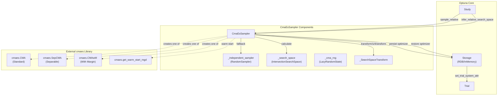
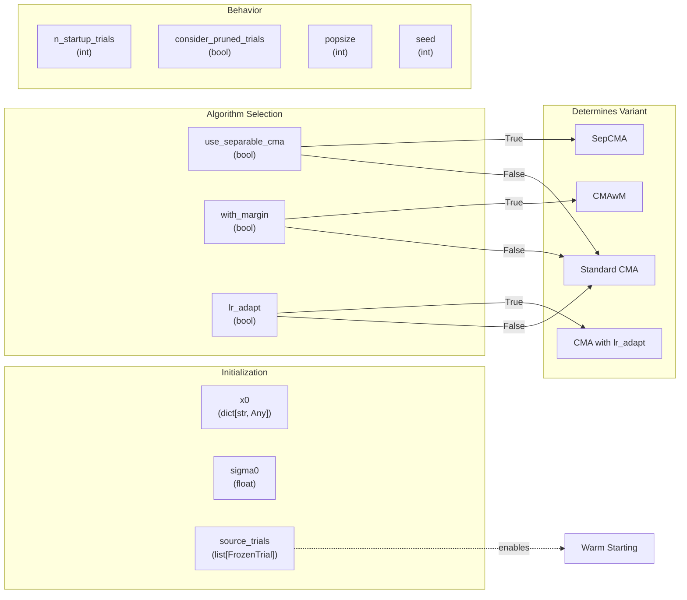
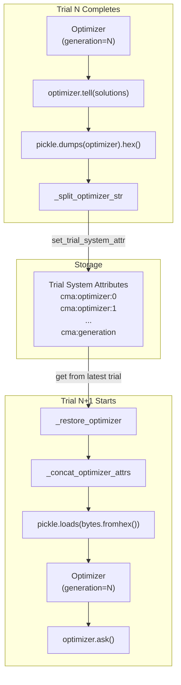
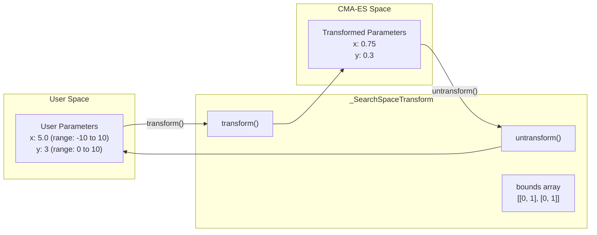
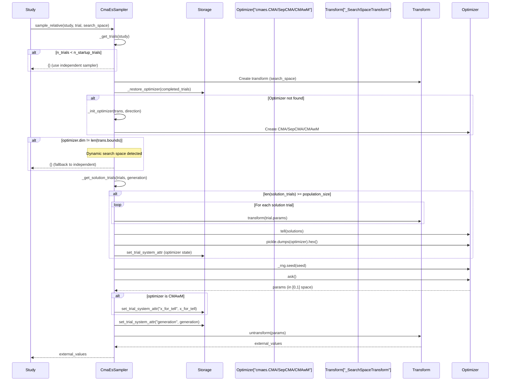
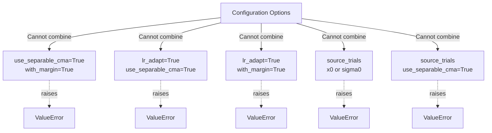

<!-- source: DeepWiki mcp.deepwiki.com · repo optuna/optuna · page 3.4 CMA-ES Sampler · fetched 2026-10-21 -->

# CMA-ES Sampler

<details>
<summary>Relevant source files</summary>

The following files were used as context for generating this wiki page:

- [optuna/integration/cma.py](optuna/integration/cma.py)
- [optuna/samplers/_cmaes.py](optuna/samplers/_cmaes.py)
- [tests/samplers_tests/test_cmaes.py](tests/samplers_tests/test_cmaes.py)

</details>


## Purpose and Scope

This page documents the **CmaEsSampler**, an evolutionary optimization algorithm implementation in Optuna. The sampler uses the Covariance Matrix Adaptation Evolution Strategy (CMA-ES) algorithm via the external `cmaes` library to suggest parameter values during hyperparameter optimization.

This page covers the sampler's architecture, state management, parameter transformation, and three algorithmic variants (standard CMA, SepCMA, and CMAwM). For information about the base sampler interface and sampling strategies, see [BaseSampler Interface](#3.1). For other evolutionary algorithms like NSGA-II/III, see [Multi-Objective Optimization](#3.5).

**Sources:** [optuna/samplers/_cmaes.py:47-246]()

---

## Overview

CMA-ES (Covariance Matrix Adaptation Evolution Strategy) is a population-based evolutionary algorithm that maintains and adapts a multivariate Gaussian distribution to model promising regions of the search space. The algorithm iteratively samples a population of candidate solutions, evaluates them, and updates the distribution's mean vector and covariance matrix based on the best-performing solutions.

The `CmaEsSampler` wraps three variants from the `cmaes` library:
- **CMA**: Standard CMA-ES with full covariance matrix
- **SepCMA**: Separable CMA-ES with diagonal covariance matrix (faster for high dimensions)
- **CMAwM**: CMA-ES with Margin (handles discrete parameters better)

### Key Characteristics

| Feature | Support |
|---------|---------|
| **Distributions Supported** | `FloatDistribution`, `IntDistribution` (including with `step`) |
| **Distributions Unsupported** | `CategoricalDistribution` |
| **Multi-objective** | No (single-objective only) |
| **Parallelization** | Limited (some trials may be wasted) |
| **Dynamic Search Space** | No (uses `IntersectionSearchSpace`) |

**Sources:** [optuna/samplers/_cmaes.py:47-106](), [optuna/samplers/_cmaes.py:339-355]()

---

## Architecture and Integration

### System Context



The `CmaEsSampler` acts as an adapter between Optuna's trial system and the `cmaes` library's optimizer implementations. It manages optimizer state persistence, parameter space transformation, and fallback to independent sampling when CMA-ES cannot be used.

**Sources:** [optuna/samplers/_cmaes.py:1-40](), [optuna/samplers/_cmaes.py:248-334]()

---

## Class Structure

### CmaEsSampler Initialization

The sampler is configured through its constructor with options controlling algorithm variant, initialization, and behavior:



**Sources:** [optuna/samplers/_cmaes.py:248-334]()

### Attribute Prefixes

Different variants use distinct system attribute prefixes to avoid conflicts when switching algorithms:

| Variant | Prefix | Example Attribute Key |
|---------|--------|----------------------|
| Standard CMA | `"cma:"` | `"cma:optimizer:0"`, `"cma:generation"` |
| SepCMA | `"sepcma:"` | `"sepcma:optimizer:0"`, `"sepcma:generation"` |
| CMAwM | `"cmawm:"` | `"cmawm:optimizer:0"`, `"cmawm:generation"` |

**Sources:** [optuna/samplers/_cmaes.py:290-295](), [optuna/samplers/_cmaes.py:434-440]()

---

## CMA-ES Variants

### Standard CMA-ES

The default variant maintains a full covariance matrix to model parameter correlations.

**Initialization:** [optuna/samplers/_cmaes.py:558-567]()
```python
cmaes.CMA(
    mean=mean,              # Center of search distribution
    sigma=sigma0,           # Initial step size
    cov=cov,                # Optional covariance matrix (warm start)
    bounds=trans.bounds,    # Parameter bounds
    seed=seed,
    n_max_resampling=10 * n_dimension,
    population_size=popsize,
    lr_adapt=lr_adapt       # Learning rate adaptation
)
```

**Use Cases:**
- Default choice for most problems
- Handles parameter correlations effectively
- Best for low-to-medium dimensional spaces (< 100 dimensions)

**Sources:** [optuna/samplers/_cmaes.py:558-567]()

---

### SepCMA (Separable CMA-ES)

A variant that constrains the covariance matrix to be diagonal, reducing computational complexity and memory usage.

**Initialization:** [optuna/samplers/_cmaes.py:518-533]()
```python
cmaes.SepCMA(
    mean=mean,
    sigma=sigma0,
    bounds=trans.bounds,
    seed=seed,
    n_max_resampling=10 * n_dimension,
    population_size=popsize
)
```

**Advantages:**
- Faster for high-dimensional problems
- Lower memory footprint (O(n) vs O(n²))
- Increased learning rate for covariance matrix

**Limitations:**
- Cannot model parameter correlations
- Not effective for non-separable functions
- Disabled for 1D search spaces with a warning

**Sources:** [optuna/samplers/_cmaes.py:518-533](), [optuna/samplers/_cmaes.py:200-208]()

---

### CMAwM (CMA-ES with Margin)

A variant designed to handle discrete and mixed-integer optimization better by preventing premature convergence to single discrete values.

**Initialization:** [optuna/samplers/_cmaes.py:535-556]()
```python
cmaes.CMAwM(
    mean=mean,
    sigma=sigma0,
    bounds=trans.bounds,
    steps=steps,            # Step sizes for discrete dimensions
    cov=cov,
    seed=seed,
    n_max_resampling=10 * n_dimension,
    population_size=popsize
)
```

**Step Calculation:** [optuna/samplers/_cmaes.py:536-545]()
- Continuous dimensions (`step=None` or `log=True`): `steps[i] = 0.0`
- Discrete dimensions: `steps[i] = dist.step / (dist.high - dist.low)`

**Key Differences:**
- Does not transform discrete distributions (handled internally)
- Maintains margins around discrete values
- Cannot be combined with `use_separable_cma`

**Sources:** [optuna/samplers/_cmaes.py:535-556](), [optuna/samplers/_cmaes.py:210-220]()

---

## State Management and Persistence

### Optimizer State Serialization

The CMA-ES optimizer state must persist across trials to maintain the evolving search distribution. The sampler serializes the optimizer using pickle and stores it in trial system attributes.



### String Splitting for Storage Compatibility

RDBStorage limits system attribute values to 2045 characters. The optimizer state is split into multiple attributes:

**Split Logic:** [optuna/samplers/_cmaes.py:447-454]()
```python
def _split_optimizer_str(self, optimizer_str: str) -> dict[str, str]:
    optimizer_len = len(optimizer_str)
    attrs = {}
    for i in range(math.ceil(optimizer_len / _SYSTEM_ATTR_MAX_LENGTH)):
        start = i * _SYSTEM_ATTR_MAX_LENGTH
        end = min((i + 1) * _SYSTEM_ATTR_MAX_LENGTH, optimizer_len)
        attrs[f"{self._attr_key_optimizer}:{i}"] = optimizer_str[start:end]
    return attrs
```

**Concatenation Logic:** [optuna/samplers/_cmaes.py:442-445]()
```python
def _concat_optimizer_attrs(self, optimizer_attrs: dict[str, str]) -> str:
    return "".join(
        optimizer_attrs[f"{self._attr_key_optimizer}:{i}"] 
        for i in range(len(optimizer_attrs))
    )
```

**Sources:** [optuna/samplers/_cmaes.py:42-44](), [optuna/samplers/_cmaes.py:442-454](), [optuna/samplers/_cmaes.py:456-472]()

---

## Parameter Space Transformation

### Search Space Inference

The sampler uses `IntersectionSearchSpace` to determine the common parameter space across completed trials:

**Inference Logic:** [optuna/samplers/_cmaes.py:339-355]()
```python
def infer_relative_search_space(
    self, study, trial
) -> dict[str, BaseDistribution]:
    search_space: dict[str, BaseDistribution] = {}
    for name, distribution in self._search_space.calculate(study).items():
        if distribution.single():
            # Skip distributions with single value
            continue
        if not isinstance(distribution, (FloatDistribution, IntDistribution)):
            # Skip categorical distributions
            continue
        search_space[name] = distribution
    return search_space
```

### Transformation to [0, 1] Space

CMA-ES operates on continuous parameters. The `_SearchSpaceTransform` class handles conversion:

**Transform Creation:** [optuna/samplers/_cmaes.py:373-375]()
```python
trans = _SearchSpaceTransform(
    search_space, 
    transform_step=not self._with_margin,  # CMAwM handles steps internally
    transform_0_1=True                      # Normalize to [0, 1]
)
```

**Transformation Flow:**



**Step Handling:**
- For standard CMA and SepCMA: Steps are transformed (e.g., `suggest_int(0, 10)` becomes continuous in [0, 1])
- For CMAwM: Steps are preserved and passed to the optimizer

**Sources:** [optuna/samplers/_cmaes.py:373-375](), [optuna/samplers/_cmaes.py:430-431]()

---

## Sampling Lifecycle

### Complete Sampling Flow



**Sources:** [optuna/samplers/_cmaes.py:357-432]()

### Generation and Population Management

Trials are organized into generations. Each generation contains `population_size` trials:

**Solution Trial Filtering:** [optuna/samplers/_cmaes.py:620-624]()
```python
def _get_solution_trials(
    self, trials: list[FrozenTrial], generation: int
) -> list[FrozenTrial]:
    generation_attr_key = self._attr_key_generation
    return [t for t in trials 
            if generation == t.system_attrs.get(generation_attr_key, -1)]
```

The optimizer is updated (`tell()`) only when a full generation of `population_size` trials completes.

**Sources:** [optuna/samplers/_cmaes.py:393-412](), [optuna/samplers/_cmaes.py:620-624]()

---

## Warm Starting

Warm starting enables transfer learning by initializing CMA-ES from previous optimization results.

### Warm Start Initialization

**Configuration:** [optuna/samplers/_cmaes.py:496-513]()
```python
# Prepare source solutions
sign = 1 if direction == StudyDirection.MINIMIZE else -1
source_solutions = [
    (trans.transform(t.params), sign * cast(float, t.value))
    for t in self._source_trials
    if t.state in expected_states
    and _is_compatible_search_space(trans, t.distributions)
]

# Get warm start parameters
mean, sigma0, cov = cmaes.get_warm_start_mgd(source_solutions)
```

### Compatibility Check

Source trials must have compatible search spaces:

**Compatibility Function:** [optuna/samplers/_cmaes.py:639-643]()
```python
def _is_compatible_search_space(
    trans: _SearchSpaceTransform, 
    search_space: dict[str, BaseDistribution]
) -> bool:
    intersection_size = len(
        set(trans._search_space.keys()).intersection(search_space.keys())
    )
    return intersection_size == len(trans._search_space) == len(search_space)
```

### Restrictions

**Validation:** [optuna/samplers/_cmaes.py:312-327]()
- Cannot use `x0` or `sigma0` with `source_trials`
- Cannot use `use_separable_cma=True` with `source_trials`
- Raises `ValueError` if no compatible source trials found

**Sources:** [optuna/samplers/_cmaes.py:234-244](), [optuna/samplers/_cmaes.py:496-513](), [optuna/samplers/_cmaes.py:639-643]()

---

## Trial Filtering and Pruned Trials

### Handling Completed and Pruned Trials

**Trial Collection:** [optuna/samplers/_cmaes.py:601-618]()
```python
def _get_trials(self, study) -> list[FrozenTrial]:
    complete_trials = []
    for t in study._get_trials(deepcopy=False, use_cache=True):
        if t.state == TrialState.COMPLETE:
            complete_trials.append(t)
        elif (
            t.state == TrialState.PRUNED
            and len(t.intermediate_values) > 0
            and self._consider_pruned_trials
        ):
            # Use best intermediate value as final value
            _, value = max(t.intermediate_values.items())
            if value is None:
                continue
            copied_t = copy.deepcopy(t)
            copied_t.value = value
            complete_trials.append(copied_t)
    return complete_trials
```

### Pruned Trial Handling

When `consider_pruned_trials=True`:
1. Pruned trials with intermediate values are included
2. The best (maximum) intermediate value becomes the trial's value
3. A deep copy is made to avoid modifying the original trial

**Recommended Usage:** [optuna/samplers/_cmaes.py:195-198]()
- Set `False` when using `MedianPruner`
- Set `True` when using `HyperbandPruner`

**Sources:** [optuna/samplers/_cmaes.py:185-198](), [optuna/samplers/_cmaes.py:601-618]()

---

## Configuration Parameters

### Constructor Parameters

| Parameter | Type | Default | Description |
|-----------|------|---------|-------------|
| `x0` | `dict[str, Any] \| None` | `None` | Initial parameter values (midpoint of ranges if not specified) |
| `sigma0` | `float \| None` | `None` | Initial step size (computed as `min_range/6` if not specified) |
| `seed` | `int \| None` | `None` | Random seed for reproducibility |
| `n_startup_trials` | `int` | `1` | Number of trials before CMA-ES starts |
| `independent_sampler` | `BaseSampler \| None` | `None` | Sampler for unsupported parameters (defaults to `RandomSampler`) |
| `warn_independent_sampling` | `bool` | `True` | Emit warnings when falling back to independent sampling |
| `consider_pruned_trials` | `bool` | `False` | Include pruned trials using best intermediate value |
| `popsize` | `int \| None` | `None` | Population size (uses algorithm default if not specified) |
| `use_separable_cma` | `bool` | `False` | Use SepCMA variant (diagonal covariance) |
| `with_margin` | `bool` | `False` | Use CMAwM variant (better for discrete parameters) |
| `lr_adapt` | `bool` | `False` | Enable learning rate adaptation in standard CMA |
| `source_trials` | `list[FrozenTrial] \| None` | `None` | Trials for warm starting |

**Deprecated Parameters:**
- `restart_strategy`: Deprecated in v4.4.0, scheduled for removal in v6.0.0
- `inc_popsize`: Deprecated in v4.4.0, scheduled for removal in v6.0.0

**Sources:** [optuna/samplers/_cmaes.py:111-245](), [optuna/samplers/_cmaes.py:248-334]()

### Mutually Exclusive Options



**Validation Code:** [optuna/samplers/_cmaes.py:312-333]()

**Sources:** [optuna/samplers/_cmaes.py:312-333]()

---

## Limitations and Fallback Behavior

### Unsupported Features

The sampler falls back to the `_independent_sampler` (default: `RandomSampler`) in these cases:

1. **Before Startup Phase:** When `len(completed_trials) < n_startup_trials`
   - [optuna/samplers/_cmaes.py:369-370]()

2. **Empty Search Space:** When all parameters are single-valued or categorical
   - [optuna/samplers/_cmaes.py:365-366]()

3. **Dynamic Search Space:** When parameter set changes between trials
   - [optuna/samplers/_cmaes.py:381-389]()

4. **Categorical Parameters:** `CategoricalDistribution` is never supported
   - [optuna/samplers/_cmaes.py:350-352]()

### Independent Sampling Warnings

**Warning Template:** [optuna/samplers/_cmaes.py:587-599]()
```python
def _log_independent_sampling(self, trial: FrozenTrial, param_name: str) -> None:
    _logger.warning(
        _INDEPENDENT_SAMPLING_WARNING_TEMPLATE.format(
            param_name=param_name,
            trial_number=trial.number,
            independent_sampler_name=self._independent_sampler.__class__.__name__,
            sampler_name=self.__class__.__name__,
            fallback_reason=(
                "dynamic search space and `CategoricalDistribution` are not supported "
                "by `CmaEsSampler`"
            ),
        )
    )
```

Warnings can be suppressed by setting `warn_independent_sampling=False`.

**Sources:** [optuna/samplers/_cmaes.py:365-389](), [optuna/samplers/_cmaes.py:569-599]()

### Multi-Objective Optimization

CMA-ES sampler only supports single-objective optimization. Attempting to use it with multi-objective studies will raise an error through `_raise_error_if_multi_objective()`.

**Sources:** [optuna/samplers/_cmaes.py:363](), [optuna/samplers/_cmaes.py:576]()

---

## Integration with External cmaes Library

### Lazy Import Pattern

The sampler uses lazy importing to avoid hard dependencies:

**Import Definition:** [optuna/samplers/_cmaes.py:33-38]()
```python
if TYPE_CHECKING:
    import cmaes
    CmaClass = Union[cmaes.CMA, cmaes.SepCMA, cmaes.CMAwM]
else:
    cmaes = _LazyImport("cmaes")
```

The `cmaes` library is only imported when actually needed, allowing Optuna to function without it installed.

### Alternative PyCmaSampler

For users who prefer the `cma` library (pycma) instead of `cmaes`, Optuna provides an integration:

**Integration Module:** [optuna/integration/cma.py:1-10]()
```python
try:
    from optuna_integration.cma import PyCmaSampler
except ModuleNotFoundError:
    raise ModuleNotFoundError(_INTEGRATION_IMPORT_ERROR_TEMPLATE.format("cma"))
```

This requires installing `optuna-integration` and provides access to `PyCmaSampler`.

**Sources:** [optuna/samplers/_cmaes.py:33-38](), [optuna/integration/cma.py:1-10]()

---

## Testing and Validation

The sampler includes comprehensive tests covering:

### Test Coverage

| Test Category | File Reference |
|--------------|----------------|
| Basic initialization and options | [tests/samplers_tests/test_cmaes.py:45-136]() |
| Warm starting | [tests/samplers_tests/test_cmaes.py:138-203]() |
| Search space compatibility | [tests/samplers_tests/test_cmaes.py:233-261](), [tests/samplers_tests/test_cmaes.py:448-489]() |
| Optimizer state persistence | [tests/samplers_tests/test_cmaes.py:353-375]() |
| Pruned trial handling | [tests/samplers_tests/test_cmaes.py:299-349]() |
| String splitting for storage | [tests/samplers_tests/test_cmaes.py:418-432]() |
| Warning behavior | [tests/samplers_tests/test_cmaes.py:517-554]() |
| Storage backend compatibility | [tests/samplers_tests/test_cmaes.py:557-573]() |

**Sources:** [tests/samplers_tests/test_cmaes.py:1-584]()

---

## Usage Examples

### Basic Usage

```python
import optuna

def objective(trial):
    x = trial.suggest_float("x", -10, 10)
    y = trial.suggest_int("y", -10, 10)
    return x**2 + y

sampler = optuna.samplers.CmaEsSampler(seed=42)
study = optuna.create_study(sampler=sampler)
study.optimize(objective, n_trials=100)
```

### Using SepCMA for High Dimensions

```python
sampler = optuna.samplers.CmaEsSampler(
    use_separable_cma=True,
    n_startup_trials=10,
    seed=42
)
```

### Using CMAwM for Discrete Parameters

```python
sampler = optuna.samplers.CmaEsSampler(
    with_margin=True,
    n_startup_trials=10,
    seed=42
)
```

### Warm Starting from Previous Study

```python
# Source study
source_study = optuna.create_study()
source_study.optimize(objective, n_trials=50)

# Target study with warm start
sampler = optuna.samplers.CmaEsSampler(
    source_trials=source_study.trials,
    seed=42
)
target_study = optuna.create_study(sampler=sampler)
target_study.optimize(objective, n_trials=50)
```

**Sources:** [optuna/samplers/_cmaes.py:50-71]()

---

