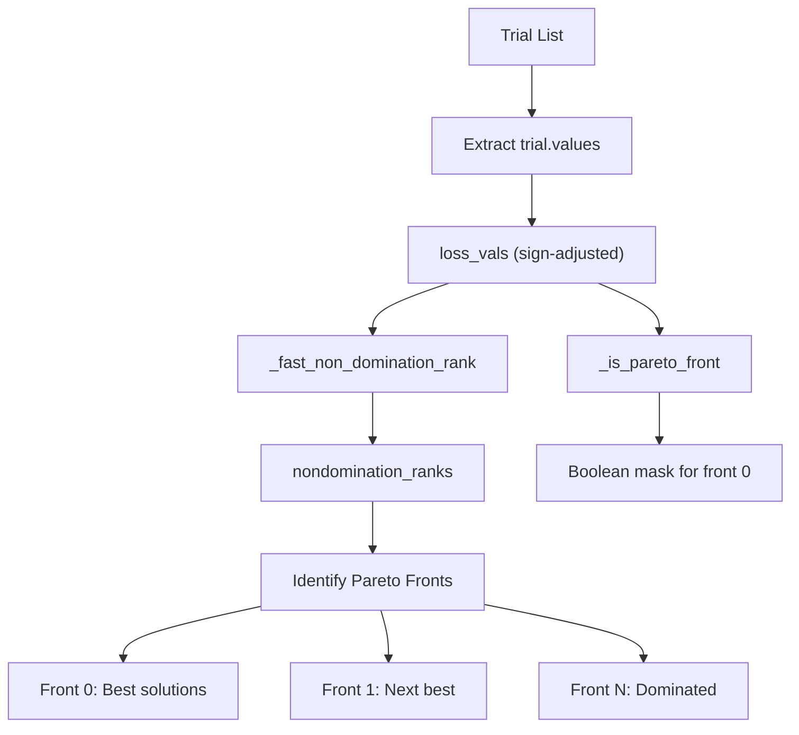
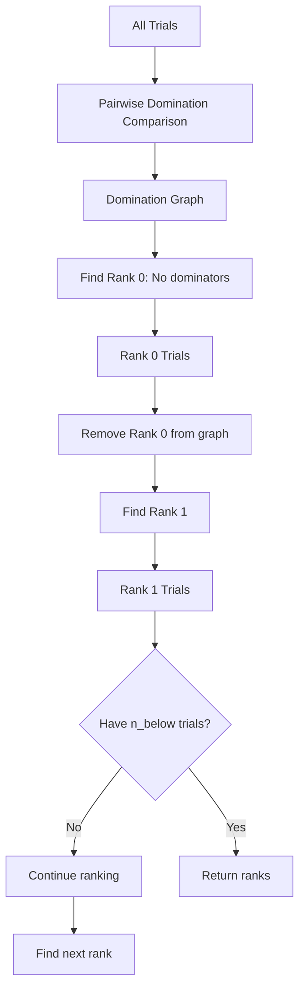
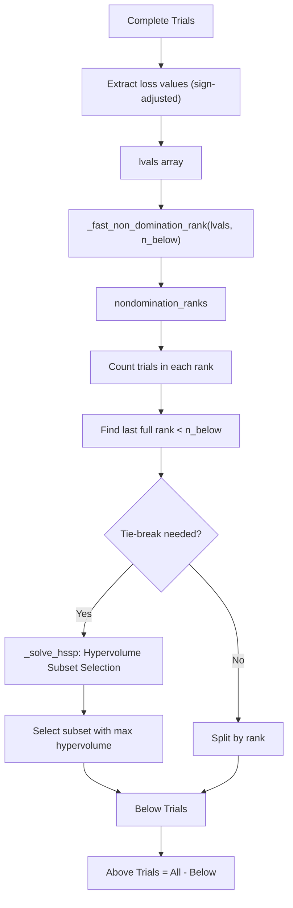
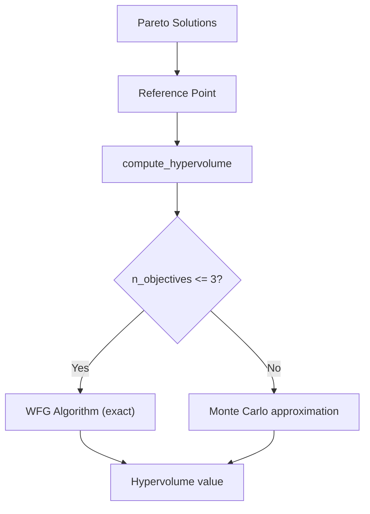
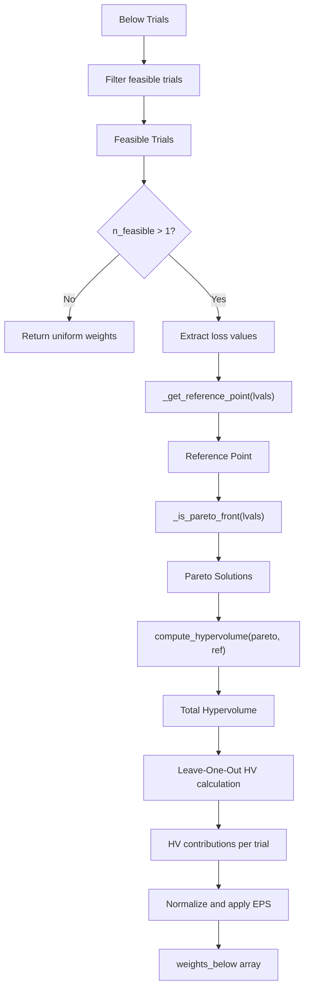
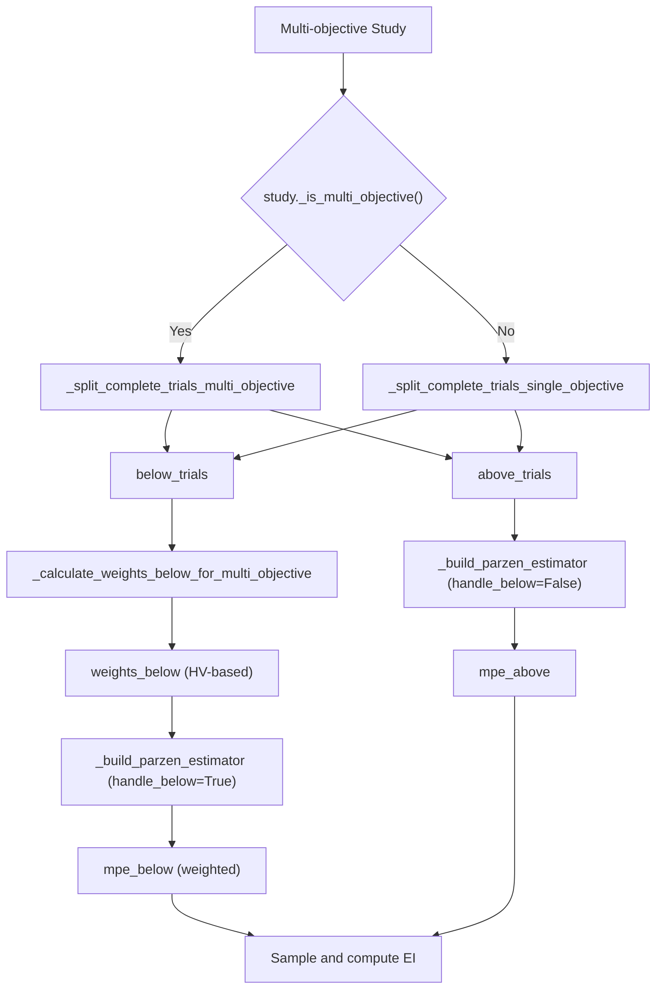
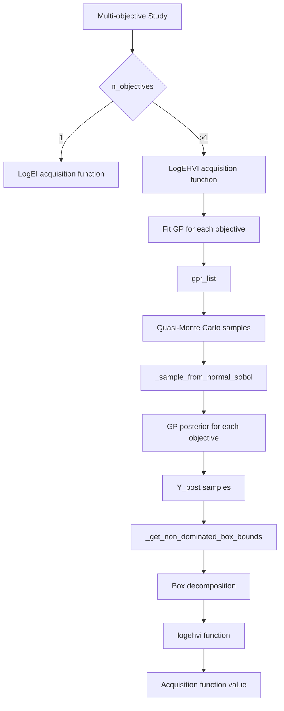
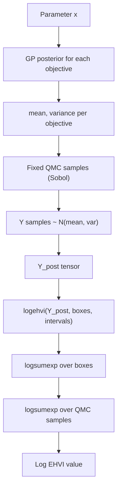
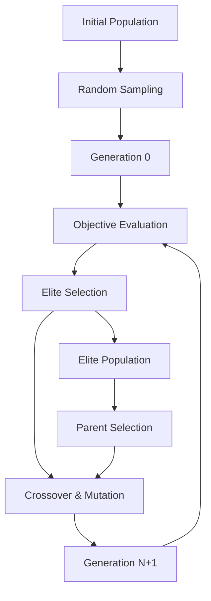

<!-- source: DeepWiki mcp.deepwiki.com · repo optuna/optuna · page 3.5 Multi-Objective Optimization · fetched 2026-10-21 -->

# Multi-Objective Optimization

<details>
<summary>Relevant source files</summary>

The following files were used as context for generating this wiki page:

- [optuna/_gp/acqf.py](optuna/_gp/acqf.py)
- [optuna/_gp/batched_lbfgsb.py](optuna/_gp/batched_lbfgsb.py)
- [optuna/_gp/gp.py](optuna/_gp/gp.py)
- [optuna/_gp/optim_mixed.py](optuna/_gp/optim_mixed.py)
- [optuna/_gp/optim_sample.py](optuna/_gp/optim_sample.py)
- [optuna/_gp/prior.py](optuna/_gp/prior.py)
- [optuna/_gp/search_space.py](optuna/_gp/search_space.py)
- [optuna/integration/chainermn.py](optuna/integration/chainermn.py)
- [optuna/samplers/_gp/sampler.py](optuna/samplers/_gp/sampler.py)
- [optuna/samplers/_tpe/parzen_estimator.py](optuna/samplers/_tpe/parzen_estimator.py)
- [optuna/samplers/_tpe/sampler.py](optuna/samplers/_tpe/sampler.py)
- [optuna/terminator/improvement/emmr.py](optuna/terminator/improvement/emmr.py)
- [optuna/terminator/improvement/evaluator.py](optuna/terminator/improvement/evaluator.py)
- [tests/gp_tests/test_acqf.py](tests/gp_tests/test_acqf.py)
- [tests/gp_tests/test_batched_lbfgsb.py](tests/gp_tests/test_batched_lbfgsb.py)
- [tests/gp_tests/test_gp.py](tests/gp_tests/test_gp.py)
- [tests/gp_tests/test_search_space.py](tests/gp_tests/test_search_space.py)
- [tests/samplers_tests/test_gp.py](tests/samplers_tests/test_gp.py)
- [tests/samplers_tests/test_samplers.py](tests/samplers_tests/test_samplers.py)
- [tests/samplers_tests/tpe_tests/test_multi_objective_sampler.py](tests/samplers_tests/tpe_tests/test_multi_objective_sampler.py)
- [tests/samplers_tests/tpe_tests/test_parzen_estimator.py](tests/samplers_tests/tpe_tests/test_parzen_estimator.py)
- [tests/samplers_tests/tpe_tests/test_sampler.py](tests/samplers_tests/tpe_tests/test_sampler.py)

</details>


This document covers Optuna's multi-objective optimization capabilities across different samplers, focusing on how `TPESampler` and `GPSampler` handle multiple conflicting objectives. The system implements Pareto front calculation, non-dominated sorting, hypervolume computation, and specialized acquisition functions for multi-objective scenarios.

For single-objective optimization details, see page 3.2 (TPE) and page 3.3 (GP Sampler). For evolutionary multi-objective algorithms (NSGA-II/NSGA-III), see page 3.6.

## Overview

Optuna's model-based samplers (TPE and GP) extend to multi-objective optimization using:

- **Pareto Front Identification**: Non-dominated sorting to identify optimal trade-off solutions
- **Hypervolume Metrics**: Quantifying solution quality and computing contributions
- **Specialized Acquisition Functions**: LogEHVI for GP-based multi-objective optimization
- **Weight Calculation**: Hypervolume-based weighting for TPE's good trials

The multi-objective support allows optimizing 2 or more conflicting objectives simultaneously, producing a Pareto front of non-dominated solutions rather than a single optimal point.

## Pareto Front and Non-Dominated Sorting

### Pareto Domination Concept

A solution dominates another if it is better in at least one objective and not worse in all others. The Pareto front consists of all non-dominated solutions.

**Multi-Objective Architecture**



Sources: [optuna/samplers/_tpe/sampler.py:746-780](), [optuna/study/_multi_objective.py]()

### Non-Dominated Ranking Algorithm

The `_fast_non_domination_rank` function implements efficient non-dominated sorting:

1. **Domination Check**: Compare each trial pair to determine domination relationships
2. **Rank Assignment**: Assign rank 0 to non-dominated solutions, then iteratively assign higher ranks
3. **Early Termination**: Can stop when `n_below` solutions are classified

**Ranking Process Flow**



Sources: [optuna/samplers/_tpe/sampler.py:757-758](), [optuna/study/_multi_objective.py]()

### TPESampler Trial Splitting

The `_split_complete_trials_multi_objective` function divides trials into "below" (good) and "above" (bad) groups for multi-objective TPE:

```python
# From optuna/samplers/_tpe/sampler.py:746-780
def _split_complete_trials_multi_objective(
    trials: Sequence[FrozenTrial], study: Study, n_below: int
) -> tuple[list[FrozenTrial], list[FrozenTrial]]:
```

**Trial Splitting Workflow**



Sources: [optuna/samplers/_tpe/sampler.py:746-780]()

**Hypervolume Subset Selection Problem (HSSP)**

When multiple trials have the same rank and selecting all would exceed `n_below`, HSSP selects the subset that maximizes hypervolume contribution:

```python
# Lines 764-775 from optuna/samplers/_tpe/sampler.py
if indices_below.size < n_below:  # Tie-break with HSSP
    need_tiebreak = nondomination_ranks == last_rank_before_tiebreak + 1
    rank_i_lvals = lvals[need_tiebreak]
    subset_size = n_below - indices_below.size
    selected_indices = _solve_hssp_with_cache(
        tuple(rank_i_lvals.ravel()),
        tuple(indices[need_tiebreak]),
        subset_size,
        tuple(_get_reference_point(rank_i_lvals)),
    )
```

Sources: [optuna/samplers/_tpe/sampler.py:764-775](), [optuna/_hypervolume/hssp.py]()

## Hypervolume Computation

### Overview

Hypervolume measures the volume of objective space dominated by a solution set. It's used in multi-objective optimization for:

1. **Solution Quality**: Measuring overall Pareto front quality
2. **Contribution Weighting**: Computing individual trial importance in TPE
3. **Subset Selection**: Solving HSSP for trial selection

**Hypervolume Calculation Flow**



Sources: [optuna/_hypervolume/__init__.py](), [optuna/samplers/_tpe/sampler.py:844-856]()

### Reference Point Selection

The reference point defines the boundary for hypervolume calculation. TPE uses a heuristic approach:

```python
# From optuna/samplers/_tpe/sampler.py:680-684
def _get_reference_point(loss_vals: np.ndarray) -> np.ndarray:
    worst_point = np.max(loss_vals, axis=0)
    reference_point = np.maximum(1.1 * worst_point, 0.9 * worst_point)
    reference_point[reference_point == 0] = EPS
    return reference_point
```

This creates a slightly worse point than the worst observed to ensure all solutions contribute to hypervolume.

Sources: [optuna/samplers/_tpe/sampler.py:680-684]()

### Hypervolume Contribution for TPE Weights

The `_calculate_weights_below_for_multi_objective` function computes weights for good trials based on hypervolume contribution:

**Weight Calculation Process**



Sources: [optuna/samplers/_tpe/sampler.py:825-863]()

**Hypervolume Contribution Calculation**

For 2D and 3D problems (≤ 3 objectives), exact leave-one-out hypervolume is computed:

```python
# From optuna/samplers/_tpe/sampler.py:852-856
if len(study.directions) <= 3:
    contribs[on_front] = [
        hv - compute_hypervolume(pareto_sols[loo], ref_point, assume_pareto=True)
        for loo in loo_mat
    ]
```

For higher dimensions, an approximation based on dominated box volumes is used:

```python
# From optuna/samplers/_tpe/sampler.py:857-862
else:
    contribs[on_front] = np.prod(ref_point - pareto_sols, axis=-1)
    limited_sols = np.maximum(pareto_sols, pareto_sols[:, np.newaxis])
    contribs[on_front] -= [
        compute_hypervolume(limited_sols[i, loo], ref_point) for i, loo in enumerate(loo_mat)
    ]
```

Sources: [optuna/samplers/_tpe/sampler.py:852-862]()

## TPESampler Multi-Objective Features

### Overview

`TPESampler` extends to multi-objective optimization by using hypervolume-based weighting for good trials. The key differences from single-objective TPE:

1. **Trial Splitting**: Uses non-dominated ranking and HSSP instead of simple sorting
2. **Weight Calculation**: Weights based on hypervolume contribution instead of uniform
3. **Parzen Estimators**: Built separately for each objective's good and bad trials

**Multi-Objective TPE Workflow**



Sources: [optuna/samplers/_tpe/sampler.py:538-561](), [optuna/samplers/_tpe/sampler.py:563-590]()

### Parzen Estimator Construction

When `handle_below=True` and the study is multi-objective, weighted Parzen estimators are constructed:

```python
# From optuna/samplers/_tpe/sampler.py:571-581
if handle_below and study._is_multi_objective():
    param_mask_below = [
        search_space.keys() <= self._get_params(trial).keys() for trial in trials
    ]
    weights_below = _calculate_weights_below_for_multi_objective(
        study, trials, self._constraints_func
    )[param_mask_below]
    assert np.isfinite(weights_below).all()
    mpe = self._parzen_estimator_cls(
        observations, search_space, self._parzen_estimator_parameters, weights_below
    )
```

The `param_mask_below` filters trials that have all parameters in the search space, and `weights_below` provides hypervolume-based importance weights.

Sources: [optuna/samplers/_tpe/sampler.py:571-581]()

### Configuration Example

```python
import optuna

sampler = optuna.samplers.TPESampler(
    n_startup_trials=10,
    multivariate=True,  # Recommended for multi-objective
    seed=42
)

study = optuna.create_study(
    directions=["minimize", "maximize"],  # Multi-objective
    sampler=sampler
)
```

Sources: [optuna/samplers/_tpe/sampler.py:72-287]()

## GPSampler Multi-Objective Features

### Overview

`GPSampler` uses Log Expected Hypervolume Improvement (LogEHVI) as the acquisition function for multi-objective optimization. This extends the single-objective LogEI to multiple objectives.

**GP Multi-Objective Architecture**



Sources: [optuna/samplers/_gp/sampler.py:360-370](), [optuna/_gp/acqf.py:223-279]()

### LogEHVI Acquisition Function

The `LogEHVI` class implements the log expected hypervolume improvement:

```python
# Key components from optuna/_gp/acqf.py:223-279
class LogEHVI(BaseAcquisitionFunc):
    def __init__(
        self,
        gpr_list: list[GPRegressor],
        search_space: SearchSpace,
        Y_train: torch.Tensor,
        n_qmc_samples: int,
        qmc_seed: int | None,
        stabilizing_noise: float = 1e-12,
    ) -> None:
```

**LogEHVI Evaluation Process**



Sources: [optuna/_gp/acqf.py:260-278](), [optuna/_gp/acqf.py:45-62]()

### Non-Dominated Box Decomposition

The reference point and Pareto front are used to decompose objective space into boxes:

```python
# From optuna/_gp/acqf.py:233-241
def _get_non_dominated_box_bounds() -> tuple[torch.Tensor, torch.Tensor]:
    loss_vals = -Y_train.numpy()  # Convert to minimization
    pareto_sols = loss_vals[_is_pareto_front(loss_vals, assume_unique_lexsorted=False)]
    ref_point = np.max(loss_vals, axis=0)
    ref_point = np.nextafter(np.maximum(1.1 * ref_point, 0.9 * ref_point), np.inf)
    lbs, ubs = get_non_dominated_box_bounds(pareto_sols, ref_point)
    return torch.from_numpy(-ubs), torch.from_numpy(-lbs)  # Flip back to maximization
```

Sources: [optuna/_gp/acqf.py:233-241](), [optuna/_hypervolume/__init__.py]()

### Best Parameter Selection for Multi-Objective

For warm-starting local search, GP sampler selects multiple points from the Pareto front:

```python
# From optuna/samplers/_gp/sampler.py:289-301
def _get_best_params_for_multi_objective(
    self,
    normalized_params: np.ndarray,
    standardized_score_vals: np.ndarray,
) -> np.ndarray:
    pareto_params = normalized_params[
        _is_pareto_front(-standardized_score_vals, assume_unique_lexsorted=False)
    ]
    n_pareto_sols = len(pareto_params)
    size = min(self._n_local_search // 2, n_pareto_sols)
    chosen_indices = self._rng.rng.choice(n_pareto_sols, size=size, replace=False)
    return pareto_params[chosen_indices]
```

This randomly selects up to `n_local_search // 2` points from the Pareto front to seed local optimization.

Sources: [optuna/samplers/_gp/sampler.py:289-301]()

## Population Management

### Generation Tracking

Both algorithms track generations using system attributes:

- **NSGA-II**: Uses `NSGAIISampler._GENERATION_KEY` for generation tracking
- **NSGA-III**: Uses `_GENERATION_KEY` and `_POPULATION_CACHE_KEY_PREFIX` for caching

### Population Lifecycle



Sources: [optuna/samplers/nsgaii/_sampler.py:255-272](), [optuna/samplers/_nsgaiii/_sampler.py:204-277]()

## Configuration Parameters

### Common Parameters

| Parameter | Type | Default | Description |
|-----------|------|---------|-------------|
| `population_size` | `int` | 50 | Number of individuals per generation |
| `mutation_prob` | `float` | `1.0/n_params` | Probability of parameter mutation |
| `crossover_prob` | `float` | 0.9 | Probability of crossover operation |
| `swapping_prob` | `float` | 0.5 | Probability of parameter swapping |
| `seed` | `int` | None | Random seed for reproducibility |

### NSGA-III Specific Parameters

| Parameter | Type | Default | Description |
|-----------|------|---------|-------------|
| `reference_points` | `np.ndarray` | None | Custom reference points |
| `dividing_parameter` | `int` | 3 | Density of default reference points |

Sources: [optuna/samplers/nsgaii/_sampler.py:156-176](), [optuna/samplers/_nsgaiii/_sampler.py:78-100]()

---

