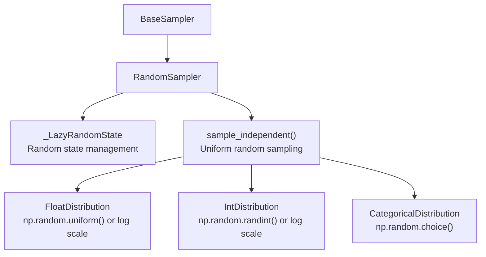
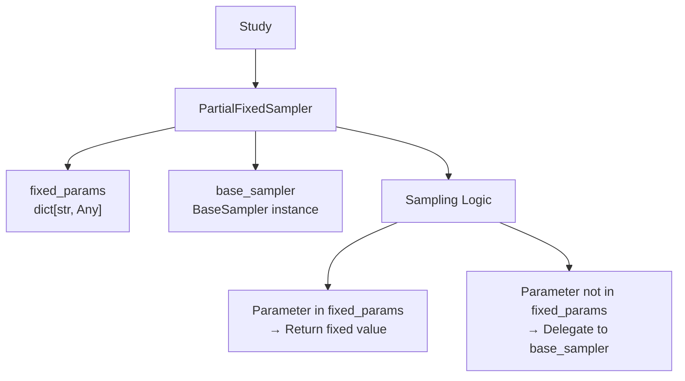
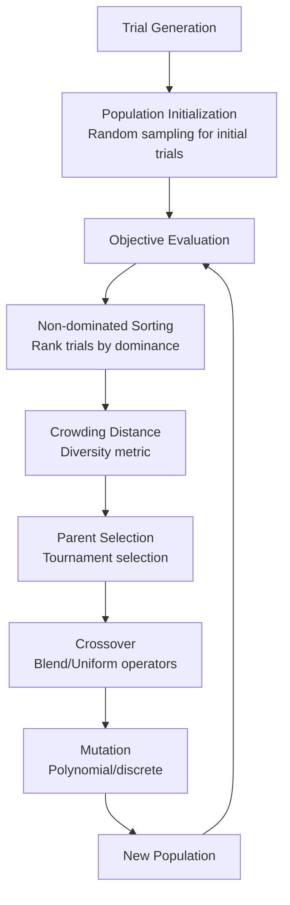
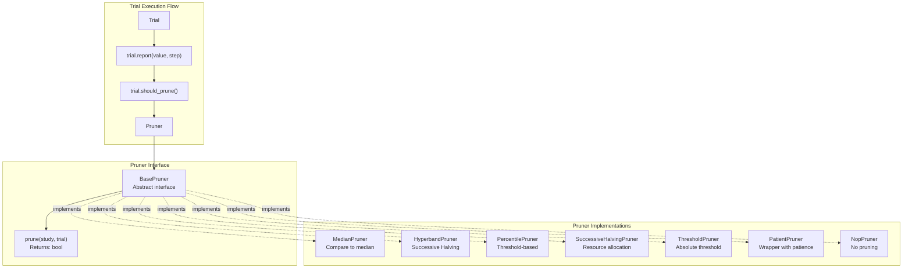
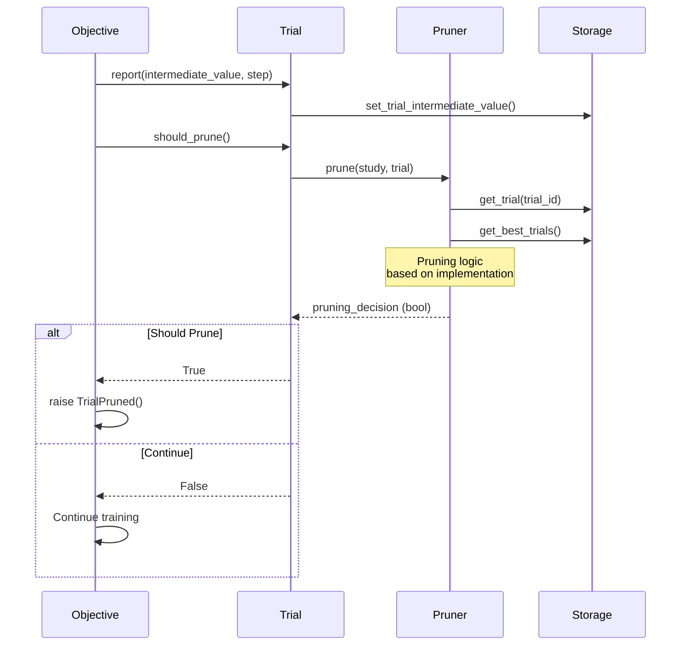
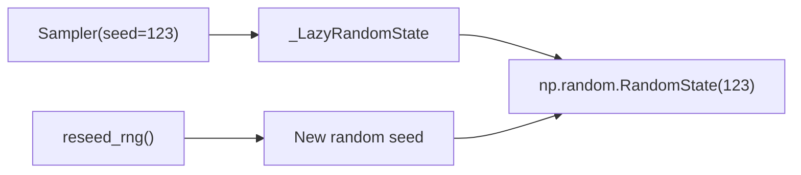

<!-- source: DeepWiki mcp.deepwiki.com · repo optuna/optuna · page 3.6 Other Samplers and Pruning · fetched 2026-10-21 -->

# Other Samplers and Pruning

<details>
<summary>Relevant source files</summary>

The following files were used as context for generating this wiki page:

- [optuna/integration/chainermn.py](optuna/integration/chainermn.py)
- [tests/samplers_tests/test_samplers.py](tests/samplers_tests/test_samplers.py)

</details>


## Purpose and Scope

This page documents Optuna's simpler sampling algorithms and the pruning system for early stopping of unpromising trials. The samplers covered here include baseline algorithms (RandomSampler, GridSampler), specialized utilities (PartialFixedSampler, QMCSampler), and multi-objective evolutionary algorithms (NSGA-II/III). The pruning system enables automatic termination of trials that show poor intermediate results.

For the core sampler interface and sampling strategies, see [BaseSampler Interface and Sampling Strategies](#3.1). For advanced Bayesian optimization samplers, see [Tree-structured Parzen Estimator (TPE)](#3.2), [Gaussian Process Sampler](#3.3), and [CMA-ES Sampler](#3.4). For multi-objective optimization with TPE and GP, see [Multi-Objective Optimization](#3.5).

---

## Simple Baseline Samplers

### RandomSampler

`RandomSampler` is Optuna's baseline sampling algorithm that draws parameter values uniformly at random from the search space. It serves as the fallback sampler for many sophisticated algorithms during their initial trials and provides a performance baseline for comparison.

**Key Characteristics:**
- No learning from previous trials
- Simple, fast, and robust
- Used as startup sampler by TPE, GP, and CMA-ES
- Supports all distribution types
- Thread-safe with proper random state management

**Implementation Details:**

The sampler maintains a `LazyRandomState` for reproducible random number generation. When a seed is provided, results are deterministic across runs. The sampler implements only `sample_independent()` and returns an empty dictionary from `infer_relative_search_space()`, delegating all sampling to independent parameter selection.



**Sources:** [tests/samplers_tests/test_samplers.py:47](), [tests/samplers_tests/test_samplers.py:82](), [tests/samplers_tests/test_samplers.py:110]()

### GridSampler

`GridSampler` performs exhaustive search over a predefined grid of parameter values. It is useful for small search spaces where complete enumeration is feasible.

**Key Characteristics:**
- Deterministic enumeration of search space
- Requires explicit grid specification via `search_space` parameter
- Cycles through grid points sequentially
- Does not support dynamic parameter addition
- Optimal for small, discrete search spaces

**Usage Pattern:**

```python
search_space = {
    'x': [0, 1, 2, 3, 4],
    'y': ['a', 'b', 'c']
}
sampler = optuna.samplers.GridSampler(search_space=search_space)
study = optuna.create_study(sampler=sampler)
```

The sampler generates all combinations of the provided grid points (15 trials in the example above). Once all combinations are exhausted, the sampler cycles back to the beginning.

**Sources:** [tests/samplers_tests/test_samplers.py:123]()

### PartialFixedSampler

`PartialFixedSampler` is a wrapper sampler that fixes specific parameters to constant values while delegating other parameters to an underlying base sampler. This is useful for targeted exploration where some hyperparameters should remain constant.

**Architecture:**



**Usage Example:**

The test at [tests/samplers_tests/test_samplers.py:568-588]() demonstrates fixing parameter `y` to `0` while allowing `x` and `z` to be sampled normally:

```python
fixed_params = {"y": 0}
sampler = optuna.samplers.PartialFixedSampler(
    fixed_params, 
    base_sampler=optuna.samplers.RandomSampler()
)
```

**Sources:** [tests/samplers_tests/test_samplers.py:117-122](), [tests/samplers_tests/test_samplers.py:568-588]()

---

## Quasi-Monte Carlo Sampler

### QMCSampler

`QMCSampler` uses quasi-random low-discrepancy sequences to sample the search space more uniformly than pure random sampling. These sequences provide better space-filling properties, which can improve exploration efficiency in the early stages of optimization.

**Key Characteristics:**
- Low-discrepancy sequence generation
- Better space coverage than random sampling
- Deterministic given a seed
- Uses an underlying sampler for non-QMC functionality
- Does not maintain a `LazyRandomState` directly (only in base sampler)

**Implementation Notes:**

QMCSampler wraps another sampler (typically RandomSampler) and uses quasi-random sequences for parameter generation. The test at [tests/samplers_tests/test_samplers.py:124]() shows it does not have its own RNG (`expected_has_rng=False`) but delegates to another sampler (`expected_has_another_sampler=True`).

**Sources:** [tests/samplers_tests/test_samplers.py:54](), [tests/samplers_tests/test_samplers.py:93](), [tests/samplers_tests/test_samplers.py:124]()

---

## Multi-Objective Evolutionary Samplers

Optuna provides NSGA-II and NSGA-III samplers for multi-objective optimization using evolutionary algorithms. These samplers are alternatives to MOTPE (covered in [Multi-Objective Optimization](#3.5)) and are particularly effective for problems with many objectives or complex Pareto fronts.

### NSGA-II Sampler

`NSGAIISampler` implements the Non-dominated Sorting Genetic Algorithm II, a popular evolutionary algorithm for multi-objective optimization with 2-3 objectives.

**Algorithm Overview:**



**Key Features:**
- Non-dominated sorting for multi-objective ranking
- Crowding distance for diversity preservation
- Genetic operators: crossover and mutation
- Supports both single and multi-objective studies
- Falls back to RandomSampler initially

**Sources:** [tests/samplers_tests/test_samplers.py:52](), [tests/samplers_tests/test_samplers.py:72](), [tests/samplers_tests/test_samplers.py:91](), [tests/samplers_tests/test_samplers.py:114]()

### NSGA-III Sampler

`NSGAIIISampler` extends NSGA-II for many-objective optimization (4+ objectives) using reference points instead of crowding distance.

**Differences from NSGA-II:**

| Feature | NSGA-II | NSGA-III |
|---------|---------|----------|
| **Diversity Mechanism** | Crowding distance | Reference points |
| **Optimal for** | 2-3 objectives | 4+ objectives |
| **Reference Points** | Not used | Das-Dennis or custom |
| **Scalability** | Degrades with many objectives | Better with many objectives |

**Key Characteristics:**
- Reference point-based diversity
- Suitable for many-objective problems
- Can use predefined or generated reference points
- Similar genetic operators to NSGA-II

**Sources:** [tests/samplers_tests/test_samplers.py:53](), [tests/samplers_tests/test_samplers.py:73](), [tests/samplers_tests/test_samplers.py:92](), [tests/samplers_tests/test_samplers.py:115]()

### Multi-Objective Sampler Comparison

The test at [tests/samplers_tests/test_samplers.py:69-78]() shows that multiple samplers support multi-objective optimization:

```python
multi_objective_sampler_class = [
    optuna.samplers.NSGAIISampler,
    optuna.samplers.NSGAIIISampler,
    optuna.samplers.TPESampler(n_startup_trials=0),
    get_gp_sampler(deterministic_objective=True),
    get_gp_sampler(deterministic_objective=False),
]
```

Each sampler provides different trade-offs:
- **NSGA-II/III**: Evolutionary approach, good for complex Pareto fronts
- **MOTPE**: Model-based, efficient for moderate dimensions
- **Multi-objective GP**: Bayesian optimization, effective with expensive evaluations

**Sources:** [tests/samplers_tests/test_samplers.py:69-78](), [tests/samplers_tests/test_samplers.py:590-636]()

---

## Pruning System

The pruning system enables automatic termination of unpromising trials based on intermediate results, significantly reducing computation time by avoiding full evaluation of poor candidates.

### Pruning Architecture



**Sources:** Diagram based on Diagram 1 from high-level architecture

### BasePruner Interface

The `BasePruner` abstract class defines the interface for all pruning algorithms. Similar to `BaseSampler`, it provides a contract that all pruner implementations must follow.

**Core Method:**
- `prune(study, trial)` → `bool`: Determines whether to prune the trial based on its intermediate values

**Pruning Decision Flow:**



**Sources:** Diagram based on Diagram 2 from high-level architecture

### MedianPruner

`MedianPruner` terminates trials whose intermediate value at a given step is worse than the median of all trials' intermediate values at the same step.

**Algorithm:**
1. Collect intermediate values from all completed/running trials at the current step
2. Calculate the median of these values
3. Prune if current trial's value is worse than the median

**Configuration Parameters:**
- `n_startup_trials`: Number of trials before pruning starts
- `n_warmup_steps`: Number of steps before pruning starts
- `interval_steps`: Evaluation interval (check every N steps)

**Typical Usage:**
```python
pruner = optuna.pruners.MedianPruner(
    n_startup_trials=5,
    n_warmup_steps=10,
    interval_steps=1
)
study = optuna.create_study(pruner=pruner)
```

**Sources:** Referenced in Diagram 1 from high-level architecture

### HyperbandPruner

`HyperbandPruner` implements the Hyperband algorithm, which adaptively allocates resources to promising trials using successive halving with different resource budgets.

**Key Concepts:**
- **Resource**: Typically training iterations, epochs, or data samples
- **Bracket**: Different resource allocation strategies
- **Successive Halving**: Progressively eliminates worst-performing trials

**Algorithm Overview:**

The algorithm runs multiple brackets, each with a different resource allocation strategy. Within each bracket, trials are evaluated at exponentially increasing resource levels, and the worst-performing half is pruned at each rung.

**Configuration:**
- `min_resource`: Minimum resource allocation (e.g., min epochs)
- `max_resource`: Maximum resource allocation (e.g., max epochs)
- `reduction_factor`: Factor by which to reduce trials (default: 3)

**Advantages:**
- More aggressive than MedianPruner
- Theoretically grounded resource allocation
- Effective for expensive evaluations

**Sources:** Referenced in Diagram 1 from high-level architecture

### Other Pruners

**PercentilePruner:**
Prunes trials whose intermediate values are in the bottom percentile at each step. More configurable than MedianPruner (50th percentile).

**SuccessiveHalvingPruner:**
Simpler version of Hyperband that uses a single bracket with successive halving.

**ThresholdPruner:**
Prunes trials whose intermediate values fall below (or above) an absolute threshold.

**PatientPruner:**
Wrapper pruner that delays the pruning decision of an underlying pruner by a specified number of steps, providing "patience" before termination.

**NopPruner:**
No-operation pruner that never prunes trials. Useful for disabling pruning without changing code structure.

**Sources:** Inferred from common Optuna patterns based on high-level architecture

### Pruning in Practice

**Integration with Objective Function:**

The test at [tests/samplers_tests/test_samplers.py:688-713]() demonstrates the `after_trial` callback receiving pruned trials:

```python
def pruned_objective(trial):
    trial.report(0.5, step=0)
    if trial.should_prune():
        raise optuna.TrialPruned()
    return 1.0

# Sampler's after_trial receives:
# - state = TrialState.PRUNED
# - values = None
```

**Sampler-Pruner Interaction:**

Pruning and sampling are orthogonal systems. The sampler's `after_trial()` method is called regardless of trial outcome (complete, pruned, or failed), allowing samplers to update their internal state appropriately:

| Trial State | `after_trial` values argument |
|-------------|------------------------------|
| COMPLETE | `list[float]` (objective values) |
| PRUNED | `None` |
| FAIL | `None` |

**Sources:** [tests/samplers_tests/test_samplers.py:688-713](), [tests/samplers_tests/test_samplers.py:659-686](), [tests/samplers_tests/test_samplers.py:716-744]()

---

## Sampler Lifecycle and State Management

All samplers in this document follow the same lifecycle hooks defined in `BaseSampler`:

### Lifecycle Hooks

**before_trial(study, trial):**
Called before the trial execution begins. The trial is in `RUNNING` state but has no parameters or values yet.

Test demonstration at [tests/samplers_tests/test_samplers.py:638-657]():
```python
def before_trial(self, study, trial):
    assert trial.state == TrialState.RUNNING
    assert trial.values is None
```

**after_trial(study, trial, state, values):**
Called after the trial execution completes (whether successful, pruned, or failed). The `state` parameter reflects the final state, and `values` contains objective values for completed trials or `None` for pruned/failed trials.

Test demonstration at [tests/samplers_tests/test_samplers.py:659-686]():
```python
def after_trial(self, study, trial, state, values):
    assert trial.state == TrialState.RUNNING  # Not yet updated
    assert state == TrialState.COMPLETE
    assert values is not None
```

**Sources:** [tests/samplers_tests/test_samplers.py:638-686]()

### Random State Management

Most samplers maintain deterministic behavior through proper random state management:

**Seeding Behavior:**



The test at [tests/samplers_tests/test_samplers.py:128-177]() verifies that:
1. Samplers with seeds produce reproducible results
2. `reseed_rng()` changes the random state
3. Base samplers in composite samplers are also reseeded

**Reproducibility Guarantees:**

The test at [tests/samplers_tests/test_samplers.py:922-948]() ensures that:
- Same seed → identical parameter sequences
- Different seed → different parameter sequences
- Works across all sampler types

**Sources:** [tests/samplers_tests/test_samplers.py:128-177](), [tests/samplers_tests/test_samplers.py:922-948](), [tests/samplers_tests/test_samplers.py:953-974]()

---

## Sampler Testing and Validation

### Distribution Support

All samplers must support the standard distribution types with proper bounds checking:

**Float Distributions:**
- Linear scale: `FloatDistribution(low, high)`
- Log scale: `FloatDistribution(low, high, log=True)`
- Discrete: `FloatDistribution(low, high, step=value)`

**Integer Distributions:**
- Linear scale: `IntDistribution(low, high)`
- Log scale: `IntDistribution(low, high, log=True)`
- Stepped: `IntDistribution(low, high, step=value)`

**Categorical Distributions:**
- `CategoricalDistribution(choices)` with mixed types supported

Tests at [tests/samplers_tests/test_samplers.py:222-310]() verify that sampled values:
- Fall within distribution bounds
- Are not NumPy types (returned as native Python types)
- Respect step constraints for discrete distributions

**Sources:** [tests/samplers_tests/test_samplers.py:222-310]()

### Conditional Parameters

The test at [tests/samplers_tests/test_samplers.py:445-476]() validates that samplers handle conditional parameter spaces correctly:

```python
# Different parameters depending on categorical choice
if category == "x":
    trial.suggest_float("x", 0, 1)
else:
    trial.suggest_float("y", 0, 1)
```

This reproduces real-world scenarios where the search space structure depends on earlier parameter choices.

**Sources:** [tests/samplers_tests/test_samplers.py:445-476](), [tests/samplers_tests/test_samplers.py:852-868]()

### Dynamic Range Handling

The test at [tests/samplers_tests/test_samplers.py:892-919]() ensures samplers handle changing distribution bounds across trials:

```python
# First 10 trials: range [0, 10]
# Next 10 trials: range [20, 30]  # Non-overlapping
```

All samplers must gracefully handle such dynamic search spaces without errors.

**Sources:** [tests/samplers_tests/test_samplers.py:892-919]()

---

