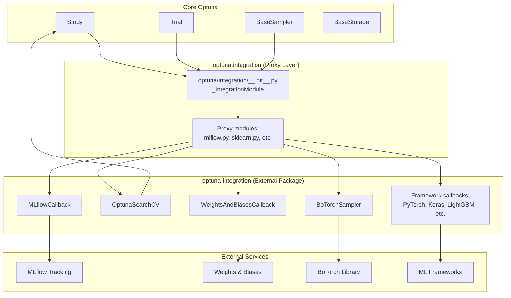
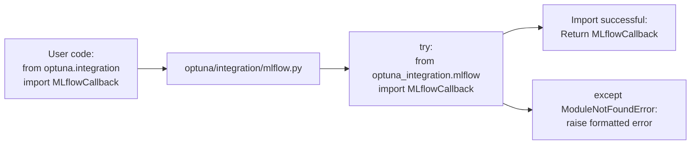
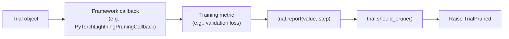
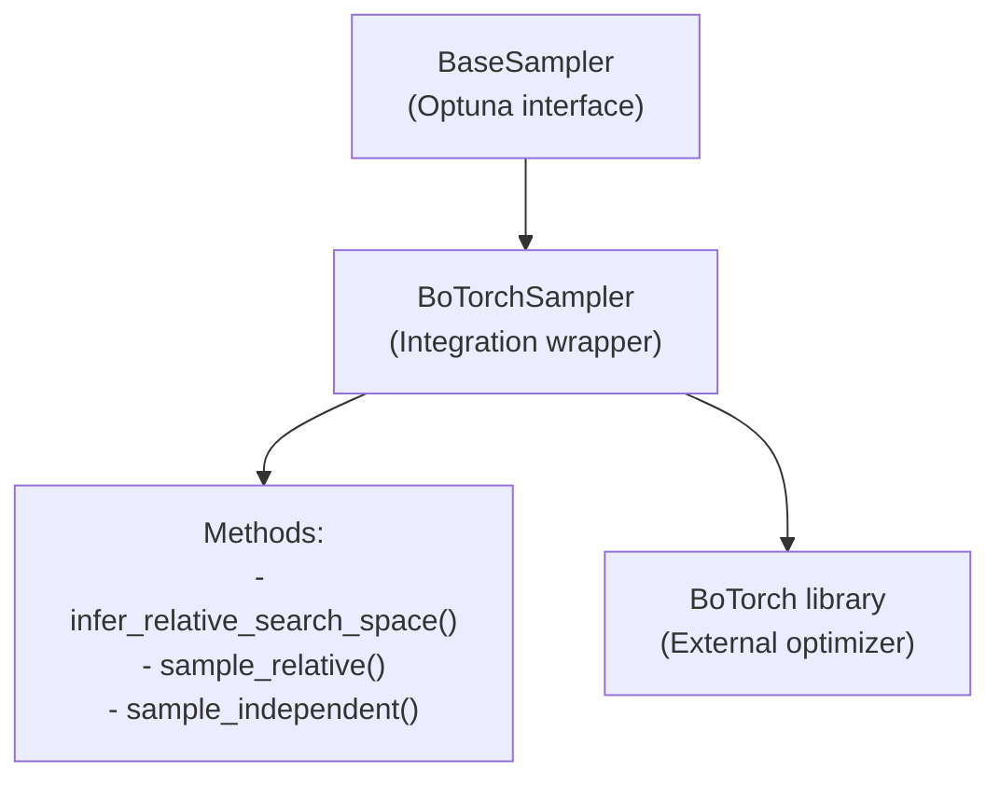
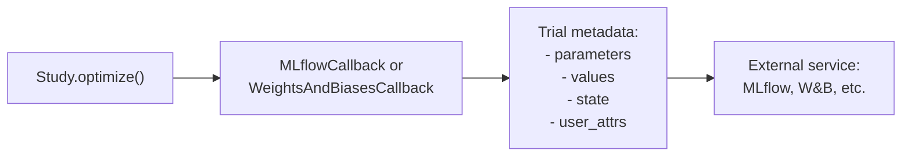
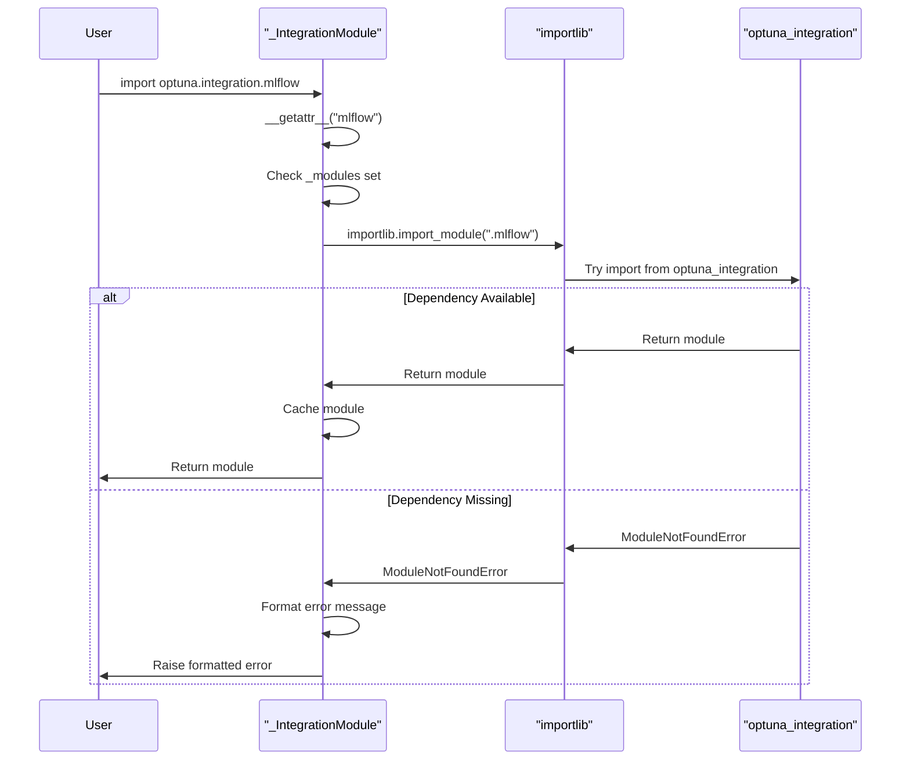

<!-- source: DeepWiki mcp.deepwiki.com · repo optuna/optuna · page 4 Integration System · fetched 2026-10-21 -->

# Integration System

Relevant source files

The following files were used as context for generating this wiki page:

- [docs/source/reference/integration.rst](docs/source/reference/integration.rst)
- [optuna/integration/__init__.py](optuna/integration/__init__.py)
- [optuna/integration/botorch.py](optuna/integration/botorch.py)
- [optuna/integration/dask.py](optuna/integration/dask.py)
- [optuna/integration/mlflow.py](optuna/integration/mlflow.py)
- [optuna/integration/sklearn.py](optuna/integration/sklearn.py)
- [optuna/integration/wandb.py](optuna/integration/wandb.py)
- [optuna/samplers/_base.py](optuna/samplers/_base.py)

The Integration System provides a framework for connecting Optuna with external ML frameworks, experiment tracking tools, and optimization libraries. The system allows Optuna to leverage external tools without forcing users to install unnecessary dependencies.

The integration system migrates to an external package called `optuna-integration`, with the `optuna.integration` module serving as a lazy-loading proxy layer. This architecture ensures that `import optuna` remains fast by deferring dependency imports until integrations are actually accessed.

For details about the lazy loading mechanism, see page 4.1. For specific framework integrations and their usage, see page 4.2.

## System Overview

The integration system consists of proxy modules in the main Optuna repository that defer to implementations in the external `optuna-integration` package. This separation allows the core Optuna library to remain lightweight while supporting a wide range of external tools.

### Integration System Position in Optuna Architecture

Sources: [optuna/integration/__init__.py:1-137](), [docs/source/reference/integration.rst:1-77]()

### Proxy Module Pattern

Each integration has a proxy module in `optuna/integration/` that attempts to import from `optuna_integration` and raises a formatted error if unavailable:

**Example Proxy Module Structure** (`optuna/integration/mlflow.py`):
- Lines 4-5: Attempt import from `optuna_integration.mlflow`
- Line 7: Catch `ModuleNotFoundError` and format error message
- Line 10: Export class name in `__all__`

Sources: [optuna/integration/mlflow.py:1-11](), [optuna/integration/sklearn.py:1-11](), [optuna/integration/botorch.py:1-11]()

## Integration Categories

The `_import_structure` dictionary in [optuna/integration/__init__.py:10-34]() defines the complete mapping of integration modules to their exported classes:

| Category | Module Name | Exported Classes | Purpose |
|----------|-------------|------------------|---------|
| **Pruning Callbacks** | `keras`, `pytorch_lightning`, `tensorflow`, `xgboost`, etc. | `KerasPruningCallback`, `PyTorchLightningPruningCallback`, etc. | Report intermediate values and enable early stopping |
| **Experiment Tracking** | `mlflow`, `wandb`, `tensorboard` | `MLflowCallback`, `WeightsAndBiasesCallback`, `TensorBoardCallback` | Log study/trial metadata to external platforms |
| **Alternative Samplers** | `botorch`, `cma` | `BoTorchSampler`, `PyCmaSampler` | Extend Optuna with external optimization algorithms |
| **Distributed Storage** | `dask`, `chainermn` | `DaskStorage`, `ChainerMNStudy` | Enable parallel optimization across workers |
| **Framework Tools** | `sklearn`, `lightgbm` | `OptunaSearchCV`, `LightGBMTuner` | Provide specialized interfaces for specific frameworks |

### Integration Module Structure in Code

```mermaid
graph TB
    ImportStructure["_import_structure dict<br/>(lines 10-34)"]
    
    subgraph "Callback Integrations"
        Keras["'keras': ['KerasPruningCallback']"]
        PyTorchLightning["'pytorch_lightning':<br/>['PyTorchLightningPruningCallback']"]
        LightGBM["'lightgbm': ['LightGBMPruningCallback',<br/>'LightGBMTuner', 'LightGBMTunerCV']"]
    end
    
    subgraph "Tracking Integrations"
        MLflow["'mlflow': ['MLflowCallback']"]
        WandB["'wandb':<br/>['WeightsAndBiasesCallback']"]
        TensorBoard["'tensorboard':<br/>['TensorBoardCallback']"]
    end
    
    subgraph "Sampler Integrations"
        BoTorch["'botorch': ['BoTorchSampler']"]
        PyCma["'cma': ['PyCmaSampler']"]
    end
    
    subgraph "Other Integrations"
        Sklearn["'sklearn': ['OptunaSearchCV']"]
        Dask["'dask': ['DaskStorage']"]
    end
    
    ImportStructure --> Keras
    ImportStructure --> PyTorchLightning
    ImportStructure --> LightGBM
    ImportStructure --> MLflow
    ImportStructure --> WandB
    ImportStructure --> TensorBoard
    ImportStructure --> BoTorch
    ImportStructure --> PyCma
    ImportStructure --> Sklearn
    ImportStructure --> Dask
```

Sources: [optuna/integration/__init__.py:10-34]()

## Common Integration Patterns

Integrations follow specific patterns based on their purpose. Understanding these patterns helps in implementing or using integrations correctly.

### Callback Pattern for Pruning

Pruning callbacks integrate with ML framework training loops to enable early stopping:

**Pattern Elements**:
1. Callback receives `Trial` object during initialization
2. During training, callback reports intermediate values via `trial.report()`
3. Callback checks `trial.should_prune()` to determine if training should stop
4. If pruning is recommended, callback raises `TrialPruned` exception

Sources: [docs/source/reference/integration.rst:13-17]()

### Sampler Extension Pattern

Alternative samplers extend Optuna's optimization capabilities:

**Pattern Elements**:
1. Integration class inherits from or implements `BaseSampler` interface
2. Wrapper translates between Optuna's sampler API and external library API
3. Search space and parameter values are converted between formats

Sources: [optuna/samplers/_base.py:31-62](), [optuna/integration/botorch.py:1-11]()

### Experiment Tracking Pattern

Tracking callbacks log study progress to external platforms:

**Pattern Elements**:
1. Callback is passed to `study.optimize(callbacks=[...])`
2. Callback receives notifications after each trial completes
3. Callback extracts trial metadata and logs to external service
4. No modification to trial execution or optimization behavior

Sources: [docs/source/reference/integration.rst:13-18]()

## Available Integrations

The integration system supports a wide range of external tools. The table below lists the most commonly used integrations and their dependencies:

| Integration | Module | Class(es) | Dependencies | Purpose |
|-------------|--------|-----------|--------------|---------|
| **MLflow** | `mlflow` | `MLflowCallback` | `mlflow` | Log trials to MLflow tracking server |
| **Weights & Biases** | `wandb` | `WeightsAndBiasesCallback` | `wandb` | Log trials to W&B cloud service |
| **TensorBoard** | `tensorboard` | `TensorBoardCallback` | `tensorboard`, `tensorflow` | Write trials to TensorBoard logs |
| **BoTorch** | `botorch` | `BoTorchSampler` | `botorch`, `gpytorch`, `torch` | Bayesian optimization with BoTorch |
| **PyCMA** | `cma` | `PyCmaSampler` | `cma` | CMA-ES optimization algorithm |
| **scikit-learn** | `sklearn` | `OptunaSearchCV` | `pandas`, `scipy`, `scikit-learn` | Drop-in replacement for GridSearchCV |
| **LightGBM** | `lightgbm` | `LightGBMTuner`, `LightGBMPruningCallback` | `lightgbm`, `scikit-learn` | LightGBM-specific optimization |
| **PyTorch Lightning** | `pytorch_lightning` | `PyTorchLightningPruningCallback` | `pytorch-lightning` | Early stopping for Lightning |
| **Keras** | `keras` | `KerasPruningCallback` | `keras` | Early stopping for Keras |
| **XGBoost** | `xgboost` | `XGBoostPruningCallback` | `xgboost` | Early stopping for XGBoost |
| **Dask** | `dask` | `DaskStorage` | `distributed` | Dask-compatible storage backend |

Sources: [docs/source/reference/integration.rst:24-76](), [optuna/integration/__init__.py:10-34]()

## Module Loading Flow

The integration system's lazy loading mechanism follows a specific flow to ensure efficient module loading:

Sources: [optuna/integration/__init__.py:116-134]()

The Integration System provides a robust, extensible framework for connecting Optuna with external tools while maintaining performance and graceful error handling. Its lazy loading architecture ensures that only required dependencies are loaded, while the standardized error handling provides clear guidance for users when dependencies are missing.

---

