<!-- source: DeepWiki mcp.deepwiki.com · repo optuna/optuna · page 4.1 Integration Architecture and Lazy Loading · fetched 2026-10-21 -->

# Integration Architecture

<details>
<summary>Relevant source files</summary>

The following files were used as context for generating this wiki page:

- [docs/source/reference/integration.rst](docs/source/reference/integration.rst)
- [optuna/integration/__init__.py](optuna/integration/__init__.py)
- [optuna/integration/botorch.py](optuna/integration/botorch.py)
- [optuna/integration/dask.py](optuna/integration/dask.py)
- [optuna/integration/mlflow.py](optuna/integration/mlflow.py)
- [optuna/integration/sklearn.py](optuna/integration/sklearn.py)
- [optuna/integration/wandb.py](optuna/integration/wandb.py)
- [optuna/samplers/_base.py](optuna/samplers/_base.py)

</details>


## Overview

Optuna's integration system enables deep integration with external machine learning frameworks through a standardized architecture. The system consists of two main integration patterns:

1. **Callback-based integrations**: Implement the trial reporting pattern (`trial.report()`, `trial.should_prune()`, `TrialPruned`) for frameworks with iterative training loops (PyTorch Lightning, Keras, XGBoost, etc.)
2. **Estimator-based integrations**: Provide scikit-learn-compatible wrappers that expose Optuna optimization through familiar estimator APIs (`OptunaSearchCV`)

All integrations follow a delegation architecture where Optuna's core package contains lightweight wrapper modules that delegate to the separate `optuna-integration` package. This design reduces core dependencies while maintaining a unified user interface.

## The Callback Pattern

Most Optuna integrations implement a **callback pattern** that enables early stopping of unpromising trials during model training. This pattern consists of three components:

| Component | Type | Purpose |
|-----------|------|---------|
| `trial.report(value, step)` | Method | Report intermediate metric values during training |
| `trial.should_prune()` | Method | Check if trial should be stopped early |
| `TrialPruned` | Exception | Signal trial termination to Optuna |

**Callback Pattern Workflow**

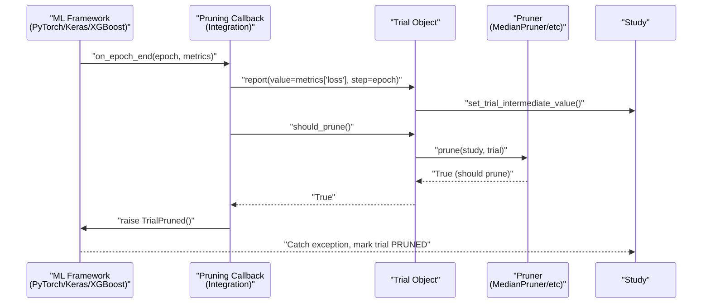

The callback pattern enables integrations to:
- Report metrics at framework-specific intervals (epochs, iterations, boosting rounds)
- Query the pruner's decision without coupling to specific pruner implementations
- Terminate training gracefully using framework-specific exception handling

Sources: [docs/source/reference/integration.rst:13-17]()

## Migration to optuna-integration Package

Optuna's integrations have migrated from the core `optuna` package to a separate `optuna-integration` package. The core package retains lightweight delegation modules that preserve backward compatibility while reducing dependency bloat.

**Delegation Architecture**

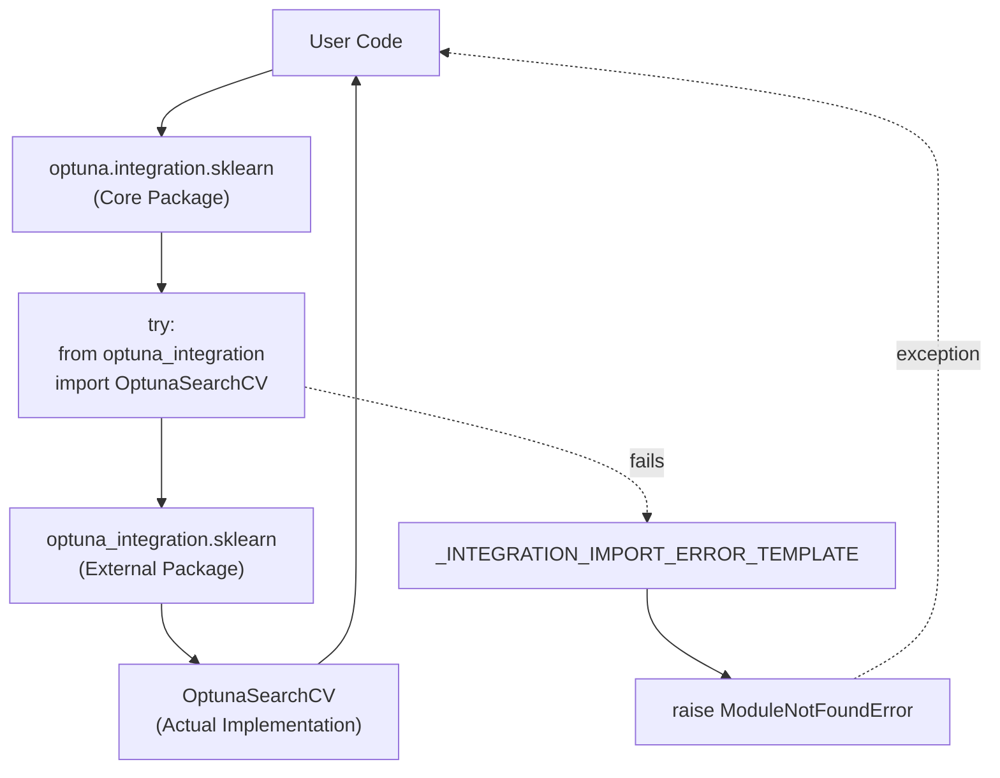

**Example Delegation Module**

```python
# optuna/integration/sklearn.py
from optuna._imports import _INTEGRATION_IMPORT_ERROR_TEMPLATE

try:
    from optuna_integration.sklearn import OptunaSearchCV
except ModuleNotFoundError:
    raise ModuleNotFoundError(_INTEGRATION_IMPORT_ERROR_TEMPLATE.format("sklearn"))

__all__ = ["OptunaSearchCV"]
```

All integration modules in the core package follow this pattern:
1. Import from `optuna_integration.<framework>`
2. Catch `ModuleNotFoundError` if package not installed
3. Re-raise with standardized error message via `_INTEGRATION_IMPORT_ERROR_TEMPLATE`
4. Export imported components via `__all__`

Sources: [optuna/integration/sklearn.py:1-11](), [optuna/integration/botorch.py:1-11](), [docs/source/reference/integration.rst:9-11]()

## Dependency Management with Error Templates

The `_INTEGRATION_IMPORT_ERROR_TEMPLATE` provides consistent error messages when optional integration packages are not installed.

**Error Template Pattern**

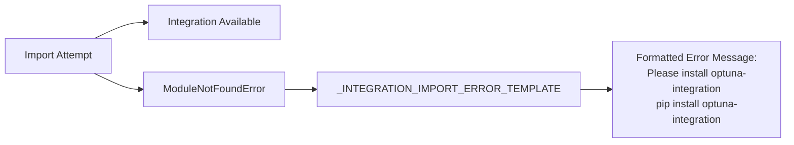

| Framework | Module Path | Error When Missing |
|-----------|-------------|-------------------|
| scikit-learn | `optuna.integration.sklearn` | `_INTEGRATION_IMPORT_ERROR_TEMPLATE.format("sklearn")` |
| BoTorch | `optuna.integration.botorch` | `_INTEGRATION_IMPORT_ERROR_TEMPLATE.format("botorch")` |
| PyTorch Lightning | `optuna.integration.pytorch_lightning` | `_INTEGRATION_IMPORT_ERROR_TEMPLATE.format("pytorch_lightning")` |

This pattern ensures:
- **Lazy loading**: Integration dependencies only required when actually used
- **Consistent UX**: All integrations provide uniform error messages
- **Migration path**: Users can upgrade to `optuna-integration` without code changes

Sources: [optuna/integration/sklearn.py:1-7](), [optuna/integration/botorch.py:1-7](), [docs/source/reference/integration.rst:9-11]()

## Integration Types

### Callback-Based Integrations

Callback-based integrations are designed for ML frameworks with **iterative training loops** (epochs, boosting rounds, training steps). These integrations implement framework-specific callback interfaces while invoking the standard Optuna pruning pattern.

**Callback Integration Components**

| Component | Description | Example Frameworks |
|-----------|-------------|-------------------|
| Callback Class | Framework-specific callback that wraps `trial.report()` and `trial.should_prune()` | `PyTorchLightningPruningCallback`, `KerasPruningCallback` |
| Metric Extraction | Extract intermediate metrics from framework training state | Loss from `trainer.callback_metrics`, validation metrics |
| Pruning Decision | Check `trial.should_prune()` and raise `TrialPruned` | After each epoch/step |

**Example Callback Integration Flow**

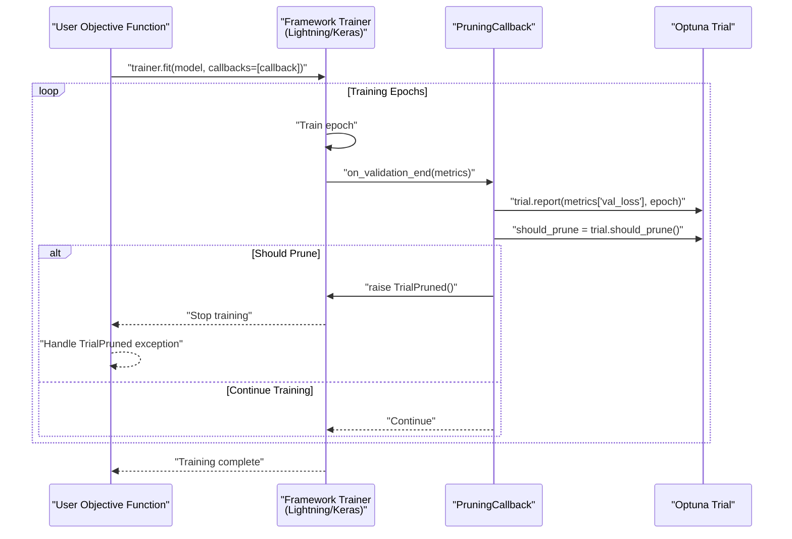

Sources: [docs/source/reference/integration.rst:13-17]()

### Estimator-Based Integrations

Estimator-based integrations provide **scikit-learn-compatible** wrappers that expose Optuna optimization through familiar estimator APIs. The primary example is `OptunaSearchCV`.

**OptunaSearchCV Architecture**

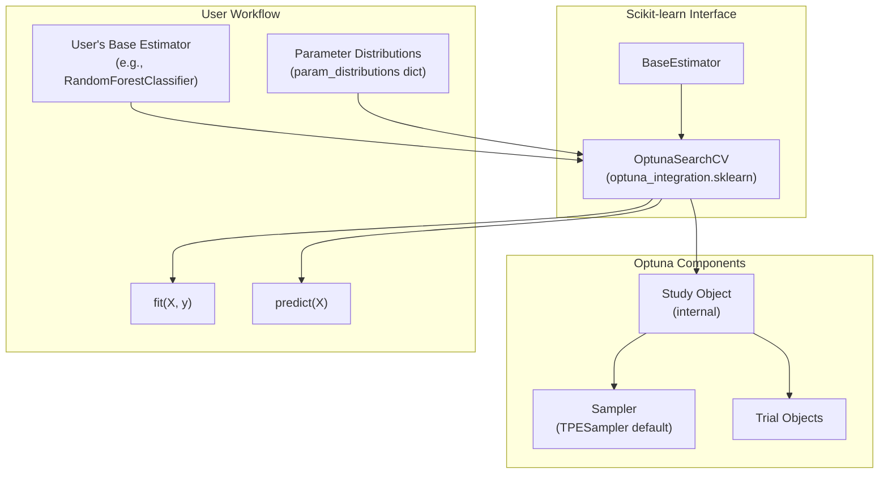

**Key Differences from Callback-Based Integrations**

| Aspect | Callback-Based | Estimator-Based |
|--------|---------------|----------------|
| **Interface** | Framework-specific callback API | Scikit-learn `BaseEstimator` API |
| **Trial Creation** | User creates trials in objective function | `OptunaSearchCV` manages trials internally |
| **Pruning** | Reports intermediate values during training | Evaluates complete model per trial |
| **Use Case** | Deep learning with iterative training | Scikit-learn models with cross-validation |
| **Example** | `PyTorchLightningPruningCallback` | `OptunaSearchCV` |

Sources: [docs/source/reference/integration.rst:19](), [optuna/integration/sklearn.py:1-11]()

## Framework-Specific Integrations

### PyTorch Lightning Integration

The PyTorch Lightning integration provides pruning capabilities for PyTorch Lightning training loops through `PyTorchLightningPruningCallback`.

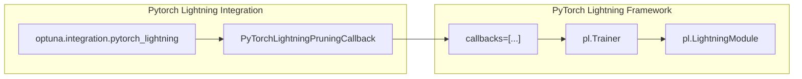

**PyTorch Lightning Integration Components**
- `PyTorchLightningPruningCallback`: Callback for pruning trials during training
- Integrates with PyTorch Lightning's callback system
- Monitors training metrics and suggests trial pruning

Sources: [optuna/integration/pytorch_lightning.py:1-11]()

### Keras and TensorFlow Integrations

The Keras ecosystem includes multiple integration points for different TensorFlow variants:

| Integration Module | Callback Class | Target Framework |
|-------------------|---------------|------------------|
| `optuna.integration.keras` | `KerasPruningCallback` | Keras |
| `optuna.integration.tensorflow` | `TensorFlowPruningHook` | TensorFlow |
| `optuna.integration.tfkeras` | `TFKerasPruningCallback` | TensorFlow Keras |

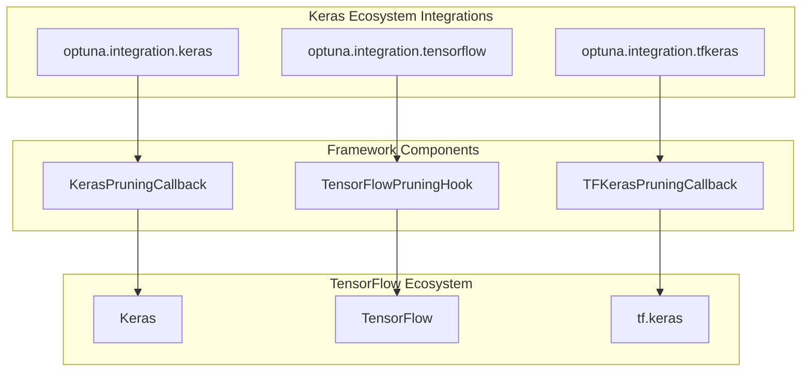

**Keras Integration Types**
- **Keras**: Standard Keras callback for pruning
- **TensorFlow**: Low-level TensorFlow hook for session-based training
- **TensorFlow Keras**: TensorFlow 2.x integrated Keras callback

Sources: [optuna/integration/keras.py:1-11](), [optuna/integration/tensorflow.py:1-11](), [optuna/integration/tfkeras.py:1-11]()

### Gradient Boosting Framework Integrations

Optuna provides comprehensive integration with gradient boosting frameworks, with special attention to LightGBM:

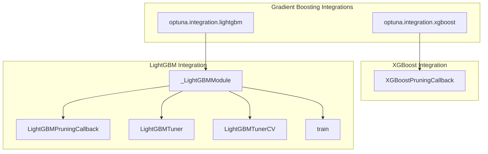

**LightGBM Special Architecture**
- `_LightGBMModule`: Custom module class implementing dynamic attribute access
- Provides both pruning callbacks and full optimization tuners
- Supports cross-validation tuning through `LightGBMTunerCV`

Sources: [optuna/integration/xgboost.py:1-11](), [optuna/integration/lightgbm.py:1-44]()

### Additional Framework Integrations

Optuna supports additional ML frameworks through dedicated integrations:

| Framework | Integration Module | Callback/Extension |
|-----------|-------------------|-------------------|
| Chainer | `optuna.integration.chainer` | `ChainerPruningExtension` |
| MXNet | `optuna.integration.mxnet` | `MXNetPruningCallback` |
| PyTorch Ignite | `optuna.integration.pytorch_ignite` | `PyTorchIgnitePruningHandler` |

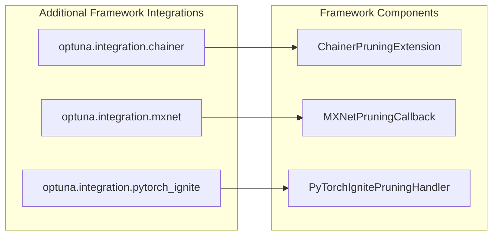

**Framework-Specific Components**
- **Chainer**: Extension-based pruning for Chainer training loops
- **MXNet**: Callback-based pruning for MXNet training
- **PyTorch Ignite**: Handler-based pruning for PyTorch Ignite engines

Sources: [optuna/integration/chainer.py:1-11](), [optuna/integration/mxnet.py:1-11](), [optuna/integration/pytorch_ignite.py:1-11]()

## Integration Error Handling

All integrations implement consistent error handling through the `_INTEGRATION_IMPORT_ERROR_TEMPLATE`:

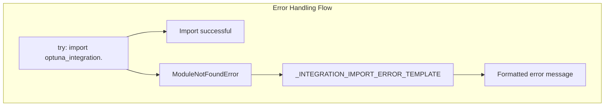

**Error Handling Pattern**
- Each integration module attempts to import from `optuna_integration`
- Failed imports trigger standardized error messages
- Error template provides consistent user guidance for missing dependencies

Sources: [optuna/integration/pytorch_lightning.py:4-7](), [optuna/integration/keras.py:4-7](), [optuna/integration/xgboost.py:4-7]()

## LightGBM Module Implementation

The LightGBM integration uses a special module implementation that provides dynamic attribute access:

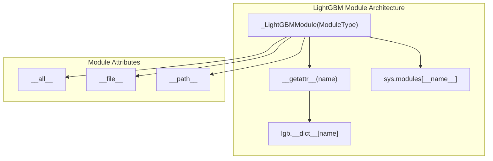

**LightGBM Module Features**
- `_LightGBMModule`: Custom `ModuleType` subclass for dynamic attribute access
- `__getattr__`: Delegates attribute access to underlying `optuna_integration.lightgbm`
- `sys.modules` replacement: Replaces module in module cache for transparent access

Sources: [optuna/integration/lightgbm.py:32-44]()

---

