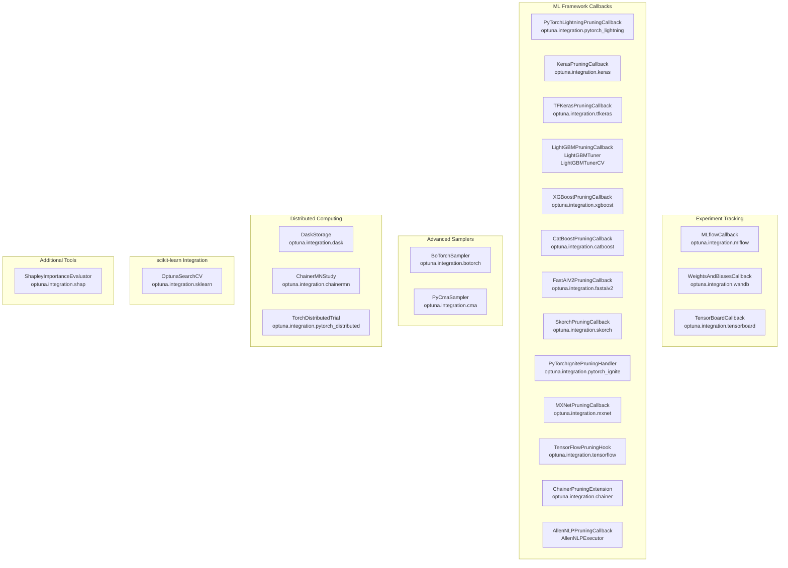
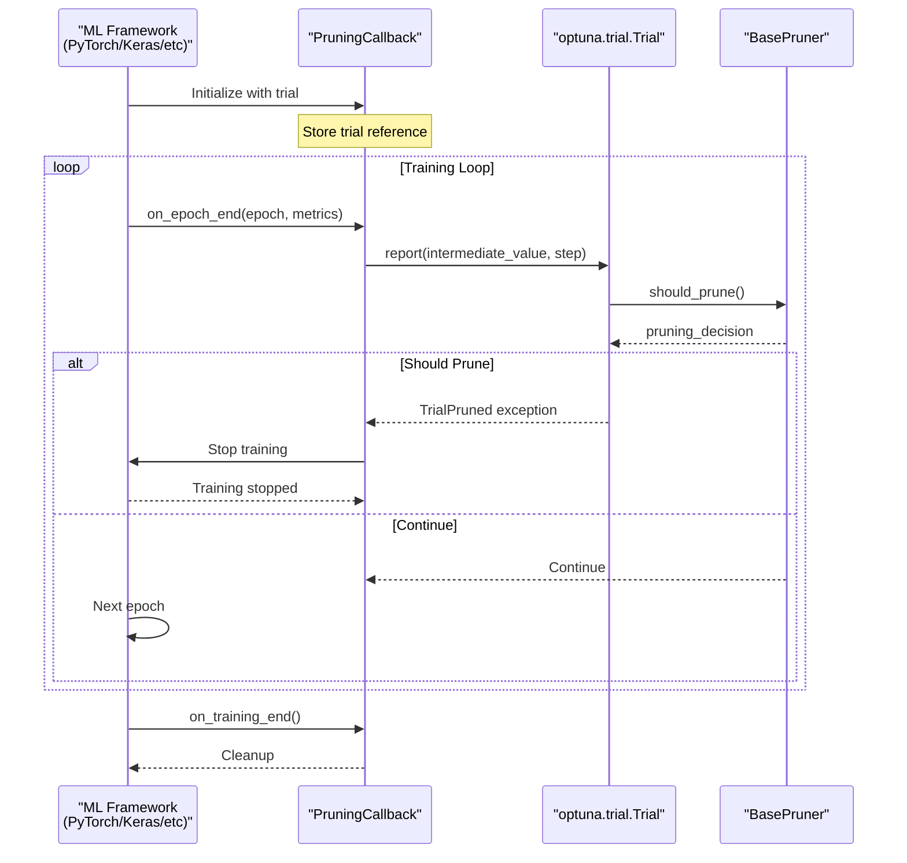
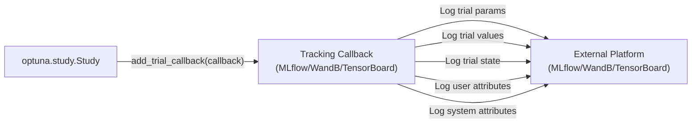
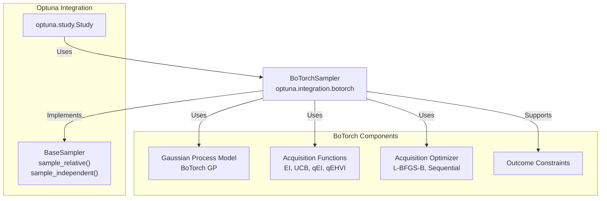
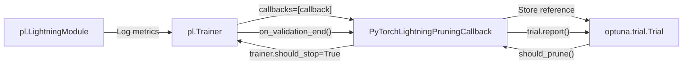
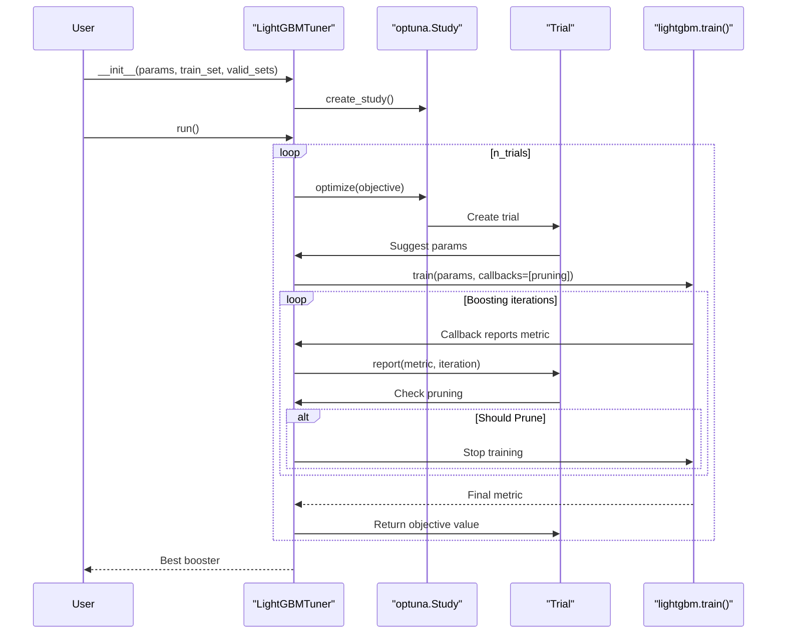
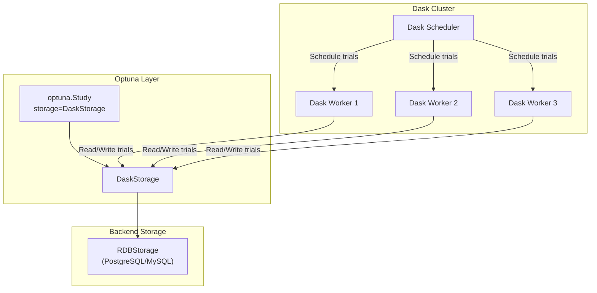
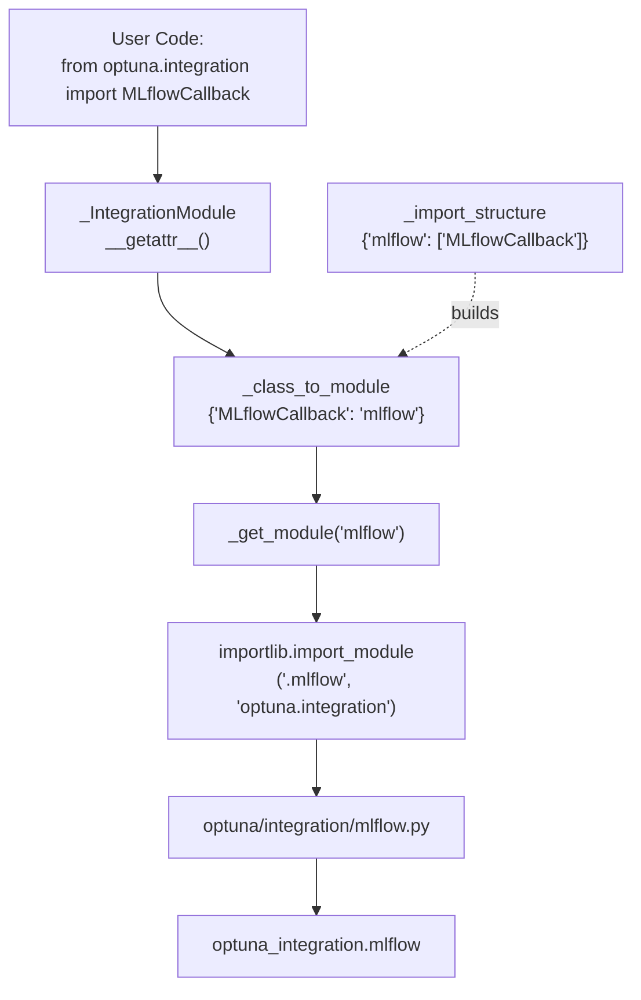

<!-- source: DeepWiki mcp.deepwiki.com · repo optuna/optuna · page 4.2 ML Framework Integrations · fetched 2026-10-21 -->

# ML Framework Integrations

<details>
<summary>Relevant source files</summary>

The following files were used as context for generating this wiki page:

- [optuna/integration/__init__.py](optuna/integration/__init__.py)
- [optuna/integration/dask.py](optuna/integration/dask.py)
- [optuna/integration/mlflow.py](optuna/integration/mlflow.py)
- [optuna/integration/wandb.py](optuna/integration/wandb.py)

</details>


## Purpose and Scope

This document covers Optuna's integrations with external machine learning frameworks and tools. These integrations enable seamless use of Optuna's optimization capabilities within existing ML workflows. The integrations are organized into five categories: experiment tracking, ML framework pruning callbacks, advanced samplers, distributed computing, and scikit-learn compatibility.

For information about the lazy loading architecture and general callback patterns used by integrations, see [Integration Architecture and Lazy Loading](#4.1).

**Sources:** [optuna/integration/__init__.py:1-137]()

---

## Integration Categories

Optuna provides integrations across multiple categories, each serving a distinct purpose within the ML workflow. All integrations are defined in the `_import_structure` dictionary and loaded lazily to minimize import overhead.



**Integration Categories and Use Cases:**

| Category | Purpose | Key Integrations |
|----------|---------|------------------|
| Experiment Tracking | Log trials, parameters, and metrics to external tracking platforms | MLflow, Weights & Biases, TensorBoard |
| ML Framework Callbacks | Enable pruning within framework training loops | PyTorch Lightning, Keras, LightGBM, XGBoost |
| Advanced Samplers | Provide alternative optimization algorithms via external libraries | BoTorch (Bayesian optimization), PyCMA (CMA-ES) |
| Distributed Computing | Enable distributed optimization across multiple workers | Dask, ChainerMN, PyTorch Distributed |
| scikit-learn | Drop-in replacement for GridSearchCV/RandomizedSearchCV | OptunaSearchCV |

**Sources:** [optuna/integration/__init__.py:10-34](), [optuna/integration/__init__.py:37-65]()

---

## Common Integration Patterns

### Pruning Callback Pattern

ML framework integrations typically implement a callback pattern that reports intermediate metrics to Optuna and checks for pruning decisions. The callback integrates into the framework's training loop lifecycle.



**Callback Lifecycle Methods:**

| Method | Purpose | Called When |
|--------|---------|-------------|
| `__init__(trial)` | Store trial reference | Callback instantiation |
| `on_epoch_end()` | Report metric and check pruning | After each training epoch |
| `on_batch_end()` | Report metric and check pruning (optional) | After each training batch |
| `on_training_end()` | Cleanup resources | Training completes |

**Sources:** [optuna/integration/__init__.py:20-32]()

### Experiment Tracking Callback Pattern

Experiment tracking integrations log study metadata, trial parameters, and optimization results to external platforms. These callbacks hook into the Study's lifecycle rather than individual trials.



**Experiment tracking callbacks typically log:**
- Trial parameters and distributions
- Objective values (single or multi-objective)
- Trial state (COMPLETE, PRUNED, FAIL)
- User-defined attributes
- System attributes (sampler, pruner)
- Intermediate values (learning curves)
- Study metadata (study name, directions)

**Sources:** [optuna/integration/__init__.py:18-19](), [optuna/integration/__init__.py:29]()

---

## Key Integrations

### MLflow Integration

The `MLflowCallback` logs Optuna trials to MLflow tracking server, enabling centralized experiment management and result visualization.

**Module Location:** [optuna/integration/mlflow.py:1-11]()

**Implementation Pattern:**
```
optuna.integration.mlflow
    └── Imports from optuna_integration.mlflow.MLflowCallback
    └── Raises ModuleNotFoundError if optuna-integration not installed
```

**Logged Information:**
- Trial parameters as MLflow parameters
- Objective values as MLflow metrics
- Trial state as MLflow tags
- User attributes as MLflow tags
- System attributes (sampler name, pruner name)
- Intermediate values as time-series metrics

**Usage Pattern:**
```python
import optuna
from optuna.integration.mlflow import MLflowCallback

mlflow_callback = MLflowCallback(
    tracking_uri="http://localhost:5000",
    metric_name="accuracy"
)

study = optuna.create_study()
study.optimize(objective, n_trials=100, callbacks=[mlflow_callback])
```

**Sources:** [optuna/integration/mlflow.py:1-11](), [optuna/integration/__init__.py:18]()

### Weights & Biases Integration

The `WeightsAndBiasesCallback` logs trials to Weights & Biases platform for experiment tracking, visualization, and collaboration.

**Module Location:** [optuna/integration/wandb.py:1-11]()

**Implementation Pattern:**
```
optuna.integration.wandb
    └── Imports from optuna_integration.wandb.WeightsAndBiasesCallback
    └── Raises ModuleNotFoundError if optuna-integration not installed
```

**Features:**
- Automatic W&B run creation per trial
- Parameter logging to W&B config
- Metric logging with step information
- Parallel coordinate plots
- Hyperparameter importance plots
- Optimization history visualization

**Sources:** [optuna/integration/wandb.py:1-11](), [optuna/integration/__init__.py:19]()

### OptunaSearchCV (scikit-learn Integration)

`OptunaSearchCV` provides a drop-in replacement for scikit-learn's `GridSearchCV` and `RandomizedSearchCV`, enabling sophisticated hyperparameter optimization with Optuna's samplers.

**Module:** `optuna.integration.sklearn`

**Key Features:**

| Feature | Description |
|---------|-------------|
| scikit-learn API compatibility | Implements `fit()`, `predict()`, `score()` methods |
| Cross-validation support | Integrates with scikit-learn's CV splitters |
| Sampler selection | Use any Optuna sampler (TPE, GP, CMA-ES, etc.) |
| Pruning support | Early-stop unpromising hyperparameter combinations |
| Warm start | Resume optimization from previous runs |
| Best estimator access | Retrieve best model via `best_estimator_` attribute |

**Distribution Mapping:**
- `scipy.stats` distributions → Optuna distributions
- `IntDistribution` for integer parameters
- `FloatDistribution` for continuous parameters
- `CategoricalDistribution` for discrete choices

**Advantages over GridSearchCV:**
- Intelligent sampling instead of exhaustive search
- Pruning of unpromising trials
- Multi-objective optimization support
- Study persistence via storage backends

**Sources:** [optuna/integration/__init__.py:25](), [optuna/integration/__init__.py:89]()

### BoTorch Integration

The `BoTorchSampler` provides Bayesian optimization using Facebook Research's BoTorch library, offering advanced acquisition functions and constraints.

**Module:** `optuna.integration.botorch`

**Key Capabilities:**



**Features:**
- Quasi-Monte Carlo acquisition function optimization
- Multi-objective optimization with qEHVI (Expected Hypervolume Improvement)
- Outcome constraints (e.g., runtime < threshold)
- Batch sampling for parallel optimization
- Custom GP priors and kernels

**Use Cases:**
- Expensive black-box optimization
- Multi-objective optimization with constraints
- Batch parallel optimization
- Transfer learning via GP priors

**Sources:** [optuna/integration/__init__.py:12](), [optuna/integration/__init__.py:71]()

### PyTorch Lightning Integration

The `PyTorchLightningPruningCallback` enables early stopping of PyTorch Lightning training based on intermediate metrics.

**Module:** `optuna.integration.pytorch_lightning`

**Integration Points:**



**Implementation Pattern:**
1. Create `PyTorchLightningPruningCallback` with trial and metric name
2. Pass callback to `pl.Trainer(callbacks=[...])`
3. Lightning module logs metrics via `self.log(metric_name, value)`
4. Callback retrieves metric and reports to trial
5. If pruned, callback sets `trainer.should_stop = True`

**Monitored Metrics:**
- Validation loss
- Validation accuracy
- Custom logged metrics

**Sources:** [optuna/integration/__init__.py:24](), [optuna/integration/__init__.py:87]()

### LightGBM Integration

Optuna provides three LightGBM integrations: `LightGBMPruningCallback`, `LightGBMTuner`, and `LightGBMTunerCV`.

**Module:** `optuna.integration.lightgbm`

**Components:**

| Component | Purpose | Usage Pattern |
|-----------|---------|---------------|
| `LightGBMPruningCallback` | Prune during `lgb.train()` | Manual parameter suggestion |
| `LightGBMTuner` | Automatic hyperparameter tuning | Replace `lgb.train()` |
| `LightGBMTunerCV` | Automatic tuning with CV | Replace `lgb.cv()` |

**LightGBMTuner Workflow:**



**Tuned Hyperparameters:**
- `num_leaves`, `max_depth` (tree structure)
- `learning_rate`, `feature_fraction` (training dynamics)
- `bagging_fraction`, `bagging_freq` (sampling)
- `lambda_l1`, `lambda_l2` (regularization)
- `min_child_samples` (leaf constraints)

**Sources:** [optuna/integration/__init__.py:21](), [optuna/integration/__init__.py:80-82]()

### Dask Integration

The `DaskStorage` enables distributed Optuna studies using Dask's distributed scheduler.

**Module Location:** [optuna/integration/dask.py:1-11]()

**Implementation Pattern:**
```
optuna.integration.dask
    └── Imports from optuna_integration.dask.DaskStorage
    └── Raises ModuleNotFoundError if optuna-integration not installed
```

**Architecture:**



**Features:**
- Distributed trial execution across Dask workers
- Shared storage backend for trial synchronization
- Fault tolerance via Dask's task retry mechanism
- Dynamic worker scaling

**Use Cases:**
- Large-scale hyperparameter search
- Distributed training of models
- Cloud-based optimization (e.g., Dask on Kubernetes)

**Sources:** [optuna/integration/dask.py:1-11](), [optuna/integration/__init__.py:17]()

---

## Integration Loading Architecture

All integrations use lazy loading implemented by `_IntegrationModule` to avoid importing unused dependencies.

**Loading Mechanism:**



**Loading Flow:**

1. User imports integration class (e.g., `from optuna.integration import MLflowCallback`)
2. `_IntegrationModule.__getattr__("MLflowCallback")` is called
3. Lookup class in `_class_to_module` to find module name (`"mlflow"`)
4. Call `_get_module("mlflow")` to import `optuna.integration.mlflow`
5. `optuna/integration/mlflow.py` imports from `optuna_integration.mlflow`
6. If `optuna-integration` not installed, raise `ModuleNotFoundError` with helpful message
7. Cache imported class in module for subsequent access

**Error Handling:**

When an integration's dependencies are not installed, Optuna raises a descriptive error:

```python
# Template from optuna/_imports.py
_INTEGRATION_IMPORT_ERROR_TEMPLATE = (
    "optuna-integration is not installed. "
    "Please install optuna-integration to use {0} integration."
)
```

**Benefits:**
- Fast `import optuna` even with many integrations
- Only pay import cost for used integrations
- Clear error messages for missing dependencies
- Maintains IDE autocomplete via `TYPE_CHECKING` block

**Sources:** [optuna/integration/__init__.py:98-136](), [optuna/integration/mlflow.py:1-11](), [optuna/integration/wandb.py:1-11](), [optuna/integration/dask.py:1-11]()

---

## Integration Summary Table

| Integration | Type | Primary Use Case | Key Classes |
|-------------|------|------------------|-------------|
| **MLflow** | Experiment Tracking | Log trials to MLflow server | `MLflowCallback` |
| **Weights & Biases** | Experiment Tracking | Log trials to W&B platform | `WeightsAndBiasesCallback` |
| **TensorBoard** | Experiment Tracking | Log trials to TensorBoard | `TensorBoardCallback` |
| **PyTorch Lightning** | Pruning Callback | Early-stop Lightning training | `PyTorchLightningPruningCallback` |
| **Keras** | Pruning Callback | Early-stop Keras training | `KerasPruningCallback` |
| **TensorFlow Keras** | Pruning Callback | Early-stop TF Keras training | `TFKerasPruningCallback` |
| **LightGBM** | Pruning + Tuner | Tune LightGBM hyperparameters | `LightGBMPruningCallback`, `LightGBMTuner`, `LightGBMTunerCV` |
| **XGBoost** | Pruning Callback | Early-stop XGBoost training | `XGBoostPruningCallback` |
| **CatBoost** | Pruning Callback | Early-stop CatBoost training | `CatBoostPruningCallback` |
| **FastAI** | Pruning Callback | Early-stop FastAI training | `FastAIV2PruningCallback` |
| **scikit-learn** | Search Utility | Drop-in GridSearchCV replacement | `OptunaSearchCV` |
| **BoTorch** | Advanced Sampler | Bayesian optimization with BoTorch | `BoTorchSampler` |
| **PyCMA** | Advanced Sampler | CMA-ES via pycma library | `PyCmaSampler` |
| **Dask** | Distributed Storage | Distributed optimization | `DaskStorage` |
| **ChainerMN** | Distributed Computing | Multi-node Chainer training | `ChainerMNStudy` |
| **PyTorch Distributed** | Distributed Computing | Distributed PyTorch trials | `TorchDistributedTrial` |
| **SHAP** | Importance Analysis | Shapley-based parameter importance | `ShapleyImportanceEvaluator` |

**Sources:** [optuna/integration/__init__.py:10-34](), [optuna/integration/__init__.py:37-65]()

---

