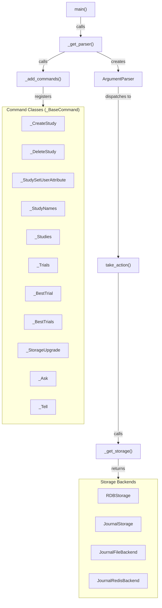
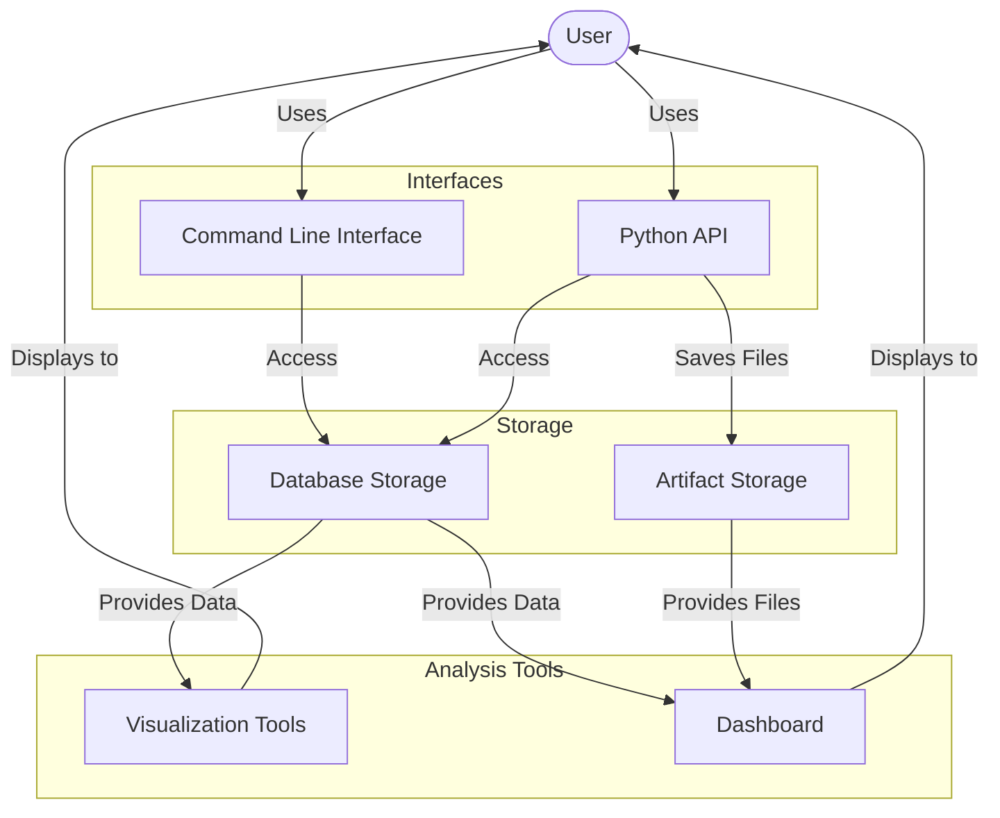

<!-- source: DeepWiki mcp.deepwiki.com · repo optuna/optuna · page 5 Tools and User Interfaces · fetched 2026-10-21 -->

# Tools and User Interfaces

<details>
<summary>Relevant source files</summary>

The following files were used as context for generating this wiki page:

- [.pre-commit-config.yaml](.pre-commit-config.yaml)
- [CONTRIBUTING.md](CONTRIBUTING.md)
- [optuna/cli.py](optuna/cli.py)
- [pyproject.toml](pyproject.toml)
- [tests/test_cli.py](tests/test_cli.py)

</details>


This document provides an overview of the tools and interfaces available for interacting with Optuna beyond its core Python API. These tools enhance the usability of Optuna by providing command-line access, visualization capabilities, and artifact management features.

## Command Line Interface

Optuna provides a comprehensive command-line interface through `optuna.cli` that allows users to manage studies and trials without writing Python code. The CLI is particularly useful for checking study status, managing studies, and integrating Optuna into shell scripts or automation workflows.

### CLI Architecture



Sources: [optuna/cli.py:979-1007](), [optuna/cli.py:814-826](), [optuna/cli.py:273-304](), [optuna/cli.py:57-79]()

### Available Commands

The CLI commands are defined in the `_COMMANDS` dictionary and implemented as `_BaseCommand` subclasses:

| Command | Class | Description |
|---------|-------|-------------|
| `create-study` | `_CreateStudy` | Create a new study with optional direction/directions |
| `delete-study` | `_DeleteStudy` | Delete a specified study from storage |
| `study set-user-attr` | `_StudySetUserAttribute` | Set a user attribute to a study |
| `study-names` | `_StudyNames` | Get all study names stored in a storage backend |
| `studies` | `_Studies` | Show a list of studies with metadata |
| `trials` | `_Trials` | Show a list of trials in a study (experimental) |
| `best-trial` | `_BestTrial` | Show the best trial of a study (experimental) |
| `best-trials` | `_BestTrials` | Show trials at the Pareto front (experimental) |
| `storage upgrade` | `_StorageUpgrade` | Upgrade the schema of an RDB storage |
| `ask` | `_Ask` | Create a new trial and suggest parameters (experimental) |
| `tell` | `_Tell` | Finish a trial with values and state (experimental) |

Each command class inherits from `_BaseCommand` and implements `add_arguments()` and `take_action()` methods.

Sources: [optuna/cli.py:814-826](), [optuna/cli.py:273-304](), [optuna/cli.py:307-352](), [optuna/cli.py:655-811]()

### Output Formats

The CLI supports multiple output formats through the `_format_output()` function:

- `value`: Simple space-separated values output
- `table`: Formatted ASCII table with `_dump_table()`  
- `json`: JSON format using `json.dumps()`
- `yaml`: YAML format using `yaml.safe_dump()`

```bash
# Example of using different output formats
optuna studies --storage sqlite:///example.db --format json
optuna trials --study-name "my_study" --storage sqlite:///example.db --format table
```

The formatting system uses `_format_value()` to handle various data types including `datetime` objects, lists, tuples, and nested dictionaries. The `_convert_to_dict()` function processes multi-index column structures and supports flattening via the `--flatten` flag.

Sources: [optuna/cli.py:244-270](), [optuna/cli.py:82-95](), [optuna/cli.py:98-153](), [optuna/cli.py:191-241]()

## Visualization System

Optuna provides comprehensive visualization capabilities for analyzing optimization results. The visualization system supports both Plotly and Matplotlib backends with various plot types to understand parameter relationships and optimization progress.

For detailed information about visualization features, implementations, and plotting backends, see [Page 5.2: Visualization]().

## Artifact Management

Optuna includes an artifact system for storing and retrieving files associated with trials, such as model checkpoints, plots, or other outputs generated during optimization. This enables reproducibility and sharing of optimization artifacts across different environments.

For detailed information about the artifact management system, storage backends, and usage patterns, see [Page 5.3: Artifact Management]().

## Integration of Tools

The CLI, visualization tools, and artifact management work together to provide a comprehensive toolset for hyperparameter optimization:



Sources: Based on the overall system architecture diagram provided.

This integrated set of tools allows for a flexible workflow, where users can:
1. Define and run studies using the Python API
2. Monitor progress via the CLI or dashboard
3. Analyze results using visualization tools
4. Access artifacts (models, checkpoints) for deployment or further analysis

Each tool serves a specific purpose in the optimization workflow, enabling users to efficiently navigate the hyperparameter space and identify optimal configurations for their machine learning models.

---

