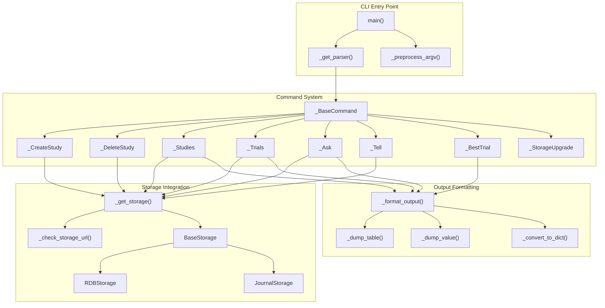
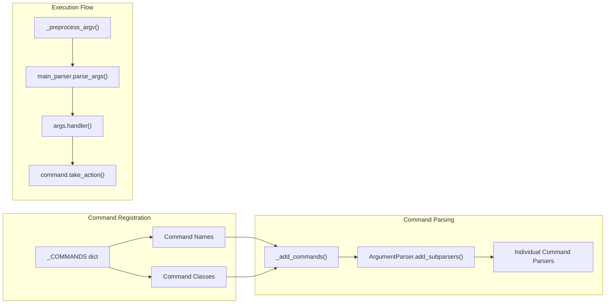
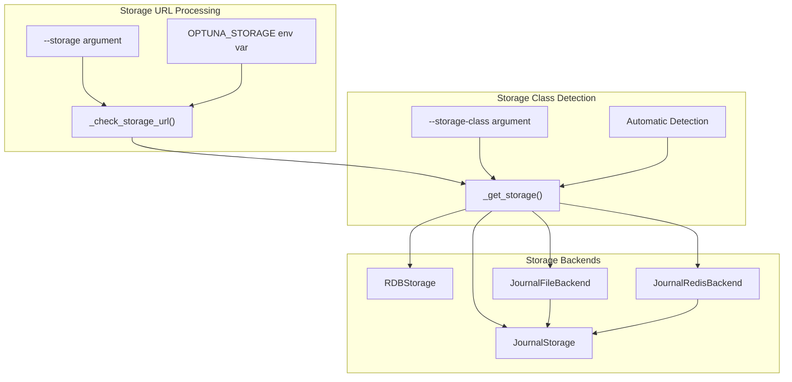
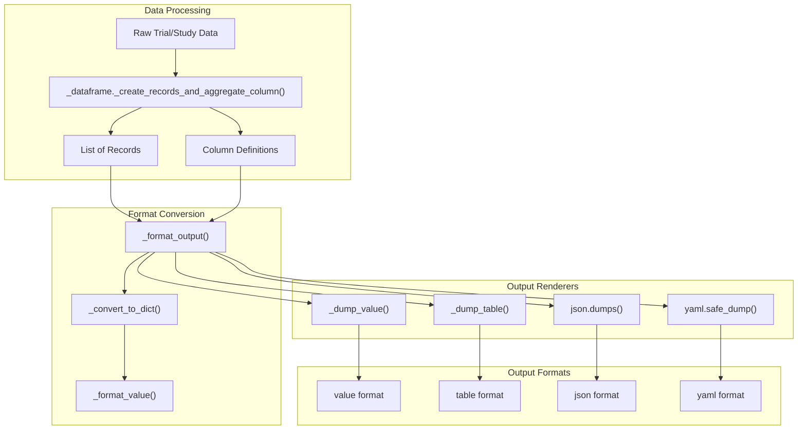
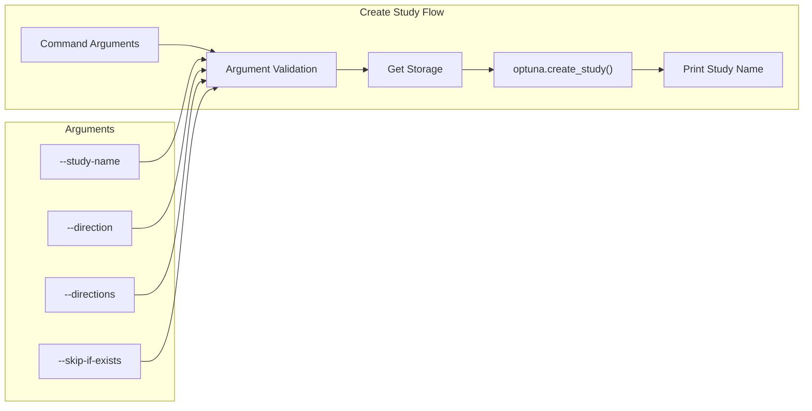
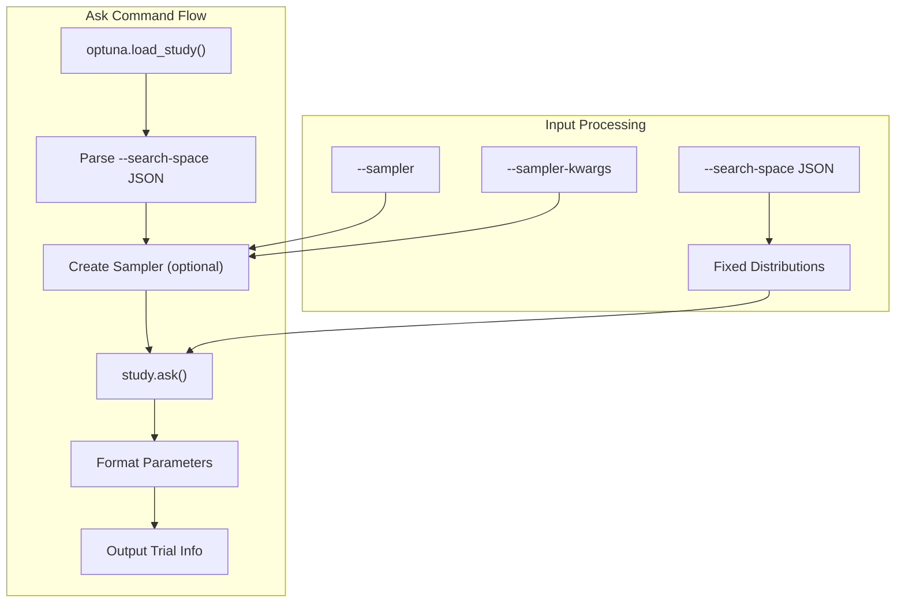
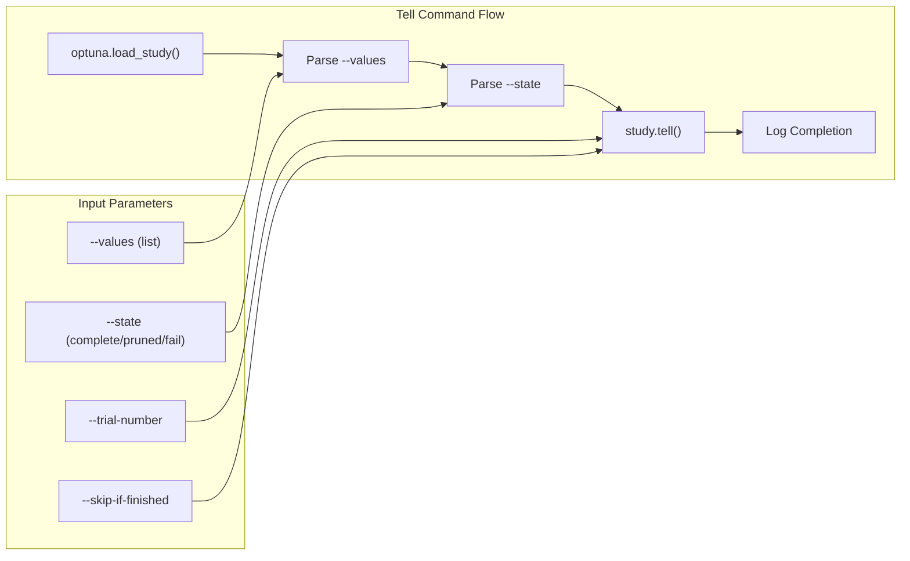
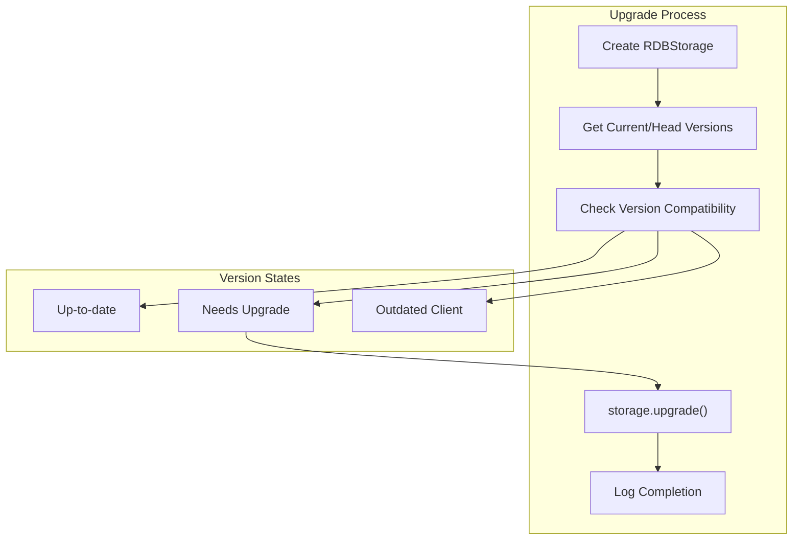

<!-- source: DeepWiki mcp.deepwiki.com · repo optuna/optuna · page 5.1 Command-Line Interface · fetched 2026-10-21 -->

# Command Line Interface

<details>
<summary>Relevant source files</summary>

The following files were used as context for generating this wiki page:

- [optuna/cli.py](optuna/cli.py)
- [tests/test_cli.py](tests/test_cli.py)

</details>


This document describes Optuna's command line interface (CLI) system, which provides programmatic access to study and trial management operations from the command line. The CLI enables users to create studies, manage trials, query optimization results, and perform storage operations without writing Python code.

For information about Optuna's Python API for study management, see [Study and Trial Management](2.1). For details about storage backends used by the CLI, see [Storage System](2.3).

## Purpose and Architecture

The CLI system provides a unified interface for interacting with Optuna studies and trials through shell commands. It supports multiple storage backends, various output formats, and implements a modular command structure where each operation is handled by a dedicated command class.

### CLI Architecture Overview



Sources: [optuna/cli.py:1-1008]()

## Command Structure and Registration

The CLI uses a class-based command system where each command inherits from `_BaseCommand`. Commands are registered in the `_COMMANDS` dictionary, which maps command names to their implementation classes.

### Command Registration System



| Command Name | Class | Purpose |
|-------------|-------|---------|
| `create-study` | `_CreateStudy` | Create a new optimization study |
| `delete-study` | `_DeleteStudy` | Delete an existing study |
| `study set-user-attr` | `_StudySetUserAttribute` | Set user attributes on a study |
| `study-names` | `_StudyNames` | List all study names |
| `studies` | `_Studies` | Show detailed study information |
| `trials` | `_Trials` | Show trial information for a study |
| `best-trial` | `_BestTrial` | Show the best trial for a study |
| `best-trials` | `_BestTrials` | Show Pareto-optimal trials |
| `storage upgrade` | `_StorageUpgrade` | Upgrade RDB storage schema |
| `ask` | `_Ask` | Create a trial and suggest parameters |
| `tell` | `_Tell` | Complete a trial with objective values |

Sources: [optuna/cli.py:814-826](), [optuna/cli.py:893-914]()

## Storage Integration

The CLI integrates with Optuna's storage system through the `_get_storage()` function, which automatically detects the appropriate storage backend based on the provided URL or explicit storage class specification.

### Storage Backend Selection



The storage selection logic follows this priority order:
1. Use `--storage` command line argument if provided
2. Fall back to `OPTUNA_STORAGE` environment variable
3. Auto-detect storage type based on URL format:
   - URLs starting with `redis://` use `JournalRedisBackend`
   - Existing file paths use `JournalFileBackend`
   - Database URLs use `RDBStorage`

Sources: [optuna/cli.py:42-80](), [optuna/cli.py:846-861]()

## Output Formatting System

The CLI supports multiple output formats through a unified formatting system that converts internal data structures to user-friendly representations.

### Output Format Pipeline



| Format | Description | Use Case | Single Record | Multiple Records |
|--------|-------------|----------|---------------|------------------|
| `value` | Space-separated values | Script processing, pipes | Single line | Multiple lines |
| `table` | ASCII table with borders | Human-readable console output | Single row + headers | Multiple rows |
| `json` | JSON object/array | API integration | Object `{}` | Array `[{}, {}]` |
| `yaml` | YAML document | Configuration files | Single document | List document |

The formatting system handles datetime objects using the format `"%Y-%m-%d %H:%M:%S"` and converts complex types to strings for serialization compatibility.

Sources: [optuna/cli.py:244-271](), [optuna/cli.py:191-241](), [optuna/cli.py:39](), [tests/test_cli.py:64-99]()

## Core Commands

### Study Management Commands

The CLI provides comprehensive study lifecycle management through dedicated commands for creation, deletion, and attribute management.

#### Create Study Command

The `_CreateStudy` command creates new optimization studies with configurable directions and names.



Key features:
- Supports single-objective (`--direction`) and multi-objective (`--directions`) optimization
- Optional study naming with `--study-name`
- Duplicate handling with `--skip-if-exists`
- Returns the created study name for use in subsequent commands

Sources: [optuna/cli.py:307-353]()

#### Delete Study Command

The `_DeleteStudy` command permanently removes studies from storage.

```python
# Example usage
optuna delete-study --storage sqlite:///example.db --study-name my-study
```

Sources: [optuna/cli.py:355-366]()

### Trial Management Commands

#### Ask Command

The `_Ask` command creates new trials and suggests parameter values, supporting the ask-and-tell optimization pattern. This command is marked as experimental.



The search space parameter accepts JSON-serialized distribution specifications:
```json
{
  "x": {
    "name": "FloatDistribution", 
    "attributes": {"low": 0.0, "high": 1.0}
  },
  "y": {
    "name": "CategoricalDistribution",
    "attributes": {"choices": ["A", "B", "C"]}
  }
}
```

**Note:** The `ask` command requires that a study be created beforehand using `create-study`. Implicit study creation was removed in Optuna v4.0.0.

**Example workflow:**
```bash
# Create study
optuna create-study --storage sqlite:///example.db --study-name opt-study

# Ask for parameters (creates trial)
optuna ask --storage sqlite:///example.db --study-name opt-study \
  --search-space '{"x": {"name": "FloatDistribution", "attributes": {"low": 0.0, "high": 1.0}}}'

# Output: {"number": 0, "params": {"x": 0.42}}
```

The `--sampler` argument accepts any sampler class name from `optuna.samplers` (e.g., `TPESampler`, `RandomSampler`), and `--sampler-kwargs` provides initialization arguments as JSON.

Sources: [optuna/cli.py:655-758](), [optuna/cli.py:689-757](), [tests/test_cli.py:1143-1197]()

#### Tell Command

The `_Tell` command completes trials by providing objective values and final states. This command is marked as experimental.



**Example workflow:**
```bash
# Complete trial with objective value
optuna tell --storage sqlite:///example.db --study-name opt-study \
  --trial-number 0 --values 0.25

# Mark trial as failed
optuna tell --storage sqlite:///example.db --study-name opt-study \
  --trial-number 1 --state fail

# Skip already finished trials
optuna tell --storage sqlite:///example.db --study-name opt-study \
  --trial-number 0 --values 0.30 --skip-if-finished
```

For multi-objective optimization, multiple values can be provided: `--values 0.25 0.50`. When `--state` is omitted, the trial is marked as `COMPLETE`. The `--skip-if-finished` flag prevents errors when attempting to update already-completed trials.

Sources: [optuna/cli.py:760-812](), [tests/test_cli.py:1446-1527]()

#### Ask-Tell Workflow Example

Complete example of distributed optimization using the ask-tell pattern:

```bash
# 1. Create the study once
optuna create-study --storage sqlite:///distributed.db --study-name dist-opt

# 2. Worker 1: Ask for parameters
TRIAL_1=$(optuna ask --storage sqlite:///distributed.db --study-name dist-opt \
  --search-space '{"x": {"name": "FloatDistribution", "attributes": {"low": -10, "high": 10}}}' \
  --format json)

# 3. Worker 1: Evaluate objective function
PARAMS=$(echo $TRIAL_1 | jq -r '.params.x')
VALUE=$(python evaluate.py $PARAMS)  # Your evaluation script

# 4. Worker 1: Report results
TRIAL_NUM=$(echo $TRIAL_1 | jq -r '.number')
optuna tell --storage sqlite:///distributed.db --study-name dist-opt \
  --trial-number $TRIAL_NUM --values $VALUE

# 5. Worker 2 can run steps 2-4 in parallel
```

Sources: [optuna/cli.py:655-812]()

### Query Commands

#### Studies Command

The `_Studies` command provides comprehensive study information including metadata, trial counts, and user attributes.

Output columns:
- `name`: Study name
- `direction`: Optimization direction(s) as tuple
- `n_trials`: Number of completed trials
- `datetime_start`: Study creation timestamp
- `user_attrs`: User-defined attributes (if any exist)

**Example usage:**
```bash
# Default table format
optuna studies --storage sqlite:///example.db

# JSON output for multi-objective studies
optuna studies --storage sqlite:///example.db --format json

# Flatten nested columns like directions
optuna studies --storage sqlite:///example.db --flatten
```

The `--flatten` option converts nested structures (like `direction` tuples and `user_attrs` dicts) into separate columns. For example, a multi-objective study with directions `["minimize", "maximize"]` produces columns `direction_0` and `direction_1`.

Sources: [optuna/cli.py:415-468](), [tests/test_cli.py:375-439](), [tests/test_cli.py:442-529]()

#### Trials Command

The `_Trials` command displays detailed trial information for a specific study, including parameters, values, and execution metadata. This command is marked as experimental.

**Standard output attributes:**
- `number`: Trial number
- `value` / `values`: Objective value(s) for single/multi-objective
- `datetime_start`: Trial start time
- `datetime_complete`: Trial completion time
- `duration`: Execution duration
- `params`: Parameter values (nested dict)
- `user_attrs`: User attributes (nested dict)
- `state`: Trial state (COMPLETE, PRUNED, FAIL, RUNNING)

**Example usage:**
```bash
# Default table format
optuna trials --storage sqlite:///example.db --study-name my-study

# JSON format for programmatic access
optuna trials --storage sqlite:///example.db --study-name my-study --format json

# Flattened output with separate columns for each parameter
optuna trials --storage sqlite:///example.db --study-name my-study --flatten --format yaml
```

The `--flatten` option is particularly useful for studies with branched search spaces, converting `params` dict into individual columns like `params_x`, `params_y`. Missing parameters (e.g., from conditional branches) appear as empty strings in table/value formats or are omitted in JSON/YAML formats.

Sources: [optuna/cli.py:470-518](), [tests/test_cli.py:531-607](), [tests/test_cli.py:609-683]()

#### Best Trial Commands

Optuna provides two commands for retrieving optimal trials:

**`best-trial` Command** - Returns the single best trial for single-objective optimization:

```bash
optuna best-trial --storage sqlite:///example.db --study-name my-study --format json
```

This command outputs the trial with the optimal objective value according to the study direction (minimize or maximize). For multi-objective studies, it raises an error.

**`best-trials` Command** - Returns Pareto-optimal trials for multi-objective optimization:

```bash
optuna best-trials --storage sqlite:///example.db --study-name pareto-study --format table
```

This command outputs all trials on the Pareto front, sorted by their dominance relationships. For single-objective studies, it returns only the single best trial.

Both commands support the same output formats and `--flatten` option as the `trials` command.

Sources: [optuna/cli.py:520-571](), [optuna/cli.py:573-623](), [tests/test_cli.py:685-764](), [tests/test_cli.py:842-925]()

## Storage Operations

### Storage Upgrade Command

The `_StorageUpgrade` command handles RDB storage schema migrations to ensure compatibility with newer Optuna versions.



Sources: [optuna/cli.py:625-653]()

## Common Arguments and Configuration

All CLI commands share common arguments for storage configuration, logging, and debugging:

| Argument | Purpose | Default | Example |
|----------|---------|---------|---------|
| `--storage` | Storage URL or path | From `OPTUNA_STORAGE` env var | `sqlite:///db.sqlite3` |
| `--storage-class` | Explicit storage backend hint | Auto-detected | `JournalFileBackend` |
| `--verbose` / `-v` | Increase logging verbosity (repeatable) | INFO level | `-vv` for DEBUG |
| `--quiet` / `-q` | Reduce logging to warnings/errors | - | `-q` |
| `--log-file` | Write logs to file | stderr only | `--log-file optuna.log` |
| `--debug` | Show full tracebacks on errors | False | `--debug` |

### Environment Variables

The `OPTUNA_STORAGE` environment variable provides a convenient way to avoid repeating the `--storage` argument:

```bash
# Set environment variable
export OPTUNA_STORAGE=sqlite:///~/optuna-studies.db

# Commands automatically use the environment storage
optuna create-study --study-name experiment-1
optuna ask --study-name experiment-1
```

**Note:** Specifying storage via `OPTUNA_STORAGE` is marked as an experimental feature and may change in future versions.

### Accepted Storage Classes

The `--storage-class` argument accepts these values:
- `RDBStorage` - For SQL database URLs
- `JournalFileBackend` - For file-based journal storage
- `JournalRedisBackend` - For Redis-based journal storage

Deprecated aliases `JournalFileStorage` and `JournalRedisStorage` are still accepted but not recommended.

Sources: [optuna/cli.py:846-891](), [optuna/cli.py:947-977](), [optuna/cli.py:42-55](), [optuna/cli.py:829-844]()

## Error Handling and Validation

The CLI implements comprehensive error handling through the `CLIUsageError` exception class and input validation functions. Storage URL validation supports environment variable fallback and provides clear error messages for configuration issues.

```python
# Storage URL validation with environment fallback
def _check_storage_url(storage_url: str | None) -> str:
    if storage_url is not None:
        return storage_url
    
    env_storage = os.environ.get("OPTUNA_STORAGE")
    if env_storage is not None:
        return env_storage
    raise CLIUsageError("Storage URL is not specified.")
```

Sources: [optuna/cli.py:42-55](), [optuna/cli.py:992-1008]()

---

