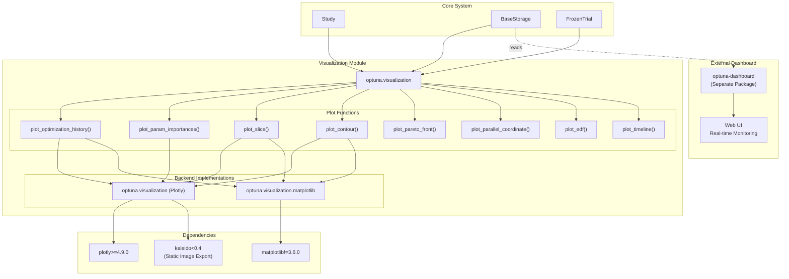
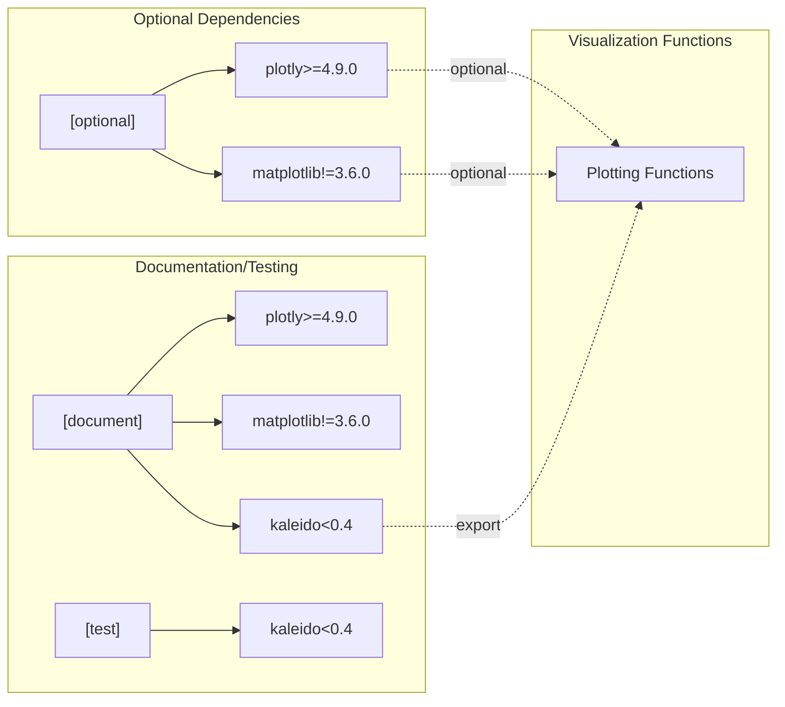
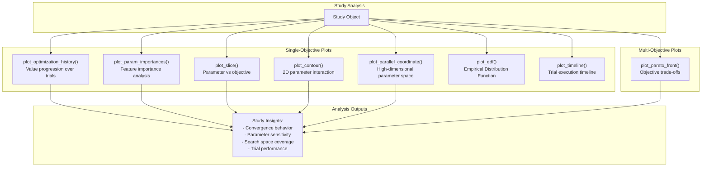
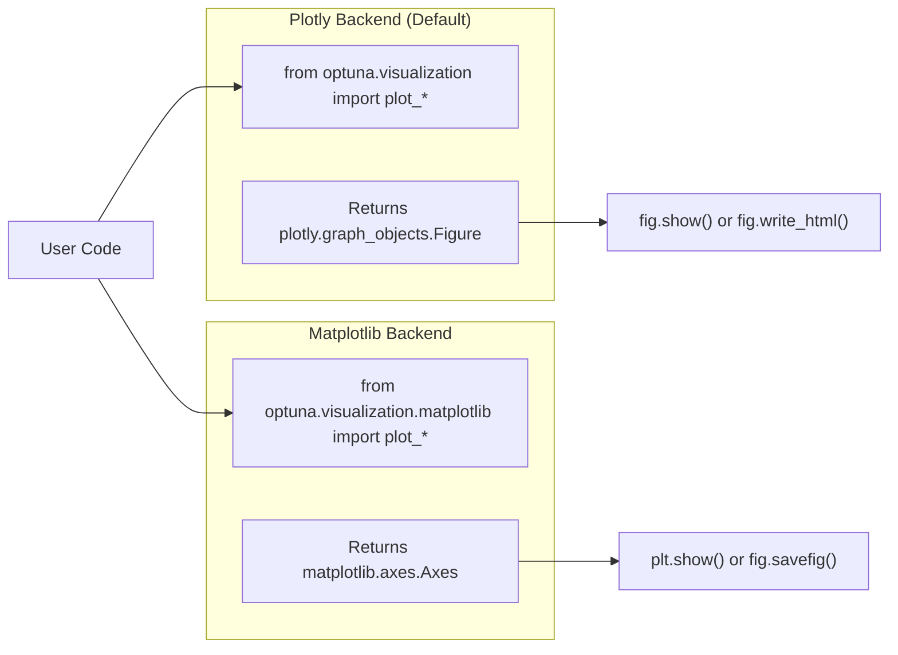
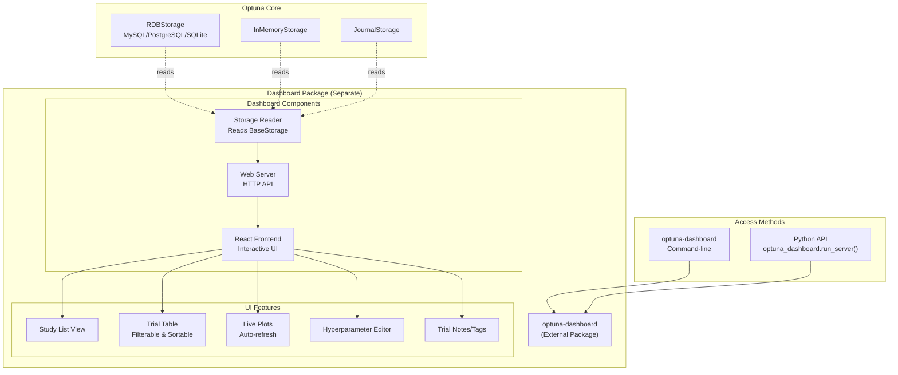
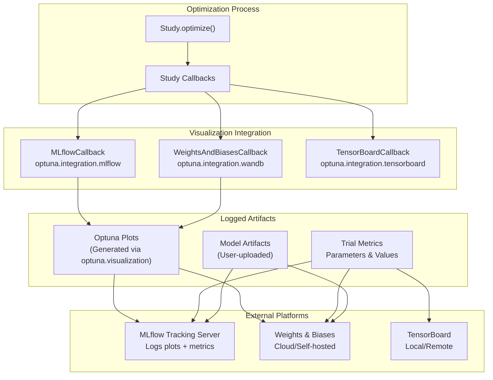
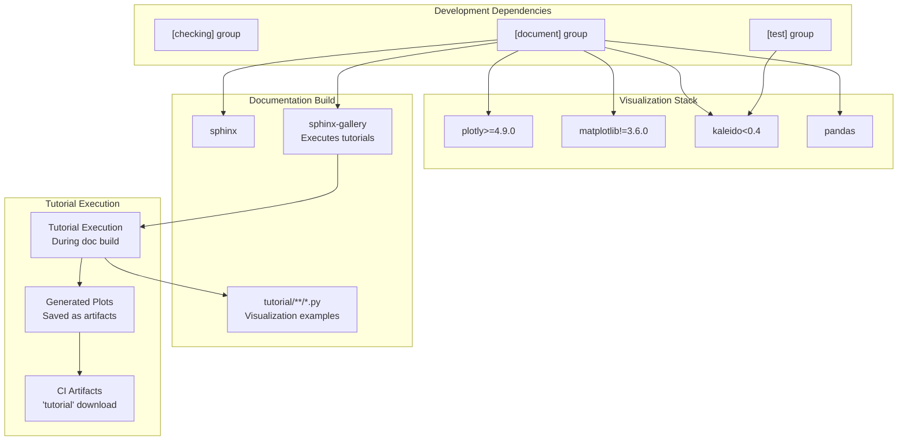
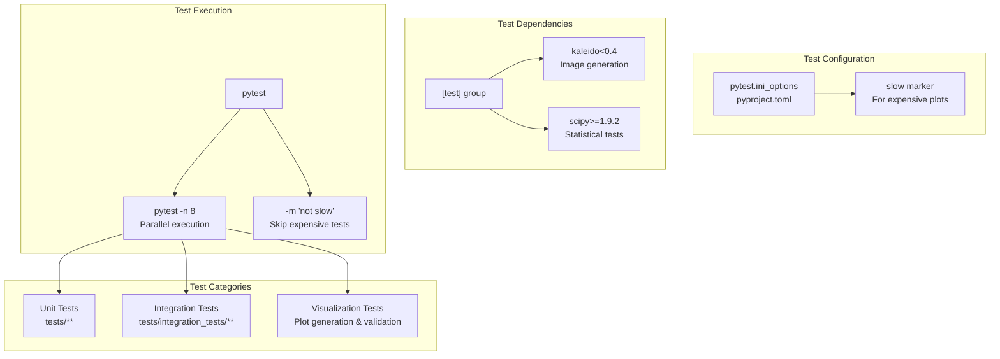

<!-- source: DeepWiki mcp.deepwiki.com · repo optuna/optuna · page 5.2 Visualization and Dashboard · fetched 2026-10-21 -->

# Visualization and Dashboard

<details>
<summary>Relevant source files</summary>

The following files were used as context for generating this wiki page:

- [.pre-commit-config.yaml](.pre-commit-config.yaml)
- [CONTRIBUTING.md](CONTRIBUTING.md)
- [pyproject.toml](pyproject.toml)

</details>


## Purpose and Scope

This document covers Optuna's visualization capabilities and dashboard system. It explains:

- The visualization module (`optuna.visualization`) and its plotting backends (Plotly and Matplotlib)
- Available visualization functions for analyzing optimization results
- The optuna-dashboard system for interactive study monitoring
- Integration points with experiment tracking tools

For information about the command-line interface for study management, see [Command-Line Interface](#5.1). For integration with external experiment tracking systems like MLflow and Weights & Biases, see [ML Framework Integrations](#4.2).

---

## Visualization Architecture

Optuna provides two complementary approaches to visualization:

1. **Static Plotting API** (`optuna.visualization`): Programmatic generation of plots within Python scripts or notebooks
2. **Interactive Dashboard** (`optuna-dashboard`): Real-time web-based monitoring as a separate package

### Visualization Module Structure



**Visualization System Components**

The visualization system operates independently from the optimization loop, reading completed trial data from storage backends to generate analytical plots.

Sources: [pyproject.toml:1-193]()

---

## Plotting Backends

Optuna supports two plotting backends, each suited for different use cases:

### Backend Comparison

| Feature | Plotly Backend | Matplotlib Backend |
|---------|---------------|-------------------|
| **Module Path** | `optuna.visualization` | `optuna.visualization.matplotlib` |
| **Interactivity** | Interactive (HTML/JavaScript) | Static images |
| **Output Format** | HTML, PNG (via kaleido) | PNG, PDF, SVG |
| **Jupyter Support** | Native inline display | Native inline display |
| **Dependencies** | plotly>=4.9.0, kaleido<0.4 | matplotlib!=3.6.0 |
| **Primary Use Case** | Exploratory analysis, notebooks | Publication figures, reports |
| **Function Coverage** | Complete | Subset (core plots) |

### Dependency Configuration



**Installation Patterns**

- **Default Installation**: Visualization dependencies are not included
- **With Visualization**: `pip install "optuna[optional]"` installs both backends
- **Documentation Build**: Includes kaleido for static image generation
- **Matplotlib Version Constraint**: Version 3.6.0 is excluded due to compatibility issues

Sources: [pyproject.toml:75-89](), [pyproject.toml:56-74](), [pyproject.toml:90-101]()

---

## Visualization Functions

The visualization module provides functions for analyzing different aspects of optimization studies. Each function accepts a `Study` object and returns a plot object.

### Core Visualization Functions



### Visualization Function Categories

| Category | Functions | Purpose |
|----------|-----------|---------|
| **Convergence** | `plot_optimization_history()` | Track objective value improvements over time |
| **Parameter Analysis** | `plot_param_importances()`<br/>`plot_slice()`<br/>`plot_contour()` | Understand parameter influence and interactions |
| **Search Space** | `plot_parallel_coordinate()`<br/>`plot_slice()` | Visualize search space exploration |
| **Multi-Objective** | `plot_pareto_front()` | Analyze objective trade-offs |
| **Distribution** | `plot_edf()` | Compare empirical distributions across studies |
| **Execution** | `plot_timeline()` | Analyze trial timing and parallelism |

### Backend Selection Pattern



**Import Strategy**

- Plotly backend functions are available directly from `optuna.visualization`
- Matplotlib backend functions are namespaced under `optuna.visualization.matplotlib`
- Both backends provide the same function names with identical signatures
- Backend choice depends on visualization requirements (interactive vs. static)

Sources: [pyproject.toml:75-89]()

---

## Dashboard System

The Optuna Dashboard is a separate web application that provides real-time monitoring of optimization studies. Unlike the static plotting API, the dashboard offers interactive exploration and live updates.

### Dashboard Architecture



**Dashboard Characteristics**

- **Separate Package**: Not bundled with core Optuna (`pip install optuna-dashboard`)
- **Storage Agnostic**: Reads from any `BaseStorage` implementation
- **Read-Only**: Does not modify study data (except notes/tags)
- **Multi-Study**: Can display multiple studies simultaneously
- **Real-Time**: Auto-refreshes to show ongoing optimization progress

### Dashboard vs Visualization API

| Aspect | Dashboard | Visualization API |
|--------|-----------|------------------|
| **Installation** | `pip install optuna-dashboard` | Included with `optuna[optional]` |
| **Interface** | Web browser | Python code |
| **Update Mode** | Real-time auto-refresh | On-demand generation |
| **Interactivity** | Full interactive UI | Plot-level interactivity |
| **Multi-Study** | Yes, built-in | Requires custom code |
| **Trial Editing** | Notes, tags, manual completion | Not supported |
| **Deployment** | Standalone server | Embedded in notebooks/scripts |

Sources: Based on architecture diagrams and common Optuna usage patterns

---

## Integration with Experiment Tracking

Visualization components integrate with external experiment tracking systems through the integration layer.

### Experiment Tracking Integration Flow



**Integration Patterns**

1. **MLflow Integration**: 
   - Logs optimization history plots automatically
   - Stores trial parameters and values as MLflow metrics
   - Requires `mlflow` package (lazy-loaded via `optuna.integration`)

2. **Weights & Biases Integration**:
   - Streams trial results to W&B dashboard
   - Generates and uploads Optuna plots
   - Supports custom visualization logging

3. **TensorBoard Integration**:
   - Logs scalar metrics (objectives, intermediate values)
   - Records hyperparameters for TensorBoard's HParams plugin
   - Does not include Optuna plot generation (different visualization paradigm)

### Visualization in Integration Callbacks

The integration callbacks leverage the visualization API to generate plots that are then uploaded to external platforms. This provides a unified visualization experience across different experiment tracking tools.

Sources: Based on architecture diagrams showing integration layer

---

## Visualization Dependencies and Build Configuration

### Development and Documentation Setup



### Kaleido Version Constraint

The `kaleido<0.4` version constraint exists across multiple dependency groups due to browser installation requirements. The constraint note indicates this is temporary pending browser separation:

```
kaleido<0.4  # TODO(nzw0301): Remove the version constraint by installing browser separately.
```

This constraint appears in both the `[document]` and `[test]` groups to ensure consistent static image generation across documentation builds and test execution.

### Tutorial Execution and Caching

The documentation build system executes tutorial files that demonstrate visualization capabilities. To optimize build times:

1. **CI Artifact Caching**: Tutorial execution results are cached as CI artifacts
2. **Download Strategy**: Developers can download "tutorial" artifacts from CI
3. **Local Build Optimization**: Extracted artifacts in `docs/source/tutorial` prevent re-execution
4. **Python Version Matching**: Artifacts contain pickle files, requiring Python 3.12 match

This caching strategy is particularly important for visualization tutorials, which may involve expensive plot generation.

Sources: [pyproject.toml:56-74](), [pyproject.toml:90-101](), [CONTRIBUTING.md:113-123]()

---

## Visualization Testing Strategy

### Test Dependencies and Coverage

Visualization functionality is tested through the standard test suite with specific dependencies:



**Test Strategy for Visualization**

- **Slow Test Marking**: Expensive plot generation tests are marked with `@pytest.mark.slow`
- **Selective Execution**: CI can skip slow tests for faster feedback (`-m "not slow"`)
- **Image Validation**: Kaleido enables static image generation for comparison testing
- **Backend Coverage**: Tests validate both Plotly and Matplotlib implementations

### Continuous Integration for Visualization

The CI/CD system validates visualization across multiple environments:

| Workflow | Purpose | Visualization Testing |
|----------|---------|----------------------|
| `tests.yml` | Ubuntu, Python 3.9-3.14 | Full visualization suite |
| `mac-tests.yml` | macOS, Python 3.12 | Cross-platform plot generation |
| `windows-tests.yml` | Windows, Python 3.12 | Platform-specific rendering |
| `tests-with-minimum-versions.yml` | Minimum dependency versions | Ensures `plotly>=4.9.0` compatibility |

Sources: [pyproject.toml:167-172](), [pyproject.toml:90-101]()

---

## Summary

Optuna's visualization system provides a comprehensive approach to optimization analysis through two complementary components:

1. **Visualization API**: Programmatic plot generation with dual backend support (Plotly for interactivity, Matplotlib for publication-quality figures)
2. **Dashboard**: Real-time web-based monitoring as a separate package, enabling live study inspection

The visualization layer is designed as an optional component with minimal dependencies on the core optimization engine. It reads completed trial data from storage backends and generates analytical views without affecting the optimization process. Integration with experiment tracking platforms (MLflow, W&B, TensorBoard) extends visualization capabilities to external monitoring systems.

Key architectural decisions include:
- Optional installation to avoid dependency bloat
- Backend abstraction for flexibility (Plotly vs. Matplotlib)
- Storage-agnostic design for compatibility with all backends
- Separation of dashboard as independent package for deployment flexibility

---

