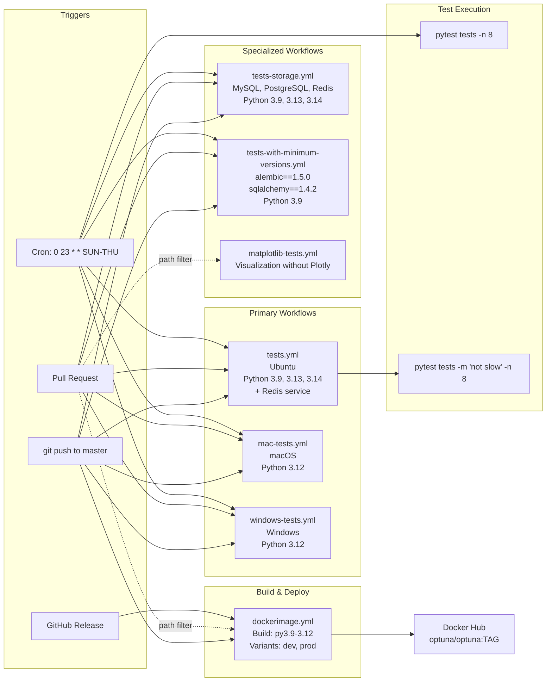
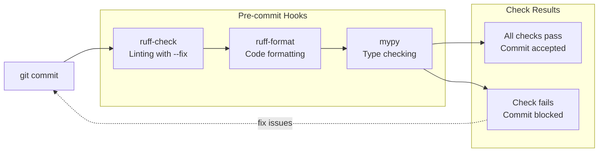
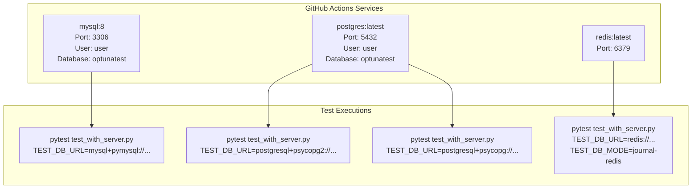

<!-- source: DeepWiki mcp.deepwiki.com · repo optuna/optuna · page 6 Development and Deployment · fetched 2026-10-21 -->

# Development and Deployment

<details>
<summary>Relevant source files</summary>

The following files were used as context for generating this wiki page:

- [.github/workflows/dockerimage.yml](.github/workflows/dockerimage.yml)
- [.github/workflows/mac-tests.yml](.github/workflows/mac-tests.yml)
- [.github/workflows/matplotlib-tests.yml](.github/workflows/matplotlib-tests.yml)
- [.github/workflows/tests-storage.yml](.github/workflows/tests-storage.yml)
- [.github/workflows/tests-with-minimum-versions.yml](.github/workflows/tests-with-minimum-versions.yml)
- [.github/workflows/tests.yml](.github/workflows/tests.yml)
- [.github/workflows/windows-tests.yml](.github/workflows/windows-tests.yml)
- [.pre-commit-config.yaml](.pre-commit-config.yaml)
- [CONTRIBUTING.md](CONTRIBUTING.md)
- [Dockerfile](Dockerfile)
- [pyproject.toml](pyproject.toml)

</details>


This document provides an overview of Optuna's development infrastructure, including project configuration, testing systems, CI/CD pipelines, and deployment processes. It is intended for developers contributing to Optuna or maintaining the project's build and release systems.

For detailed information about:
- Project configuration files and dependency management, see [Project Configuration and Dependencies](#6.1)
- Testing frameworks and CI/CD workflow details, see [Testing and CI/CD Infrastructure](#6.2)
- Contribution process and local development setup, see [Development Workflow and Contribution Guide](#6.3)

## Development Infrastructure Overview

Optuna's development infrastructure is centered around `pyproject.toml`, which serves as the single source of configuration for all development tools. The project uses modern Python development practices with automated testing, code quality enforcement, and multi-platform validation.

```mermaid
graph TB
    subgraph "Configuration Hub"
        pyproject["pyproject.toml<br/>Central configuration file"]
    end
    
    subgraph "Code Quality Tools"
        ruff["Ruff<br/>Linter & Formatter<br/>ruff check/format"]
        mypy["MyPy<br/>Type checker<br/>mypy ."]
        precommit[".pre-commit-config.yaml<br/>Pre-commit hooks"]
    end
    
    subgraph "Testing Framework"
        pytest["pytest<br/>Test runner"]
        testdir["tests/<br/>Test suite"]
        markers["Test markers<br/>slow, etc."]
    end
    
    subgraph "CI/CD Workflows"
        maintest[".github/workflows/tests.yml<br/>Ubuntu + Python 3.9-3.14"]
        mactest[".github/workflows/mac-tests.yml<br/>macOS validation"]
        wintest[".github/workflows/windows-tests.yml<br/>Windows validation"]
        storage[".github/workflows/tests-storage.yml<br/>MySQL, PostgreSQL, Redis"]
        minver[".github/workflows/tests-with-minimum-versions.yml<br/>Backward compatibility"]
        docker[".github/workflows/dockerimage.yml<br/>Docker build & push"]
        matplotlib[".github/workflows/matplotlib-tests.yml<br/>Visualization tests"]
    end
    
    subgraph "Build Artifacts"
        dockerhub["Docker Hub<br/>optuna/optuna:*"]
        pypi["PyPI<br/>pip install optuna"]
    end
    
    pyproject --> ruff
    pyproject --> mypy
    pyproject --> pytest
    pyproject --> maintest
    
    precommit --> ruff
    precommit --> mypy
    
    pytest --> testdir
    pytest --> markers
    
    maintest --> testdir
    mactest --> testdir
    wintest --> testdir
    storage --> testdir
    minver --> testdir
    
    docker --> dockerhub
    maintest -.->|on release| pypi
    
    style pyproject fill:#f9f9f9,stroke:#333,stroke-width:2px
    style maintest fill:#f9f9f9,stroke:#333,stroke-width:2px
```



**Sources:** [pyproject.toml](), [.pre-commit-config.yaml](), [.github/workflows/tests.yml](), [.github/workflows/mac-tests.yml](), [.github/workflows/windows-tests.yml](), [.github/workflows/tests-storage.yml](), [.github/workflows/tests-with-minimum-versions.yml](), [.github/workflows/dockerimage.yml]()

## CI/CD Pipeline Architecture

The CI/CD system validates code changes across multiple dimensions: Python versions, operating systems, database backends, and dependency versions. Each workflow has specific triggers and responsibilities.



**Sources:** [.github/workflows/tests.yml:1-98](), [.github/workflows/mac-tests.yml:1-72](), [.github/workflows/windows-tests.yml:1-85](), [.github/workflows/tests-storage.yml:1-148](), [.github/workflows/tests-with-minimum-versions.yml:1-97](), [.github/workflows/dockerimage.yml:1-80](), [.github/workflows/matplotlib-tests.yml:1-63]()

### Workflow Concurrency Control

All workflows implement concurrency control to prevent resource conflicts and unnecessary compute usage:

```yaml
concurrency:
  group: ${{ github.workflow }}-${{ github.ref == 'refs/heads/master' && github.run_number || github.ref }}
  cancel-in-progress: true
```

This configuration ensures that only one workflow run per branch is active at a time. For the `master` branch, each push gets a unique run number, while feature branches use the branch name as the concurrency key.

**Sources:** [.github/workflows/tests.yml:12-14](), [.github/workflows/mac-tests.yml:15-17]()

## Tool Configuration in pyproject.toml

The `pyproject.toml` file centralizes all tool configurations, eliminating the need for separate configuration files for each development tool.

### Build System Configuration

| Setting | Value | Purpose |
|---------|-------|---------|
| `build-backend` | `setuptools.build_meta` | Uses setuptools for package building |
| `requires-python` | `>=3.9` | Minimum Python version requirement |
| `dynamic` | `["version"]` | Version read from `optuna.version.__version__` |

**Sources:** [pyproject.toml:1-3](), [pyproject.toml:32](), [pyproject.toml:120-121]()

### Dependency Groups

The project defines multiple optional dependency groups for different use cases:

| Group | Purpose | Key Dependencies |
|-------|---------|------------------|
| Core | Runtime dependencies | `alembic>=1.5.0`, `sqlalchemy>=1.4.2`, `numpy`, `tqdm` |
| `test` | Testing infrastructure | `pytest`, `pytest-xdist`, `fakeredis`, `moto` |
| `optional` | Optional features | `cmaes>=0.12.0`, `plotly>=4.9.0`, `scikit-learn>=0.24.2`, `scipy`, `torch` |
| `checking` | Code quality | `mypy`, `ruff`, `types-*` packages |
| `document` | Documentation build | `sphinx`, `sphinx-gallery`, `sphinx_rtd_theme>=1.2.0` |
| `benchmark` | Performance testing | `asv>=0.5.0`, `cma`, `virtualenv` |

**Sources:** [pyproject.toml:33-106]()

### Ruff Configuration

Ruff serves as both linter and formatter, configured in `[tool.ruff]`:

```toml
line-length = 99
target-version = "py39"
exclude = [".venv", "build", "dist", "docs", ".asv", "optuna/storages/_grpc/auto_generated"]

[tool.ruff.lint]
select = ["E", "W", "F", "I"]  # pycodestyle errors/warnings, pyflakes, isort

[tool.ruff.lint.isort]
known-first-party = ["optuna", "tests", "docs", "benchmarks"]
lines-after-imports = 2
force-single-line = true
```

Special exclusions prevent formatting of tutorial files and specific test files that have custom formatting requirements.

**Sources:** [pyproject.toml:131-183]()

### MyPy Type Checking Configuration

MyPy is configured with strict type checking enabled:

```toml
[tool.mypy]
warn_unused_configs = true
disallow_untyped_calls = true
disallow_untyped_defs = true
disallow_incomplete_defs = true
check_untyped_defs = true
no_implicit_optional = true
warn_redundant_casts = true
strict_equality = true
extra_checks = true
no_implicit_reexport = true
ignore_missing_imports = true
```

The configuration excludes auto-generated code directories like `optuna/storages/_grpc/auto_generated` and Alembic migration files.

**Sources:** [pyproject.toml:192-210]()

### Pytest Configuration

Test execution is configured with markers for test categorization:

```toml
[tool.pytest.ini_options]
addopts = "--color=yes"
filterwarnings = 'ignore::optuna.exceptions.ExperimentalWarning'
markers = [
  "slow: marks tests as slow (deselect with '-m \"not slow\"')"
]
```

The `slow` marker enables selective test execution: pull requests run `pytest -m "not slow"` for fast feedback, while scheduled builds run the full suite.

**Sources:** [pyproject.toml:185-190]()

## Docker Build System

The Docker build system creates multi-version images for both development and production use.

### Dockerfile Structure

The `Dockerfile` supports two build types controlled by the `BUILD_TYPE` argument:

```dockerfile
ARG PYTHON_VERSION=3.9
ARG BUILD_TYPE='dev'

RUN if [ "${BUILD_TYPE}" = "dev" ]; then \
        pip install ${PIP_OPTIONS} -e '.[benchmark, checking, document, optional, test]'; \
    else \
        pip install ${PIP_OPTIONS} -e .; \
    fi
```

The development variant includes all optional dependencies, while the production variant installs only core dependencies.

**Sources:** [Dockerfile:1-28]()

### Docker Image Tags

The `dockerimage.yml` workflow builds images for multiple Python versions with the following tag scheme:

| Event | Tag Format | Example |
|-------|-----------|---------|
| Master push | `py{VERSION}` or `py{VERSION}-dev` | `optuna/optuna:py3.12-dev` |
| Release | `{RELEASE}-py{VERSION}` or `{RELEASE}-py{VERSION}-dev` | `optuna/optuna:v3.5.0-py3.12` |

The matrix strategy builds for Python 3.9, 3.10, 3.11, and 3.12, with both standard and development variants.

**Sources:** [.github/workflows/dockerimage.yml:29-48]()

### Docker Build Caching

The workflow uses Docker BuildKit with caching to speed up builds:

```yaml
- name: Build the Docker image
  run: |
    if [ "${{ github.event_name }}" = 'release' ]; then
      CACHE_FROM=""  # No cache for releases
    else
      CACHE_FROM="--cache-from=${HUB_TAG}"
    fi
    docker build ${CACHE_FROM} . --build-arg PYTHON_VERSION=${{ matrix.python_version }}
  env:
    DOCKER_BUILDKIT: 1
```

Release builds skip caching to ensure clean builds with the version tag.

**Sources:** [.github/workflows/dockerimage.yml:50-61]()

## Pre-commit Hook System

The `.pre-commit-config.yaml` configures automated checks that run before commits are accepted.



**Sources:** [.pre-commit-config.yaml:1-49]()

### Hook Configuration

The pre-commit system uses the following hook sequence:

1. **Ruff Check**: Runs `ruff-check` with automatic fixing enabled
2. **Ruff Format**: Applies code formatting rules
3. **MyPy**: Performs static type checking with strict settings

The MyPy hook includes all necessary type stub packages as `additional_dependencies` to ensure type checking works without requiring local installation of optional dependencies.

**Sources:** [.pre-commit-config.yaml:9-48]()

## Test Execution Strategy

The CI/CD system uses different test execution strategies based on the trigger type:

### Fast Tests (Pull Requests)

```bash
pytest tests -m "not slow" -n 8
```

This command:
- Excludes tests marked with `@pytest.mark.slow`
- Uses `pytest-xdist` with 8 parallel workers (`-n 8`)
- Provides fast feedback for pull requests (typically < 10 minutes)

**Sources:** [.github/workflows/tests.yml:86-95]()

### Full Tests (Scheduled/Manual)

```bash
pytest tests -n 8
```

Runs all tests including slow ones, executed:
- On scheduled runs (nightly, weekdays only)
- On manual workflow dispatch
- Ensures comprehensive validation before releases

**Sources:** [.github/workflows/tests.yml:88-95]()

### Platform-Specific Considerations

**Windows**: Requires special matplotlib backend configuration and NumPy version constraints:

```yaml
env:
  MPLBACKEND: "QtAgg"  # Use QtAgg as matplotlib backend
```

The workflow installs PyQt6 and constrains NumPy to `<2.0.0` due to PyTorch compatibility issues on Windows.

**Sources:** [.github/workflows/windows-tests.yml:54-61](), [.github/workflows/windows-tests.yml:77-84]()

## Database Backend Testing

The `tests-storage.yml` workflow validates Optuna's storage layer against multiple database systems using Docker services.

### Service Configuration



**Sources:** [.github/workflows/tests-storage.yml:37-69](), [.github/workflows/tests-storage.yml:119-147]()

### Database Driver Testing

The workflow tests multiple database drivers for PostgreSQL:
- **psycopg2**: Traditional driver (`postgresql+psycopg2://`)
- **psycopg**: Modern driver version 3 (`postgresql+psycopg://`)

This ensures compatibility with both driver versions that users might have installed.

**Sources:** [.github/workflows/tests-storage.yml:127-139]()

## Minimum Version Compatibility

The `tests-with-minimum-versions.yml` workflow validates backward compatibility by testing with the minimum allowed versions of all dependencies.

### Minimum Version Matrix

| Package | Minimum Version | Defined In |
|---------|----------------|------------|
| `alembic` | 1.5.0 | [pyproject.toml:34]() |
| `sqlalchemy` | 1.4.2 | [pyproject.toml:38]() |
| `packaging` | 20.0 | [pyproject.toml:37]() |
| `cmaes` | 0.12.0 | [pyproject.toml:63]() |
| `plotly` | 5.0.0 (optional) | [pyproject.toml:70]() |
| `scikit-learn` | 0.24.2 (optional) | [pyproject.toml:88]() |
| `tqdm` | 4.27.0 | Tested in workflow |

The workflow explicitly uninstalls and reinstalls packages at minimum versions to catch any unintentional use of newer APIs:

```yaml
- name: Install dependencies with minimum versions
  run: |
    pip uninstall -y alembic cmaes packaging sqlalchemy plotly scikit-learn
    pip install alembic==1.5.0 cmaes==0.12.0 packaging==20.0 sqlalchemy==1.4.2
```

**Sources:** [.github/workflows/tests-with-minimum-versions.yml:69-78]()

## Package Distribution

The `[project.scripts]` section in `pyproject.toml` defines the command-line entry point:

```toml
[project.scripts]
optuna = "optuna.cli:main"
```

This creates the `optuna` command that maps to the `main()` function in `optuna/cli.py`, providing CLI access to all Optuna commands documented in [Command Line Interface](#5.1).

**Sources:** [pyproject.toml:114-115]()

### Package Data Inclusion

Optuna includes non-Python files in the distribution for storage system functionality:

```toml
[tool.setuptools.package-data]
"optuna" = [
  "storages/_rdb/alembic.ini",
  "storages/_rdb/alembic/*.*",
  "storages/_rdb/alembic/versions/*.*",
  "py.typed",
]
```

These files support Alembic database migrations and enable type checking for installed packages via the `py.typed` marker.

**Sources:** [pyproject.toml:123-129]()

---

