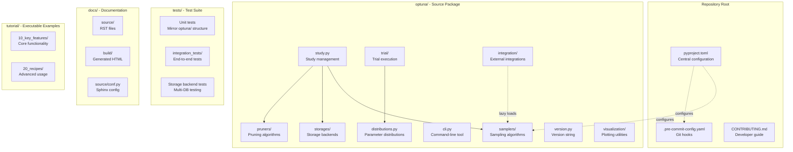
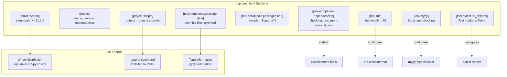
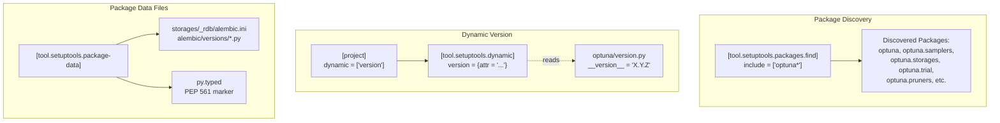
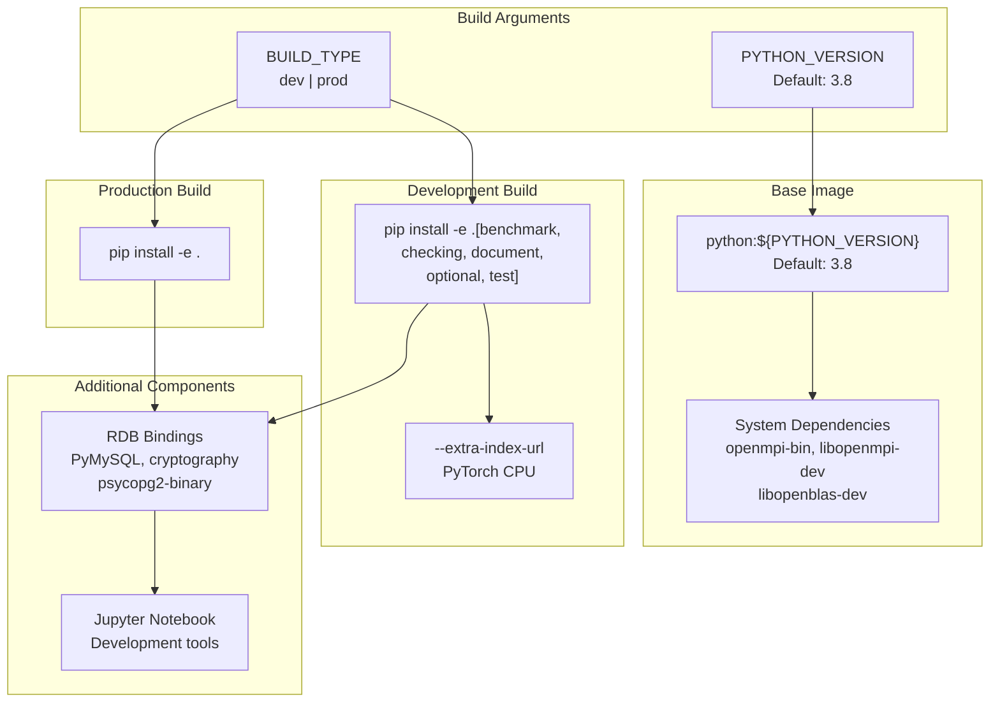

<!-- source: DeepWiki mcp.deepwiki.com · repo optuna/optuna · page 6.1 Project Structure and Dependencies · fetched 2026-10-21 -->

# Project Structure and Dependencies

<details>
<summary>Relevant source files</summary>

The following files were used as context for generating this wiki page:

- [.pre-commit-config.yaml](.pre-commit-config.yaml)
- [CONTRIBUTING.md](CONTRIBUTING.md)
- [pyproject.toml](pyproject.toml)

</details>


## Purpose and Scope

This document explains Optuna's project structure, build configuration, and dependency management system. It covers the directory layout of the repository, the `pyproject.toml` configuration file that serves as the central build and tool configuration, and how dependencies are organized into groups for different use cases. For information about the testing framework and CI/CD workflows, see page 6.2. For contribution guidelines including development setup, see page 6.3.

## Repository Structure Overview

The Optuna repository follows a standard Python package structure with clear separation between source code, tests, documentation, and configuration files:



**Optuna Repository Directory Structure**

The repository is organized into distinct areas: the `optuna/` package contains all source code, `tests/` mirrors this structure for testing, `docs/` contains Sphinx documentation, and `tutorial/` provides executable examples that are built into the documentation via Sphinx-Gallery.

Sources: [pyproject.toml:112-124](), [CONTRIBUTING.md:94-141]()

## Configuration Architecture Overview

Optuna uses `pyproject.toml` as the central configuration file for package metadata, dependencies, build system, and all development tools. This follows PEP 517/518 standards for modern Python packaging:



**pyproject.toml Configuration Architecture**

The `pyproject.toml` file centralizes all project configuration. The build system section defines how to build the package, project section defines metadata and dependencies, optional-dependencies enable feature sets, and tool sections configure development tools.

Sources: [pyproject.toml:1-193]()

## Build System Configuration

### Build Backend

Optuna uses `setuptools` as the build backend with PEP 517/518 compliance:

```toml
[build-system]
requires = ["setuptools >= 61.1.0", "wheel"]
build-backend = "setuptools.build_meta"
```

The minimum setuptools version (61.1.0) ensures support for `pyproject.toml`-based configuration without requiring `setup.py`. The build backend is `setuptools.build_meta`, which provides the standard PEP 517 build interface.

Sources: [pyproject.toml:1-3]()

### Package Discovery and Metadata

Setuptools automatically discovers packages and reads version information dynamically:



**Package Discovery and Version Management**

Setuptools discovers all packages matching the `optuna*` pattern. The version is read dynamically from `optuna.version.__version__` at build time. Package data includes Alembic migration files for database schema versioning and the `py.typed` marker to indicate the package supports type checking.

Sources: [pyproject.toml:42](), [pyproject.toml:112-124]()

### Project Metadata

The `[project]` section defines core metadata:

| Field | Value | Purpose |
|-------|-------|---------|
| `name` | `"optuna"` | Package name on PyPI |
| `description` | `"A hyperparameter optimization framework"` | Short description |
| `readme` | `"README.md"` | Long description from README |
| `requires-python` | `">=3.9"` | Minimum Python version |
| `dynamic` | `["version"]` | Version read from code at build time |

The project also defines classifiers indicating production stability, Python version support (3.9-3.14), and categorization as a scientific/AI library.

Sources: [pyproject.toml:5-42]()

### CLI Entry Point

The `optuna` command-line tool is registered as a console script:

```toml
[project.scripts]
optuna = "optuna.cli:main"
```

This creates an executable `optuna` command that invokes the `main()` function in `optuna.cli` module.

Sources: [pyproject.toml:109-110]()

## Dependency Management

### Core Runtime Dependencies

Optuna's core dependencies are minimal to reduce installation overhead. These are installed automatically with `pip install optuna`:

| Dependency | Version Constraint | Purpose | Used By |
|------------|-------------------|---------|---------|
| `alembic` | >=1.5.0 | Database schema migrations | `optuna.storages._rdb` |
| `colorlog` | (any) | Colored log output | Logging system |
| `numpy` | (any) | Numerical arrays and operations | Samplers, distributions |
| `packaging` | >=20.0 | Version parsing and comparison | Compatibility checks |
| `sqlalchemy` | >=1.4.2 | SQL database ORM | `optuna.storages.RDBStorage` |
| `tqdm` | (any) | Progress bar display | `optuna._optimize` |
| `PyYAML` | (any) | YAML configuration parsing | `optuna.cli` |

These dependencies support the core optimization loop, basic storage backends (RDBStorage, InMemoryStorage), and simple samplers (RandomSampler). Advanced features require optional dependencies.

Sources: [pyproject.toml:33-41]()

### Optional Dependency Groups

Optuna organizes optional dependencies into feature groups that can be installed selectively:

```mermaid
graph TB
    subgraph "Installation Options"
        Base["pip install optuna<br/>(core only)"]
        Optional["pip install optuna[optional]<br/>(all optional features)"]
        Test["pip install optuna[test]<br/>(testing tools)"]
        Checking["pip install optuna[checking]<br/>(linters, type checkers)"]
        Document["pip install optuna[document]<br/>(doc building)"]
    end
    
    subgraph "optional - Advanced Features"
        OptCmaes["cmaes >= 0.12.0<br/>CmaEsSampler"]
        OptPlotly["plotly >= 4.9.0<br/>Visualization"]
        OptPandas["pandas<br/>DataFrame export"]
        OptScikit["scikit-learn >= 0.24.2<br/>Feature importance"]
        OptScipy["scipy, torch, greenlet<br/>GPSampler"]
        OptBoto["boto3<br/>S3 artifact storage"]
        OptGCS["google-cloud-storage<br/>GCS artifacts"]
        OptRedis["redis<br/>JournalRedisBackend"]
        OptGRPC["grpcio, protobuf<br/>gRPC storage"]
    end
    
    subgraph "test - Testing Infrastructure"
        TestPytest["pytest<br/>Test framework"]
        TestXdist["pytest-xdist<br/>Parallel testing"]
        TestFakeRedis["fakeredis[lua]<br/>Mock Redis"]
        TestMoto["moto<br/>Mock AWS services"]
    end
    
    subgraph "checking - Code Quality"
        CheckMypy["mypy<br/>Type checking"]
        CheckRuff["ruff<br/>Linting/formatting"]
        CheckTypes["types-*<br/>Type stubs"]
    end
    
    Optional --> OptCmaes
    Optional --> OptPlotly
    Optional --> OptScipy
    Test --> TestPytest
    Checking --> CheckMypy
```



**Optional Dependency Groups**

Each group enables specific functionality. The `optional` group includes all advanced features like sophisticated samplers and cloud storage. The `test` group provides testing infrastructure. The `checking` group enables code quality tools.

Sources: [pyproject.toml:44-101]()

### Optional Dependencies Details

#### optional - Advanced Features

| Dependency | Purpose | Enables |
|------------|---------|---------|
| `cmaes>=0.12.0` | CMA-ES optimization library | `CmaEsSampler` |
| `plotly>=4.9.0` | Interactive visualizations | `optuna.visualization` module |
| `matplotlib!=3.6.0` | Static plotting backend | `optuna.visualization.matplotlib` |
| `pandas` | DataFrame operations | `study.trials_dataframe()` |
| `scikit-learn>=0.24.2` | Feature importance calculation | `optuna.importance` module |
| `scipy` | Scientific computing | `GPSampler` kernel functions |
| `torch` | PyTorch integration | `GPSampler` optimization |
| `greenlet` | Async optimization | Faster GP sampling |
| `boto3` | AWS S3 client | `optuna.artifacts._boto3` |
| `google-cloud-storage` | GCS client | `optuna.artifacts._gcs` |
| `redis` | Redis client | `JournalRedisBackend` |
| `grpcio`, `protobuf>=5.28.1` | gRPC protocol | `optuna.storages._grpc` |

Sources: [pyproject.toml:75-89]()

#### test - Testing Dependencies

| Dependency | Purpose |
|------------|---------|
| `pytest` | Test framework and runner |
| `pytest-xdist` | Parallel test execution |
| `fakeredis[lua]` | In-memory Redis mock for testing |
| `moto` | Mock AWS services (S3, etc.) |
| `scipy>=1.9.2` | Required for GP sampler tests |
| `torch`, `greenlet` | GP sampler testing |
| `grpcio`, `protobuf>=5.28.1` | gRPC storage testing |
| `kaleido<0.4` | Plotly static image export |

Sources: [pyproject.toml:90-101]()

#### checking - Development Tools

| Dependency | Purpose |
|------------|---------|
| `mypy` | Static type checker |
| `ruff` | Fast Python linter and formatter |
| `mypy_boto3_s3` | Type stubs for boto3 S3 |
| `scipy-stubs` | Type stubs for scipy (Python ≥3.10) |
| `types-PyYAML`, `types-redis`, `types-setuptools`, `types-tqdm` | Type stubs for runtime dependencies |
| `typing_extensions>=3.10.0.0` | Backported typing features |

Sources: [pyproject.toml:45-55]()

#### document - Documentation Building

The `document` group includes dependencies for building Sphinx documentation and executing tutorial examples:

- **Documentation tools**: `sphinx`, `sphinx-copybutton`, `sphinx-gallery`, `sphinx-notfound-page`, `sphinx_rtd_theme>=1.2.0`
- **Tutorial dependencies**: `torch`, `torchvision`, `lightgbm`, `scikit-learn`, `ase`, `fvcore`
- **Visualization**: `plotly>=4.9.0`, `matplotlib!=3.6.0`, `pandas`, `pillow`, `kaleido<0.4`
- **Sampling**: `cmaes>=0.12.0`

The tutorial dependencies are needed because Sphinx-Gallery executes all `tutorial/**/*.py` files during the documentation build to generate output and ensure examples remain functional.

Sources: [pyproject.toml:56-74](), [CONTRIBUTING.md:113-141]()

## Docker Containerization

### Multi-Stage Build Configuration



**Docker Build Process and Configuration**

The Docker configuration supports both development and production environments with different dependency sets and configurations.

### Build Type Configuration

| Build Type | Dependencies | Purpose |
|------------|--------------|---------|
| `dev` (default) | Full extras: benchmark, checking, document, optional, test | Development environment |
| `prod` | Minimal installation | Production deployment |

The development build includes PyTorch CPU-only wheels for faster installation and comprehensive tooling for development workflows.

Sources: [Dockerfile:1-29]()

## Environment Configuration

### System Dependencies

The Docker image includes essential system-level dependencies for scientific computing and parallel processing:

- **OpenMPI**: `openmpi-bin`, `libopenmpi-dev` for distributed computing support
- **OpenBLAS**: `libopenblas-dev` for optimized linear algebra operations
- **Database Connectors**: PyMySQL, cryptography, psycopg2-binary for RDB storage backends

### Python Environment Setup

The container configuration optimizes pip installation with specific options:

```bash
ENV PIP_OPTIONS "--no-cache-dir --progress-bar off"
```

This configuration reduces disk usage and provides cleaner output during builds, which is particularly important in CI/CD environments.

Sources: [Dockerfile:5-11](), [Dockerfile:25-28]()

## Integration with Development Workflow

The build system integrates with the broader development ecosystem through several mechanisms:

1. **Automated Quality Checks**: The `formats.sh` script can be integrated into pre-commit hooks or CI pipelines
2. **Containerized Development**: Docker provides consistent environments across different development machines
3. **Flexible Build Types**: Support for both minimal production builds and full-featured development environments
4. **Database Testing**: RDB bindings enable comprehensive storage backend testing

The build system ensures that code quality standards are maintained consistently across all development environments while providing flexibility for different deployment scenarios.

Sources: [formats.sh:1-112](), [Dockerfile:1-29](), [setup.cfg:1-10]()

---

