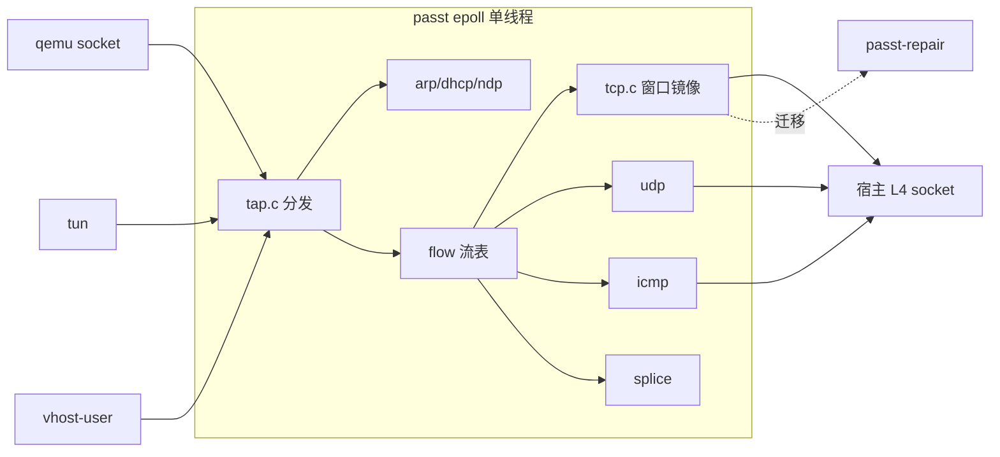

# passt 新人入职文档（ONBOARDING）

> 图谱 `6aa4f88b`（16 层/16 步 tour）+ 源码抽查。

## 1. 这是什么项目

passt（**P**lug **A** **S**imple **S**ocket **T**ransport）是 C 语言用户态网络"协议翻译层"守护进程：一侧呈现 L2 以太网接口（给 qemu 或 network namespace），另一侧用宿主**原生 L4 socket** 收发，中间翻译两侧协议语义。痛点：libslirp/slirp4netns 要在用户态重实现整套 TCP/IP 栈；passt 的立场是"TCP 状态机不该由我实现"——只观察 socket 参数（`TCP_INFO`）与 guest 报文头，把内核算好的窗口/MSS/RTT 镜像到另一侧，分段排队重组全委托两侧内核。

同一二进制双化身（`pasta` 是 `passt` 的符号链接）：**passt 模式**面向 qemu，guest virtio-net 经 UNIX socket（或 vhost-user）接入；**pasta 模式**（**P**ack **A** **S**ubtle **T**ap **A**bstraction）面向容器/无 root 场景，进入目标 netns 把 `/dev/net/tun` 当 L2 接口，本地流量可 `splice()` 零拷贝直通。差异定位：libslirp 是"用户态完整网络栈"，passt 是"协议翻译器"（README 明言 replacement for Slirp），另有 `slirp4netns.sh` 兼容包装器。可执行文件四个：passt/pasta 同体、`passt-repair`（迁移特权 helper）、`pesto`（在线改转发规则）。

## 2. 五分钟架构

单线程 epoll 循环（`passt_worker()`，passt.c:229）驱动一切：上行 tap 收帧→L4 分发→flow 命中→协议处理；下行 socket 可读→组 L2 帧（或直写 virtio 描述符）→发回 tap。

三个关键抽象：**tap 抽象**（tap.c，1627 行；`tap4_handler` tap.c:692/`tap6_handler` tap.c:940 分发 L4；三后端 qemu socket L1393/tun L1556/vhost-user 在此抹平）；**flow 表**（flow_table.h，各 L4 协议共用 `union flow` 联合体）；**epoll_ref 位域**（epoll_ctl.h，64 位事件数据拆 type/fd/flow；epoll_type.h 的 21 种 fd 类型即架构地图）。性能分叉：默认 tcp_buf.c；pasta 本地流量 tcp_splice.c；vhost-user 走 tcp_vu/udp_vu。

## 3. 目录地图（16 层 → 7 组）

| 组 | 路径 | 职责 | 入口 |
|---|---|---|---|
| ① 门面与构建 | Makefile、.clang-*、CONTRIBUTING.md | 三二进制+AVX2 构建、seccomp 头生成 | Makefile |
| ② 基础库 | util/iov/lineread/bitmap/log/pcap、siphash.h | 套接字与 ns 助手、iov_tail、日志与 pcap | util.h |
| ③ 协议原语 | ip、inany、checksum、packet | 地址 union、AVX2/VSX 校验和、报文池 | inany.h |
| ④ 核心数据面 | tap+arp/dhcp/ndp；tcp+tcp_buf/splice/vu；udp/icmp；vhost_user | 上行分发、协议应答、L4 翻译、vhost-user 数据面 | tap.c |
| ⑤ 骨架与配置 | passt/pasta/epoll_*/flow/pif；conf/fwd*/netlink | 主循环、流表底座、选项解析、转发与 NAT | passt.c |
| ⑥ 迁移与安全 | migrate/repair/passt-repair；pesto；isolation、seccomp.sh、contrib/ | TCP 热迁移、配置前端、自隔离与打包 | migrate.c |
| ⑦ 文档与测试 | doc/、*.1、test/ | man 手册、架构图、契约探测、DSL 测试框架 | test/run |

易忽略点：`doc/platform-requirements/` 固化 Linux 特有 socket 行为契约；`test/nstool.c`/`test/rampstream.c` 是测试基础设施独立 C 工具。

## 4. 核心子系统深读

### 4.1 无特权自隔离（isolation.c，580 行）

"不请求特权、主动丢弃特权"。文件头 DOC（isolation.c:25-62）拆成五阶段：**1a** `isolate_initial()`（isolation.c:209，丢 capability）→ **1b** `isolate_fds()`（关泄漏 fd）→ **2** `isolate_user()`（isolation.c:382，uid/gid+userns）→ **3** `isolate_prefork()`（mount ns+`pivot_root()`）→ **4** `isolate_postfork()`（isolation.c:554，seccomp）。seccomp 白名单构建期生成：`seccomp.sh` 扫描 `#syscalls[:PROFILE]` 注释产出 BPF 头。**改系统调用必须同步 `#syscalls` 注释**，否则运行期被杀。

### 4.2 窗口镜像：tcp.c 的 TCP_INFO 机制（约 4600 行，全仓最重）

文件头 Theory of Operation（tcp.c:36-75）：transparency 手段是 "mirroring TCP dynamics by observation of socket parameters (TCP_INFO socket option) and TCP headers"（tcp.c:47-49）。要点：

- `tcp_update_seqack_wnd()`（tcp.c:1109）是心脏：查 `TCP_INFO`，把内核算好的 snd_wnd/bytes_acked 译成 guest 侧 ack/window（tcp.c:1201-1224）；
- 能力探测：`tcp_info_cap()`（tcp.c:425）按 getsockopt 返回长度判断 snd_wnd（kernel commit 8f7baad7f035）等是否存在（tcp.c:429-435）；`struct tcp_info_linux` 在 linux_dep.h 手工镜像内核 v6.11 防头文件漂移；
- 窗口从发送缓冲推导（`tcp_wnd_from_sndbuf()` tcp.c:1025；基准 14600=RFC 6928）；
- **16MiB 窗口顶**（tcp.c:70-75）：无动态分配，未确认数据用 `MSG_PEEK` 读进静态缓冲，`MAX_WINDOW = 1U << (16 + MAX_WS)`（tcp_internal.h:14-15，MAX_WS=8 即 16MiB），缩放因子封顶 256。

连接字段全集在 tcp_conn.h（禁入非 TCP 代码）。

### 4.3 flow 表与 pif 抽象（flow.c，1279 行）

`union flow` 把各协议连接结构塞进同一组槽位（union-punning）。状态机 `FLOW_STATE_FREE→NEW→INI/TGT→TYPED→ACTIVE`（flow.h:92-99）；原语 `flow_alloc()`/`flow_set_type()`/`flow_activate()`；哈希用 SipHash-2-4-64（siphash.h）。`pif.h` 定义 `PIF_HOST/PIF_TAP/PIF_SPLICE`。UDP"类连接"（五元组建流、30s/120s 超时）与 ICMP ping 映射挂此框架。

### 4.4 TCP 连接热迁移线（migrate.c + repair.c + passt-repair.c）

`migrate.c`（313 行）定义 v2 协议（magic 0xB1BB1D1B0BB1D1B0，migrate.c:30；阶段表 `stages_v2`，migrate.c:107）；`repair.c`（274 行）经迁移 UNIX socket 对以 `SCM_RIGHTS` 传 fd（≤253 个）；tcp.c 尾部 dump/restore 族序列化状态。`passt-repair.c`（287 行）是**全仓唯一需特权的组件**：装 seccomp 后循环收 fd 与单字节命令（只认 `TCP_REPAIR_ON`/`OFF`/`OFF_NO_WP`，passt-repair.c:260-261）。

### 4.5 pesto：在线转发配置前端（pesto.c，521 行）

pesto（头注释自嘲 "Programmable Extensible Socket Translation Orchestrator... it's not actually extensible"，pesto.c:3）经 UNIX 配置 socket 对运行中实例增删/替换端口转发表（魔数 `"basil:s"`）。规则引擎在 `fwd_rule.c`（833 行，与主程序共享）。

## 5. 新人第一周路线（16 步 tour → 5 天）

- **Day 1（t01/t02）**：README + `doc/*.excalidraw`；Makefile 确认 pasta 是符号链接；精读 passt.c（main L333→passt_worker L229）配两份 epoll 头。
- **Day 2（t03/t04/t05）**：isolation.c 五阶段+seccomp.sh；tap.c 三后端与 tap4/6_handler；arp/dhcp/ndp/dhcpv6 极简服务。
- **Day 3（t06/t07/t08）**：flow.h→flow.c→flow_table.h；conf.c 与 fwd.c；tcp.c 文件头与 4.2 节。
- **Day 4（t09/t10/t11）**：tcp_buf.c 与 tcp_splice.c 对照（同一逻辑两条路径）；udp.c+icmp.c；pasta.c+netlink.c。
- **Day 5（t12-t16）**：vhost-user 线（vhost_user.c→virtio.c→tcp_vu/udp_vu）；迁移线（4.4）；pesto；contrib/；test/ 跑一遍。

每天收尾 `--trace`/`--pcap` 实跑对应流量，在 pcap 里指认当日路径。

## 6. 构建与测试

**主 Makefile**：`make`=all；`static`/`valgrind`；`pkgs`（deb/rpm）；`cppcheck`/`clang-tidy`（提交前必跑）；`seccomp.h:` 规则（Makefile:93）调 seccomp.sh 生成 BPF 头。AVX2 变体由 arch.c 运行时检测后自切换。

**测试体系**（test/，POSIX shell 框架）：`test/run` 编排全量、`test/ci` 录制（产物上 passt.top）、`test/run_demo` 播演示。框架在 `test/lib/` 十一个库：`lib/test` 是 DSL 解释器（`test_one_line` L107 解释 `host`/`guest`/`check`/`say` 指令）、`lib/term` 管 tmux、`lib/context` 抽象宿主/ns/guest 上下文、`lib/setup` 管场景生命周期。流程：test/ 下 `make assets` 后 `./run`（`PCAP=1 TRACE=1` 带抓包）。用例覆盖 passt/passt_in_ns/pasta、two_guests、passt_vu、migrate 12 例、perf、distro 矩阵。

## 7. 设计哲学与坑

- **零 capability 红线**：主程序不持特权，唯一特权动作（TCP_REPAIR）隔离进 helper；"需要新 capability"的冲动先怀疑设计。
- **静态内存**：tcp.c 明言 "no dynamic memory allocation"（tcp.c:63），连接数封顶 128k、窗口顶 16MiB；严禁 malloc。
- **头注释即文档**：tcp.c/udp.c/tap.c/flow.h/isolation.c 的 "Theory of Operation" 是第一手设计文档；改设计先改注释；`#syscalls` 直接参与 seccomp 生成。
- **位域密集**：`union flow`/`union epoll_ref`/tcp_conn.h 位域压缩（tcp_conn.h:98-101）依赖精确位宽，动结构体先看 static_assert。
- **多构建变体**：同源码编出 passt/pesto（-DPESTO 改 log.h 宏）+AVX2；改公共头后全变体重编。
- **测试即发布物**：`./ci` 录像上官网（hooks/pre-push 在 push 前跑全量测试）。

## 8. 深入索引

- **图谱**：同目录 `knowledge-graph.json`（layers 16 层/tour 16 步对应本文；hub 节点 util.h/tcp.c 适合 grep 起步）。
- **按问题 grep**：事件分发 `case EPOLL_TYPE`；窗口镜像 `tcp_update_seqack_wnd`/`tcp_info_cap`；流表 `flow_alloc`；隔离 `isolate_`/`#syscalls`；迁移 `MIGRATE_MAGIC`；转发规则 `fwd_rule`。
- **上手**：`make`；`make cppcheck clang-tidy`；test/ 下 `make assets && ./run`；`passt.1` man 手册。
- **社区**：passt.top；passt-dev@passt.top（CONTRIBUTING.md 有 send-email 流程）。
