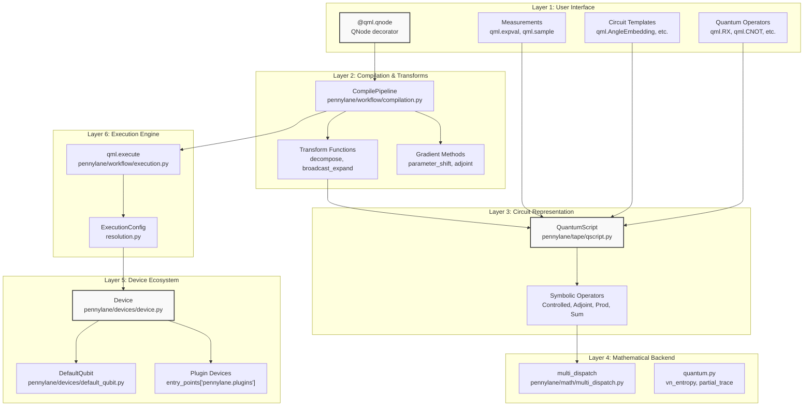
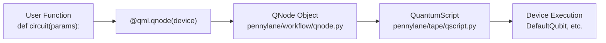
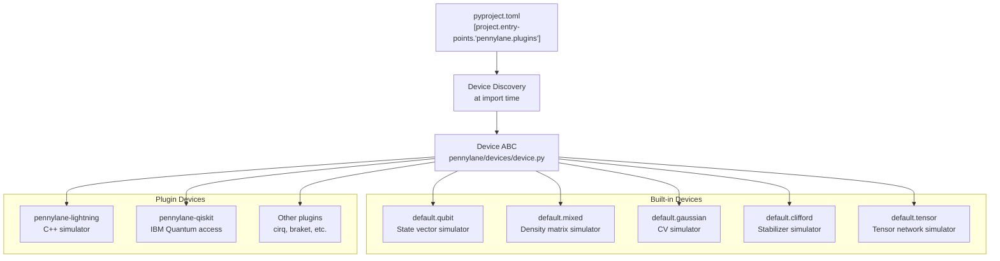
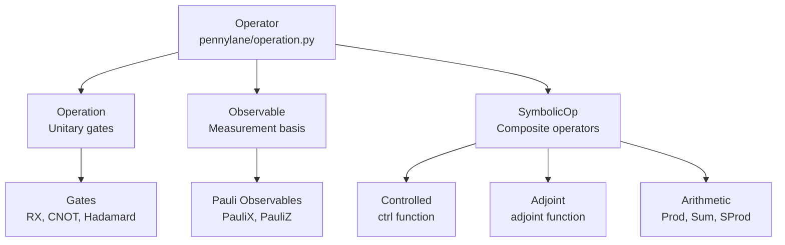
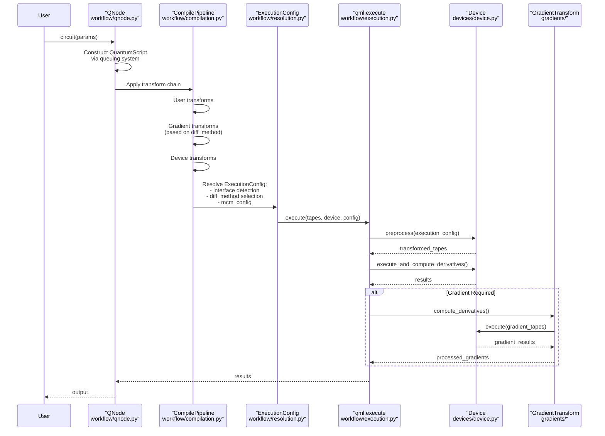
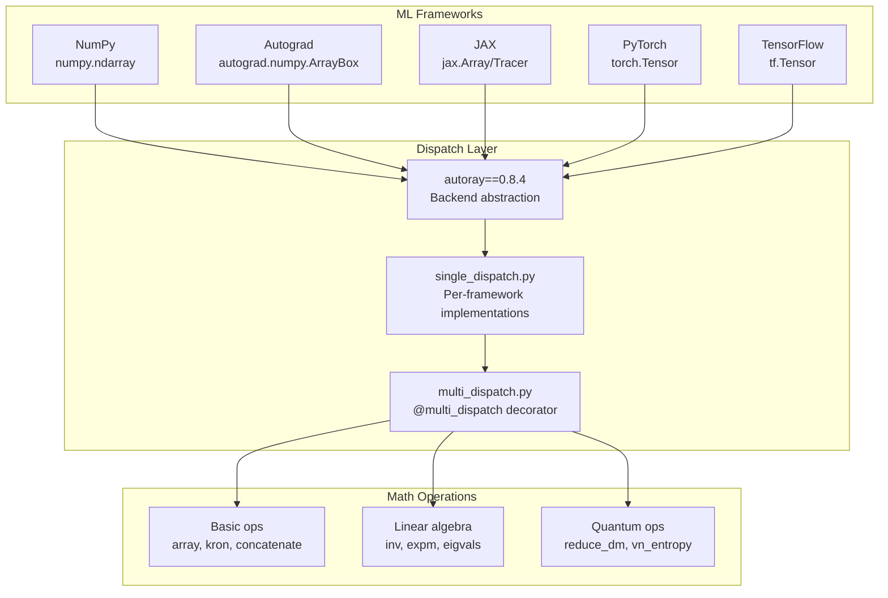
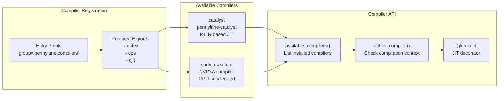
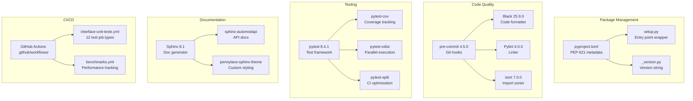

<!-- source: DeepWiki mcp.deepwiki.com · repo PennyLaneAI/pennylane · page 1 Overview · fetched 2026-10-21 -->

# Overview

<details>
<summary>Relevant source files</summary>

The following files were used as context for generating this wiki page:

- [.github/CONTRIBUTING.md](.github/CONTRIBUTING.md)
- [.pylintrc](.pylintrc)
- [AI_Policy.md](AI_Policy.md)
- [README.md](README.md)
- [doc/code/qml.rst](doc/code/qml.rst)
- [doc/conf.py](doc/conf.py)
- [doc/development/guide/documentation.rst](doc/development/guide/documentation.rst)
- [doc/development/guide/installation.rst](doc/development/guide/installation.rst)
- [doc/index.rst](doc/index.rst)
- [doc/introduction/compiling_workflows.rst](doc/introduction/compiling_workflows.rst)
- [doc/requirements.txt](doc/requirements.txt)
- [pennylane/compiler/__init__.py](pennylane/compiler/__init__.py)
- [pennylane/compiler/compiler.py](pennylane/compiler/compiler.py)
- [pennylane/numpy/random.py](pennylane/numpy/random.py)
- [pyproject.toml](pyproject.toml)
- [setup.py](setup.py)
- [tests/.pylintrc](tests/.pylintrc)

</details>


## Purpose and Scope

This document provides a high-level introduction to PennyLane, its architecture, and core concepts. It is intended for developers who want to understand how PennyLane is structured and how its major systems interact.

For detailed information about specific subsystems:
- Core quantum abstractions (operators, circuits, measurements): see [Core Quantum Abstractions](#2)
- Circuit transformation and compilation: see [Transform and Compilation System](#3)
- Device backends and simulation: see [Devices and Simulation](#4)
- Quantum operations and gates: see [Quantum Operations](#5)
- Mathematical framework: see [Mathematical Framework](#6)
- Development tools and infrastructure: see [Development Infrastructure](#8)

**Sources:** [doc/index.rst:1-55](), [README.md:28-67]()

---

## What is PennyLane?

PennyLane is a cross-platform Python library for **quantum computing**, **quantum machine learning**, and **quantum chemistry**. Its central design principle is to enable users to "train a quantum computer the same way as a neural network" by providing automatic differentiation of quantum circuits and seamless integration with machine learning frameworks.

**Core capabilities:**

| Feature | Description |
|---------|-------------|
| **Quantum Circuit Programming** | Define quantum circuits using a wide range of gates, state preparations, and measurements |
| **Automatic Differentiation** | Built-in gradient computation for quantum circuits via multiple methods (parameter shift, adjoint, finite difference) |
| **Hybrid Workflows** | Combine quantum circuits with classical processing in a single computational graph |
| **Multi-Framework Support** | Interface with NumPy, JAX, PyTorch, TensorFlow, and Autograd |
| **Device Independence** | Run the same circuit on simulators or quantum hardware by changing one line of code |
| **JIT Compilation** | Compile hybrid quantum-classical workflows using Catalyst or CUDA Quantum |
| **Transform System** | Apply circuit optimizations and manipulations via composable transforms |

**Sources:** [doc/index.rst:28-92](), [README.md:47-67](), [pyproject.toml:6-8]()

---

## Installation and Requirements

**Minimum Requirements:**
- Python >= 3.11
- Core dependencies installed automatically: `numpy`, `scipy`, `networkx`, `rustworkx>=0.14.0`, `autograd`, `autoray==0.8.4`, `pennylane-lightning>=0.44`

**Installation:**
```bash
python -m pip install pennylane
```

**Optional Dependency Groups:**

| Group | Purpose | Install Command |
|-------|---------|-----------------|
| `dev` | Development tools (pytest, black, pylint, isort) | `pip install --group dev` |
| `docs` | Documentation building (sphinx, jax, torch) | `pip install --group docs` |
| `qchem` | Quantum chemistry support | `pip install pennylane[qchem]` |
| `qcut` | Circuit cutting functionality | `pip install pennylane[qcut]` |
| `external-libraries` | Third-party integrations (pyzx, stim, quimb) | `pip install --group external-libraries` |

**Sources:** [pyproject.toml:10-27](), [pyproject.toml:46-144](), [doc/development/guide/installation.rst:1-84]()

---

## Core Architecture

PennyLane follows a **layered architecture** that separates user-facing abstractions from device execution. This design enables the same quantum circuit to run on different backends with minimal code changes.



**Architecture Layers:**

1. **User Interface Layer:** High-level abstractions for defining quantum circuits (`@qml.qnode`, operators, templates, measurements)
2. **Compilation & Transforms Layer:** Circuit optimization, decomposition, and gradient computation via `CompilePipeline`
3. **Circuit Representation Layer:** Internal representation as `QuantumScript` with symbolic operator algebra
4. **Mathematical Backend Layer:** Framework-agnostic math operations supporting NumPy, JAX, PyTorch, TensorFlow
5. **Device Ecosystem:** Abstract `Device` interface with built-in simulators and plugin system
6. **Execution Engine:** Batch execution, workflow configuration, and differentiation via `qml.execute`

**Sources:** High-level architecture diagram, [pennylane/workflow/qnode.py](), [pennylane/tape/qscript.py](), [pennylane/devices/device.py](), [pennylane/workflow/execution.py]()

---

## Key Concepts

### QNode: Quantum Functions

A **QNode** is a quantum function decorated with `@qml.qnode` that binds a Python function to a quantum device. When called, the QNode constructs a `QuantumScript`, applies transforms, and executes on the device.



**Key QNode attributes:**
- `device`: The device to execute on
- `interface`: Auto-detected ML framework (`'jax'`, `'torch'`, `'tf'`, `'autograd'`, `'numpy'`)
- `diff_method`: Differentiation method (`'best'`, `'parameter-shift'`, `'adjoint'`, `'backprop'`, etc.)
- `expansion_strategy`: How to decompose operations

**Sources:** [pennylane/workflow/qnode.py](), QNode Execution Pipeline diagram

### Devices: Execution Backends

**Devices** implement the abstract `Device` interface and provide the execution backend for quantum circuits. Devices are registered via Python entry points in the `pennylane.plugins` group.



**Entry point registration example:**
```python
[project.entry-points."pennylane.plugins"]
"default.qubit" = "pennylane.devices:DefaultQubit"
"default.gaussian" = "pennylane.devices:DefaultGaussian"
"default.mixed" = "pennylane.devices.default_mixed:DefaultMixed"
```

**Sources:** [pyproject.toml:161-170](), Device Plugin System diagram, [pennylane/devices/device.py]()

### Operators: Quantum Gates and Observables

All quantum operations inherit from the `Operator` base class defined in `pennylane/operation.py`. Operators support:
- **Matrix representation:** `compute_matrix()`, `sparse_matrix()`
- **Decomposition:** `compute_decomposition()` into primitive gates
- **Parameter broadcasting:** `batch_size`, `ndim_params` for batched execution
- **Symbolic composition:** `Controlled`, `Adjoint`, `Prod`, `Sum`, `SProd`, `Pow`



**Sources:** [pennylane/operation.py](), Operator and Symbolic Mathematics System diagram

### Transforms: Circuit Manipulation

**Transforms** are functions decorated with `@transform` that modify quantum circuits. They can be applied to QNodes, tapes, or functions, and are composed into a `CompilePipeline`.

**Transform categories:**

| Category | Examples | Purpose |
|----------|----------|---------|
| **Circuit Optimization** | `cancel_inverses`, `merge_rotations`, `commute_controlled` | Reduce gate count |
| **Decomposition** | `decompose`, `unitary_to_rot` | Convert to device gate set |
| **Batching** | `broadcast_expand`, `batch_params` | Handle batched parameters |
| **Gradient** | `param_shift`, `adjoint_metric_tensor` | Enable differentiation |
| **Measurement** | `defer_measurements`, `dynamic_one_shot` | Mid-circuit measurements |
| **Advanced** | `qcut` (circuit cutting), `mitigate_with_zne` | Specialized techniques |

**Pipeline levels:**
- `top`: Complete pipeline
- `user`: User-applied transforms
- `gradient`: Gradient-related transforms
- `device`: Device-specific transforms

**Sources:** [pennylane/transforms/](), Transform and Compilation System diagram

---

## Execution Flow

The following diagram shows the complete execution path from user code to device results, including the key classes and functions involved:



**Key execution stages:**

1. **QNode Call:** User calls the quantum function with parameters
2. **Tape Construction:** QNode uses the queuing system to record operations into a `QuantumScript`
3. **Transform Pipeline:** `CompilePipeline` applies transforms at user/gradient/device levels
4. **Config Resolution:** `ExecutionConfig` determines interface, differentiation method, and device capabilities
5. **Device Preprocessing:** Device applies its own transforms and optimizations
6. **Execution:** `qml.execute` batches tapes and calls device execution methods
7. **Gradient Computation:** If gradients are needed, gradient transforms generate and execute additional tapes
8. **Result Processing:** Results are processed and returned to the user

**Sources:** QNode Execution Pipeline diagram, [pennylane/workflow/qnode.py](), [pennylane/workflow/execution.py](), [pennylane/workflow/resolution.py]()

---

## Multi-Framework Integration

PennyLane supports multiple machine learning frameworks through a **multi-dispatch system** that provides framework-agnostic mathematical operations:



**Interface detection:** PennyLane automatically detects the ML framework from tensor types:
- `numpy` → NumPy arrays
- `autograd` → Autograd ArrayBox
- `jax` → JAX Arrays/Tracers
- `torch` → PyTorch Tensors
- `tensorflow` → TensorFlow Tensors

**Gradient computation methods by interface:**

| Interface | Supported Gradient Methods |
|-----------|----------------------------|
| `autograd` | `parameter-shift`, `finite-diff`, `adjoint` |
| `jax` | `parameter-shift`, `finite-diff`, `adjoint`, `backprop` |
| `torch` | `parameter-shift`, `finite-diff`, `adjoint`, `backprop` |
| `tensorflow` | `parameter-shift`, `finite-diff`, `adjoint`, `backprop` |
| `numpy` | None (forward evaluation only) |

**Sources:** Math and Interface Abstraction Layer diagram, [pennylane/math/multi_dispatch.py](), [pennylane/math/single_dispatch.py](), [pyproject.toml:18]()

---

## Compiler Integration

PennyLane supports hybrid quantum-classical compilation through a **plugin system** for external compilers. Compilers are registered via the `pennylane.compilers` entry point group.



**Compiler entry point structure:**
- `compiler_name.context`: Compilation context manager with `is_tracing()` method
- `compiler_name.ops`: Compiler-specific operations (e.g., `cond`, `for_loop`)
- `compiler_name.qjit`: JIT decorator function with signature `qjit(fn, *args, **kwargs)`

**Usage example:**
```python
@qml.qjit  # Uses default compiler (Catalyst)
@qml.qnode(dev)
def circuit(x):
    qml.RX(x, wires=0)
    return qml.expval(qml.Z(0))

@qml.qjit(compiler="cuda_quantum")  # Specify compiler
@qml.qnode(dev)
def circuit_cuda(x):
    qml.RX(x, wires=0)
    return qml.expval(qml.Z(0))
```

**Sources:** [pennylane/compiler/compiler.py:1-248](), [pennylane/compiler/__init__.py:14-255](), [doc/introduction/compiling_workflows.rst:1-181]()

---

## Development Infrastructure

PennyLane uses modern Python development tools and CI/CD infrastructure:



**Dependency groups:**

| Group | Purpose | Key Packages |
|-------|---------|--------------|
| Core dependencies | Required for basic functionality | `numpy>=2.0`, `scipy`, `autograd`, `autoray==0.8.4`, `pennylane-lightning>=0.44` |
| `dev` | Development and testing | `pytest>=8.4.1`, `black==25.9.0`, `pylint~=4.0.0`, `isort~=7.0.0` |
| `docs` | Documentation building | `sphinx==8.1`, `jax==0.7.1`, `torch~=2.9.0` |
| `qchem` | Quantum chemistry | `openfermionpyscf`, `basis-set-exchange`, `geometric` |
| `qcut` | Circuit cutting | `kahypar==1.3.5`, `opt_einsum` |
| `external-libraries` | Third-party integrations | `pyzx`, `stim`, `quimb`, `qualtran` |

**CI/CD workflows:**
- **interface-unit-tests.yml:** 12 test job types covering different ML frameworks (JAX, PyTorch, TensorFlow)
- **benchmarks.yml:** Performance regression tracking
- **upload.yml:** Automated PyPI releases

**Sources:** [pyproject.toml:1-210](), [setup.py:1-3](), [doc/conf.py:1-397](), [.pylintrc:1-48](), Development and Quality Infrastructure diagram

---

## Repository Structure

**Key directories:**

| Directory | Purpose |
|-----------|---------|
| `pennylane/` | Main package source code |
| `pennylane/devices/` | Built-in device implementations |
| `pennylane/ops/` | Quantum operations and gates |
| `pennylane/transforms/` | Circuit transforms |
| `pennylane/workflow/` | QNode and execution engine |
| `pennylane/math/` | Multi-dispatch math system |
| `pennylane/gradients/` | Differentiation methods |
| `pennylane/tape/` | QuantumScript and tape system |
| `pennylane/compiler/` | Compiler plugin infrastructure |
| `doc/` | Documentation source (reStructuredText) |
| `tests/` | Test suite |
| `.github/workflows/` | CI/CD configurations |

**Sources:** Repository structure inspection

---

## Next Steps

For detailed information about specific subsystems, refer to the following pages:

- **[Core Quantum Abstractions](#2):** `Operator`, `QuantumScript`, `QNode`, measurement processes
- **[Transform and Compilation System](#3):** Transform framework, `CompilePipeline`, decomposition, gradient methods
- **[Devices and Simulation](#4):** Device API, `DefaultQubit`, `DefaultMixed`, Gaussian simulators, Catalyst JIT
- **[Quantum Operations](#5):** Gate sets, controlled/adjoint operations, operator arithmetic, resource estimation
- **[Mathematical Framework](#6):** Multi-dispatch system, quantum information functions
- **[Templates and Advanced Features](#7):** Circuit templates, quantum chemistry, operator validation
- **[Development Infrastructure](#8):** Package structure, testing, CI/CD, documentation system

**External Resources:**
- GitHub Repository: https://github.com/PennyLaneAI/pennylane
- Documentation: https://docs.pennylane.ai
- Demos and Tutorials: https://pennylane.ai/qml/demonstrations
- Discussion Forum: https://discuss.pennylane.ai

**Sources:** [doc/index.rst:154-247](), [README.md:84-169](), [.github/CONTRIBUTING.md:1-106]()

---

