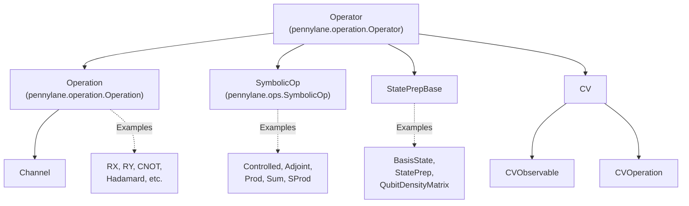
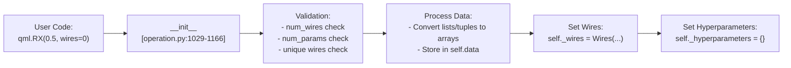
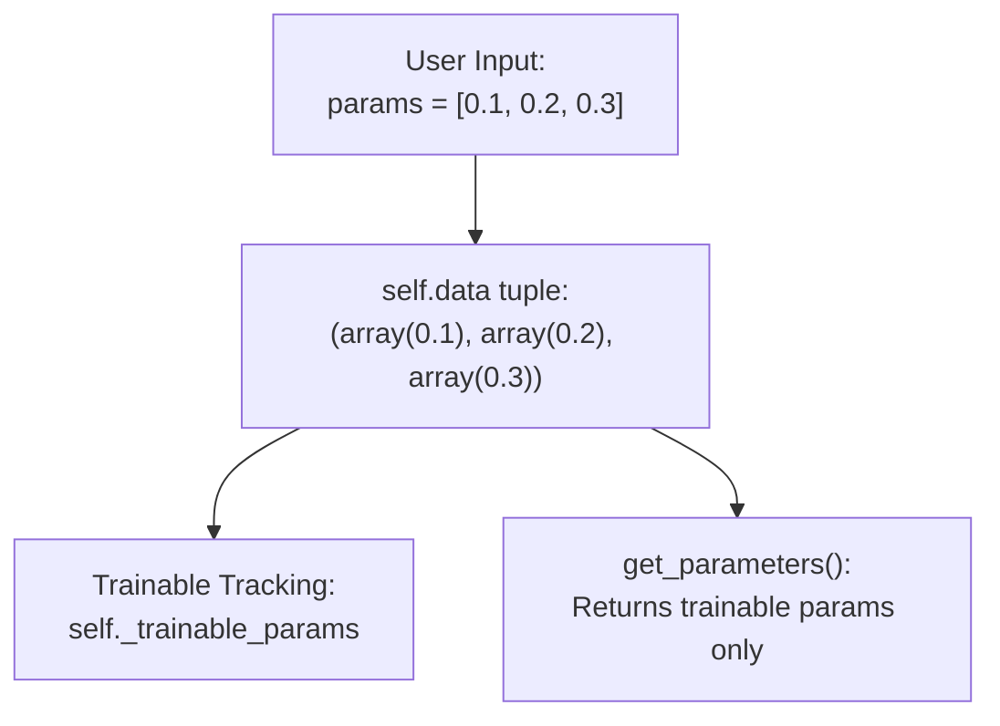
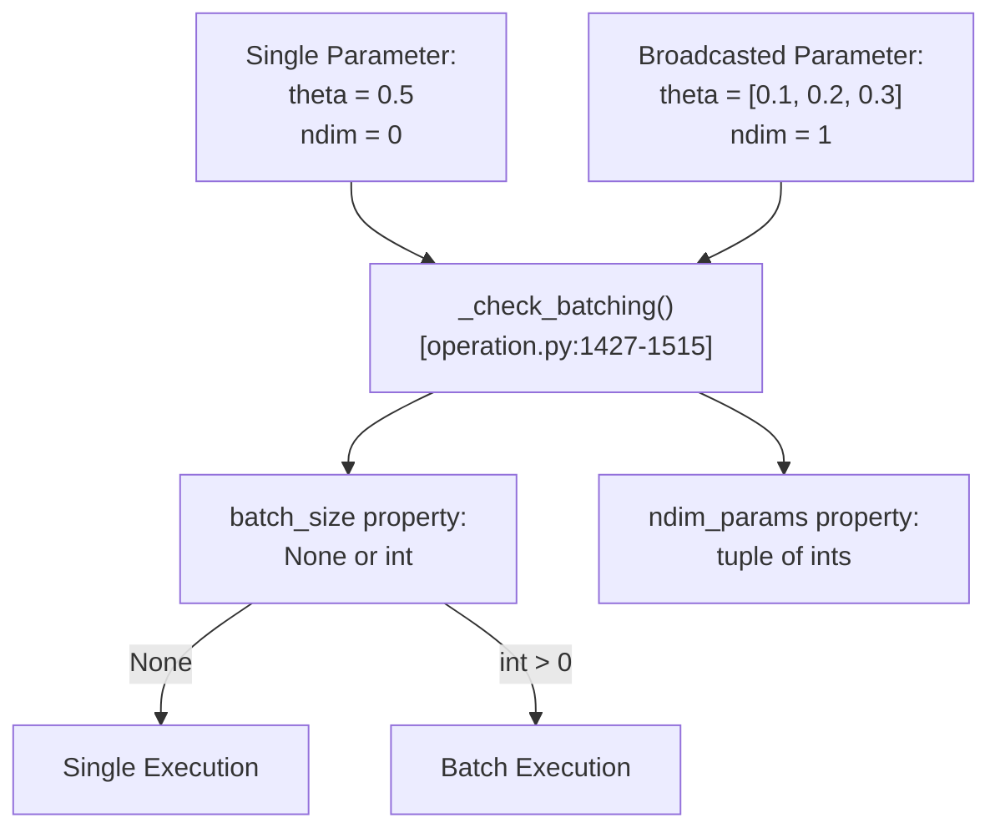
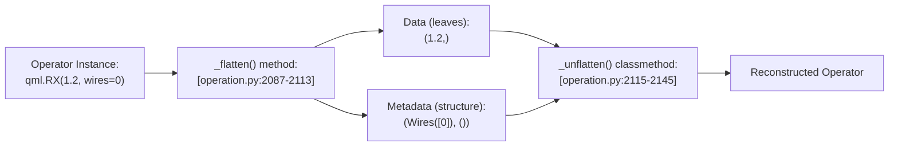
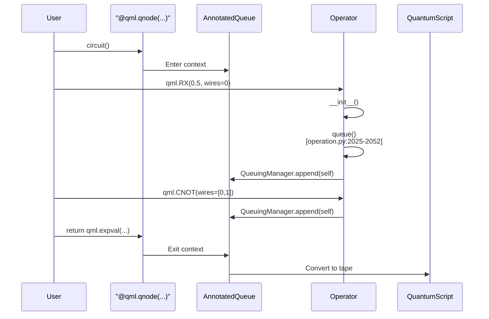
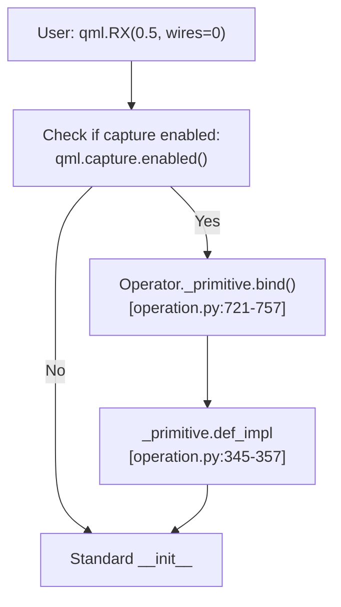

<!-- source: DeepWiki mcp.deepwiki.com · repo PennyLaneAI/pennylane · page 2.1 Operators and Operation System · fetched 2026-10-21 -->

# Operators and Operation System

<details>
<summary>Relevant source files</summary>

The following files were used as context for generating this wiki page:

- [doc/development/deprecations.rst](doc/development/deprecations.rst)
- [doc/releases/changelog-dev.md](doc/releases/changelog-dev.md)
- [pennylane/__init__.py](pennylane/__init__.py)
- [pennylane/operation.py](pennylane/operation.py)
- [pennylane/workflow/__init__.py](pennylane/workflow/__init__.py)
- [pennylane/workflow/_setup_transform_program.py](pennylane/workflow/_setup_transform_program.py)
- [pennylane/workflow/construct_execution_config.py](pennylane/workflow/construct_execution_config.py)
- [pennylane/workflow/execution.py](pennylane/workflow/execution.py)
- [pennylane/workflow/get_compile_pipeline.py](pennylane/workflow/get_compile_pipeline.py)
- [pennylane/workflow/qnode.py](pennylane/workflow/qnode.py)
- [pennylane/workflow/resolution.py](pennylane/workflow/resolution.py)
- [tests/test_operation.py](tests/test_operation.py)
- [tests/test_qnode.py](tests/test_qnode.py)
- [tests/test_qnode_legacy.py](tests/test_qnode_legacy.py)
- [tests/workflow/interfaces/execute/test_execute.py](tests/workflow/interfaces/execute/test_execute.py)
- [tests/workflow/test_get_compile_pipeline.py](tests/workflow/test_get_compile_pipeline.py)
- [tests/workflow/test_resolve_execution_config.py](tests/workflow/test_resolve_execution_config.py)

</details>


This page documents PennyLane's operator system, which provides the foundation for representing quantum operations, gates, and observables. It covers the `Operator` base class, parameter management, broadcasting, pytree integration, and the queuing system.

For information about specific gate implementations and quantum operations, see [Basic Qubit Operations](#5.1). For symbolic operator composition (controlled, adjoint, products, sums), see [Controlled and Adjoint Operations](#5.2) and [Operator Arithmetic](#5.3). For circuit construction with operators, see [QuantumScript and Circuit Representation](#2.2).

---

## Class Hierarchy

The operator system is built on two primary base classes:



**Sources:** [pennylane/operation.py:393-677](), [pennylane/operation.py:2613-2687]()

### Operator

The `Operator` class is the abstract base for all quantum operators. Every operator instance is uniquely defined by:

- **Name**: Identifier for the operator type (e.g., `"RX"`, `"CNOT"`)
- **Wires**: The quantum wires/qubits the operator acts on
- **Data**: Trainable parameters (as tensors compatible with autodifferentiation frameworks)
- **Hyperparameters**: Non-trainable metadata that affects operator behavior

**Sources:** [pennylane/operation.py:393-433]()

### Operation

The `Operation` class represents unitary quantum gates and state transformations. It inherits from `Operator` and adds gate-specific functionality. Most concrete gates like `RX`, `RY`, `CNOT` inherit from this class.

**Sources:** [pennylane/operation.py:2613-2687]()

### Key Distinctions

| Aspect | Operator | Operation |
|--------|----------|-----------|
| Purpose | Base abstraction for all operators | Represents unitary transformations |
| Examples | Measurements, symbolic ops, gates | `RX`, `RY`, `CNOT`, `Hadamard` |
| Usage | Abstract base class | Concrete quantum gates |

**Sources:** [pennylane/operation.py:14-99]()

---

## Operator Construction and Initialization

### Basic Construction Pattern



**Sources:** [pennylane/operation.py:1029-1166]()

### Constructor Behavior

The `Operator.__init__` method performs the following steps:

1. **Parameter Processing**: Trainable parameters passed as positional arguments are stored in `self.data` as a tuple. Lists and tuples are automatically converted to NumPy arrays.

2. **Wire Handling**: Wires can be provided via the `wires` keyword argument or as the final positional argument. They are stored as a `Wires` object.

3. **Validation**: 
   - Checks that the correct number of wires is provided (if `num_wires` is specified)
   - Checks that wires are unique
   - Validates the number of parameters (if `num_params` is specified)

4. **Hyperparameters**: Non-trainable metadata is stored in `self._hyperparameters` dictionary.

**Example from tests:**

```python
class DummyOp(qml.operation.Operator):
    num_wires = 1
    num_params = 1

# Wires as keyword argument
op1 = DummyOp(1.234, wires="a")

# Wires as final positional argument
op2 = DummyOp(1.234, "a")
```

**Sources:** [pennylane/operation.py:1029-1166](), [tests/test_operation.py:246-266]()

---

## Parameters and Data Management

### Data Property

The `data` property returns a tuple of trainable parameters. These parameters are compatible with autodifferentiation frameworks (NumPy, JAX, PyTorch, TensorFlow).



**Sources:** [pennylane/operation.py:1168-1207]()

### Parameters vs Hyperparameters

| Category | Storage | Purpose | Examples |
|----------|---------|---------|----------|
| **Parameters** (trainable) | `self.data` tuple | Values that can be optimized/differentiated | Rotation angles, matrix elements |
| **Hyperparameters** (non-trainable) | `self._hyperparameters` dict | Configuration affecting operator behavior | Basis states, control flags, wire ordering |

**Sources:** [pennylane/operation.py:1168-1262](), [tests/test_operation.py:287-316]()

### Trainable Parameters

By default, all parameters in `self.data` are trainable. Operators can selectively mark parameters as non-trainable:

```python
op = qml.RX(0.5, wires=0)
# Mark parameter as non-trainable
op.trainable_params = [False]
```

The `get_parameters()` method returns only trainable parameters.

**Sources:** [pennylane/operation.py:1264-1313]()

### Number of Parameters

The `num_params` attribute can be defined as:
- **Class property**: Fixed number of parameters for all instances
- **Instance property**: Computed dynamically based on provided parameters
- **Default**: If not defined, defaults to `len(self.data)`

**Sources:** [pennylane/operation.py:1315-1376](), [tests/test_operation.py:122-164]()

---

## Parameter Broadcasting

Parameter broadcasting allows a single operator to represent a batch of operations with different parameter values. This is essential for efficient execution of circuits with batched inputs.



**Sources:** [pennylane/operation.py:1427-1649]()

### ndim_params

The `ndim_params` attribute specifies the expected number of dimensions for each parameter **without broadcasting**. For example:

| Operator | Parameters | ndim_params |
|----------|------------|-------------|
| `RX(theta, wires=0)` | Single scalar | `(0,)` |
| `QubitUnitary(U, wires=[0,1])` | 2D matrix | `(2,)` |
| Custom layer | Scalar + 2D matrix | `(0, 2)` |

**Sources:** [pennylane/operation.py:1613-1649]()

### batch_size

The `batch_size` property indicates whether the operator is broadcasted:
- `None`: Not broadcasted (single execution)
- `int`: Batch size (number of parameter sets)

**Example:**

```python
# No broadcasting
op1 = qml.RX(0.5, wires=0)
assert op1.batch_size is None

# Broadcasted with batch_size=3
op2 = qml.RX([0.1, 0.2, 0.3], wires=0)
assert op2.batch_size == 3
```

**Sources:** [pennylane/operation.py:1516-1611](), [tests/test_operation.py:390-455]()

### Lazy Evaluation

Both `batch_size` and `ndim_params` are computed lazily on first access via the `_check_batching()` method. This avoids unnecessary computation during operator construction.

**Sources:** [pennylane/operation.py:1427-1515](), [tests/test_operation.py:344-359]()

---

## Pytree Integration and Serialization

PennyLane operators are automatically registered as JAX pytrees, enabling compatibility with JAX transformations and serialization.



**Sources:** [pennylane/operation.py:2087-2145]()

### Default Behavior

The default `_flatten` implementation returns:
1. **Data** (leaves): `self.data` tuple containing trainable parameters
2. **Metadata** (structure): 
   - `self.wires`: Wire labels
   - `tuple(self.hyperparameters.items())`: Hyperparameters as hashable tuple

The default `_unflatten` reconstructs the operator by calling the constructor with data and metadata.

**Sources:** [pennylane/operation.py:2087-2145](), [tests/test_operation.py:361-388]()

### Custom Pytree Implementation

Operators can override `_flatten` and `_unflatten` when:
- Data and hyperparameters are insufficient to reconstruct the operator
- Hyperparameters contain non-hashable components (lists, dicts)
- Custom initialization logic is required

**Example from tests:**

```python
class CustomOp(qml.operation.Operator):
    def __init__(self, x1, x2, wires, info):
        self._hyperparameters = {"info": info}
        super().__init__(x1, x2, wires=wires)

op = CustomOp(1.2, 2.3, wires=(0, 1), info="value")
data, metadata = op._flatten()
# data == (1.2, 2.3)
# metadata == (Wires([0, 1]), (("info", "value"),))

new_op = CustomOp._unflatten(data, metadata)
# new_op is equivalent to op
```

**Sources:** [tests/test_operation.py:361-388]()

---

## Queuing System

Operators are automatically added to the active recording context when instantiated. This enables circuit construction via Python's context manager protocol.



**Sources:** [pennylane/operation.py:2025-2052](), [pennylane/queuing.py]()

### Queue Method

The `queue()` method is called automatically during `__init__` and determines whether the operator should be added to the recording context:

```python
def queue(self, context=QueuingManager):
    """Append the operator to the active recording queue."""
    context.append(self)
    return self
```

**Sources:** [pennylane/operation.py:2025-2052]()

### Queue Category

The `_queue_category` class attribute controls queuing behavior:
- `"_ops"`: Standard operators (default for most operators)
- `None`: **Deprecated** - Previously used to disable queuing
- Custom categories for special operator types

**Note:** Setting `_queue_category=None` is deprecated. Override the `queue()` method instead to customize queuing behavior.

**Sources:** [pennylane/operation.py:678-702](), [doc/releases/changelog-dev.md:404-468]()

---

## Key Properties and Methods

### Core Properties

| Property | Type | Description |
|----------|------|-------------|
| `name` | `str` | Operator identifier (e.g., `"RX"`, `"CNOT"`) |
| `wires` | `Wires` | Wire labels the operator acts on |
| `data` | `tuple` | Trainable parameters |
| `num_params` | `int` | Number of parameters |
| `num_wires` | `int` or `None` | Required number of wires (validation) |
| `hyperparameters` | `dict` | Non-trainable metadata |
| `batch_size` | `int` or `None` | Broadcasting batch size |
| `ndim_params` | `tuple` | Expected parameter dimensions |

**Sources:** [pennylane/operation.py:1168-1649]()

### Representation Methods

| Method | Return Type | Purpose |
|--------|-------------|---------|
| `matrix(*params, **hyperparams)` | `ndarray` | Matrix representation |
| `eigvals(*params, **hyperparams)` | `ndarray` | Eigenvalues |
| `decomposition(*params, wires, **hyperparams)` | `list[Operator]` | Decomposition into simpler ops |
| `generator()` | `Operator` | Generator for parameterized gates |
| `diagonalizing_gates()` | `list[Operator]` | Gates that diagonalize observable |
| `sparse_matrix(*params, **hyperparams)` | `scipy.sparse` | Sparse matrix representation |

These methods have both instance versions (using `self.data`, `self.wires`, `self.hyperparameters`) and static `compute_*` versions that accept parameters directly.

**Sources:** [pennylane/operation.py:393-420]()

### Has Methods

Boolean methods checking operator capabilities:

| Method | Purpose |
|--------|---------|
| `has_matrix` | Can compute matrix representation |
| `has_decomposition` | Has decomposition defined |
| `has_diagonalizing_gates` | Defines diagonalizing gates |
| `has_generator` | Has generator (for parameter-shift) |
| `has_adjoint` | Defines adjoint operation |

**Sources:** [pennylane/operation.py:1775-1944]()

---

## Resource Management

### Resource Keys and Parameters

The `resource_keys` class attribute defines parameters that affect resource requirements:

```python
class MyOp(Operator):
    resource_keys = {"num_layers", "num_qubits"}
    
    def resource_params(self):
        return {"num_layers": 5, "num_qubits": 10}
```

This is used by the resource estimation system to calculate gate counts and circuit depth.

**Sources:** [pennylane/operation.py:689-702]()

---

## Program Capture (PLXPR)

Operators integrate with PennyLane's program capture system for QJIT compilation:



**Sources:** [pennylane/operation.py:323-366](), [pennylane/operation.py:721-757]()

### Primitive Registration

Each `Operator` subclass automatically gets a JAX primitive registered in `__init_subclass__`:

```python
@classmethod
def __init_subclass__(cls, **_):
    # ...
    cls._primitive = create_operator_primitive(cls)
```

The primitive enables operators to be captured into PLXPR (PennyLane's intermediate representation) for compilation with Catalyst.

**Sources:** [pennylane/operation.py:704-719]()

---

## Operator Equality and Hashing

### Equality

Operators support equality comparison via `==`, which delegates to `qml.equal()`:

```python
op1 = qml.RX(0.5, wires=0)
op2 = qml.RX(0.5, wires=0)
assert op1 == op2  # True

op3 = qml.RX(0.6, wires=0)
assert op1 == op3  # False
```

**Sources:** [pennylane/operation.py:1946-2007](), [tests/test_operation.py:317-342]()

### Hashing

Operators are hashable based on their name, wires, data, and hyperparameters:

```python
op1 = qml.RX(0.5, wires=0)
op2 = qml.RX(0.5, wires=0)
assert hash(op1) == hash(op2)

# Can be used in sets
op_set = {op1, op2}
assert len(op_set) == 1  # Duplicate removed
```

The hash is computed lazily and cached in the `hash` property.

**Sources:** [pennylane/operation.py:2009-2023](), [tests/test_operation.py:330-342]()

---

## Deprecations and Changes

### id Argument

The `id` keyword argument to `Operator` is deprecated as of v0.45 and will be removed in v0.46. Two new functions replace its functionality:

1. **Custom labels** for circuit drawing: Use `qml.drawer.label()`
2. **Fourier spectrum marking**: Use `qml.fourier.mark()`

```python
# Deprecated (v0.45)
op = qml.RX(0.5, wires=0, id="my-rx")

# New approach
op = qml.drawer.label(qml.RX(0.5, wires=0), "my-rx")
```

**Sources:** [doc/releases/changelog-dev.md:577-620](), [doc/development/deprecations.rst:34-69]()

### Queue Category

Setting `_queue_category=None` to disable queuing is deprecated. Override the `queue()` method instead:

```python
# Deprecated
class MyOp(Operator):
    _queue_category = None

# New approach
class MyOp(Operator):
    def queue(self, context=QueuingManager):
        return self  # Don't append to queue
```

**Sources:** [doc/releases/changelog-dev.md:621-625](), [doc/development/deprecations.rst:71-78]()

---

## Summary

The operator system provides:

1. **Unified abstraction** via `Operator` base class for all quantum operations
2. **Flexible parameter management** with trainable/non-trainable distinction
3. **Efficient broadcasting** through `batch_size` and `ndim_params`
4. **Seamless serialization** via automatic pytree registration
5. **Automatic queuing** for circuit construction
6. **Multiple representations** (matrix, eigenvalues, decomposition, generator)
7. **Program capture** integration for QJIT compilation

Key files:
- [pennylane/operation.py]() - Core implementation
- [pennylane/ops/]() - Concrete operator implementations
- [pennylane/queuing.py]() - Queuing system

**Sources:** [pennylane/operation.py:1-2687](), [pennylane/__init__.py:32-43]()

---

