<!-- source: DeepWiki mcp.deepwiki.com · repo PennyLaneAI/pennylane · page 2.2 QuantumScript and Circuit Representation · fetched 2026-10-21 -->

# QuantumScript and Circuit Representation

<details>
<summary>Relevant source files</summary>

The following files were used as context for generating this wiki page:

- [doc/code/qml_queuing.rst](doc/code/qml_queuing.rst)
- [doc/introduction/measurements.rst](doc/introduction/measurements.rst)
- [pennylane/queuing.py](pennylane/queuing.py)
- [pennylane/tape/operation_recorder.py](pennylane/tape/operation_recorder.py)
- [pennylane/tape/qscript.py](pennylane/tape/qscript.py)
- [pennylane/tape/tape.py](pennylane/tape/tape.py)
- [tests/tape/test_qscript.py](tests/tape/test_qscript.py)
- [tests/tape/test_tape.py](tests/tape/test_tape.py)
- [tests/test_queuing.py](tests/test_queuing.py)

</details>


## Purpose and Scope

This document covers PennyLane's internal circuit representation system, focusing on the `QuantumScript` and `QuantumTape` classes that store quantum operations and measurements. These classes form the foundation for circuit manipulation, transformation, and execution. For information about how these circuits are executed on devices, see [QNode System and Execution Workflow](#2.3). For details about the operations stored in circuits, see [Operators and Operation System](#2.1).

---

## Overview: QuantumScript vs QuantumTape

PennyLane uses two closely related classes for circuit representation:

| Class | Purpose | Queuing | Use Case |
|-------|---------|---------|----------|
| `QuantumScript` | Lightweight immutable circuit representation | No | Transformations, optimization, post-construction manipulation |
| `QuantumTape` | Recording-enabled circuit builder | Yes | Interactive circuit construction, QNode internals |

**QuantumScript** is the base class that stores operations and measurements as simple lists. It is more performant when queuing is not needed.

**QuantumTape** extends both `QuantumScript` and `AnnotatedQueue`, adding the ability to record operations as they are constructed within a context manager. This is the primary interface used internally by QNodes.

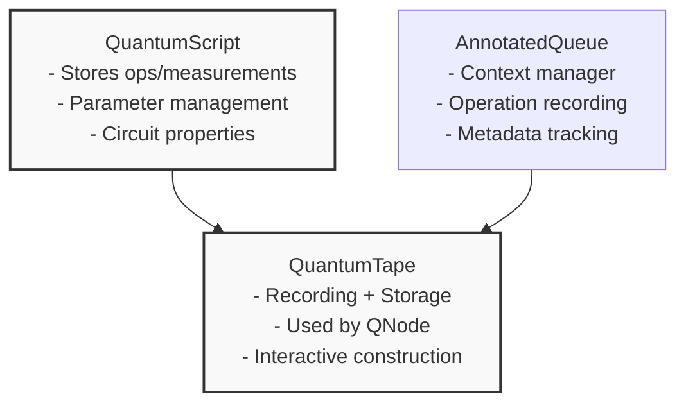

**Sources:** [pennylane/tape/qscript.py:41-118](), [pennylane/tape/tape.py:123-253]()

---

## QuantumScript: Core Circuit Data Structure

### Basic Structure

A `QuantumScript` consists of three primary components:

1. **Operations** (`_ops`): The quantum gates and state preparations
2. **Measurements** (`_measurements`): Observable measurements and sampling instructions  
3. **Metadata**: Shots, trainable parameters, cached properties

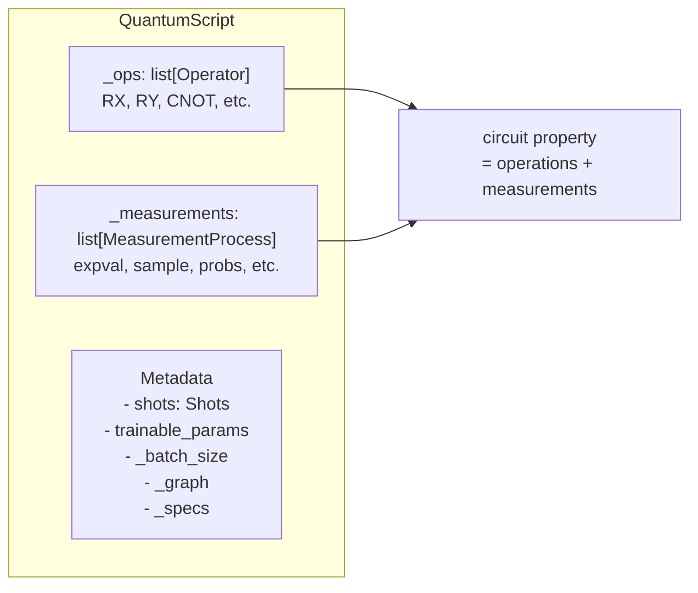

**Sources:** [pennylane/tape/qscript.py:127-145](), [pennylane/tape/qscript.py:178-196]()

### Construction Methods

**Direct instantiation:**

```python
ops = [qml.RX(0.432, wires=0), qml.RY(0.543, wires=0), qml.CNOT((0, 1))]
measurements = [qml.expval(qml.Z(0))]
qscript = QuantumScript(ops, measurements, shots=1000)
```

**From an AnnotatedQueue:**

```python
with qml.queuing.AnnotatedQueue() as q:
    qml.RX(0.432, wires=0)
    qml.expval(qml.Z(0))

qscript = QuantumScript.from_queue(q)
```

The constructor accepts iterables for both `ops` and `measurements`, automatically converting them to lists internally.

**Sources:** [pennylane/tape/qscript.py:56-117](), [pennylane/tape/qscript.py:127-145]()

### Key Properties

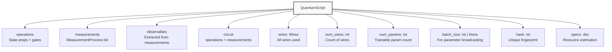

**Sources:** [pennylane/tape/qscript.py:178-397]()

---

## QuantumTape: Recording-Enabled Circuits

### Queuing Context Manager

`QuantumTape` is a context manager that records operations as they are constructed:

```python
with QuantumTape() as tape:
    qml.RX(0.432, wires=0)
    qml.RY(0.543, wires=0)
    qml.CNOT(wires=[0, 1])
    qml.expval(qml.Z(0))

# tape.operations = [RX, RY, CNOT]
# tape.measurements = [expval(Z(0))]
```

The recording mechanism works through the global `QueuingManager` singleton, which maintains a stack of active recording contexts.

**Sources:** [pennylane/tape/tape.py:123-253](), [pennylane/tape/tape.py:262-273]()

### Context Manager Lifecycle

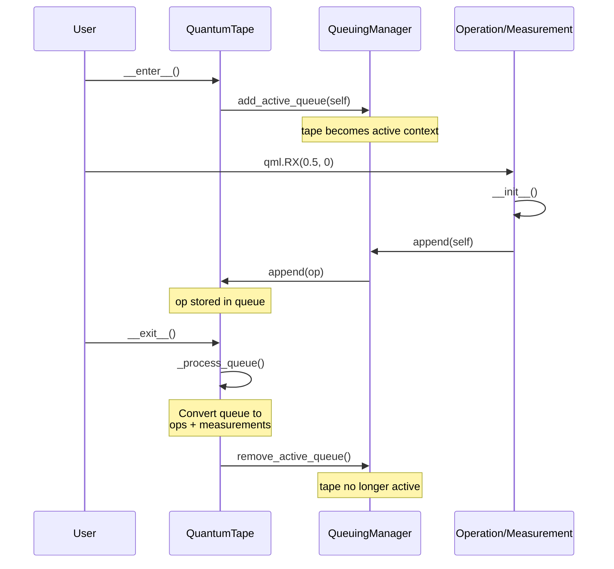

**Sources:** [pennylane/tape/tape.py:262-298](), [pennylane/queuing.py:209-257]()

---

## The Queuing System

### QueuingManager: Global Recording Coordinator

The `QueuingManager` is a singleton class that manages the stack of active recording contexts. It provides class methods for queueable objects (Operators, MeasurementProcesses) to interact with the active queue.

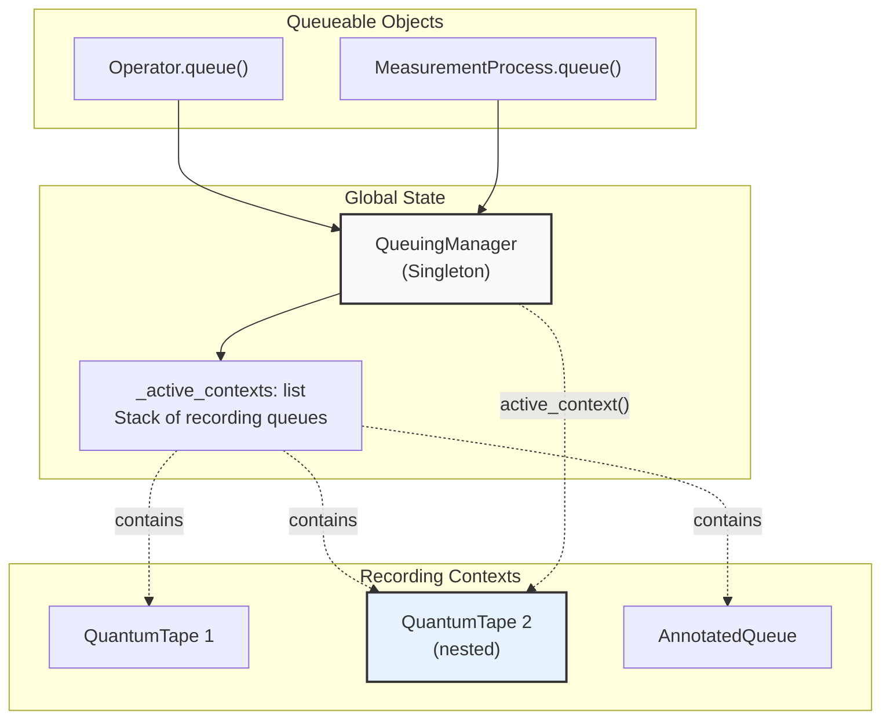

**Key methods:**
- `active_context()`: Returns the currently recording queue (top of stack)
- `recording()`: Returns `True` if any context is active
- `append(obj, **kwargs)`: Adds an object to the active queue
- `remove(obj)`: Removes an object from the active queue
- `stop_recording()`: Context manager to temporarily disable recording

**Sources:** [pennylane/queuing.py:209-364]()

### AnnotatedQueue: The Recording Queue

`AnnotatedQueue` is an `OrderedDict` subclass that stores operations along with metadata annotations. It's the base class that `QuantumTape` inherits from to gain queuing capabilities.

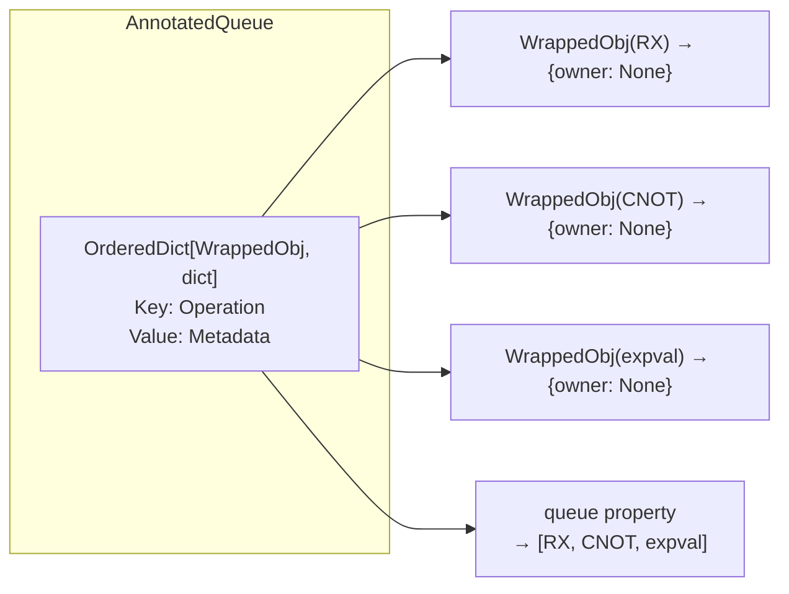

**Key methods:**
- `append(obj, **kwargs)`: Add an object with metadata
- `remove(obj)`: Remove an object
- `update_info(obj, **kwargs)`: Update object metadata
- `get_info(obj)`: Retrieve object metadata
- `queue` property: Returns list of objects (without metadata)

**Sources:** [pennylane/queuing.py:366-433]()

### WrappedObj: Identity-Based Hashing

Operations are wrapped in `WrappedObj` before being used as dictionary keys. This ensures that hash and equality are based on object identity (`id()`) rather than value equality, allowing the same operation to be queued multiple times if it's a different instance.

**Sources:** [pennylane/queuing.py:191-207]()

### process_queue: Converting Queue to Circuit

The `process_queue` function transforms an `AnnotatedQueue` into separate lists of operations and measurements:

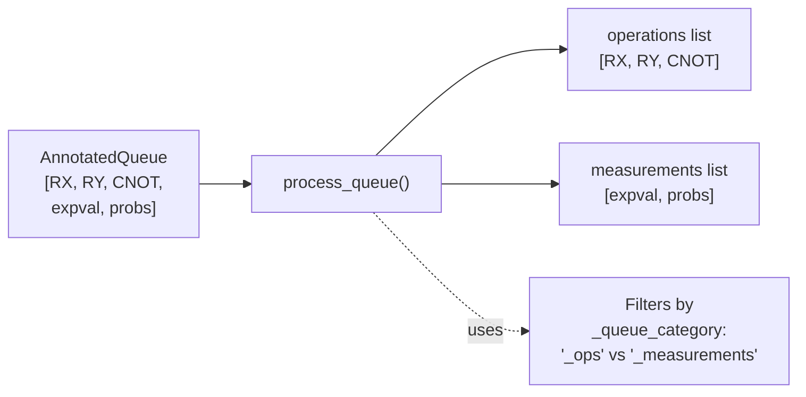

The function checks each object's `_queue_category` attribute:
- `_queue_category = "_ops"`: Goes to operations list
- `_queue_category = "_measurements"`: Goes to measurements list

It also enforces ordering: operations must come before measurements, or a `ValueError` is raised.

**Sources:** [pennylane/queuing.py:546-591](), [pennylane/tape/tape.py:287-298]()

---

## Circuit Construction Workflow

### Method 1: Direct Instantiation

```python
# Construct operations outside any context
ops = [qml.Hadamard(0), qml.CNOT([0, 1])]
measurements = [qml.expval(qml.Z(0))]

# Create QuantumScript directly
qscript = QuantumScript(ops, measurements, shots=1000)
```

### Method 2: QuantumTape Context Manager

```python
# Recording context automatically captures operations
with QuantumTape() as tape:
    qml.Hadamard(0)
    qml.CNOT([0, 1])
    qml.expval(qml.Z(0))

# Operations are processed on exit
# tape.operations = [Hadamard(0), CNOT([0, 1])]
```

### Method 3: From AnnotatedQueue

```python
# Build queue manually
with qml.queuing.AnnotatedQueue() as q:
    qml.Hadamard(0)
    qml.CNOT([0, 1])
    qml.expval(qml.Z(0))

# Convert to QuantumScript
qscript = QuantumScript.from_queue(q)
```

**Sources:** [pennylane/tape/qscript.py:56-117](), [pennylane/tape/tape.py:146-253]()

---

## Circuit Properties and Metadata

### Wire Information

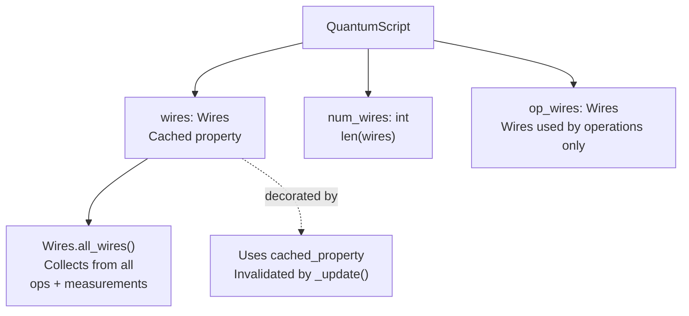

The `wires` property aggregates all wires used across operations and measurements, maintaining their order of appearance. It's a cached property, meaning it's computed once and reused until the circuit is modified.

**Sources:** [pennylane/tape/qscript.py:360-396]()

### Parameter Information

The `par_info` property provides detailed information about each parameter in the circuit:

```python
ops = [qml.RX(0.1, 0), qml.Rot(0.2, 0.3, 0.4, 0)]
qscript = QuantumScript(ops, [qml.expval(qml.Z(0))])

# qscript.par_info = [
#     {'op': RX(0.1), 'op_idx': 0, 'p_idx': 0},
#     {'op': Rot(...), 'op_idx': 1, 'p_idx': 0},
#     {'op': Rot(...), 'op_idx': 1, 'p_idx': 1},
#     {'op': Rot(...), 'op_idx': 1, 'p_idx': 2}
# ]
```

Each entry contains:
- `op`: The operator/measurement containing the parameter
- `op_idx`: Index in the circuit (operations + measurements)
- `p_idx`: Index within the operator's `data` list

**Sources:** [pennylane/tape/qscript.py:398-426]()

### Batch Size Inference

For parameter broadcasting, the `batch_size` property infers the batch dimension from operations:

```python
# Single parameter has batch dimension 3
ops = [qml.RX([0.1, 0.2, 0.3], wires=0)]
qscript = QuantumScript(ops, [qml.expval(qml.Z(0))])

assert qscript.batch_size == 3
```

The batch size is computed lazily and cached. If operations have inconsistent batch sizes, accessing this property raises a `ValueError`.

**Sources:** [pennylane/tape/qscript.py:266-277](), [pennylane/tape/qscript.py:477-498]()

### Observable Sharing and Diagonalization

The `obs_sharing_wires` and `diagonalizing_gates` properties support measurement processing:

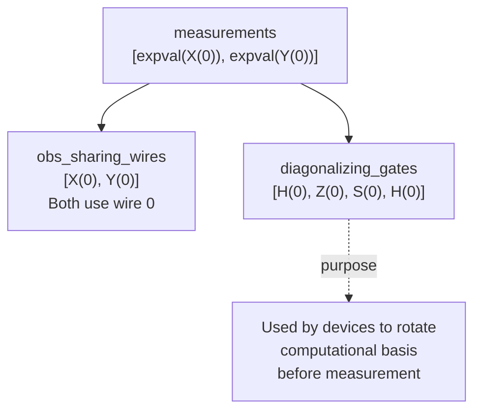

**Sources:** [pennylane/tape/qscript.py:280-338](), [pennylane/tape/qscript.py:429-476]()

### Hash and Specs

- **`hash`**: Unique integer fingerprint based on operations, measurements, and trainable parameters. Used for caching and comparison.
- **`specs`**: Resource estimation dictionary including gate counts, circuit depth, and wire allocations.

**Sources:** [pennylane/tape/qscript.py:149-157]()

---

## Parameter Management

### Trainable Parameters

The `trainable_params` property controls which parameters are considered differentiable:

```python
ops = [qml.RX(0.1, 0), qml.RY(0.2, 0), qml.RZ(0.3, 0)]
qscript = QuantumScript(ops, [qml.expval(qml.Z(0))])

# By default, all parameters are trainable
assert qscript.trainable_params == [0, 1, 2]

# Mark only the first parameter as trainable
qscript.trainable_params = [0]
assert qscript.get_parameters() == [0.1]
```

Setting `trainable_params` affects:
- `num_params`: Returns length of trainable parameter list
- `get_parameters(trainable_only=True)`: Returns only trainable values
- Gradient computation: Only trainable parameters get derivatives

**Sources:** [pennylane/tape/qscript.py:504-558]()

### Getting Parameters

The `get_parameters()` method extracts parameter values:

```python
# Get only trainable parameters (default)
trainable = qscript.get_parameters(trainable_only=True)

# Get all parameters
all_params = qscript.get_parameters(trainable_only=False)

# Get only operation parameters (exclude measurement observables)
op_params = qscript.get_parameters(operations_only=True)
```

**Sources:** [pennylane/tape/qscript.py:578-638]()

### Binding New Parameters

The `bind_new_parameters()` method creates a new circuit with updated parameter values:

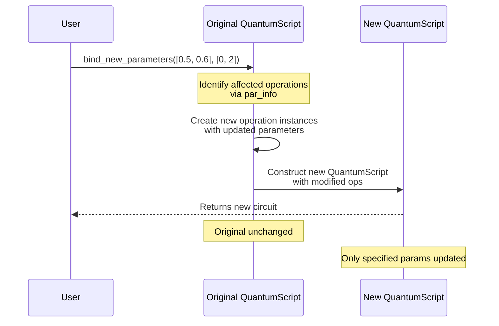

```python
ops = [qml.RX(0.1, 0), qml.RY(0.2, 0), qml.RZ(0.3, 0)]
qscript = QuantumScript(ops, [qml.expval(qml.Z(0))])

# Update parameters at indices 0 and 2
new_qscript = qscript.bind_new_parameters([0.5, 0.8], [0, 2])

# Original unchanged
assert qscript.get_parameters() == [0.1, 0.2, 0.3]

# New has updated values
assert new_qscript.get_parameters() == [0.5, 0.2, 0.8]
```

**Sources:** [pennylane/tape/qscript.py:640-721]()

---

## Circuit Manipulation

### Copying Circuits

The `copy()` method creates a new circuit with optional modifications:

```python
# Shallow copy: operations are references
new_tape = tape.copy()

# Deep copy: operations are copied
new_tape = tape.copy(copy_operations=True)

# Copy with modifications
new_tape = tape.copy(
    operations=[qml.Hadamard(0)],  # Replace operations
    measurements=[qml.expval(qml.X(0))],  # Replace measurements
    shots=2000,  # Change shots
    trainable_params=[0, 1]  # Change trainable params
)
```

The copy behavior:
- Without `copy_operations=True`: Operations are references (shared data)
- With `copy_operations=True`: Operations are shallow copied (independent parameters)
- When updates are provided: Automatically performs operation copying

**Sources:** [pennylane/tape/qscript.py:727-822]()

### Expanding Circuits

The `expand()` method decomposes operations to a target depth:

```python
ops = [qml.Permute([2, 1, 0], wires=[0, 1, 2])]
tape = QuantumScript(ops, [qml.expval(qml.Z(0))])

# Decompose once
expanded = tape.expand(depth=1)
# Operations decomposed into simpler gates

# Decompose multiple times
expanded = tape.expand(depth=2)
# Operations decomposed recursively

# Stop at specific gates
def stop_at(op):
    return op.name in ["RX", "RY", "CNOT"]
    
expanded = tape.expand(stop_at=stop_at)
```

**Sources:** [pennylane/tape/qscript.py:827-936]()

### Adjoint (Inverse) Circuits

The `adjoint()` method creates the inverse circuit:

```python
with QuantumTape() as tape:
    qml.RX(0.1, 0)
    qml.RY(0.2, 0)
    qml.CNOT([0, 1])

adj_tape = tape.adjoint()
# Operations reversed and inverted:
# [Adjoint(CNOT), Adjoint(RY), Adjoint(RX)]
```

**Sources:** [pennylane/tape/qscript.py:938-1007]()

---

## Integration with Execution Pipeline

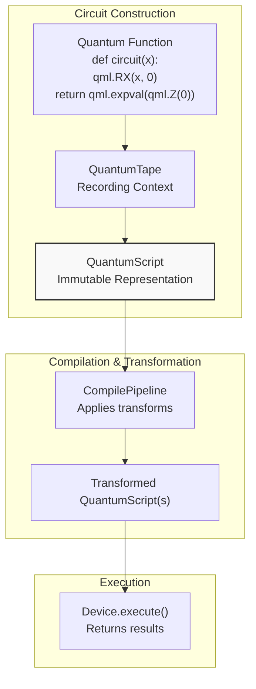

The `QuantumScript`/`QuantumTape` serves as the interface between:
1. **User code**: Quantum functions defining circuits
2. **Transform system**: Circuit optimization and compilation
3. **Device layer**: Execution on simulators or hardware

**Sources:** [pennylane/tape/qscript.py:14-17](), [pennylane/tape/tape.py:14-16]()

---

## Common Usage Patterns

### Pattern 1: Transform Development

Transforms operate on `QuantumScript` objects:

```python
def my_transform(tape: QuantumScript) -> tuple[list[QuantumScript], Callable]:
    """Example transform that modifies a circuit."""
    # Access circuit components
    ops = tape.operations
    measurements = tape.measurements
    
    # Create modified circuit
    new_ops = [transform_op(op) for op in ops]
    new_tape = QuantumScript(new_ops, measurements)
    
    # Return modified tape(s) and processing function
    return [new_tape], lambda results: results[0]
```

### Pattern 2: QNode Circuit Construction

QNodes use `QuantumTape` to record circuits:

```python
def construct_tape(qfunc, *args, **kwargs):
    with QuantumTape() as tape:
        qfunc(*args, **kwargs)
    return tape
```

### Pattern 3: Circuit Analysis

Inspect circuit properties without execution:

```python
qscript = QuantumScript(ops, measurements)

print(f"Circuit uses {qscript.num_wires} wires: {qscript.wires}")
print(f"Contains {len(qscript.operations)} operations")
print(f"Has {qscript.num_params} trainable parameters")
print(f"Resource specs: {qscript.specs}")
```

**Sources:** Various examples from [tests/tape/test_tape.py]() and [tests/tape/test_qscript.py]()

---

## Relationship to Other Systems

This circuit representation layer interacts with:

- **[Operators and Operation System](#2.1)**: Provides the operation objects stored in circuits
- **[QNode System](#2.3)**: Uses `QuantumTape` to construct circuits from quantum functions
- **[Transform System](#3.1)**: Operates on `QuantumScript` objects to modify circuits
- **[Device Layer](#4.1)**: Receives `QuantumScript` for execution

**Sources:** High-level architecture diagrams in overall system documentation

---

