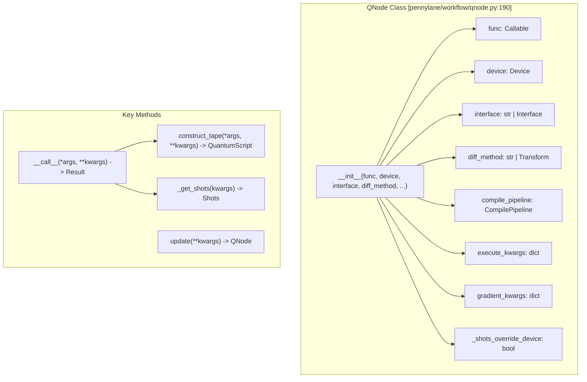
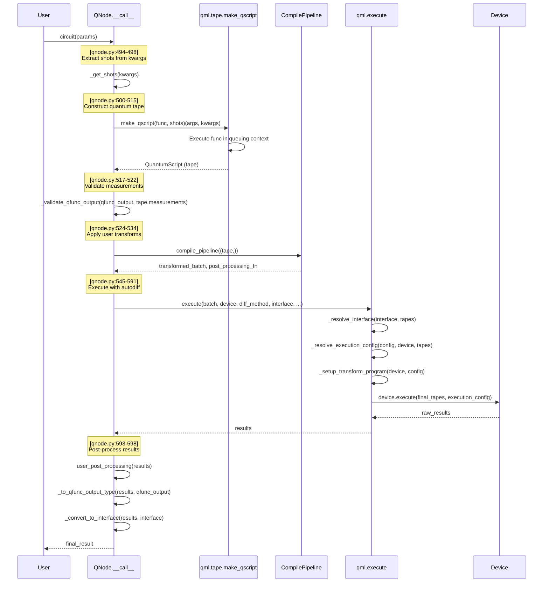
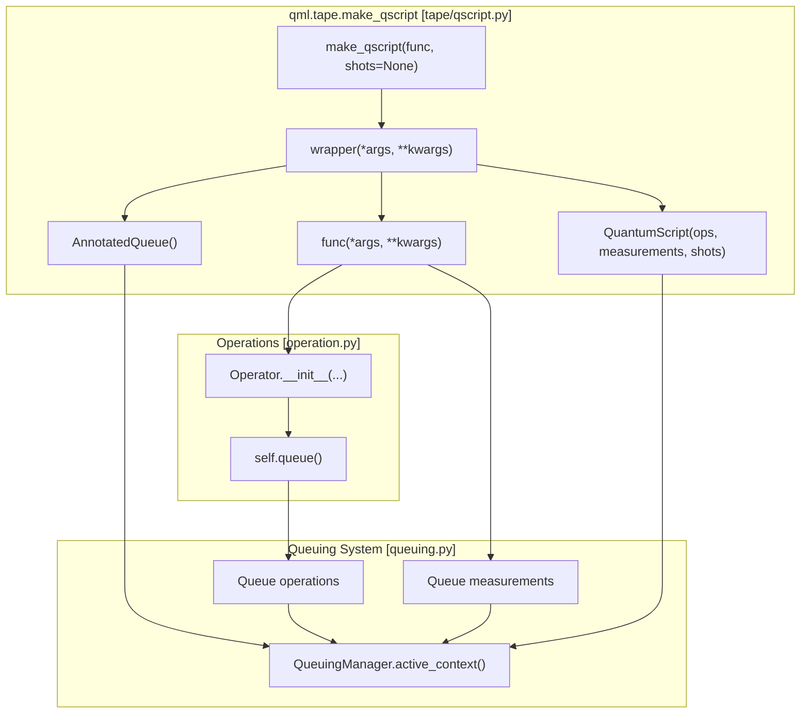
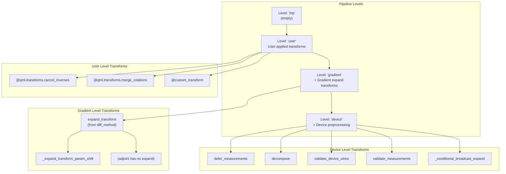
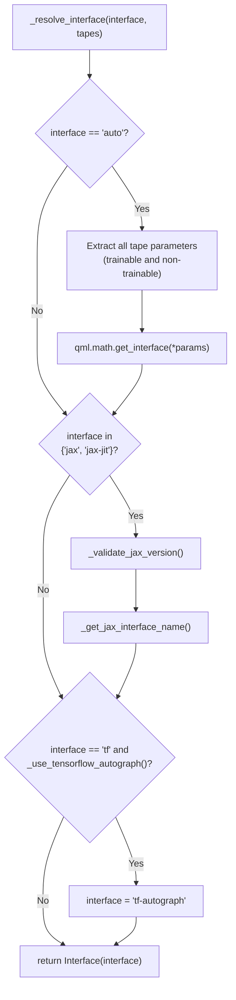
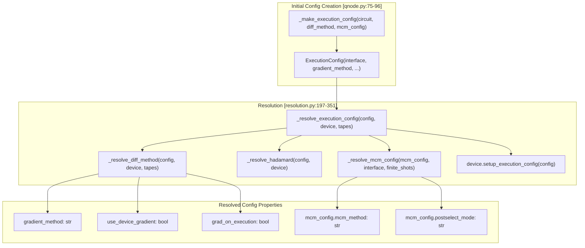
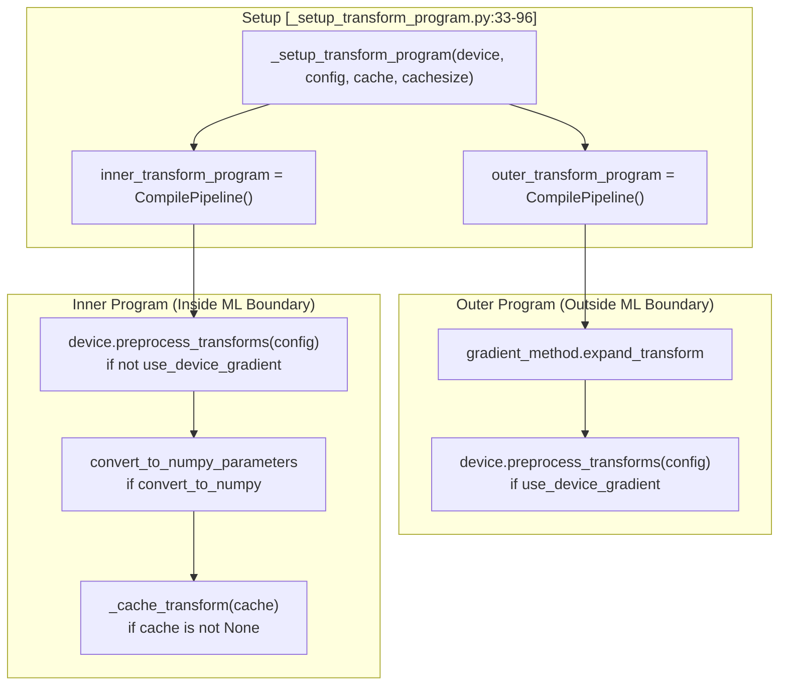
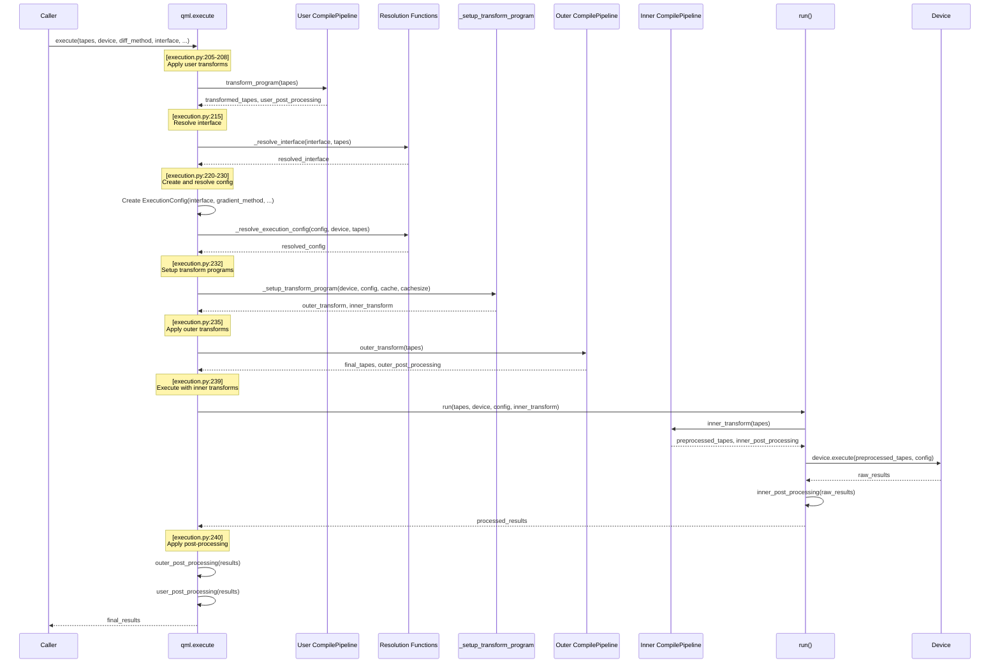
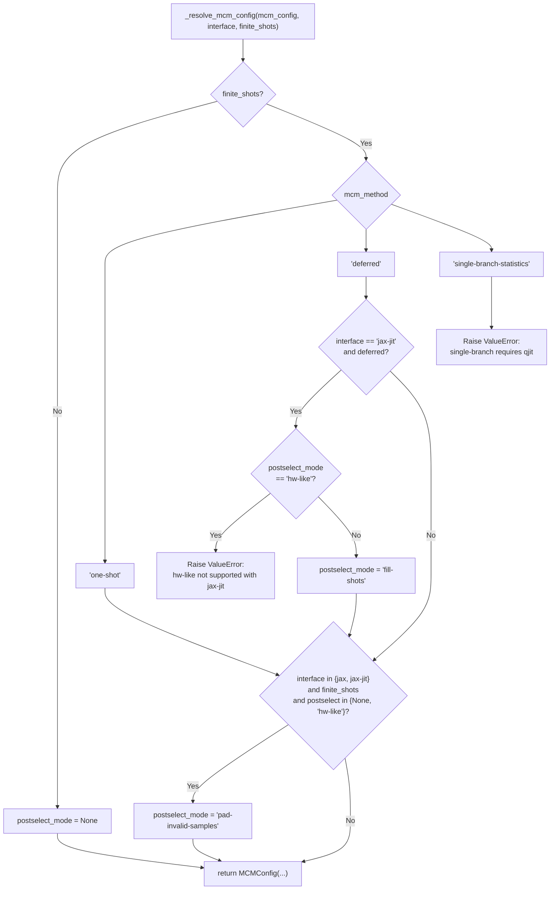

<!-- source: DeepWiki mcp.deepwiki.com · repo PennyLaneAI/pennylane · page 2.3 QNode System and Execution Workflow · fetched 2026-10-21 -->

# QNode System and Execution Workflow

<details>
<summary>Relevant source files</summary>

The following files were used as context for generating this wiki page:

- [doc/development/deprecations.rst](doc/development/deprecations.rst)
- [doc/releases/changelog-dev.md](doc/releases/changelog-dev.md)
- [pennylane/__init__.py](pennylane/__init__.py)
- [pennylane/operation.py](pennylane/operation.py)
- [pennylane/workflow/__init__.py](pennylane/workflow/__init__.py)
- [pennylane/workflow/_setup_transform_program.py](pennylane/workflow/_setup_transform_program.py)
- [pennylane/workflow/construct_execution_config.py](pennylane/workflow/construct_execution_config.py)
- [pennylane/workflow/execution.py](pennylane/workflow/execution.py)
- [pennylane/workflow/get_compile_pipeline.py](pennylane/workflow/get_compile_pipeline.py)
- [pennylane/workflow/qnode.py](pennylane/workflow/qnode.py)
- [pennylane/workflow/resolution.py](pennylane/workflow/resolution.py)
- [tests/test_operation.py](tests/test_operation.py)
- [tests/test_qnode.py](tests/test_qnode.py)
- [tests/test_qnode_legacy.py](tests/test_qnode_legacy.py)
- [tests/workflow/interfaces/execute/test_execute.py](tests/workflow/interfaces/execute/test_execute.py)
- [tests/workflow/test_get_compile_pipeline.py](tests/workflow/test_get_compile_pipeline.py)
- [tests/workflow/test_resolve_execution_config.py](tests/workflow/test_resolve_execution_config.py)

</details>


## Purpose and Scope

This document describes the QNode system in PennyLane, which provides the core abstraction for quantum circuits with automatic differentiation support. It covers the complete workflow from QNode creation through circuit execution, including tape construction, transform application, interface resolution, and device execution.

For information about the underlying circuit representation, see [QuantumScript and Circuit Representation](#2.2). For details about specific transform types, see [Transform Framework](#3.1) and [CompilePipeline and Execution Config](#3.2). For device-specific execution details, see [Device Architecture and Plugin System](#4.1).

---

## QNode Class Structure

The `QNode` class [pennylane/workflow/qnode.py:190-891]() serves as the primary interface for defining quantum circuits with classical processing. It combines three essential components: a quantum function, a device, and execution configuration.

### Core Components

| Component | Type | Purpose |
|-----------|------|---------|
| `func` | `Callable` | Python function defining quantum operations and measurements |
| `device` | `Device` or `LegacyDevice` | Hardware or simulator for executing circuits |
| `interface` | `str` or `Interface` | Autodiff framework (`"auto"`, `"autograd"`, `"torch"`, `"jax"`, `"tf"`) |
| `diff_method` | `str` or `Transform` | Differentiation strategy (`"best"`, `"parameter-shift"`, `"adjoint"`, `"backprop"`, etc.) |
| `compile_pipeline` | `CompilePipeline` | Chain of transforms to apply before execution |
| `execute_kwargs` | `dict` | Execution parameters (shots, caching, grad_on_execution, etc.) |
| `gradient_kwargs` | `dict` | Parameters passed to gradient transforms |

**QNode Initialization and Attributes**



Sources: [pennylane/workflow/qnode.py:190-491]()

---

## QNode Execution Lifecycle

The QNode execution follows a multi-stage pipeline from user function call to final results. Each stage performs specific transformations and validations.

**QNode Execution Sequence**



Sources: [pennylane/workflow/qnode.py:494-598](), [pennylane/workflow/execution.py:52-241]()

---

## Tape Construction Process

The tape construction process converts a Python function into a structured `QuantumScript` representation. This occurs through the queuing mechanism.

**Tape Construction Flow**



The queuing mechanism works via context managers:

1. `AnnotatedQueue` is created as active context [pennylane/queuing.py]()
2. Operations and measurements call `self.queue()` during initialization [pennylane/operation.py:1142-1148]()
3. `QueuingManager.active_context()` returns current queue [pennylane/queuing.py]()
4. All queued operators are collected into `QuantumScript` [pennylane/tape/qscript.py]()

Sources: [pennylane/workflow/qnode.py:500-515](), [pennylane/tape/qscript.py](), [pennylane/queuing.py](), [pennylane/operation.py:1142-1148]()

---

## Transform Pipeline Levels

The `CompilePipeline` applies transforms in distinct levels, each serving different purposes in the execution workflow.

**Transform Pipeline Architecture**



| Level | Description | Applied When | Key Transforms |
|-------|-------------|--------------|----------------|
| `"top"` | No transforms | Pipeline initialization | None |
| `"user"` | Manually applied by user via decorators | QNode definition | `cancel_inverses`, `merge_rotations`, custom transforms |
| `"gradient"` | Gradient-related expansions | After user transforms | `expand_transform` from gradient method |
| `"device"` | Device-specific preprocessing | Before device execution | `defer_measurements`, `decompose`, validation |

The pipeline can be retrieved at any level using `get_compile_pipeline(qnode, level="user")` [pennylane/workflow/get_compile_pipeline.py:71-245]().

Sources: [pennylane/workflow/get_compile_pipeline.py:71-245](), [pennylane/transforms/core/compile_pipeline.py](), [pennylane/workflow/qnode.py:524-534]()

---

## Interface Resolution

Interface resolution determines which autodiff framework to use for backpropagation. The process occurs in `_resolve_interface` [pennylane/workflow/resolution.py:102-144]().

**Interface Resolution Logic**



**Interface Detection Priority**:

1. If `interface="auto"`: Inspect tape parameters to determine framework [resolution.py:115-123]()
2. If JAX detected: Check if in JIT context via `_get_jax_interface_name()` [resolution.py:55-60]()
3. If TensorFlow: Check for Autograph mode via `_use_tensorflow_autograph()` [resolution.py:88-99]()
4. Return resolved `Interface` enum

Sources: [pennylane/workflow/resolution.py:102-144](), [pennylane/math/interface_utils.py]()

---

## Execution Configuration Resolution

The `ExecutionConfig` object consolidates all execution parameters and is resolved through multiple stages.

**ExecutionConfig Creation and Resolution**



**ExecutionConfig Fields**

| Field | Type | Purpose | Resolution Location |
|-------|------|---------|---------------------|
| `gradient_method` | `str` or `Transform` | Differentiation method | [resolution.py:218-300]() |
| `use_device_gradient` | `bool` | Whether device computes gradients | [resolution.py:218-300]() |
| `grad_on_execution` | `bool` or `None` | Compute gradients during forward pass | [resolution.py:85-87]() |
| `interface` | `Interface` | Autodiff framework | [resolution.py:102-144]() |
| `mcm_config` | `MCMConfig` | Mid-circuit measurement handling | [resolution.py:147-184]() |
| `use_device_jacobian_product` | `bool` | Use device VJP if available | [qnode.py:94]() |
| `derivative_order` | `int` | Maximum derivative order (`max_diff`) | [qnode.py:227-230]() |

**Gradient Method Resolution** [resolution.py:218-300]():

1. `"best"` → Select optimal method based on device capabilities
2. Device-specific methods (`"backprop"`, `"adjoint"`, `"device"`) → Validate device support
3. Parameter-based methods (`"parameter-shift"`, `"finite-diff"`) → Always allowed
4. Transform objects → Use directly as gradient method

Sources: [pennylane/workflow/resolution.py:197-351](), [pennylane/workflow/qnode.py:75-96](), [pennylane/devices/execution_config.py]()

---

## Transform Program Setup

The execution workflow requires two separate transform programs: outer (outside ML boundary) and inner (inside ML boundary).

**Transform Program Structure**



**Program Assignment Logic** [_setup_transform_program.py:56-94]():

```
if gradient_method has expand_transform:
    outer_program.add_transform(expand_transform, **gradient_kwargs)

device_transforms = device.preprocess_transforms(config)

if config.use_device_gradient:
    outer_program += device_transforms
else:
    inner_program += device_transforms

if not interface_data_supported:
    inner_program.add_transform(convert_to_numpy_parameters)

if cache is not None:
    inner_program.add_transform(_cache_transform, cache=cache)
```

**Cache Configuration** [_setup_transform_program.py:73-83]():

- `cache="auto"`: Use cache if `derivative_order > 1`, else no cache
- `cache=True`: Create `LRUCache(maxsize=cachesize)`
- `cache=False` or `cache=None`: No caching
- `cache=dict()` or `cache=Cache()`: Use provided cache object

Sources: [pennylane/workflow/_setup_transform_program.py:33-96](), [pennylane/workflow/_cache_transform.py]()

---

## Complete Execution Flow

The `execute` function [pennylane/workflow/execution.py:52-241]() orchestrates the complete execution workflow from tapes to results.

**execute() Function Workflow**



Sources: [pennylane/workflow/execution.py:52-241](), [pennylane/workflow/run.py]()

---

## Gradient Computation Methods

Different differentiation methods are supported, each with distinct characteristics and requirements.

**Supported Differentiation Methods**

| Method | Type | Device Requirement | Execution Mode | Description |
|--------|------|-------------------|----------------|-------------|
| `"best"` | Meta | Any | Auto-selected | Chooses optimal method based on device/circuit |
| `"backprop"` | Device | Simulator with classical backprop | Grad on execution | Classical autodiff through simulation |
| `"adjoint"` | Device | Simulator with adjoint support | Grad on execution | Adjoint method for state vector simulators |
| `"device"` | Device | Device with custom gradient | Depends on device | Device-native gradient computation |
| `"parameter-shift"` | Transform | Any | Backward pass | Quantum parameter shift rule |
| `"finite-diff"` | Transform | Any | Backward pass | Numerical finite differences |
| `"hadamard"` | Transform | Any with auxiliary wire | Backward pass | Hadamard test gradient |
| `"spsa"` | Transform | Any | Backward pass | Simultaneous perturbation stochastic approximation |

**Gradient Method Selection Logic** [resolution.py:218-300]():

```
if diff_method == "best":
    if device supports backprop/adjoint:
        return device method (use_device_gradient=True)
    else:
        return "parameter-shift" (use_device_gradient=False)

elif diff_method in ["backprop", "adjoint", "device"]:
    if device.supports_derivatives(config):
        return diff_method (use_device_gradient=True)
    else:
        raise QuantumFunctionError

elif diff_method in ["parameter-shift", "finite-diff", "hadamard", "spsa"]:
    return diff_method (use_device_gradient=False)

elif isinstance(diff_method, Transform):
    return diff_method (use_device_gradient=False)
```

**Device Gradient vs Transform Gradient** [_setup_transform_program.py:66-70]():

- **Device gradient** (`use_device_gradient=True`): Device transforms added to outer program
- **Transform gradient** (`use_device_gradient=False`): Device transforms added to inner program, gradient transform in outer program

Sources: [pennylane/workflow/resolution.py:218-300](), [pennylane/workflow/_setup_transform_program.py:66-70](), [pennylane/gradients]()

---

## Mid-Circuit Measurement Configuration

Mid-circuit measurements require special handling based on the measurement method and postselection mode.

**MCMConfig Resolution** [resolution.py:147-184]():



**MCM Methods**:

- `"deferred"`: Measurements deferred until end of circuit (requires `defer_measurements` transform)
- `"one-shot"`: Each shot is a separate execution path (requires `dynamic_one_shot` transform)
- `"tree-traversal"`: Tree-based evaluation of all measurement branches
- `"single-branch-statistics"`: Only available in qJIT context

**Postselect Modes**:

- `"hw-like"`: Invalid shots discarded (matches hardware behavior)
- `"fill-shots"`: Invalid shots replaced to maintain shot count
- `"pad-invalid-samples"`: JAX-specific padding for invalid samples
- `None`: No postselection handling

Sources: [pennylane/workflow/resolution.py:147-184](), [pennylane/devices/execution_config.py](), [pennylane/transforms/dynamic_one_shot.py](), [pennylane/transforms/defer_measurements.py]()

---

## QNode Update Mechanism

QNodes are immutable; the `update` method creates a new instance with modified parameters.

**update() Method** [qnode.py:408-475]():

```python
def update(
    self,
    func=None,
    device=None,
    diff_method=None,
    interface=None,
    **kwargs
) -> QNode:
    """Create a new QNode with updated parameters."""
    # Validate at least one parameter provided
    # Create new QNode instance with updated values
    # Preserve compile_pipeline from original
```

Updatable parameters:
- `func`: Quantum function
- `device`: Execution device
- `diff_method`: Differentiation method
- `interface`: Autodiff framework
- `gradient_kwargs`: Additional gradient parameters
- Any `execute_kwargs` fields (shots, cache, max_diff, etc.)

The original QNode's `compile_pipeline` is preserved in the new instance [qnode.py:473-475]().

Sources: [pennylane/workflow/qnode.py:408-475](), [tests/test_qnode.py:118-224]()

---

## Validation and Error Handling

Multiple validation steps ensure correct QNode configuration and execution.

**Validation Points**

| Validation | Location | Purpose |
|------------|----------|---------|
| `_validate_diff_method` | [qnode.py:165-186]() | Verify device supports requested differentiation method |
| `_validate_qfunc_output` | [qnode.py:131-163]() | Ensure quantum function returns valid measurements |
| `_validate_mcm_config` | [qnode.py:124-128]() | Check MCM configuration is valid |
| `_validate_jax_version` | [resolution.py:63-83]() | Verify JAX version compatibility |
| Device validation | [resolution.py:229-234]() | Check device capabilities match config |

**Common Validation Errors**:

1. **Invalid differentiation method**: Raised when device doesn't support requested `diff_method` [qnode.py:174-177]()
2. **Invalid measurements**: Raised when quantum function doesn't return `MeasurementProcess` objects [qnode.py:154-157]()
3. **Measurement order**: Raised when measurements not returned in order they were measured [qnode.py:159-162]()
4. **MCM configuration**: Raised for invalid mid-circuit measurement settings [resolution.py:162-164]()

Sources: [pennylane/workflow/qnode.py:124-186](), [pennylane/workflow/resolution.py:63-83](), [pennylane/workflow/resolution.py:197-351]()

---

