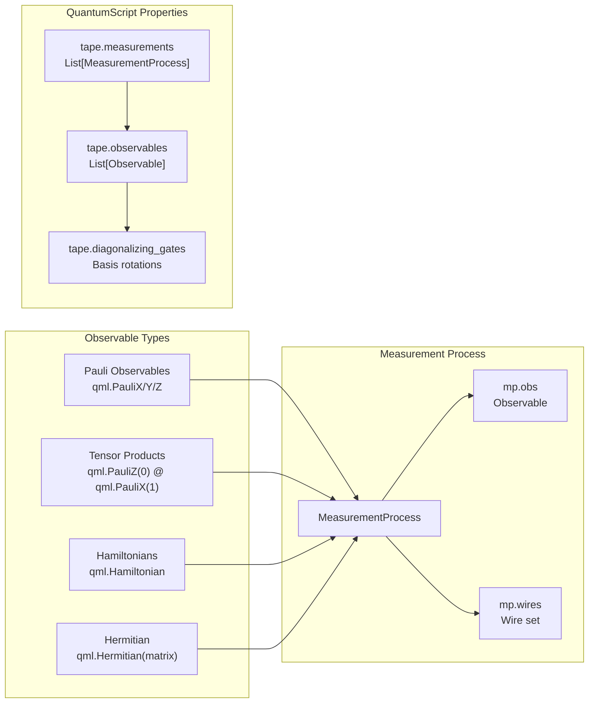
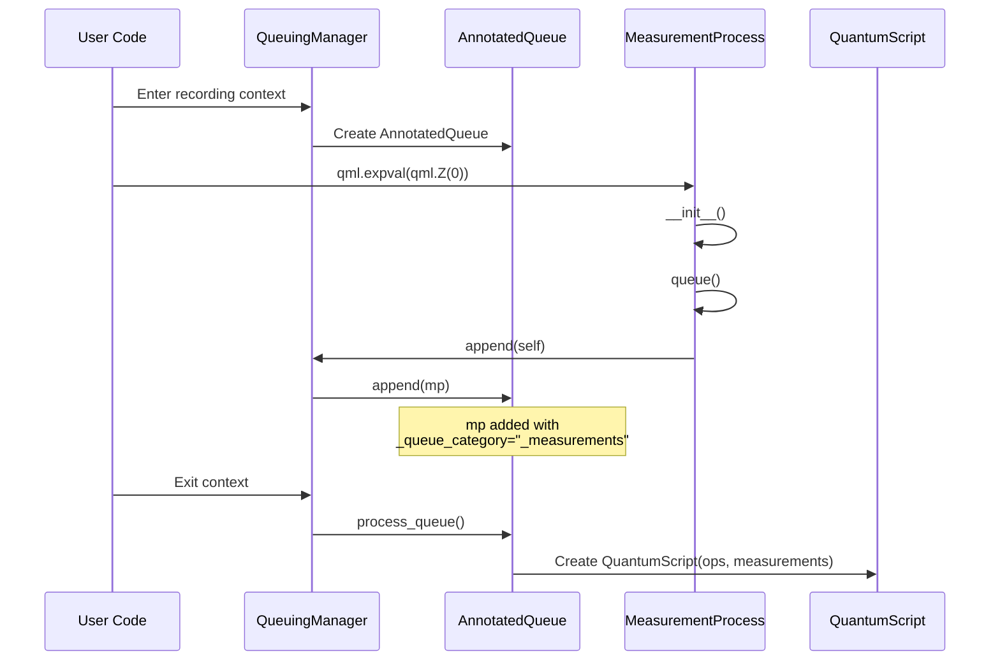
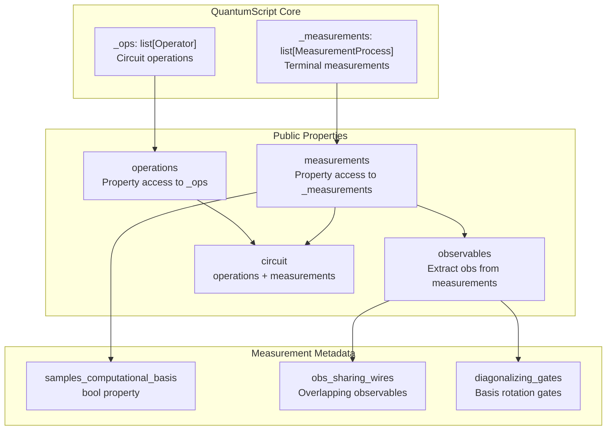
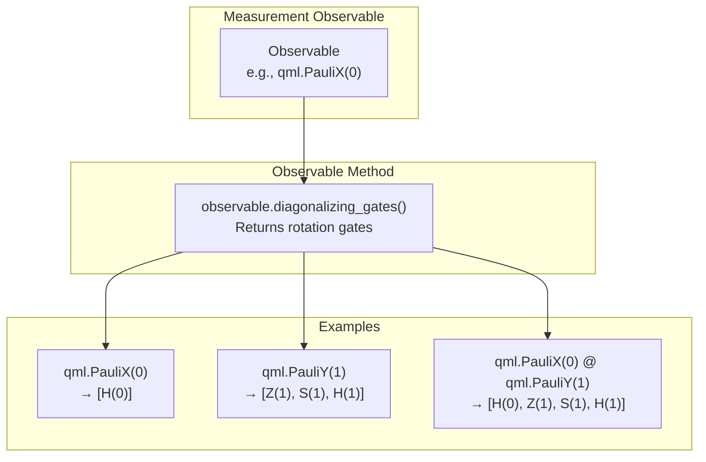
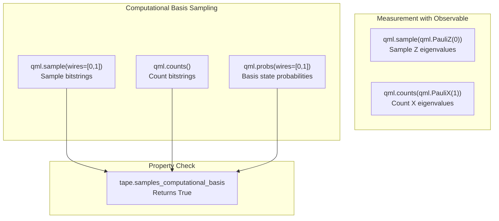
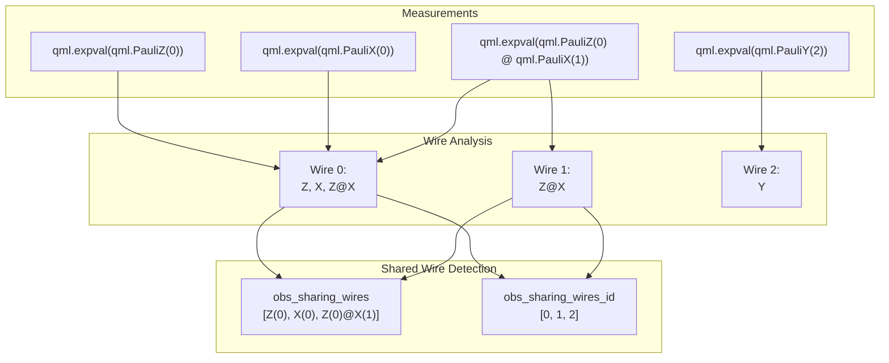
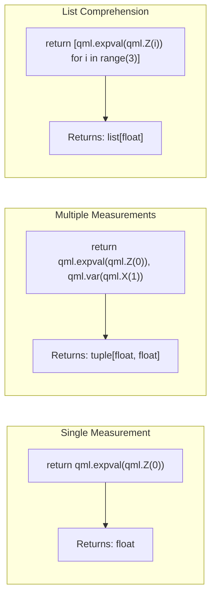
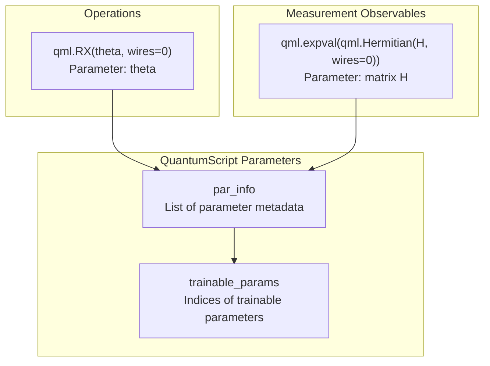
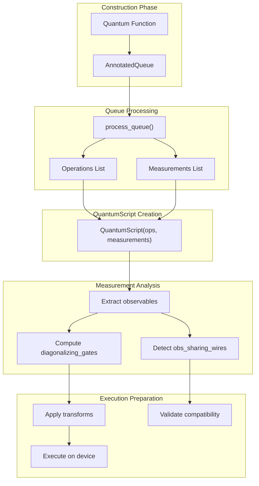

<!-- source: DeepWiki mcp.deepwiki.com · repo PennyLaneAI/pennylane · page 2.4 Measurement Processes · fetched 2026-10-21 -->

# Measurement Processes

<details>
<summary>Relevant source files</summary>

The following files were used as context for generating this wiki page:

- [doc/code/qml_queuing.rst](doc/code/qml_queuing.rst)
- [doc/introduction/measurements.rst](doc/introduction/measurements.rst)
- [pennylane/queuing.py](pennylane/queuing.py)
- [pennylane/tape/operation_recorder.py](pennylane/tape/operation_recorder.py)
- [pennylane/tape/qscript.py](pennylane/tape/qscript.py)
- [pennylane/tape/tape.py](pennylane/tape/tape.py)
- [tests/tape/test_qscript.py](tests/tape/test_qscript.py)
- [tests/tape/test_tape.py](tests/tape/test_tape.py)
- [tests/test_queuing.py](tests/test_queuing.py)

</details>


## Purpose and Scope

Measurement processes represent the terminal measurements performed at the end of a quantum circuit. They define what classical information to extract from the quantum state after executing the circuit operations. This page documents the measurement system, including the `MeasurementProcess` base class, measurement types, observable handling, and the processing pipeline.

For information about circuit operations and gates, see [Operators and Operation System](#2.1). For the full circuit representation, see [QuantumScript and Circuit Representation](#2.2).

---

## MeasurementProcess Class Hierarchy

The `MeasurementProcess` class is the base class for all measurement types in PennyLane. Each measurement encapsulates:

- **Observable** (optional): The operator being measured (e.g., `qml.PauliZ(0)`)
- **Wires**: The wires involved in the measurement
- **Return type**: What classical data structure is returned (expectation value, samples, probabilities, etc.)
- **Measurement properties**: Metadata about the measurement behavior

```mermaid
graph TB
    MP["MeasurementProcess<br/>pennylane.measurements"]
    
    subgraph "Observable-based Measurements"
        ExpectationMP["ExpectationMP<br/>qml.expval()"]
        VarianceMP["VarianceMP<br/>qml.var()"]
        SampleMP["SampleMP<br/>qml.sample()"]
        CountsMP["CountsMP<br/>qml.counts()"]
    end
    
    subgraph "State-based Measurements"
        StateMP["StateMP<br/>qml.state()"]
        DensityMatrixMP["DensityMatrixMP<br/>qml.density_matrix()"]
        ProbabilityMP["ProbabilityMP<br/>qml.probs()"]
    end
    
    subgraph "Quantum Information Measurements"
        VnEntropyMP["VnEntropyMP<br/>qml.vn_entropy()"]
        MutualInfoMP["MutualInfoMP<br/>qml.mutual_info()"]
        PurityMP["PurityMP<br/>qml.purity()"]
    end
    
    subgraph "Shadow Measurements"
        ClassicalShadowMP["ClassicalShadowMP<br/>qml.classical_shadow()"]
        ShadowExpvalMP["ShadowExpvalMP<br/>qml.shadow_expval()"]
    end
    
    MP --> ExpectationMP
    MP --> VarianceMP
    MP --> SampleMP
    MP --> CountsMP
    MP --> StateMP
    MP --> DensityMatrixMP
    MP --> ProbabilityMP
    MP --> VnEntropyMP
    MP --> MutualInfoMP
    MP --> PurityMP
    MP --> ClassicalShadowMP
    MP --> ShadowExpvalMP
```



**Diagram: MeasurementProcess Type Hierarchy**

Sources: [doc/introduction/measurements.rst:26-45](), [pennylane/tape/qscript.py:30](), [pennylane/tape/tape.py:24]()

---

## Measurement Types

PennyLane provides several categories of measurements:

| Measurement Function | Return Type | Differentiable | Observable Required | Description |
|---------------------|-------------|----------------|---------------------|-------------|
| `qml.expval(obs)` | float/array | Yes | Yes | Expectation value of observable |
| `qml.var(obs)` | float/array | Yes | Yes | Variance of observable |
| `qml.sample(obs)` | array | No (stochastic) | Optional | Raw measurement samples |
| `qml.counts(obs)` | dict | No (stochastic) | Optional | Histogram of measurement outcomes |
| `qml.probs(wires)` | array | Yes | Optional | Computational basis probabilities |
| `qml.state()` | array | Yes | No | Full quantum state vector |
| `qml.density_matrix(wires)` | array | Yes | No | Reduced density matrix |
| `qml.vn_entropy(wires)` | float | Yes | No | Von Neumann entropy |
| `qml.mutual_info(wires0, wires1)` | float | Yes | No | Mutual information |
| `qml.purity(wires)` | float | Yes | No | State purity |
| `qml.classical_shadow(wires)` | array | No | No | Classical shadow representation |
| `qml.shadow_expval(obs)` | float | No | Yes | Expectation from shadows |

Sources: [doc/introduction/measurements.rst:26-45]()

---

## Observable Handling

Measurements can be associated with observables, which define the basis in which measurements occur:



**Diagram: Observable and Measurement Relationship**

The `QuantumScript.observables` property extracts observables from measurements:

```python
# From pennylane/tape/qscript.py:213-237
@property
def observables(self) -> list[MeasurementProcess | Operator]:
    obs = []
    for m in self.measurements:
        if m.obs is not None:
            obs.append(m.obs)
        else:
            obs.append(m)
    return obs
```

Sources: [pennylane/tape/qscript.py:213-237](), [doc/introduction/measurements.rst:115-137]()

---

## Measurement Queuing and Circuit Construction

Measurements are queued during circuit construction using the same queuing system as operations:



**Diagram: Measurement Queuing Flow**

Measurements have `_queue_category = "_measurements"` which ensures they are separated from operations during queue processing:

```python
# From pennylane/queuing.py:546-591
def process_queue(queue: AnnotatedQueue):
    lists = {"_ops": [], "_measurements": []}
    
    for obj, _ in queue.items():
        # Check _queue_category
        lists[obj._queue_category].append(obj)
    
    return lists["_ops"], lists["_measurements"]
```

Sources: [pennylane/queuing.py:546-591](), [pennylane/tape/qscript.py:134-135](), [pennylane/tape/tape.py:287-298]()

---

## QuantumScript Measurement Storage

The `QuantumScript` class stores and manages measurements:



**Diagram: QuantumScript Measurement Properties**

Key properties related to measurements:

| Property | Type | Description | Source |
|----------|------|-------------|--------|
| `measurements` | `list[MeasurementProcess]` | All measurement processes | [pennylane/tape/qscript.py:240-253]() |
| `observables` | `list[Operator]` | Extracted observables from measurements | [pennylane/tape/qscript.py:213-237]() |
| `samples_computational_basis` | `bool` | True if any measurement samples comp. basis | [pennylane/tape/qscript.py:256-258]() |
| `obs_sharing_wires` | `list[Operator]` | Observables that share wires | [pennylane/tape/qscript.py:429-439]() |
| `diagonalizing_gates` | `list[Operation]` | Gates to rotate to measurement basis | [pennylane/tape/qscript.py:280-338]() |

Sources: [pennylane/tape/qscript.py:240-253](), [pennylane/tape/qscript.py:213-237](), [pennylane/tape/qscript.py:256-258](), [pennylane/tape/qscript.py:280-338]()

---

## Diagonalizing Gates

Measurement observables often require basis rotations to be measured in the computational basis. The `diagonalizing_gates` property computes these rotations:



**Diagram: Diagonalizing Gate Generation**

Example from the code:
```python
# From pennylane/tape/qscript.py:289-299
>>> tape = qml.tape.QuantumScript([], [qml.expval(qml.X(0))])
>>> tape.diagonalizing_gates
[H(0)]

>>> tape = qml.tape.QuantumScript([], [qml.expval(qml.X(0)), qml.var(qml.Y(1))])
>>> tape.diagonalizing_gates
[H(0), Z(1), S(1), H(1)]
```

The implementation iterates over all observables and collects their diagonalizing gates:

```python
# From pennylane/tape/qscript.py:330-338
rotation_gates = []
with qml.queuing.QueuingManager.stop_recording():
    for observable in _get_base_obs(self.observables):
        with contextlib.suppress(qml.operation.DiagGatesUndefinedError):
            rotation_gates.extend(observable.diagonalizing_gates())
return rotation_gates
```

Sources: [pennylane/tape/qscript.py:280-338](), [pennylane/tape/qscript.py:289-299]()

---

## Computational Basis Sampling

Measurements like `sample()`, `counts()`, and `probs()` can operate without an observable, in which case they sample the computational basis:



**Diagram: Computational Basis Sampling**

The `samples_computational_basis` property checks all measurements:

```python
# From pennylane/tape/qscript.py:256-258
@property
def samples_computational_basis(self) -> bool:
    return any(o.samples_computational_basis for o in self.measurements)
```

This property is used for validation and special handling during execution. For example, computational basis sampling must be validated for qubit-wise commutativity:

```python
# From pennylane/tape/tape.py:40-90
def _validate_computational_basis_sampling(tape):
    # Validates that computational basis sampling is compatible
    # with other measurements considering qubit-wise commutativity
    ...
```

Sources: [pennylane/tape/qscript.py:256-258](), [pennylane/tape/tape.py:40-90]()

---

## Observable Sharing Wires

When multiple measurements act on the same wires, PennyLane must determine if they are compatible:



**Diagram: Observable Wire Sharing Detection**

The detection is performed by `_update_observables()`:

```python
# From pennylane/tape/qscript.py:454-476
def _update_observables(self):
    obs_wires = [wire for m in self.measurements for wire in m.wires if m.obs is not None]
    self._obs_sharing_wires = []
    self._obs_sharing_wires_id = []
    
    if len(obs_wires) != len(set(obs_wires)):
        c = Counter(obs_wires)
        repeated_wires = {w for w in obs_wires if c[w] > 1}
        
        for i, m in enumerate(self.measurements):
            if m.obs is not None and len(set(m.wires) & repeated_wires) > 0:
                self._obs_sharing_wires.append(m.obs)
                self._obs_sharing_wires_id.append(i)
```

When observables share wires, they must be qubit-wise commuting (QWC) or the tape must be split. The `rotations_and_diagonal_measurements()` function handles this:

```python
# From pennylane/tape/tape.py:92-120
def rotations_and_diagonal_measurements(tape):
    if not tape.obs_sharing_wires:
        return [], tape.measurements
    
    with QueuingManager.stop_recording():
        rotations, diag_obs = qml.pauli.diagonalize_qwc_pauli_words(tape.obs_sharing_wires)
    
    measurements = copy.copy(tape.measurements)
    for o, i in zip(diag_obs, tape.obs_sharing_wires_id):
        new_m = tape.measurements[i].__class__(obs=o)
        measurements[i] = new_m
    
    return rotations, measurements
```

Sources: [pennylane/tape/qscript.py:454-476](), [pennylane/tape/tape.py:92-120]()

---

## Combined Measurements

A quantum function can return multiple measurements as a tuple, list, or dictionary:



**Diagram: Combined Measurement Return Types**

Examples:
```python
# Single measurement
def circuit():
    qml.Hadamard(0)
    return qml.expval(qml.Z(0))

# Multiple measurements
def circuit():
    qml.Hadamard(0)
    qml.CNOT([0, 1])
    return qml.expval(qml.Z(0)), qml.var(qml.X(1))

# List comprehension
def circuit():
    qml.Hadamard(0)
    return [qml.expval(qml.Z(i)) for i in range(2)]
```

Non-commuting measurements may trigger multiple device executions. Stochastic measurements (sample, counts) cannot be combined with non-commuting observable measurements.

Sources: [doc/introduction/measurements.rst:54-79](), [doc/introduction/measurements.rst:70-79]()

---

## Measurement Parameter Handling

Observables within measurements can have parameters that are tracked for differentiation:



**Diagram: Measurement Parameter Tracking**

The `par_info` property includes parameters from measurement observables:

```python
# From pennylane/tape/qscript.py:415-426
@cached_property
def par_info(self) -> list[dict[str, int | Operator]]:
    par_info = []
    for idx, op in enumerate(self.operations):
        par_info.extend({"op": op, "op_idx": idx, "p_idx": i} for i, d in enumerate(op.data))
    
    n_ops = len(self.operations)
    for idx, m in enumerate(self.measurements):
        if m.obs is not None:
            par_info.extend(
                {"op": m.obs, "op_idx": idx + n_ops, "p_idx": i}
                for i, d in enumerate(m.obs.data)
            )
    return par_info
```

This allows observable parameters to participate in gradient computations.

Sources: [pennylane/tape/qscript.py:398-426](), [tests/tape/test_tape.py:786-806]()

---

## Measurement Processing Summary

The complete measurement processing pipeline:



**Diagram: Complete Measurement Processing Pipeline**

Sources: [pennylane/queuing.py:546-591](), [pennylane/tape/qscript.py:240-253](), [pennylane/tape/tape.py:40-120]()

---

## Implementation Files

Key files implementing the measurement system:

| File | Purpose |
|------|---------|
| `pennylane/measurements/` | MeasurementProcess classes and implementations |
| [pennylane/tape/qscript.py:240-338]() | Measurement properties in QuantumScript |
| [pennylane/tape/tape.py:40-120]() | Measurement validation and processing |
| [pennylane/queuing.py:546-591]() | Queue processing to separate operations and measurements |
| [tests/tape/test_tape.py]() | Test suite for measurement functionality |

Sources: [pennylane/tape/qscript.py](), [pennylane/tape/tape.py](), [pennylane/queuing.py]()

---

