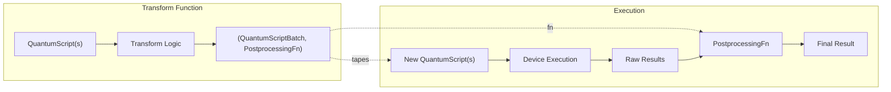
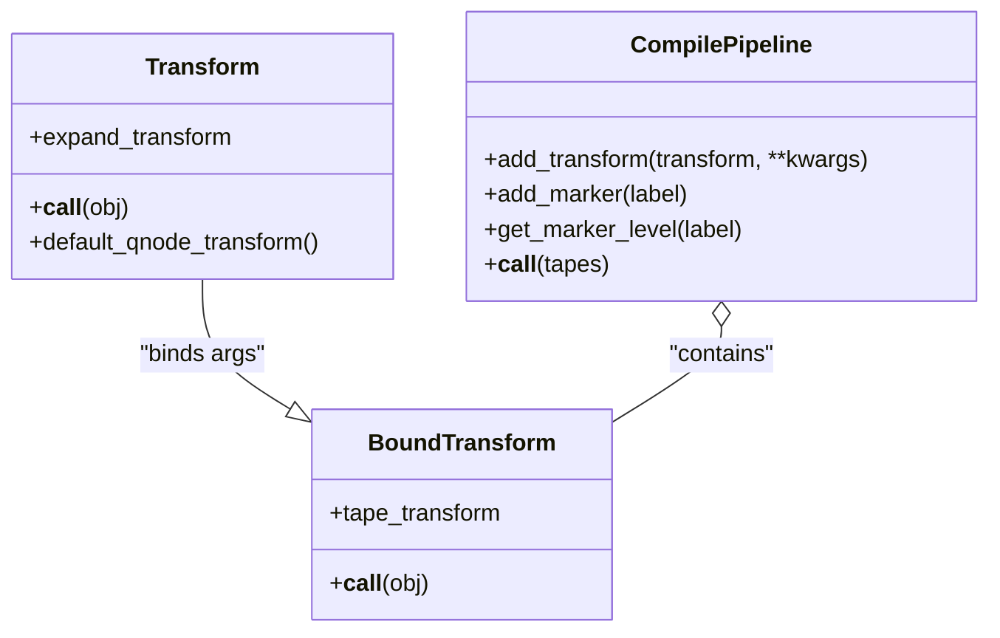
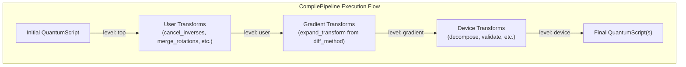
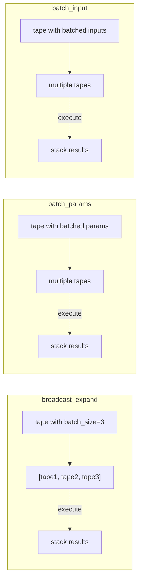
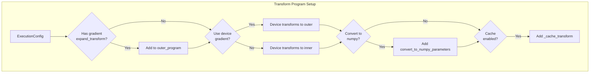
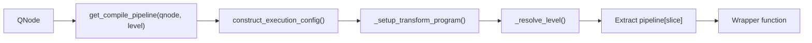
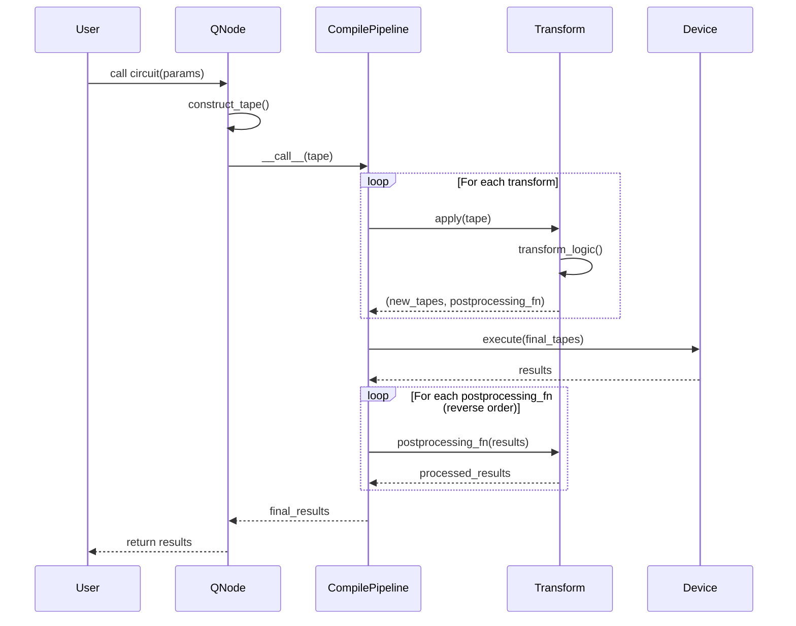

<!-- source: DeepWiki mcp.deepwiki.com · repo PennyLaneAI/pennylane · page 3 Transform and Compilation System · fetched 2026-10-21 -->

# Transform and Compilation System

<details>
<summary>Relevant source files</summary>

The following files were used as context for generating this wiki page:

- [doc/development/deprecations.rst](doc/development/deprecations.rst)
- [doc/releases/changelog-dev.md](doc/releases/changelog-dev.md)
- [pennylane/__init__.py](pennylane/__init__.py)
- [pennylane/operation.py](pennylane/operation.py)
- [pennylane/transforms/__init__.py](pennylane/transforms/__init__.py)
- [pennylane/transforms/batch_input.py](pennylane/transforms/batch_input.py)
- [pennylane/transforms/batch_params.py](pennylane/transforms/batch_params.py)
- [pennylane/transforms/broadcast_expand.py](pennylane/transforms/broadcast_expand.py)
- [pennylane/workflow/__init__.py](pennylane/workflow/__init__.py)
- [pennylane/workflow/_setup_transform_program.py](pennylane/workflow/_setup_transform_program.py)
- [pennylane/workflow/construct_execution_config.py](pennylane/workflow/construct_execution_config.py)
- [pennylane/workflow/execution.py](pennylane/workflow/execution.py)
- [pennylane/workflow/get_compile_pipeline.py](pennylane/workflow/get_compile_pipeline.py)
- [pennylane/workflow/qnode.py](pennylane/workflow/qnode.py)
- [pennylane/workflow/resolution.py](pennylane/workflow/resolution.py)
- [tests/test_operation.py](tests/test_operation.py)
- [tests/test_qnode.py](tests/test_qnode.py)
- [tests/test_qnode_legacy.py](tests/test_qnode_legacy.py)
- [tests/transforms/test_broadcast_expand.py](tests/transforms/test_broadcast_expand.py)
- [tests/workflow/interfaces/execute/test_execute.py](tests/workflow/interfaces/execute/test_execute.py)
- [tests/workflow/test_get_compile_pipeline.py](tests/workflow/test_get_compile_pipeline.py)
- [tests/workflow/test_resolve_execution_config.py](tests/workflow/test_resolve_execution_config.py)

</details>


## Purpose and Scope

This document describes PennyLane's transform and compilation system, which provides a unified framework for manipulating quantum circuits through composable transformations. The system manages how quantum tapes are processed before execution on devices, including circuit optimization, batching, decomposition, and gradient computation.

For information about the QNode execution workflow and how transforms fit into the overall execution pipeline, see [QNode System and Execution Workflow](#2.3). For details on specific gradient computation methods, see [Gradient Computation Methods](#3.4). For circuit decomposition specifics, see [Circuit Decomposition](#3.3).

---

## Transform Framework Architecture

### Core Concepts

A **transform** in PennyLane is a function that maps one or more quantum circuits to one or more new circuits, alongside a classical post-processing function. Transforms enable circuit manipulation without requiring devices to implement every possible operation or optimization.



**Transform Function Signature**: `tape -> (QuantumScriptBatch, PostprocessingFn)`

Sources: [pennylane/transforms/__init__.py:15-396](), [doc/releases/changelog-dev.md:324-396]()

### Transform Decorator and Base Classes

The `@transform` decorator [pennylane/transforms/core/transform.py]() converts a function into a `Transform` object. Transforms can be applied to:
- Individual `QuantumScript` (tape) objects
- `QNode` instances (via decorator syntax)
- Callable quantum functions



**Key Classes**:
- `Transform` [pennylane/transforms/core/transform.py](): Base transform class
- `BoundTransform` [pennylane/transforms/core/transform.py](): Transform with bound arguments
- `CompilePipeline` [pennylane/transforms/core/compile_pipeline.py](): Sequential chain of transforms

Sources: [pennylane/transforms/__init__.py:23-28](), [pennylane/transforms/core/](), [doc/development/deprecations.rst:80-83]()

### Creating Custom Transforms

Custom transforms are created using the `@qml.transform` decorator:

```python
@qml.transform
def my_transform(tape: QuantumScript) -> tuple[QuantumScriptBatch, PostprocessingFn]:
    # Transform logic: create new operations
    new_ops = [process_op(op) for op in tape.operations]
    new_tape = tape.copy(operations=new_ops)
    
    # Postprocessing: handle results from executed tapes
    def postprocessing(results):
        return results[0]
    
    return [new_tape], postprocessing
```

Sources: [pennylane/transforms/__init__.py:323-389](), [doc/releases/changelog-dev.md:342-344]()

---

## CompilePipeline System

### Pipeline Structure and Levels

The `CompilePipeline` class manages a sequential chain of transforms applied at different stages of circuit processing. Transforms are organized into conceptual **levels**:

| Level | Description | When Applied |
|-------|-------------|--------------|
| `"top"` | Before any transforms | Initial circuit state |
| `"user"` | User-specified transforms | Applied via decorators on QNode |
| `"gradient"` | Gradient method transforms | Added based on `diff_method` |
| `"device"` | Device preprocessing | Device-specific decomposition/validation |



Sources: [pennylane/workflow/get_compile_pipeline.py:54-65](), [pennylane/transforms/__init__.py:30-38](), [doc/releases/changelog-dev.md:215-263]()

### Markers for Inspection

Markers are labels that can be inserted into the pipeline to enable inspection at specific points:

```python
pipeline = qml.CompilePipeline()
pipeline.add_marker("no-transforms")
pipeline += qml.transforms.cancel_inverses
pipeline.add_marker("after-cancel-inverses")
```

Markers enable:
- **Drawing circuits** at intermediate stages: `qml.draw(circuit, level="after-cancel-inverses")()`
- **Inspecting specs**: `qml.specs(circuit, level="after-cancel-inverses")()`
- **Debugging** transform application

Sources: [doc/releases/changelog-dev.md:220-263](), [pennylane/workflow/marker.py]()

### Composing Transforms

Multiple transforms can be chained together using the `+` operator:

```python
pipeline = qml.transforms.cancel_inverses(recursive=True) + qml.transforms.merge_rotations
```

Or applied sequentially as decorators:

```python
@qml.transforms.merge_rotations
@qml.transforms.cancel_inverses(recursive=True)
@qml.qnode(device=dev)
def circuit(x, y):
    qml.X(0)
    qml.Hadamard(0)
    qml.Hadamard(0)
    qml.X(0)
    qml.RX(x, 0)
    qml.RX(y, 0)
    return qml.expval(qml.Z(0))
```

Sources: [pennylane/transforms/__init__.py:268-305](), [doc/releases/changelog-dev.md:278-279]()

---

## Transform Types

### Batching Transforms

Batching transforms expand circuits with broadcasted parameters or inputs into multiple circuit executions:



**Key Batching Transforms**:
- `broadcast_expand` [pennylane/transforms/broadcast_expand.py:59-182](): Expands broadcasted operations into separate tapes
- `batch_params` [pennylane/transforms/batch_params.py:80-167](): Splits batched parameters across tapes
- `batch_input` [pennylane/transforms/batch_input.py:28-163](): Creates separate executions for batched inputs

**Implementation Details**:
- `_split_operations` [pennylane/transforms/broadcast_expand.py:26-49](): Splits operations based on batch size
- `_nested_stack` [pennylane/transforms/batch_params.py:26-38](): Stacks results from multiple tapes

Sources: [pennylane/transforms/broadcast_expand.py:1-182](), [pennylane/transforms/batch_params.py:1-250](), [pennylane/transforms/batch_input.py:1-163]()

### Circuit Optimization Transforms

These transforms perform compilation and optimization:

| Transform | Purpose | File Reference |
|-----------|---------|----------------|
| `decompose` | Decomposes operations to target gate set | [pennylane/transforms/decompose.py]() |
| `cancel_inverses` | Removes inverse gate pairs | [pennylane/transforms/optimization/]() |
| `merge_rotations` | Combines consecutive rotation gates | [pennylane/transforms/optimization/]() |
| `merge_amplitude_embedding` | Optimizes amplitude embedding | [pennylane/transforms/optimization/]() |
| `single_qubit_fusion` | Fuses single-qubit gates | [pennylane/transforms/optimization/]() |
| `transpile` | Maps to device-specific gates | [pennylane/transforms/transpile.py]() |

Sources: [pennylane/transforms/__init__.py:46-70](), [doc/releases/changelog-dev.md:275-276]()

### Gradient Transforms

Gradient transforms compute derivatives of quantum circuits. These are typically specified via the `diff_method` parameter of a QNode and added at the "gradient" level of the pipeline.

**Available Gradient Methods**:
- `parameter_shift` [pennylane/gradients/parameter_shift.py](): Analytic gradient via parameter-shift rule
- `finite_diff` [pennylane/gradients/finite_difference.py](): Finite-difference approximation
- `adjoint` [pennylane/gradients/adjoint.py](): Adjoint differentiation (device-based)
- `hadamard_grad` [pennylane/gradients/hadamard_grad.py](): Hadamard test gradient
- `spsa` [pennylane/gradients/spsa.py](): Simultaneous perturbation stochastic approximation

Each gradient transform defines an `expand_transform` property that is added to the pipeline if needed.

Sources: [pennylane/workflow/resolution.py:34-47](), [pennylane/gradients/](), [doc/releases/changelog-dev.md:632-637]()

---

## Integration with QNode Execution

### QNode Compilation Pipeline

Every `QNode` has a `compile_pipeline` property that stores its transform chain:

```mermaid
graph TB
    subgraph "QNode Initialization"
        QNodeInit["QNode.__init__()"]
        StorePipeline["self.compile_pipeline = CompilePipeline()"]
        AddUserTransforms["Add user transforms from decorators"]
    end
    
    subgraph "QNode Execution"
        Call["QNode.__call__(*args, **kwargs)"]
        ConstructTape["construct_tape(qnode.func, *args, **kwargs)"]
        SetupTransforms["_setup_transform_program(device, config)"]
        ApplyPipeline["Apply full compile_pipeline"]
        Execute["execute(transformed_tapes, device)"]
    end
    
    QNodeInit --> StorePipeline
    StorePipeline --> AddUserTransforms
    
    Call --> ConstructTape
    ConstructTape --> SetupTransforms
    SetupTransforms --> ApplyPipeline
    ApplyPipeline --> Execute
```



Sources: [pennylane/workflow/qnode.py:190-557](), [doc/development/deprecations.rst:98-102]()

### Setup of Transform Programs

The `_setup_transform_program` function [pennylane/workflow/_setup_transform_program.py:33-96]() creates two transform programs:

**Outer Transform Program** (outside ML boundary):
- Gradient expand transform (if gradient method requires it)
- Device transforms (if using device gradient)

**Inner Transform Program** (inside ML boundary):
- Device transforms (if not using device gradient)
- `convert_to_numpy_parameters` (if needed)
- Cache transform (if caching enabled)



Sources: [pennylane/workflow/_setup_transform_program.py:33-96](), [pennylane/workflow/execution.py:1-250]()

### Execution Config Resolution

The `_resolve_execution_config` function [pennylane/workflow/resolution.py:175-267]() determines the final execution configuration:

**Resolution Process**:
1. Resolve interface (`auto` → actual interface)
2. Resolve MCM (mid-circuit measurement) config
3. Resolve gradient method (`best` → specific method)
4. Query device for support
5. Set derivative order and execution flags

**Key Functions**:
- `_resolve_interface` [pennylane/workflow/resolution.py:102-144](): Determines interface from tape parameters
- `_resolve_mcm_config` [pennylane/workflow/resolution.py:147-169](): Configures mid-circuit measurement handling
- `_resolve_diff_method` [pennylane/workflow/resolution.py:172-267](): Selects appropriate differentiation method

Sources: [pennylane/workflow/resolution.py:1-267](), [tests/workflow/test_resolve_execution_config.py:1-156]()

---

## Inspecting and Debugging Pipelines

### The get_compile_pipeline Function

The `get_compile_pipeline` function [pennylane/workflow/get_compile_pipeline.py:66-160]() extracts the compilation pipeline at a specified level:

```python
@qml.qnode(qml.device("default.qubit"))
def circuit(x):
    qml.RX(x, 0)
    return qml.expval(qml.Z(0))

# Get pipeline at user level (after user transforms, before gradient transforms)
pipeline = qml.workflow.get_compile_pipeline(circuit, level="user")(0.5)
```

**Supported Level Arguments**:

| Level Type | Examples | Description |
|------------|----------|-------------|
| String | `"top"`, `"user"`, `"gradient"`, `"device"` | Predefined levels |
| String | `"my-marker"` | Custom marker labels |
| Integer | `0`, `1`, `2` | Specific transform index |
| Slice | `slice(0, 2)` | Range of transforms |



Sources: [pennylane/workflow/get_compile_pipeline.py:1-160](), [tests/workflow/test_get_compile_pipeline.py:1-427]()

### Level Resolution

The `_resolve_level` function [pennylane/workflow/get_compile_pipeline.py:46-79]() converts level specifications to slices:

```python
# String levels
level = "top"       # → slice(0, 0)
level = "user"      # → slice(0, num_user)
level = "gradient"  # → slice(0, num_user + gradient_transforms)
level = "device"    # → slice(0, -1)  # Everything except last

# Integer levels (skip markers)
level = 1           # → First transform only

# Custom markers
level = "my-marker" # → _find_level(program, "my-marker")
```

Sources: [pennylane/workflow/get_compile_pipeline.py:34-79]()

### Debugging with Markers

Markers enable inspection at intermediate compilation stages:

```python
@qml.marker("initial")
@qml.transforms.cancel_inverses
@qml.marker("after-cancel")
@qml.transforms.merge_rotations
@qml.marker("after-merge")
@qml.qnode(dev)
def circuit():
    qml.X(0)
    qml.X(0)
    qml.RX(0.5, 0)
    qml.RX(0.3, 0)
    return qml.expval(qml.Z(0))

# Inspect at different stages
print(qml.draw(circuit, level="initial")())
print(qml.draw(circuit, level="after-cancel")())
print(qml.draw(circuit, level="after-merge")())

# Get specs at specific level
specs = qml.specs(circuit, level="after-cancel")()
print(specs)
```

Sources: [doc/releases/changelog-dev.md:215-263](), [pennylane/workflow/marker.py]()

---

## Key Data Flows

### Transform Application Flow



Sources: [pennylane/transforms/core/compile_pipeline.py](), [pennylane/workflow/qnode.py:402-557]()

### Execution with Transforms

```mermaid
graph TB
    subgraph "execute() Function Flow"
        ExecuteCall["qml.execute(tapes, device, diff_method)"]
        
        ResolveInterface["_resolve_interface(interface, tapes)"]
        ResolveConfig["_resolve_execution_config(config, device)"]
        
        SetupPrograms["_setup_transform_program(device, config)"]
        ApplyTransform["transform_program(tapes)"]
        
        RunBatch["run(device, execution_config, tapes)"]
        
        Results["Return results"]
    end
    
    ExecuteCall --> ResolveInterface
    ResolveInterface --> ResolveConfig
    ResolveConfig --> SetupPrograms
    SetupPrograms --> ApplyTransform
    ApplyTransform --> RunBatch
    RunBatch --> Results
```



Sources: [pennylane/workflow/execution.py:52-250](), [pennylane/workflow/run.py]()

---

## Summary Table: Key Components

| Component | Location | Purpose |
|-----------|----------|---------|
| `@transform` | [pennylane/transforms/core/transform.py]() | Decorator for creating transforms |
| `Transform` | [pennylane/transforms/core/transform.py]() | Base transform class |
| `BoundTransform` | [pennylane/transforms/core/transform.py]() | Transform with bound arguments |
| `CompilePipeline` | [pennylane/transforms/core/compile_pipeline.py]() | Sequential transform chain |
| `broadcast_expand` | [pennylane/transforms/broadcast_expand.py:59-182]() | Expand broadcasted circuits |
| `batch_params` | [pennylane/transforms/batch_params.py:80-167]() | Batch parameter handling |
| `_setup_transform_program` | [pennylane/workflow/_setup_transform_program.py:33-96]() | Create inner/outer programs |
| `_resolve_execution_config` | [pennylane/workflow/resolution.py:175-267]() | Resolve execution configuration |
| `get_compile_pipeline` | [pennylane/workflow/get_compile_pipeline.py:66-160]() | Extract pipeline at level |
| `QNode.compile_pipeline` | [pennylane/workflow/qnode.py:190-557]() | QNode's transform chain |

---

