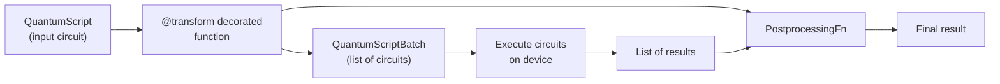
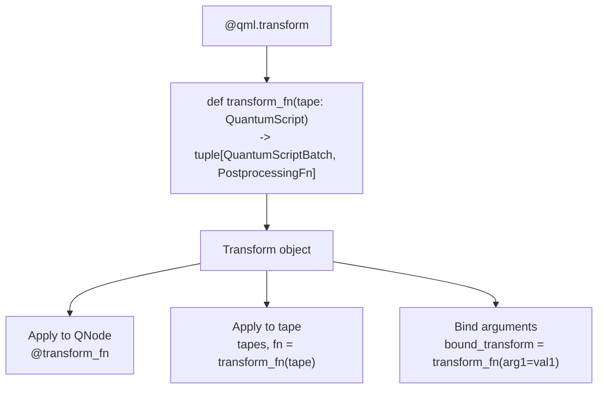
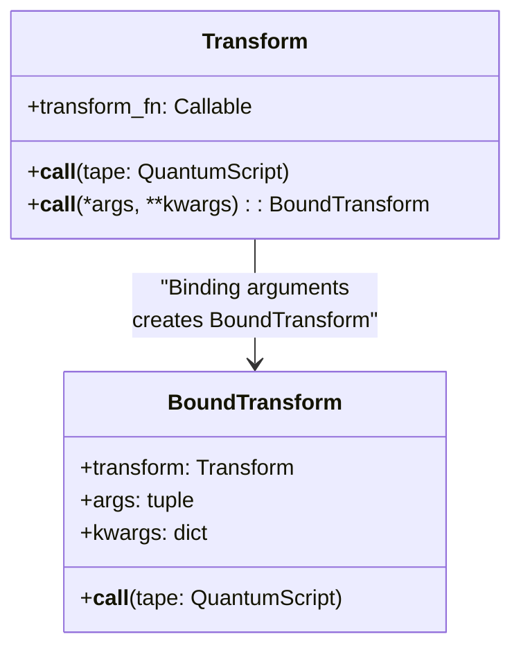
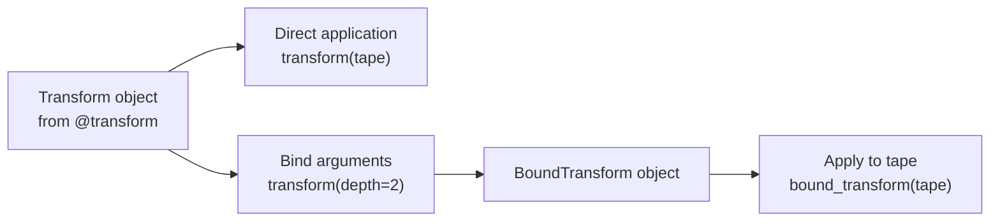
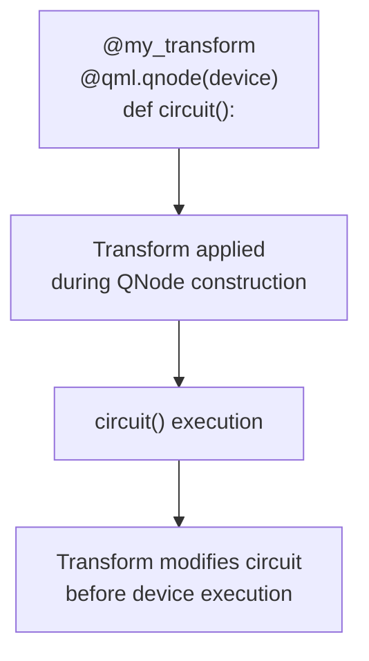
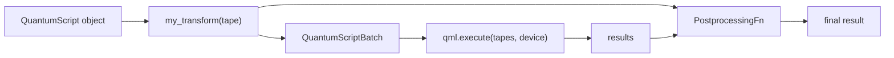
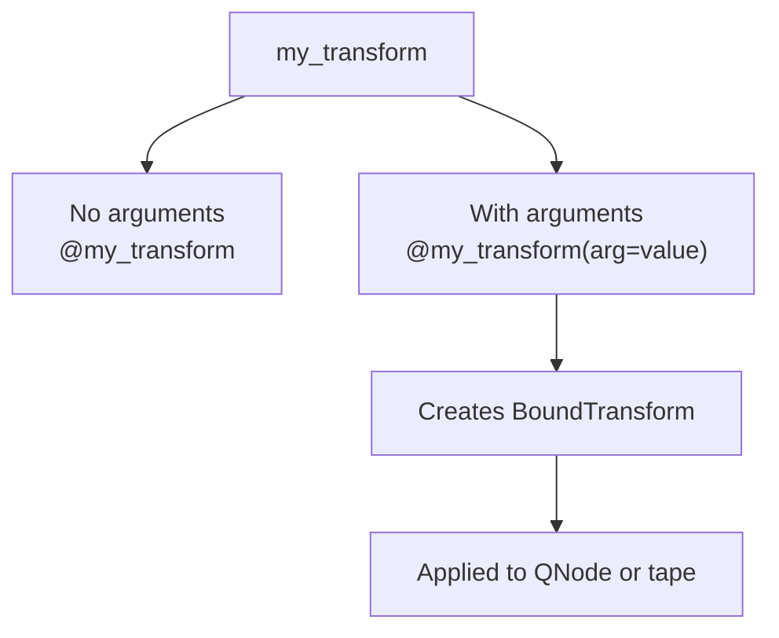
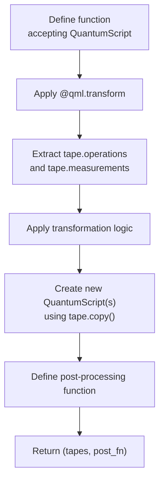
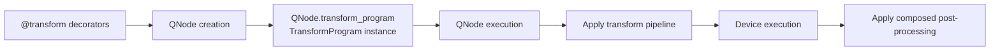

<!-- source: DeepWiki mcp.deepwiki.com · repo PennyLaneAI/pennylane · page 3.1 Transform Framework · fetched 2026-10-21 -->

# Transform Framework

<details>
<summary>Relevant source files</summary>

The following files were used as context for generating this wiki page:

- [pennylane/transforms/__init__.py](pennylane/transforms/__init__.py)
- [pennylane/transforms/batch_input.py](pennylane/transforms/batch_input.py)
- [pennylane/transforms/batch_params.py](pennylane/transforms/batch_params.py)
- [pennylane/transforms/broadcast_expand.py](pennylane/transforms/broadcast_expand.py)
- [tests/transforms/test_broadcast_expand.py](tests/transforms/test_broadcast_expand.py)

</details>


This document explains PennyLane's transform framework - the decorator system and classes that enable creation of quantum circuit transformations. A transform is a function that maps a quantum circuit (represented as a `QuantumScript`) to one or more circuits, alongside a classical post-processing function. This page covers the `@transform` decorator, the `Transform` and `BoundTransform` classes, and how to create custom transforms.

## Overview

Transforms in PennyLane follow a standardized pattern enabled by the `@transform` decorator. A transform function accepts a `QuantumScript` and returns a tuple containing:
1. A `QuantumScriptBatch` (list of one or more `QuantumScript` objects)
2. A `PostprocessingFn` that processes the execution results

**Transform Execution Flow**


Sources: [pennylane/transforms/__init__.py:323-354]()

The `@transform` decorator handles:
- Input validation and conversion to `QuantumScript`
- Output processing and validation
- Integration with QNodes and quantum functions
- Composition with other transforms

## The @transform Decorator

The `@transform` decorator converts a standard Python function into a `Transform` object that can be applied to QNodes, quantum functions, or `QuantumScript` objects.

**Basic Transform Signature**


Sources: [pennylane/transforms/__init__.py:323-355]()

**Transform Function Requirements**

A function decorated with `@transform` must:
1. Accept a `QuantumScript` as its first positional argument
2. Return a tuple of `(QuantumScriptBatch, PostprocessingFn)`
3. The `QuantumScriptBatch` is a sequence of `QuantumScript` objects
4. The `PostprocessingFn` accepts a list of results and returns the final processed result

**Decorator Application**

The `@transform` decorator enables three usage patterns:

1. **Direct decoration of QNodes**: Apply transform when defining a QNode
2. **Manual tape transformation**: Call transform on a `QuantumScript` directly
3. **Parameterized transforms**: Bind arguments to create a `BoundTransform`

Sources: [pennylane/transforms/__init__.py:225-267]()

## Transform and BoundTransform Classes

The `@transform` decorator creates a `Transform` object. When arguments are provided to a transform, it returns a `BoundTransform` object.

**Transform Class Hierarchy**


Sources: [pennylane/transforms/__init__.py:200-206]()

**Transform Objects**

A `Transform` object (created by `@transform`) can be:
1. **Applied directly to a tape**: `tapes, fn = my_transform(quantum_script)`
2. **Used as a QNode decorator**: `@my_transform` before `@qml.qnode`
3. **Bound with arguments**: `bound = my_transform(arg1=value1)` creates a `BoundTransform`

**BoundTransform Objects**

When a transform is called with arguments (but not a tape), it returns a `BoundTransform`:
- Stores the transform along with its bound arguments
- Can be applied to tapes or used as a QNode decorator
- Enables parameterized transforms like `@decompose(gate_set=my_gates)`

**Usage Pattern**


Sources: [pennylane/transforms/__init__.py:243-267]()

## Transform Application Patterns

Transforms can be applied in multiple ways depending on the use case:

**Pattern 1: QNode Decorator**


When a transform decorates a QNode, it is applied automatically during circuit execution.

**Pattern 2: Direct Tape Transformation**


Transforms can be manually applied to `QuantumScript` objects for fine-grained control.

Sources: [pennylane/transforms/__init__.py:225-322]()

**Pattern 3: Parameterized Transforms**

Many transforms accept arguments that control their behavior:



When arguments are provided, the transform returns a `BoundTransform` that can be applied.

Sources: [pennylane/transforms/__init__.py:243-267]()

## Creating Custom Transforms

Custom transforms follow a standard structure enabled by the `@transform` decorator.

**Transform Creation Workflow**


Sources: [pennylane/transforms/__init__.py:323-388]()

**Basic Transform Template**

The simplest transform modifies a single circuit:

```python
from pennylane.tape import QuantumScript, QuantumScriptBatch
from pennylane.typing import PostprocessingFn

@qml.transform
def my_transform(tape: QuantumScript) -> tuple[QuantumScriptBatch, PostprocessingFn]:
    # Extract components
    operations = tape.operations
    measurements = tape.measurements
    
    # Apply transformation logic
    new_operations = [op for op in operations if condition(op)]
    
    # Create modified tape
    new_tape = tape.copy(operations=new_operations)
    
    # Define post-processing
    def null_postprocessing(results):
        return results[0]
    
    return [new_tape], null_postprocessing
```

Sources: [pennylane/transforms/__init__.py:346-354]()

**Removing Operations Example**

The documentation provides an example transform that removes all `RX` operations:

```python
@qml.transform
def remove_rx(tape: QuantumScript) -> tuple[QuantumScriptBatch, PostprocessingFn]:
    operations = filter(lambda op: op.name != "RX", tape.operations)
    new_tape = tape.copy(operations=operations)
    
    def null_postprocessing(results):
        return results[0]
    
    return [new_tape], null_postprocessing
```

Sources: [pennylane/transforms/__init__.py:346-354]()

**Multiple Tapes Example**

Transforms can return multiple tapes, with post-processing that combines results:

```python
@qml.transform
def sum_circuit_and_adjoint(tape: QuantumScript) -> tuple[QuantumScriptBatch, PostprocessingFn]:
    # Create adjoint operations
    operations = [qml.adjoint(op) for op in tape.operations]
    new_tape = tape.copy(operations=operations)
    
    def sum_postprocessing(results):
        return qml.math.sum(results)
    
    return [tape, new_tape], sum_postprocessing
```

Sources: [pennylane/transforms/__init__.py:374-388]()

## Transform Framework Integration

The transform framework integrates with PennyLane's execution pipeline through several key integration points.

**QNode Integration**


Sources: [pennylane/transforms/__init__.py:231-253]()

**Direct Transform Application**

Transforms can be applied directly to quantum scripts:

```python
# Direct application
tapes, post_processing_fn = transform_function(quantum_script)
results = qml.execute(tapes, device, diff_method=None)  
final_result = post_processing_fn(results)
```

**Transform Pipeline Management**

The framework provides mechanisms for:

1. **Adding transforms to QNodes**: Using decorators or direct manipulation of `QNode.transform_program`
2. **Transform composition**: Automatic handling of multiple transforms through `TransformProgram`  
3. **Argument handling**: Support for parameterized transforms using `functools.partial`

**Integration with Execution**

The transform framework integrates with:
- `qml.execute()` function for direct script execution
- `qml.workflow` system for advanced execution control
- Device preprocessing pipelines
- Gradient computation systems

Sources: [pennylane/transforms/__init__.py:256-285]()

## Summary

Basic transformations in PennyLane provide essential functionality for manipulating quantum circuits:

| Transformation | Purpose | Return Value |
|----------------|---------|--------------|
| `batch_params` | Add batch dimension to operation parameters | Multiple circuits, one per batch dimension |
| `batch_input` | Support batched non-trainable inputs | Multiple circuits, one per batch item |
| `broadcast_expand` | Expand broadcasted circuits for devices without native broadcasting | Multiple circuits, one per broadcast dimension |
| `convert_to_numpy_parameters` | Convert all parameters to NumPy arrays | Single circuit with NumPy parameters |

These basic transformations form the foundation of PennyLane's transformation system, enabling more complex circuit manipulations for optimization, error mitigation, and specialized quantum algorithms.

Sources: [pennylane/transforms/__init__.py:34-133]()

---

