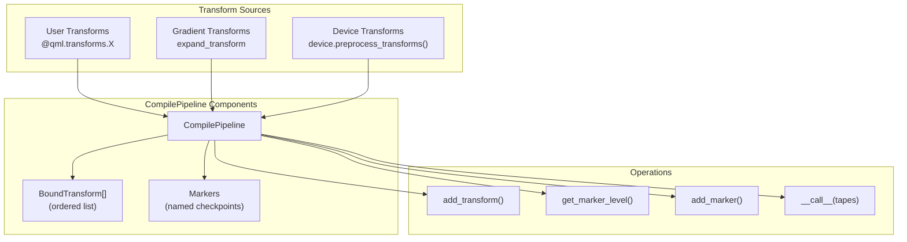
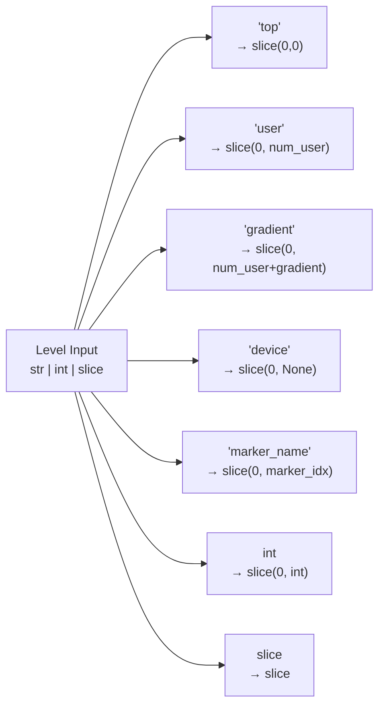
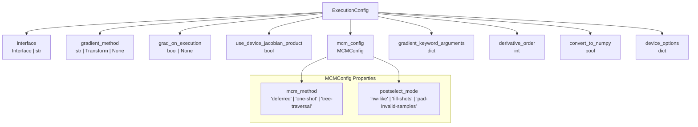
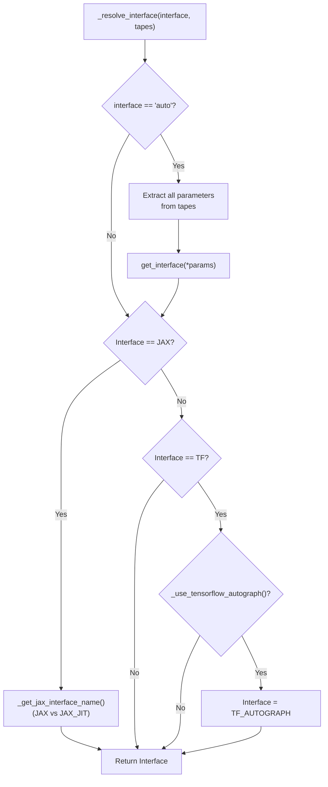
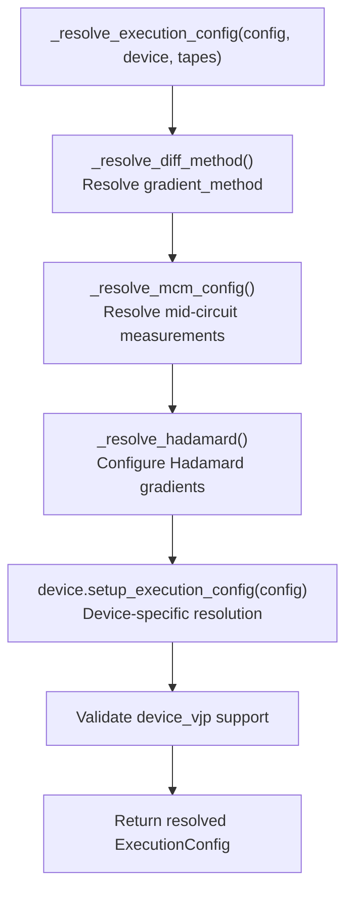
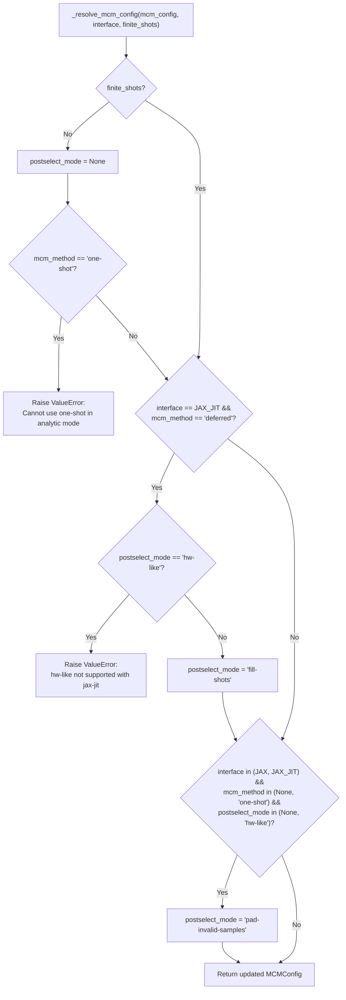
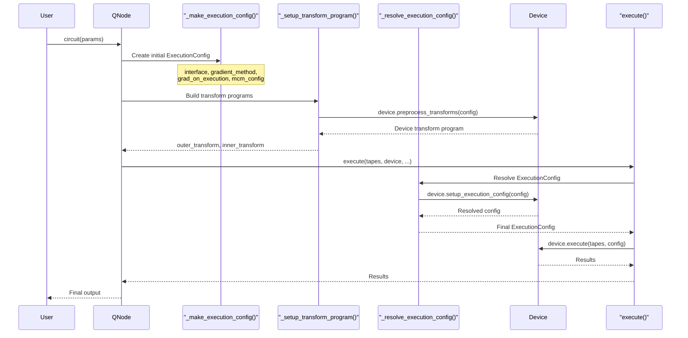
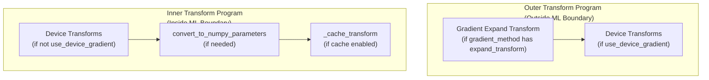
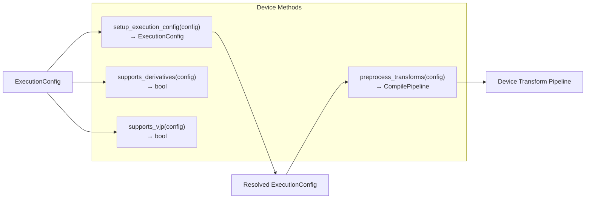

<!-- source: DeepWiki mcp.deepwiki.com · repo PennyLaneAI/pennylane · page 3.2 CompilePipeline and Execution Config · fetched 2026-10-21 -->

# CompilePipeline and Execution Config

<details>
<summary>Relevant source files</summary>

The following files were used as context for generating this wiki page:

- [doc/development/deprecations.rst](doc/development/deprecations.rst)
- [doc/releases/changelog-dev.md](doc/releases/changelog-dev.md)
- [pennylane/__init__.py](pennylane/__init__.py)
- [pennylane/operation.py](pennylane/operation.py)
- [pennylane/workflow/__init__.py](pennylane/workflow/__init__.py)
- [pennylane/workflow/_setup_transform_program.py](pennylane/workflow/_setup_transform_program.py)
- [pennylane/workflow/construct_execution_config.py](pennylane/workflow/construct_execution_config.py)
- [pennylane/workflow/execution.py](pennylane/workflow/execution.py)
- [pennylane/workflow/get_compile_pipeline.py](pennylane/workflow/get_compile_pipeline.py)
- [pennylane/workflow/qnode.py](pennylane/workflow/qnode.py)
- [pennylane/workflow/resolution.py](pennylane/workflow/resolution.py)
- [tests/test_operation.py](tests/test_operation.py)
- [tests/test_qnode.py](tests/test_qnode.py)
- [tests/test_qnode_legacy.py](tests/test_qnode_legacy.py)
- [tests/workflow/interfaces/execute/test_execute.py](tests/workflow/interfaces/execute/test_execute.py)
- [tests/workflow/test_get_compile_pipeline.py](tests/workflow/test_get_compile_pipeline.py)
- [tests/workflow/test_resolve_execution_config.py](tests/workflow/test_resolve_execution_config.py)

</details>


## Purpose and Scope

This document describes the **compilation pipeline** and **execution configuration** systems in PennyLane, which manage how quantum circuits are transformed and executed. The `CompilePipeline` class orchestrates the sequential application of transforms to quantum circuits, while `ExecutionConfig` specifies runtime parameters for execution and differentiation. Together, these systems form the bridge between user-defined quantum functions and device execution.

For information about the QNode system that uses these components, see [QNode System and Execution Workflow](#2.3). For details about specific transform implementations, see [Transform Framework](#3.1).

---

## CompilePipeline Architecture

### Overview

The `CompilePipeline` class manages a sequential chain of transforms that are applied to quantum circuits before execution. Transforms are organized into distinct **levels** that represent different stages of the compilation process.

**Pipeline Levels:**

| Level | Description | Contains |
|-------|-------------|----------|
| `"top"` | Initial state | No transforms |
| `"user"` | User-specified transforms | Manually applied transforms (e.g., `@qml.transforms.cancel_inverses`) |
| `"gradient"` | Gradient-related transforms | User transforms + gradient expansion transforms |
| `"device"` | Full compilation | User + gradient + device preprocessing transforms |

Sources: [pennylane/workflow/get_compile_pipeline.py:52-68](), [doc/releases/changelog-dev.md:220-264]()

### CompilePipeline Structure



Sources: [pennylane/workflow/get_compile_pipeline.py:1-220](), [doc/releases/changelog-dev.md:220-264]()

### Level Resolution

The system resolves abstract level specifications to concrete transform slices:



Sources: [pennylane/workflow/get_compile_pipeline.py:45-68]()

### Markers

Markers are named checkpoints that can be inserted into the pipeline to identify specific compilation stages:

```python
# Adding markers to a pipeline
pipeline = qml.CompilePipeline()
pipeline.add_marker("no-transforms")
pipeline += qml.transforms.cancel_inverses

@qml.marker("after-cancel-inverses")
@pipeline
@qml.qnode(qml.device("default.qubit"))
def circuit():
    qml.X(0)
    qml.H(0)
    qml.H(0)
    return qml.probs()
```

Sources: [doc/releases/changelog-dev.md:220-264]()

---

## ExecutionConfig Structure

### Core Properties

`ExecutionConfig` is a dataclass that specifies how quantum circuits should be executed and differentiated. It is created and resolved during QNode execution.

**ExecutionConfig Components:**



Sources: [pennylane/workflow/resolution.py:1-280](), [pennylane/workflow/qnode.py:75-96]()

### Gradient Methods

The `gradient_method` property supports multiple differentiation strategies:

| Method | Description | Requirements |
|--------|-------------|--------------|
| `"best"` | Automatically selects best available method | Resolved during execution |
| `"backprop"` | Classical backpropagation | Differentiable simulator device |
| `"adjoint"` | Adjoint method | Supported simulator, no finite shots |
| `"device"` | Device-provided gradient | Device implements `compute_derivatives()` |
| `"parameter-shift"` | Parameter-shift rule | Analytic gradients for supported ops |
| `"finite-diff"` | Finite differences | Fallback method |
| `"hadamard"` | Hadamard gradient test | Specific operation support |
| `"spsa"` | Simultaneous perturbation | Approximate gradients |
| `Transform` | Custom gradient transform | Any `Transform` object |

Sources: [pennylane/workflow/resolution.py:34-47](), [pennylane/workflow/qnode.py:231-269]()

---

## Resolution Process

### Interface Resolution

The `_resolve_interface` function determines the actual computation interface from the `"auto"` setting:



Sources: [pennylane/workflow/resolution.py:102-144]()

### ExecutionConfig Resolution

The `_resolve_execution_config` function fills in unresolved configuration values:



Sources: [pennylane/workflow/resolution.py:196-280]()

### Gradient Method Resolution

The `_resolve_diff_method` function implements the `"best"` gradient method selection:

**Resolution Strategy:**

1. If `gradient_method` is not `"best"`, return as-is
2. Query `device.supports_derivatives(config)` for each candidate method
3. Preference order: `"device"` → `"backprop"` → `"adjoint"` → `"parameter-shift"` → `"finite-diff"`
4. Return first supported method

Sources: [pennylane/workflow/resolution.py:196-280]()

### MCM Config Resolution

Mid-circuit measurement configuration is adjusted based on interface and shot settings:

**Resolution Rules:**



Sources: [pennylane/workflow/resolution.py:147-184]()

---

## Integration with QNode Execution

### QNode Compilation Flow

When a `QNode` is executed, the compilation pipeline and execution config work together:



Sources: [pennylane/workflow/qnode.py:337-485](), [pennylane/workflow/execution.py:52-241]()

### Transform Program Setup

The `_setup_transform_program` function creates outer and inner transform programs:

**Outer vs Inner Transforms:**



**Cache Configuration:**

| Cache Value | Behavior |
|-------------|----------|
| `"auto"` | Cache if `derivative_order > 1`, else no cache |
| `True` | Create `LRUCache` with `maxsize=cachesize` |
| `False` or `None` | No caching |
| `dict` or `Cache` | Use provided cache object |

Sources: [pennylane/workflow/_setup_transform_program.py:33-96]()

### Device Integration

The device participates in execution config resolution:



Sources: [pennylane/workflow/resolution.py:196-280](), [pennylane/workflow/_setup_transform_program.py:56-70]()

---

## Accessing the Compilation Pipeline

### get_compile_pipeline Function

The `get_compile_pipeline` function extracts the compilation pipeline at a specified level:

```python
from pennylane.workflow import get_compile_pipeline

@qml.transforms.cancel_inverses
@qml.qnode(dev, diff_method="parameter-shift")
def circuit(x):
    qml.RX(x, 0)
    return qml.expval(qml.Z(0))

# Get full device-level pipeline
pipeline = get_compile_pipeline(circuit, level="device")(1.0)

# Get only user transforms
user_pipeline = get_compile_pipeline(circuit, level="user")(1.0)

# Get up to gradient transforms
gradient_pipeline = get_compile_pipeline(circuit, level="gradient")(1.0)
```

Sources: [pennylane/workflow/get_compile_pipeline.py:71-220]()

### construct_execution_config Function

The `construct_execution_config` function creates an `ExecutionConfig` from a `QNode`:

```python
from pennylane.workflow import construct_execution_config

@qml.qnode(qml.device("default.qubit"), diff_method="adjoint")
def circuit(x):
    qml.RX(x, 0)
    return qml.expval(qml.Z(0))

# Get unresolved config
config = construct_execution_config(circuit, resolve=False)(1.0)
# config.gradient_method == "adjoint"
# config.interface == Interface.AUTO

# Get resolved config
resolved_config = construct_execution_config(circuit, resolve=True)(1.0)
# resolved_config.gradient_method == "adjoint"
# resolved_config.interface == Interface.NUMPY (resolved from auto)
```

Sources: [pennylane/workflow/construct_execution_config.py:34-131]()

### QNode Properties

The `QNode` class exposes compilation-related properties:

| Property | Type | Description |
|----------|------|-------------|
| `compile_pipeline` | `CompilePipeline` | Full compilation pipeline (user + gradient + device) |
| `diff_method` | `str | Transform` | Differentiation method |
| `interface` | `str` | Interface name |
| `execute_kwargs` | `dict` | Execution keyword arguments |
| `gradient_kwargs` | `dict` | Gradient-specific keyword arguments |

**Note:** The `transform_program` property is deprecated in favor of `compile_pipeline`.

Sources: [pennylane/workflow/qnode.py:190-682](), [doc/development/deprecations.rst:98-102]()

---

## Key File References

### Core Implementation Files

- [pennylane/transforms/core/compile_pipeline.py]() - `CompilePipeline` class implementation
- [pennylane/devices/execution_config.py]() - `ExecutionConfig` dataclass
- [pennylane/workflow/resolution.py:1-280]() - Resolution functions
- [pennylane/workflow/_setup_transform_program.py:33-96]() - Transform program setup
- [pennylane/workflow/get_compile_pipeline.py:1-220]() - Pipeline extraction
- [pennylane/workflow/construct_execution_config.py:34-131]() - Config construction

### Integration Points

- [pennylane/workflow/qnode.py:75-96]() - `_make_execution_config`
- [pennylane/workflow/qnode.py:337-485]() - QNode execution flow
- [pennylane/workflow/execution.py:52-241]() - `execute` function
- [pennylane/devices/default_qubit.py]() - Device implementation example

---

