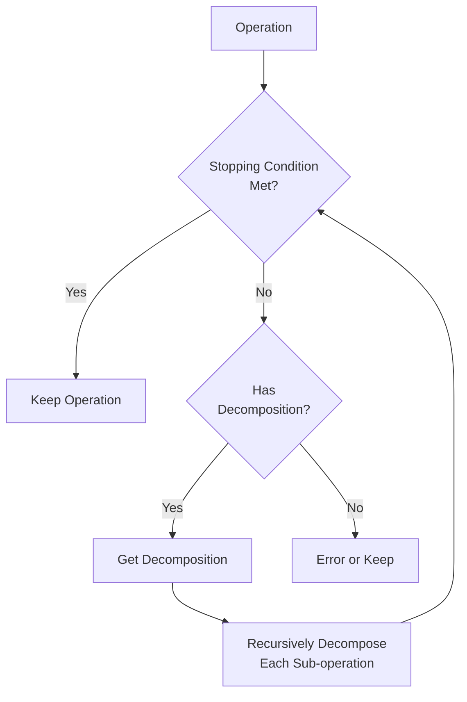
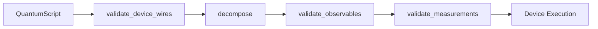

<!-- source: DeepWiki mcp.deepwiki.com · repo PennyLaneAI/pennylane · page 3.3 Circuit Decomposition · fetched 2026-10-21 -->

# Circuit Decomposition

<details>
<summary>Relevant source files</summary>

The following files were used as context for generating this wiki page:

- [pennylane/devices/__init__.py](pennylane/devices/__init__.py)
- [pennylane/devices/preprocess.py](pennylane/devices/preprocess.py)
- [pennylane/devices/tests/conftest.py](pennylane/devices/tests/conftest.py)
- [pennylane/devices/tests/test_measurements.py](pennylane/devices/tests/test_measurements.py)
- [pennylane/devices/tests/test_properties.py](pennylane/devices/tests/test_properties.py)
- [pennylane/devices/tests/test_templates.py](pennylane/devices/tests/test_templates.py)
- [pennylane/transforms/decompose.py](pennylane/transforms/decompose.py)
- [tests/capture/transforms/test_capture_decompose.py](tests/capture/transforms/test_capture_decompose.py)
- [tests/capture/transforms/test_capture_graph_decompose.py](tests/capture/transforms/test_capture_graph_decompose.py)
- [tests/conftest.py](tests/conftest.py)
- [tests/devices/test_preprocess.py](tests/devices/test_preprocess.py)
- [tests/templates/layers/test_strongly_entangling.py](tests/templates/layers/test_strongly_entangling.py)
- [tests/templates/subroutines/test_grover.py](tests/templates/subroutines/test_grover.py)
- [tests/templates/subroutines/test_qft.py](tests/templates/subroutines/test_qft.py)
- [tests/templates/subroutines/time_evolution/test_trotter.py](tests/templates/subroutines/time_evolution/test_trotter.py)
- [tests/transforms/test_decompose_transform.py](tests/transforms/test_decompose_transform.py)
- [tests/transforms/test_decompose_transform_graph.py](tests/transforms/test_decompose_transform_graph.py)

</details>


Circuit decomposition is the process of breaking down quantum operations into simpler, more primitive gates that are supported by a target device or gate set. This is a fundamental component of PennyLane's compilation pipeline, ensuring that quantum circuits can be executed on devices with limited native gate sets.

## Overview

Circuit decomposition addresses the gap between high-level quantum algorithms and device capabilities:

1. **Device Compatibility**: Converting operations to gates supported by specific hardware
2. **Gate Set Targeting**: Decomposing to universal gate sets or custom target sets
3. **Optimization**: Choosing efficient decompositions to minimize circuit depth or gate count
4. **Preprocessing**: Preparing circuits for execution as part of the device workflow

PennyLane provides two main decomposition interfaces:
- **User-facing**: `qml.transforms.decompose` for manual circuit transformation
- **Device-facing**: `qml.devices.preprocess.decompose` for automatic device preprocessing

Sources: [pennylane/transforms/decompose.py:1-790](), [pennylane/devices/preprocess.py:270-439]()

## Decomposition Workflow

The decomposition process transforms operations through recursive expansion until a stopping condition is met:

**Decomposition Process Flow**



Sources: [pennylane/transforms/decompose.py:793-891](), [pennylane/devices/preprocess.py:414-439]()

### Gate Sets and Stopping Conditions

Decomposition is controlled by two key concepts:

**Gate Set**: The target set of operations, specified as:
- Iterable of operation names or types: `{"RX", "RZ", "CNOT"}`
- Dictionary with weights (graph system only): `{qml.RX: 1.0, qml.CNOT: 2.0}`

**Stopping Condition**: A function determining whether an operation needs decomposition:
```python
stopping_condition = lambda op: op.name in {"RX", "RZ", "CNOT"}
```

By default, the stopping condition checks if the operation is in the gate set.

Sources: [pennylane/transforms/decompose.py:376-407](), [tests/transforms/test_decompose_transform.py:93-170]()

### Core Decomposition Function

The `_operator_decomposition_gen` function performs recursive decomposition:

**Function Signature and Key Parameters**

| Parameter | Type | Description |
|-----------|------|-------------|
| `op` | `Operator` | The operator to decompose |
| `acceptance_function` | `Callable` | Returns `True` if operation doesn't need decomposition |
| `max_expansion` | `int` | Maximum decomposition depth (default: `None` for unlimited) |
| `graph_solution` | `DecompGraphSolution` | Graph-based decomposition solution (optional) |
| `num_work_wires` | `int` | Available work wires for decomposition |

The generator recursively yields primitive operations until all are accepted by the stopping condition.

Sources: [pennylane/transforms/decompose.py:793-891](), [pennylane/devices/preprocess.py:414-439]()

## User-Facing vs Device-Facing Decomposition

PennyLane provides two decompose functions with different purposes:

**Comparison of Decompose Functions**

| Feature | `qml.transforms.decompose` | `qml.devices.preprocess.decompose` |
|---------|---------------------------|-----------------------------------|
| **Purpose** | User-controlled circuit transformation | Device preprocessing |
| **Location** | [pennylane/transforms/decompose.py:349-790]() | [pennylane/devices/preprocess.py:270-439]() |
| **Gate Set** | Optional, defaults to all ops | Required via `stopping_condition` |
| **State Prep** | Configurable skip behavior | `skip_initial_state_prep=True` by default |
| **Custom Decomposer** | Not supported | Supported via `decomposer` parameter |
| **Error Handling** | Warnings for undefined decompositions | Configurable error type |
| **Strict Mode** | Controls error vs warning | Always errors for unsupported ops |

### User-Facing Transform

The user-facing `qml.transforms.decompose` provides flexible circuit transformation:

```python
# Basic usage
@qml.transforms.decompose(gate_set={"RX", "RY", "RZ", "CNOT"})
@qml.qnode(dev)
def circuit():
    qml.Hadamard(0)
    qml.Toffoli([0, 1, 2])
    return qml.expval(qml.Z(0))
```

Sources: [pennylane/transforms/decompose.py:349-790](), [tests/transforms/test_decompose_transform.py:90-280]()

### Device-Facing Transform

The device-facing `qml.devices.preprocess.decompose` is used internally by devices during preprocessing:

```python
from pennylane.devices.preprocess import decompose

# Used by device preprocessing
tape, _ = decompose(
    tape,
    stopping_condition=lambda op: op.name in device_ops,
    skip_initial_state_prep=True
)
```

This version integrates with the device's `preprocess` method and supports custom decomposition functions.

Sources: [pennylane/devices/preprocess.py:270-439](), [tests/devices/test_preprocess.py:414-627]()

## Graph-Based Decomposition System

PennyLane includes an experimental graph-based decomposition system that optimizes decomposition choices based on gate costs and resource constraints.

### Enabling the Graph System

```python
qml.decomposition.enable_graph()
```

With the graph system enabled, decomposition can optimize for:
- **Weighted gate sets**: Minimize total cost based on gate weights
- **Work wire allocation**: Choose decompositions based on available ancilla qubits
- **Custom decomposition rules**: Override or supplement default decompositions

Sources: [pennylane/transforms/decompose.py:362-738](), [tests/transforms/test_decompose_transform_graph.py:34-238]()

### Weighted Gate Sets

When using the graph system, gate sets can specify costs for each operation:

```python
@qml.transforms.decompose(
    gate_set={
        qml.Toffoli: 1.23,
        qml.RX: 4.56,
        qml.CZ: 0.01,
        qml.H: 420
    }
)
@qml.qnode(dev)
def circuit():
    qml.CRX(0.1, [0, 1])
    return qml.expval(qml.Z(0))
```

The system chooses decompositions that minimize total cost. In this example, operations with lower weights (like `CZ`) are preferred over those with higher weights (like `H`).

Sources: [pennylane/transforms/decompose.py:572-611](), [tests/transforms/test_decompose_transform_graph.py:45-69]()

### Custom Decomposition Rules

The graph system supports custom decomposition rules via `fixed_decomps` and `alt_decomps`:

**Custom Decomposition Example**

```python
@qml.register_resources({qml.H: 2, qml.CZ: 1})
def my_cnot(wires, **__):
    qml.H(wires[1])
    qml.CZ(wires=wires)
    qml.H(wires[1])

@qml.transforms.decompose(
    gate_set={"RY", "RZ", "CZ", "H"},
    fixed_decomps={qml.CNOT: my_cnot}  # Always use this decomposition
)
@qml.qnode(dev)
def circuit():
    qml.CNOT([0, 1])
    return qml.state()
```

| Parameter | Purpose | Behavior |
|-----------|---------|----------|
| `fixed_decomps` | Force specific decomposition rules | Always used for specified operators |
| `alt_decomps` | Provide alternative rules | Used if they result in lower cost |

Sources: [pennylane/transforms/decompose.py:669-726](), [tests/transforms/test_decompose_transform_graph.py:239-315]()

### Work Wire Management

Decompositions can utilize work wires (ancilla qubits) for more efficient implementations:

```python
@qml.register_resources({qml.Toffoli: 2}, work_wires={"burnable": 2})
def decomp_with_work_wires(wires, **__):
    with qml.allocation.allocate(2, state="zero", restored=False) as work:
        qml.Toffoli([wires[0], wires[1], work[0]])
        # ... rest of decomposition
```

The graph system tracks work wire availability via the `num_work_wires` parameter and selects decompositions accordingly.

Sources: [pennylane/transforms/decompose.py:390-407](), [tests/devices/test_preprocess.py:540-627]()

## Integration with Device Workflow

Decomposition is a critical part of the device preprocessing pipeline:

**Device Preprocessing Pipeline with Decomposition**



Sources: [pennylane/devices/preprocess.py:1-790]()

### Device Integration

Devices use `decompose` in their `preprocess` method to ensure circuit compatibility:

```python
def preprocess(self):
    # Device defines stopping condition based on supported ops
    def stopping_condition(op):
        return op.name in self.operations
    
    return TransformProgram([
        decompose(stopping_condition=stopping_condition),
        validate_observables(stopping_condition=obs_condition),
        # ... other preprocessing steps
    ])
```

The decomposition happens before validation, ensuring that all operations are in a form the device can execute.

Sources: [pennylane/devices/preprocess.py:270-439](), [pennylane/devices/__init__.py:64-84]()

### Stopping Condition with Shots

The `decompose` transform supports different stopping conditions for finite-shot vs analytic execution:

```python
decompose(
    tape,
    stopping_condition=analytic_condition,
    stopping_condition_shots=finite_shot_condition
)
```

If `stopping_condition_shots` is provided and the tape has shots, it replaces the standard stopping condition.

Sources: [pennylane/devices/preprocess.py:274-379](), [tests/devices/test_preprocess.py:417-431]()

## Considerations and Limitations

When using circuit cutting, keep in mind:

1. **Approximation Errors**: The recombined results approximate rather than exactly reproduce the original output
2. **Classical Overhead**: Significant classical post-processing may be required
3. **Scaling**: The number of fragment executions may scale exponentially with the number of cuts
4. **Cut Placement**: Optimal placement of cuts is a complex optimization problem

Despite these limitations, circuit cutting provides a valuable tool for executing quantum circuits that would otherwise be infeasible due to hardware constraints.

## Integration with PennyLane's Transform System

Circuit cutting is part of PennyLane's broader transformation system, which provides tools for modifying quantum circuits. As shown in the imports file, PennyLane offers numerous transforms for circuit manipulation, optimization, and execution strategies.

The `qcut` module integrates with this system by providing specialized operations and functions for circuit cutting, while leveraging the core transformation infrastructure.

Sources: [pennylane/transforms/__init__.py:288-350]()

---

