<!-- source: DeepWiki mcp.deepwiki.com · repo PennyLaneAI/pennylane · page 3.4 Gradient Computation Methods · fetched 2026-10-21 -->

# Gradient Computation Methods

Relevant source files

The following files were used as context for generating this wiki page:

- [pennylane/gradients/__init__.py](pennylane/gradients/__init__.py)
- [pennylane/gradients/finite_difference.py](pennylane/gradients/finite_difference.py)
- [pennylane/gradients/gradient_transform.py](pennylane/gradients/gradient_transform.py)
- [pennylane/gradients/hadamard_gradient.py](pennylane/gradients/hadamard_gradient.py)
- [pennylane/gradients/parameter_shift.py](pennylane/gradients/parameter_shift.py)
- [pennylane/gradients/parameter_shift_cv.py](pennylane/gradients/parameter_shift_cv.py)
- [pennylane/gradients/parameter_shift_hessian.py](pennylane/gradients/parameter_shift_hessian.py)
- [pennylane/gradients/pulse_gradient.py](pennylane/gradients/pulse_gradient.py)
- [pennylane/gradients/pulse_gradient_odegen.py](pennylane/gradients/pulse_gradient_odegen.py)
- [pennylane/gradients/spsa_gradient.py](pennylane/gradients/spsa_gradient.py)
- [tests/gradients/core/test_gradient_transform.py](tests/gradients/core/test_gradient_transform.py)
- [tests/gradients/core/test_hadamard_gradient.py](tests/gradients/core/test_hadamard_gradient.py)
- [tests/gradients/core/test_pulse_gradient.py](tests/gradients/core/test_pulse_gradient.py)
- [tests/gradients/core/test_pulse_odegen.py](tests/gradients/core/test_pulse_odegen.py)
- [tests/gradients/parameter_shift/test_parameter_shift_cv.py](tests/gradients/parameter_shift/test_parameter_shift_cv.py)

This document covers PennyLane's gradient computation system, which provides multiple transform-based methods for computing derivatives of quantum circuits. These transforms convert quantum circuits into collections of modified circuits whose results can be combined to compute gradients analytically or numerically.

For information about the broader transform framework infrastructure, see [Transform Framework](#3.1). For circuit optimization and compilation transforms, see [Circuit Optimization and Compilation](#3.2).

## Overview of Gradient Methods

PennyLane provides several gradient computation methods, each optimized for different scenarios and operation types. All gradient methods follow the transform pattern, taking a `QuantumScript` and returning a batch of modified scripts plus a postprocessing function.

### Gradient Method Architecture

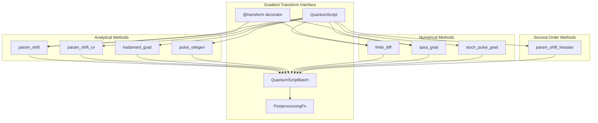

**Sources:** [pennylane/gradients/__init__.py:42-82](), [pennylane/gradients/gradient_transform.py:54-84]()

### Method Selection and Validation

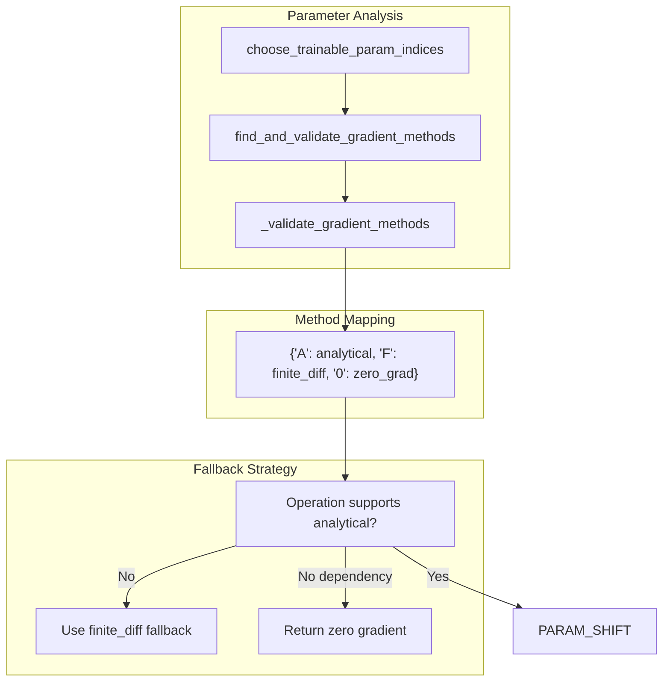

**Sources:** [pennylane/gradients/gradient_transform.py:122-162](), [pennylane/gradients/gradient_transform.py:221-254]()

## Transform Infrastructure

### Core Transform Pattern

All gradient methods use PennyLane's transform system, following a consistent interface pattern:

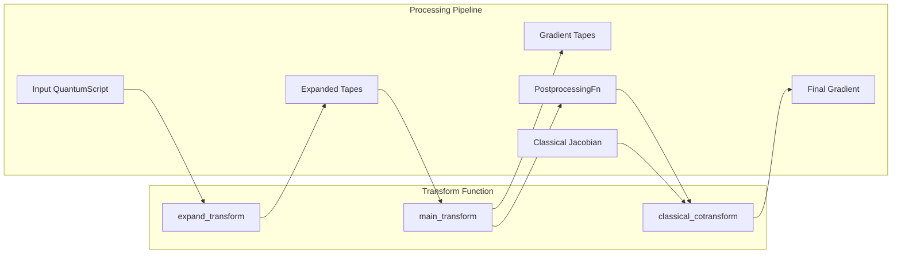

**Sources:** [pennylane/gradients/gradient_transform.py:398-486](), [pennylane/transforms/core.py]()

### Jacobian Contraction

The `contract_qjac_with_cjac` function combines quantum Jacobians with classical preprocessing Jacobians:

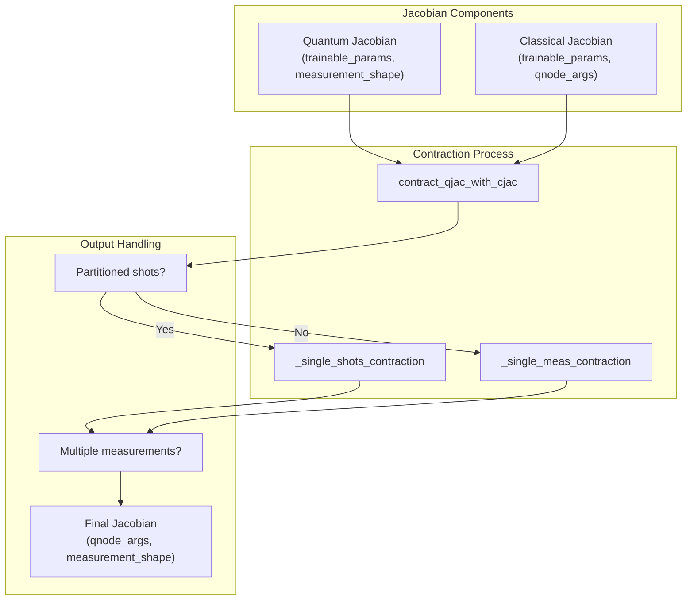

**Sources:** [pennylane/gradients/gradient_transform.py:398-486]()

## Parameter-Shift Methods

### Core Parameter-Shift Rule

The `param_shift` transform implements the fundamental analytical gradient method for quantum circuits:

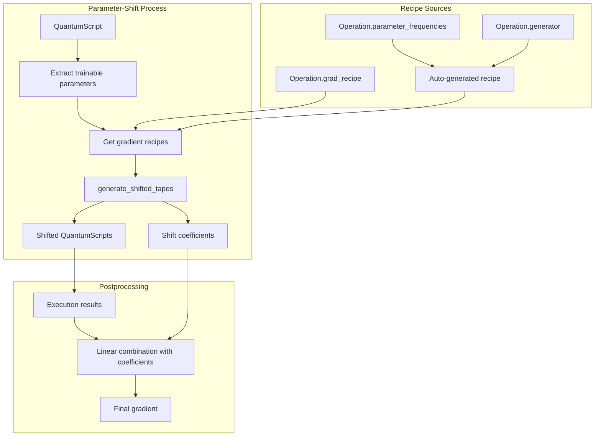

**Sources:** [pennylane/gradients/parameter_shift.py:815-900](), [pennylane/gradients/parameter_shift.py:241-294]()

### Variance Parameter-Shift

For variance measurements, the parameter-shift rule requires computing derivatives of both `<A>` and `<A²>`:

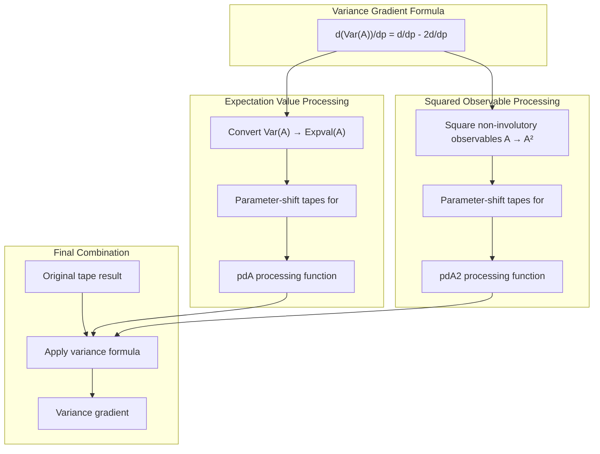

**Sources:** [pennylane/gradients/parameter_shift.py:652-757](), [pennylane/gradients/parameter_shift.py:455-576]()

## Finite Difference Methods

### Finite Difference Transform

The `finite_diff` transform provides numerical gradient approximation when analytical methods aren't available:

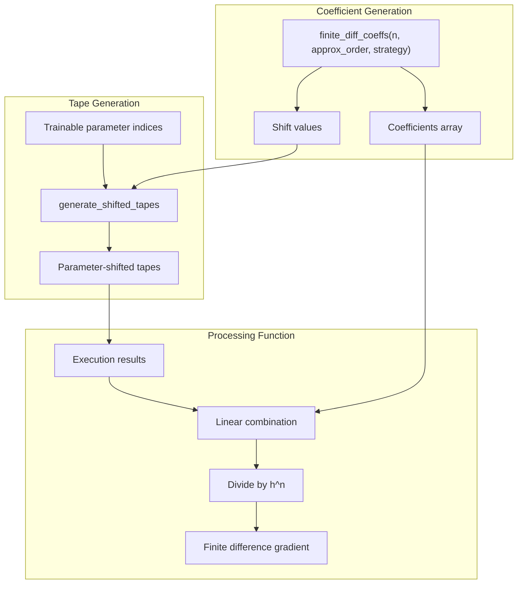

**Sources:** [pennylane/gradients/finite_difference.py:315-617](), [pennylane/gradients/finite_difference.py:50-171]()

### SPSA Gradient Method

SPSA (Simultaneous Perturbation Stochastic Approximation) provides gradient estimates using simultaneous perturbations:

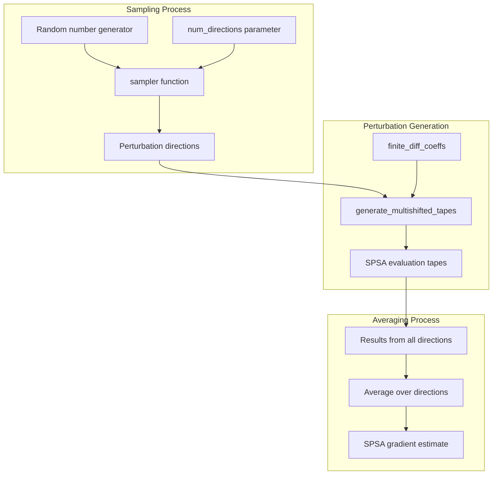

**Sources:** [pennylane/gradients/spsa_gradient.py:97-390](), [pennylane/gradients/spsa_gradient.py:42-61]()

## Advanced Gradient Methods

### Hadamard Test Gradient

The Hadamard test method uses an auxiliary qubit to compute gradients via quantum interference:

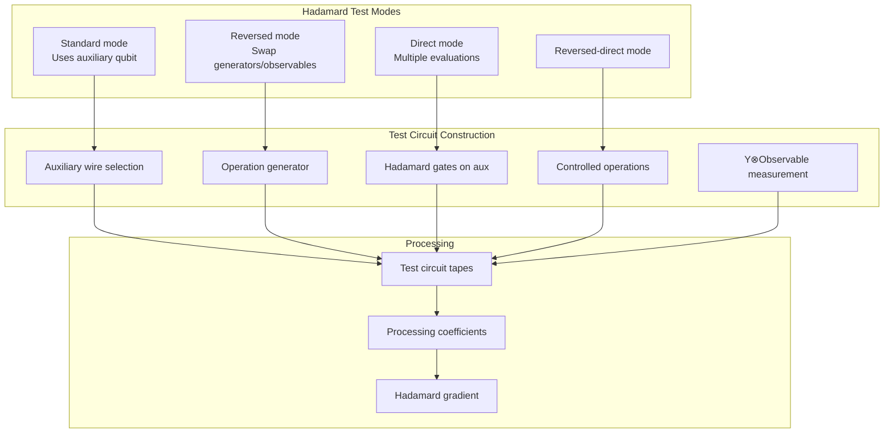

**Sources:** [pennylane/gradients/hadamard_gradient.py:100-421](), [pennylane/gradients/hadamard_gradient.py:424-800]()

### Pulse Gradient Methods

PennyLane provides specialized methods for differentiating parametrized quantum evolution operations:

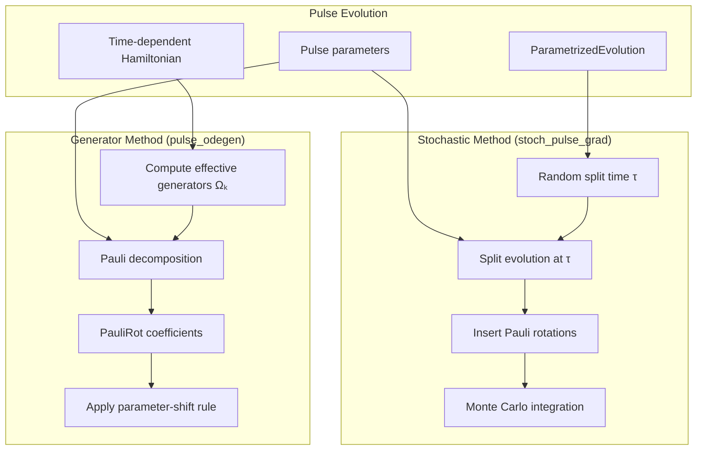

**Sources:** [pennylane/gradients/pulse_gradient.py:79-139](), [pennylane/gradients/pulse_gradient_odegen.py:50-108]()

## Integration with Execution Pipeline

### QNode Integration

Gradient transforms integrate with QNodes through the `diff_method` parameter and autodifferentiation interfaces:

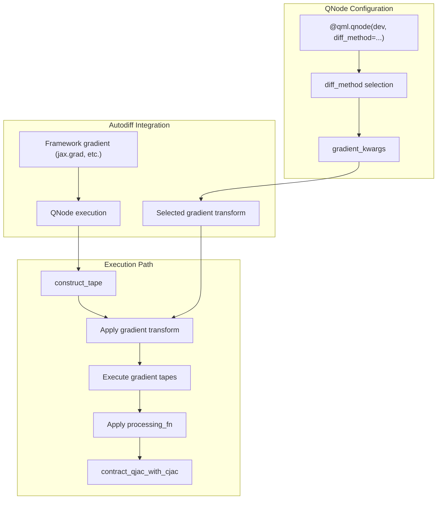

**Sources:** [pennylane/gradients/__init__.py:94-138](), [pennylane/gradients/gradient_transform.py:398-486]()

### Transform Registration

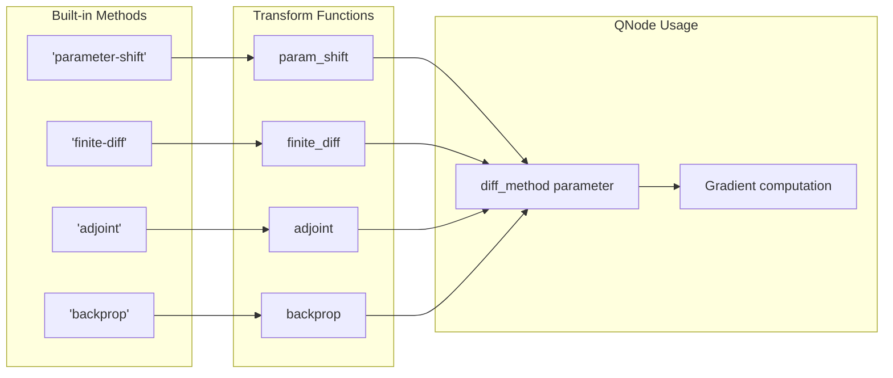

**Sources:** [pennylane/gradients/__init__.py:117-138]()

---

