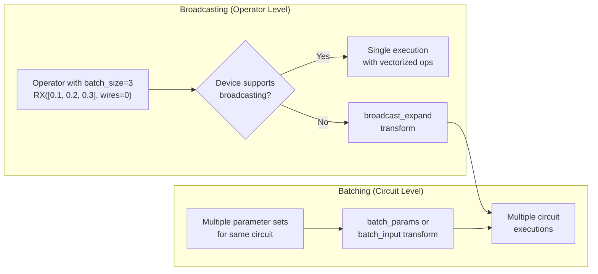
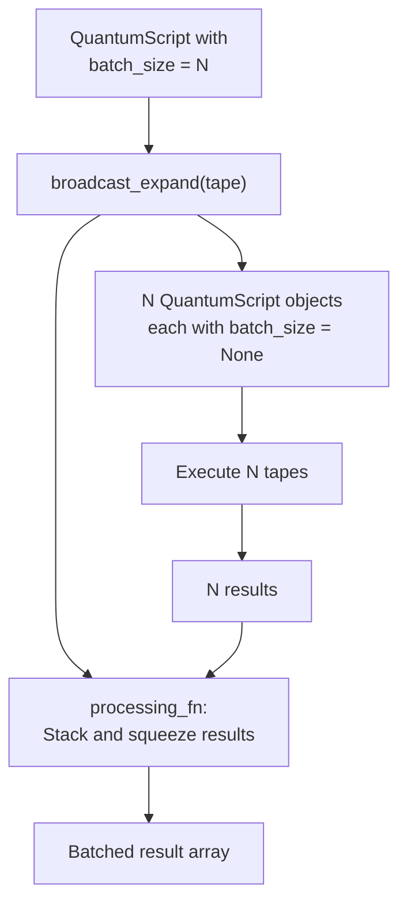
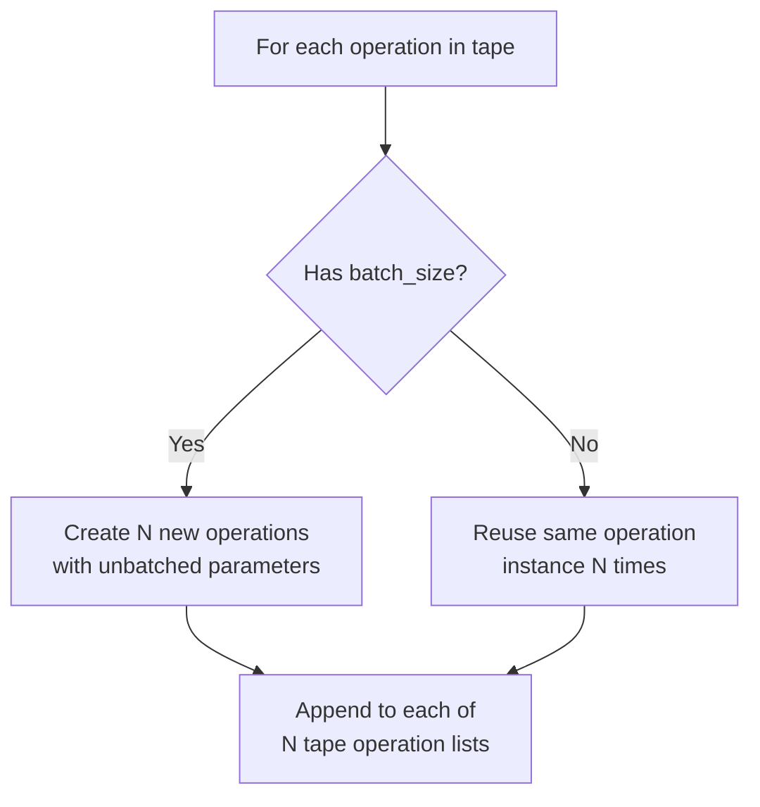
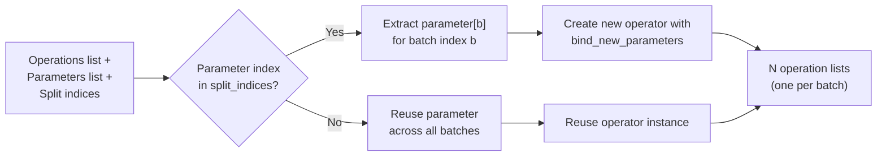
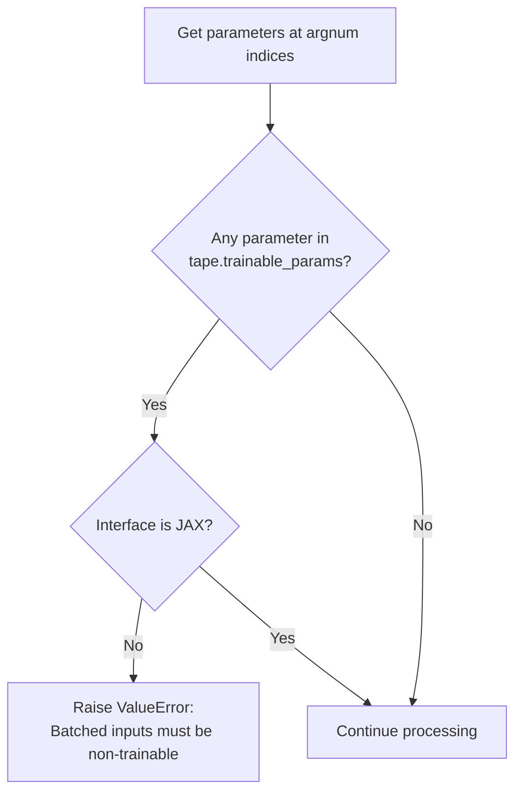
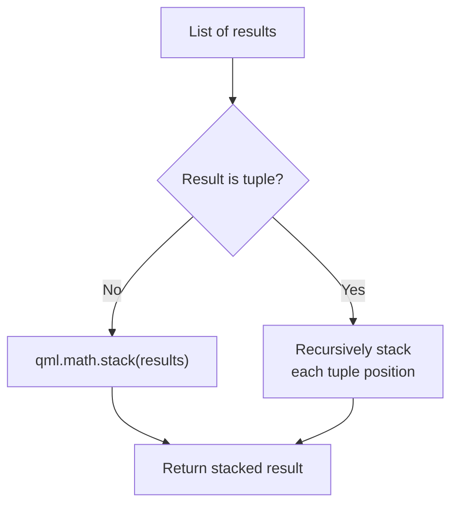

<!-- source: DeepWiki mcp.deepwiki.com · repo PennyLaneAI/pennylane · page 3.5 Batching and Broadcasting Transforms · fetched 2026-10-21 -->

# Batching and Broadcasting Transforms

<details>
<summary>Relevant source files</summary>

The following files were used as context for generating this wiki page:

- [pennylane/transforms/__init__.py](pennylane/transforms/__init__.py)
- [pennylane/transforms/batch_input.py](pennylane/transforms/batch_input.py)
- [pennylane/transforms/batch_params.py](pennylane/transforms/batch_params.py)
- [pennylane/transforms/broadcast_expand.py](pennylane/transforms/broadcast_expand.py)
- [tests/transforms/test_broadcast_expand.py](tests/transforms/test_broadcast_expand.py)

</details>


## Purpose and Scope

This page documents PennyLane's batching and broadcasting transforms, which enable efficient execution of quantum circuits with multiple parameter sets or input examples. These transforms convert circuits with batched parameters into multiple circuit executions and handle the aggregation of results.

Three core transforms are covered:
- `broadcast_expand` - Expands circuits with broadcasted operator parameters
- `batch_params` - Batches trainable parameters for multiple executions
- `batch_input` - Batches non-trainable input examples

For the general transform framework and infrastructure, see [Transform Framework](#3.1). For information about operator-level broadcasting via the `batch_size` property, see [Operators and Operation System](#2.1).

## Broadcasting vs Batching

PennyLane distinguishes between two related but distinct concepts:

**Broadcasting** refers to operators having parameters with an extra leading dimension, automatically handled by devices that support native broadcasting. When an operator has a `batch_size` property greater than `None`, it contains broadcasted parameters.

**Batching** refers to explicitly creating multiple circuit executions with different parameter sets. The batching transforms convert a single circuit specification into multiple tape executions.



**Sources:** [pennylane/transforms/broadcast_expand.py:1-185](), [pennylane/transforms/batch_params.py:1-207]()

## The `broadcast_expand` Transform

The `broadcast_expand` transform handles circuits where operators have broadcasted parameters (i.e., `batch_size` is not `None`). When a device does not support native broadcasting, this transform expands a single broadcasted tape into multiple tapes, one for each batch dimension.

### Transform Signature and Usage



The transform is defined at [pennylane/transforms/broadcast_expand.py:59-184]() with signature:

```python
@transform
def broadcast_expand(tape: QuantumScript) -> tuple[QuantumScriptBatch, PostprocessingFn]
```

**Sources:** [pennylane/transforms/broadcast_expand.py:59-130]()

### Operation Splitting Logic

The `_split_operations` function at [pennylane/transforms/broadcast_expand.py:26-49]() handles the core logic:



For each operator:
1. If `op.batch_size` is truthy, extract individual parameter values for each batch index
2. Use `bind_new_parameters` to create new operator instances with unbatched parameters
3. If no batching, reuse the same operator instance across all tapes (optimization)

The unbatching logic at [pennylane/transforms/broadcast_expand.py:38-42]() extracts parameters:

```python
new_params = tuple(
    p if qml.math.ndim(p) == op.ndim_params[j] else p[b]
    for j, p in enumerate(op.data)
)
```

This compares the actual parameter dimension against the expected dimension (`ndim_params`) to determine if the parameter is broadcasted.

**Sources:** [pennylane/transforms/broadcast_expand.py:26-49]()

### Result Post-Processing

The processing function at [pennylane/transforms/broadcast_expand.py:153-183]() handles result aggregation with special logic for:

1. **Shot vectors** - Results have shape `results[batch][shot_vector][measurement]` and must be transposed to `results[shot_vector][measurement][batch]`
2. **Multiple measurements** - Each measurement needs independent stacking
3. **Single measurements** - Direct stacking with `qml.math.stack`

The handling is complex due to the interplay of three dimensions: batch, shot vector, and measurement index.

**Sources:** [pennylane/transforms/broadcast_expand.py:153-183]()

### Device Integration

When a device does not support broadcasting (lacks native vectorization), the execution workflow automatically applies `broadcast_expand`. This happens transparently during device preprocessing. The transform is applied internally but can also be used explicitly as a decorator:

```python
@qml.transforms.broadcast_expand
@qml.qnode(dev)
def circuit(x):
    qml.RX(x, wires=0)
    return qml.expval(qml.Z(0))
```

**Sources:** [pennylane/transforms/broadcast_expand.py:88-130]()

## The `batch_params` Transform

The `batch_params` transform enables batching of trainable parameters, creating separate circuit executions for each parameter set in the batch. Unlike `broadcast_expand`, which works at the operator level, `batch_params` works at the QNode level for trainable parameters.

### Transform Signature

Defined at [pennylane/transforms/batch_params.py:82-206]():

```python
@transform
def batch_params(
    tape: QuantumScript, 
    all_operations=False
) -> tuple[QuantumScriptBatch, PostprocessingFn]
```

The `all_operations` flag determines whether to batch:
- `False` (default): Only trainable parameters
- `True`: All operation parameters, regardless of trainability

**Sources:** [pennylane/transforms/batch_params.py:82-206]()

### Parameter Splitting

The shared utility `_split_operations` at [pennylane/transforms/batch_params.py:41-79]() is used by both `batch_params` and `batch_input`:



Key difference from `broadcast_expand._split_operations`:
- `broadcast_expand` uses operator's `batch_size` and `ndim_params` to detect broadcasting
- `batch_params._split_operations` uses explicit `split_indices` parameter

**Sources:** [pennylane/transforms/batch_params.py:41-79]()

### Batch Dimension Validation

At [pennylane/transforms/batch_params.py:174-194](), the transform validates:

1. At least one parameter to batch exists
2. First batched parameter has a leading dimension (the batch dimension)
3. All batched parameters have the same batch dimension size

```python
batch_dim = qml.math.shape(params[indices[0]])[0]
for i in indices:
    shape = qml.math.shape(params[i])
    if len(shape) == 0 or shape[0] != batch_dim:
        raise ValueError(...)
```

**Sources:** [pennylane/transforms/batch_params.py:174-194]()

## The `batch_input` Transform

The `batch_input` transform is designed for batching non-trainable input examples, analogous to batching inputs in classical machine learning. This enables efficient evaluation of a quantum circuit across multiple input examples with the same trainable parameters.

### Transform Signature

Defined at [pennylane/transforms/batch_input.py:27-114]():

```python
@transform
def batch_input(
    tape: QuantumScript,
    argnum: Sequence[int] | int,
) -> tuple[QuantumScriptBatch, PostprocessingFn]
```

The `argnum` parameter specifies which QNode arguments should be batched, by index position.

**Sources:** [pennylane/transforms/batch_input.py:27-114]()

### Non-Trainability Validation

At [pennylane/transforms/batch_input.py:87-94](), the transform enforces that batched inputs must be non-trainable:



The JAX exception exists because JAX arrays cannot be explicitly marked as non-trainable in the same way as other frameworks.

**Sources:** [pennylane/transforms/batch_input.py:87-94]()

### Batch Dimension Consistency

At [pennylane/transforms/batch_input.py:96-102](), the transform validates that all batched inputs have the same batch dimension:

```python
batch_dims = np.unique([qml.math.shape(x)[0] for x in argnum_params])
if len(batch_dims) != 1:
    raise ValueError(
        "Batch dimension for all gate arguments specified by 'argnum' must be the same."
    )
```

**Sources:** [pennylane/transforms/batch_input.py:96-102]()

## Transform Comparison

| Transform | Purpose | Parameter Type | Batching Level | Validation |
|-----------|---------|----------------|----------------|------------|
| `broadcast_expand` | Expand operator-level broadcasting | Any | Operator level via `batch_size` | Automatic via `batch_size` |
| `batch_params` | Batch trainable parameters | Trainable (or all if flag set) | QNode level | All must have same batch dim |
| `batch_input` | Batch non-trainable inputs | Non-trainable | QNode level via `argnum` | Must not be trainable |

**Sources:** [pennylane/transforms/broadcast_expand.py:1-185](), [pennylane/transforms/batch_params.py:1-207](), [pennylane/transforms/batch_input.py:1-114]()

## Shared Infrastructure

### The `_nested_stack` Utility

Both `batch_params` and `batch_input` use the `_nested_stack` function at [pennylane/transforms/batch_params.py:26-38]() for post-processing:



This handles nested tuple structures that arise from multiple measurements, recursively stacking arrays at the leaf positions.

**Sources:** [pennylane/transforms/batch_params.py:26-38]()

### Parameter Extraction and Binding

All three transforms use `qml.ops.functions.bind_new_parameters` to create new operator instances with modified parameters:

- `broadcast_expand` at [pennylane/transforms/broadcast_expand.py:42]()
- `batch_params` at [pennylane/transforms/batch_params.py:70]()  

This function creates a new operator instance with the same properties but different parameter values, maintaining the operator's identity and metadata.

**Sources:** [pennylane/transforms/broadcast_expand.py:42](), [pennylane/transforms/batch_params.py:70]()

## Usage Patterns

### Pattern 1: Device-Driven Broadcasting

When a device doesn't support native broadcasting, `broadcast_expand` is automatically applied:

```
User writes circuit with broadcasted parameters
    ↓
QNode constructs QuantumScript with batch_size=N
    ↓
Device preprocessing detects lack of broadcast support
    ↓
broadcast_expand transform applied automatically
    ↓
N separate tapes executed
    ↓
Results stacked and returned
```

**Sources:** [pennylane/transforms/broadcast_expand.py:85-87]()

### Pattern 2: Explicit Batching for Training

For machine learning workflows with batched training data:

```
@qml.batch_params
@qml.qnode(dev)
def circuit(params, x):
    # params has shape (batch_size, num_params)
    ...
```

**Sources:** [pennylane/transforms/batch_params.py:114-171]()

### Pattern 3: Classical Input Batching

For quantum machine learning with classical data batches:

```
@qml.batch_input(argnum=0)  # Batch first argument
@qml.qnode(dev)
def circuit(inputs, weights):
    # inputs has shape (batch_size, num_features)
    # weights are trainable, not batched
    ...
```

**Sources:** [pennylane/transforms/batch_input.py:59-79]()

## Transform Registration

All three transforms are registered in the transforms module at [pennylane/transforms/__init__.py:405-407]():

```python
from .batch_params import batch_params
from .batch_input import batch_input
from .broadcast_expand import broadcast_expand
```

They are also documented in the public API at [pennylane/transforms/__init__.py:145-147]():

```python
~batch_params
~batch_input
~transforms.broadcast_expand
```

**Sources:** [pennylane/transforms/__init__.py:405-407](), [pennylane/transforms/__init__.py:145-147]()

---

