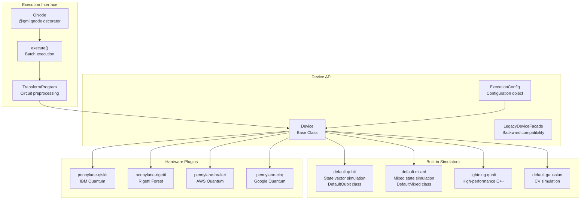
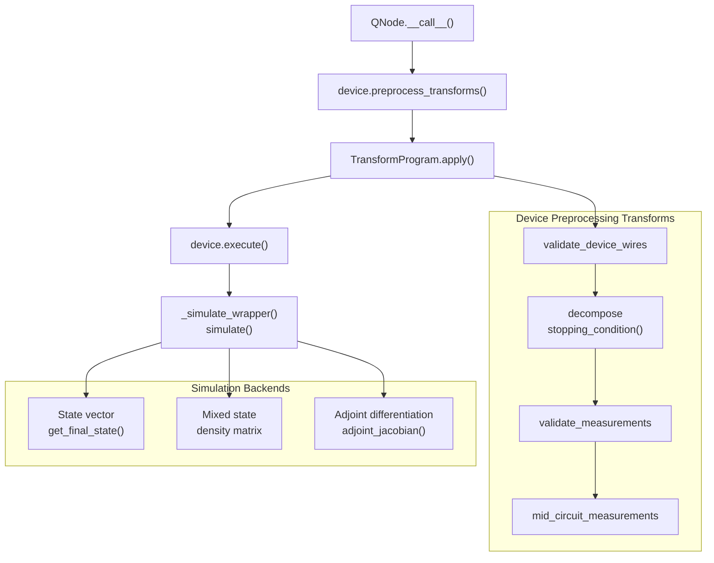
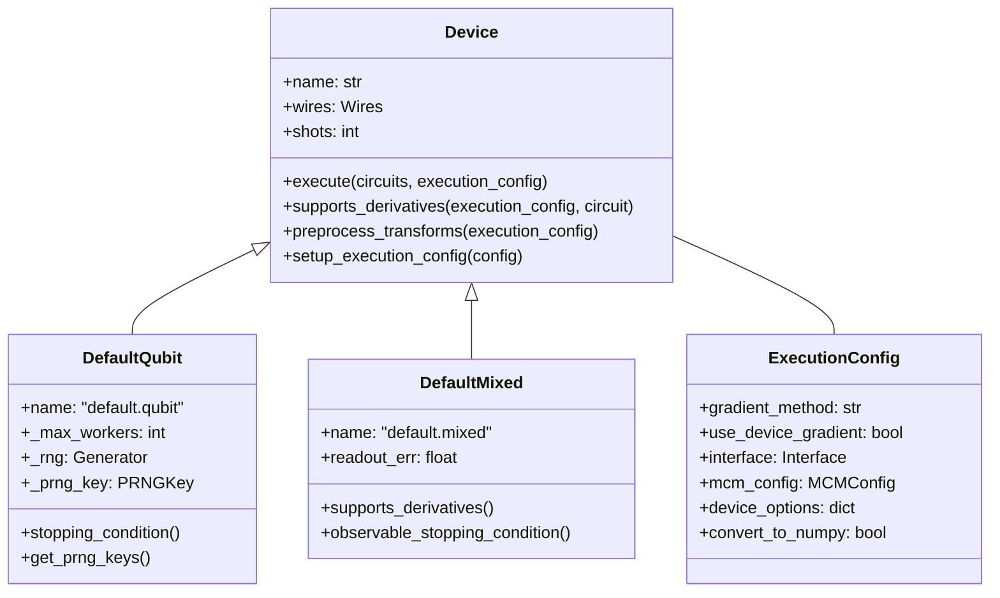
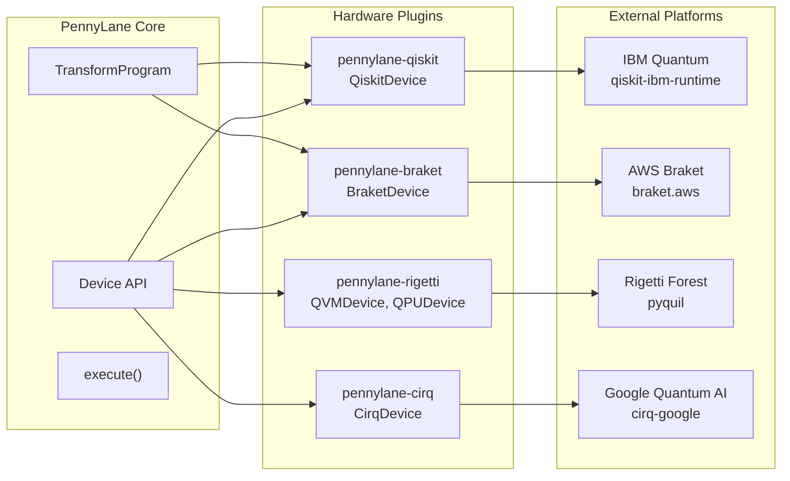
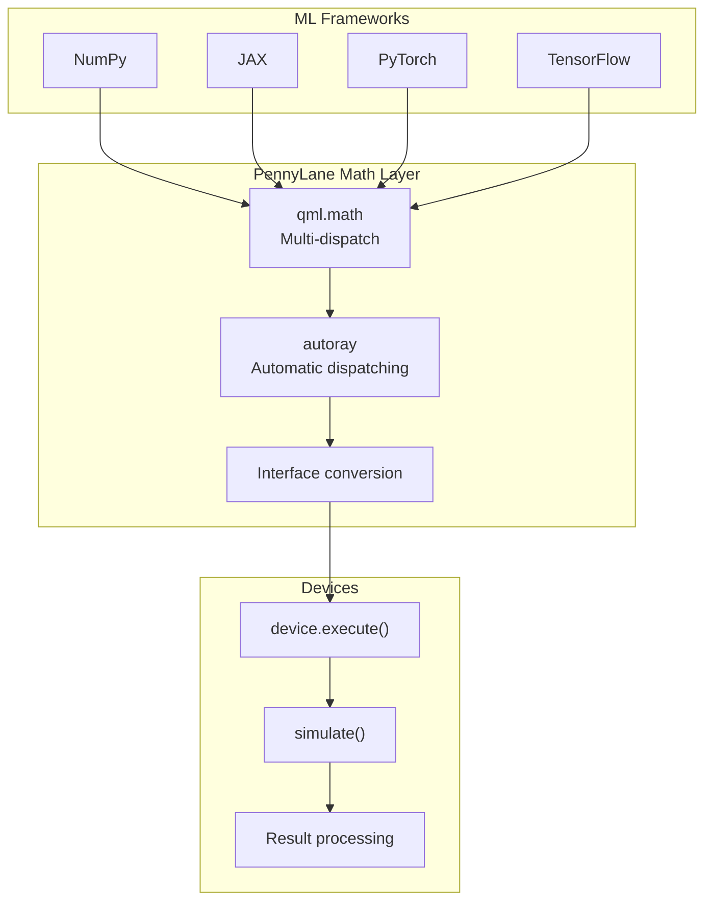

<!-- source: DeepWiki mcp.deepwiki.com · repo PennyLaneAI/pennylane · page 4 Devices and Simulation · fetched 2026-10-21 -->

# Devices and Simulation

<details>
<summary>Relevant source files</summary>

The following files were used as context for generating this wiki page:

- [.github/CHANGELOG.md](.github/CHANGELOG.md)
- [.github/workflows/docker.yml](.github/workflows/docker.yml)
- [.pylintrc](.pylintrc)
- [doc/code/qml.rst](doc/code/qml.rst)
- [doc/development/guide/documentation.rst](doc/development/guide/documentation.rst)
- [doc/development/guide/installation.rst](doc/development/guide/installation.rst)
- [doc/development/release_notes.md](doc/development/release_notes.md)
- [doc/introduction/compiling_workflows.rst](doc/introduction/compiling_workflows.rst)
- [doc/introduction/operations.rst](doc/introduction/operations.rst)
- [doc/news/program_capture_sharp_bits.rst](doc/news/program_capture_sharp_bits.rst)
- [doc/releases/changelog-0.42.1.md](doc/releases/changelog-0.42.1.md)
- [doc/releases/changelog-0.42.2.md](doc/releases/changelog-0.42.2.md)
- [doc/releases/changelog-0.42.3.md](doc/releases/changelog-0.42.3.md)
- [doc/releases/changelog-0.43.0.md](doc/releases/changelog-0.43.0.md)
- [doc/requirements.txt](doc/requirements.txt)
- [docker/interfaces/gpu-cuda/cuda-base.dockerfile](docker/interfaces/gpu-cuda/cuda-base.dockerfile)
- [docker/pennylane.dockerfile](docker/pennylane.dockerfile)
- [pennylane/_version.py](pennylane/_version.py)
- [pennylane/compiler/__init__.py](pennylane/compiler/__init__.py)
- [pennylane/compiler/compiler.py](pennylane/compiler/compiler.py)
- [pennylane/devices/default_gaussian.py](pennylane/devices/default_gaussian.py)
- [pennylane/devices/default_mixed.py](pennylane/devices/default_mixed.py)
- [pennylane/devices/default_qubit.py](pennylane/devices/default_qubit.py)
- [pennylane/devices/tests/test_gates.py](pennylane/devices/tests/test_gates.py)
- [pennylane/numpy/random.py](pennylane/numpy/random.py)
- [pennylane/ops/qubit/__init__.py](pennylane/ops/qubit/__init__.py)
- [pyproject.toml](pyproject.toml)
- [setup.py](setup.py)
- [tests/.pylintrc](tests/.pylintrc)
- [tests/devices/test_default_gaussian.py](tests/devices/test_default_gaussian.py)
- [tests/devices/test_default_mixed.py](tests/devices/test_default_mixed.py)
- [tests/gate_data.py](tests/gate_data.py)

</details>


This page covers PennyLane's device ecosystem, which provides the execution layer for quantum circuits. Devices handle the simulation of quantum operations and interface with quantum hardware backends.

For detailed information about specific simulators like `DefaultQubit` and `DefaultMixed`, see [DefaultQubit and DefaultMixed Devices](#4.1). For device interface design patterns, see [Device Interfaces and Architecture](#4.2). For low-level simulation details, see [Simulation Internals](#4.3).

## Overview

PennyLane devices are the execution layer that converts quantum circuits (`QuantumScript` objects) into results. They handle:

- Circuit preprocessing and validation
- Quantum state simulation or hardware execution  
- Measurement processing and result formatting
- Gradient computation support
- Integration with machine learning frameworks

## Device Ecosystem Architecture

The device system consists of built-in simulators, hardware plugins, and a unified interface:



Sources: [pennylane/devices/default_qubit.py:1-100](), [pennylane/devices/default_mixed.py:1-50](), [pennylane/devices/device_api.py]()

## Device Execution Flow

When a `QNode` is called, the execution flow involves device preprocessing, simulation, and postprocessing:



Sources: [pennylane/devices/default_qubit.py:554-614](), [pennylane/devices/default_qubit.py:700-767](), [pennylane/devices/qubit/simulate.py]()

## Built-in Simulators

PennyLane provides several built-in quantum simulators optimized for different use cases:

| Device | Type | Key Features | Gradient Methods | Class Name |
|--------|------|-------------|------------------|------------|
| `default.qubit` | State vector | Backprop, adjoint differentiation, JAX/PyTorch/TF | `backprop`, `adjoint` | `DefaultQubit` |
| `default.mixed` | Mixed state | Noise simulation, density matrices, readout errors | `backprop` | `DefaultMixed` |
| `lightning.qubit` | State vector | High-performance C++, GPU acceleration | `adjoint` | `LightningQubit` |
| `default.gaussian` | Continuous variable | Gaussian states, photonic quantum | N/A | `DefaultGaussian` |

The `DefaultQubit` class implements the core state vector simulator with support for multiple ML frameworks:

```python
# Key methods from DefaultQubit class
class DefaultQubit(Device):
    def execute(self, circuits, execution_config=None):
        # Handles batch processing and parallel execution
        
    def supports_derivatives(self, execution_config=None, circuit=None):
        # Checks gradient method compatibility
        
    def preprocess_transforms(self, execution_config=None):
        # Builds circuit preprocessing pipeline
```

The `stopping_condition` function determines which operations are natively supported:

```python
def stopping_condition(op):
    """Specify whether an Operator is supported by the device."""
    return (isinstance(op, Conditional) and stopping_condition(op.base)) \
           or isinstance(op, MidMeasureMP) \
           or op.has_matrix or op.has_sparse_matrix
```

Sources: [pennylane/devices/default_qubit.py:303-449](), [pennylane/devices/default_mixed.py:176-203](), [pennylane/devices/default_qubit.py:80-98]()

## Device Interface and Configuration  

All devices implement the `Device` base class and use `ExecutionConfig` for configuration:



The `ExecutionConfig` object controls device behavior including gradient methods, interfaces, and device-specific options. Devices modify the config during preprocessing to set optimal defaults:

```python
# Example from DefaultQubit.setup_execution_config()
if config.gradient_method == "best":
    gradient_method = "backprop" if no_max_workers else "adjoint"
    updated_values["gradient_method"] = gradient_method
```

Sources: [pennylane/devices/device_api.py](), [pennylane/devices/execution_config.py](), [pennylane/devices/default_qubit.py:617-697]()

## Transform Integration

Devices integrate with the transform system to preprocess circuits before execution. The transform pipeline is built in `preprocess_transforms()`:

| Transform Category | Transform Functions | Purpose |
|-------------------|-------------------|---------|
| Validation | `validate_device_wires`, `validate_measurements`, `validate_observables` | Check circuit compatibility |
| Decomposition | `decompose` with `stopping_condition` | Break down unsupported operations |
| MCM Processing | `defer_measurements`, `mid_circuit_measurements` | Handle mid-circuit measurements |
| Gradient Prep | `adjoint_state_measurements`, `no_sampling` | Prepare for differentiation |
| Broadcasting | `broadcast_expand`, `_conditional_broastcast_expand` | Handle parameter broadcasting |

Example transform pipeline from `DefaultQubit`:

```python
def preprocess_transforms(self, execution_config=None):
    transform_program = TransformProgram()
    transform_program.add_transform(validate_device_wires, self.wires, name=self.name)
    transform_program.add_transform(decompose, 
                                  stopping_condition=stopping_condition,
                                  name=self.name)
    transform_program.add_transform(validate_measurements, ...)
    if config.gradient_method == "adjoint":
        _add_adjoint_transforms(transform_program)
```

Sources: [pennylane/devices/default_qubit.py:554-613](), [pennylane/devices/preprocess.py](), [pennylane/devices/default_qubit.py:274-299]()

## Hardware Plugin Architecture

Hardware devices extend the base `Device` class and integrate with external quantum computing platforms:



The plugin architecture provides:
- **Vendor Integration**: Connect to IBM Quantum, AWS Braket, Rigetti Forest, Google Cirq
- **Unified Interface**: All hardware devices use the same `Device` API  
- **Transform Compatibility**: Hardware devices leverage the same transform system
- **Gradient Support**: Some hardware devices support parameter-shift gradients

Sources: Plugin repositories, [pennylane/devices/__init__.py]()

## Mathematical Backend Integration

Devices integrate with PennyLane's mathematical framework for cross-platform compatibility:



Key integration features:
- **Framework Agnostic**: Support NumPy, JAX, PyTorch, TensorFlow tensors via `qml.math`
- **Auto-dispatch**: Automatic selection of appropriate tensor operations through `autoray`
- **Interface Conversion**: Convert between different ML framework formats
- **Gradient Integration**: Native gradient support for backpropagation methods

The `ExecutionConfig.interface` field controls which ML framework interface is used during execution.

Sources: [pennylane/math/](), [pennylane/interfaces/](), [pennylane/devices/default_qubit.py:635-643]()

---

