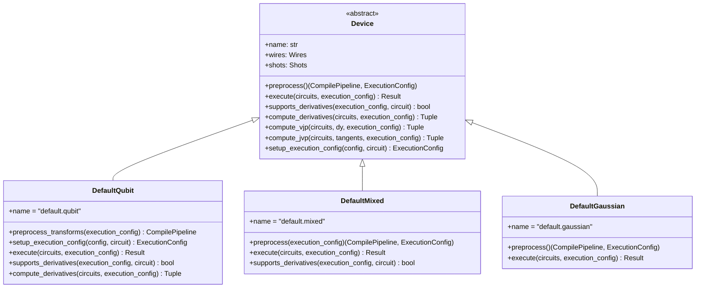
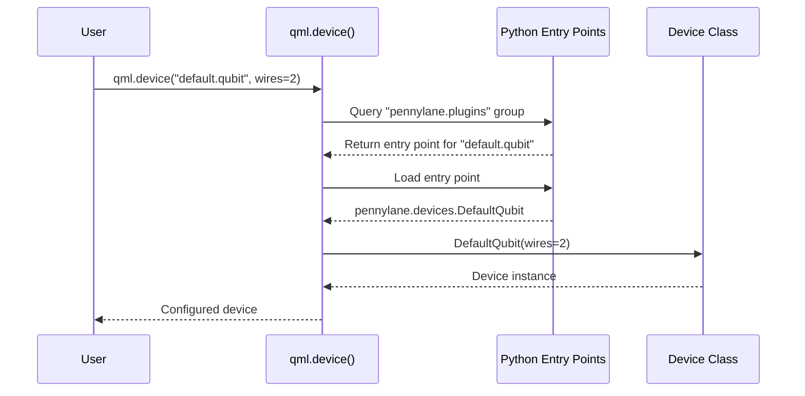
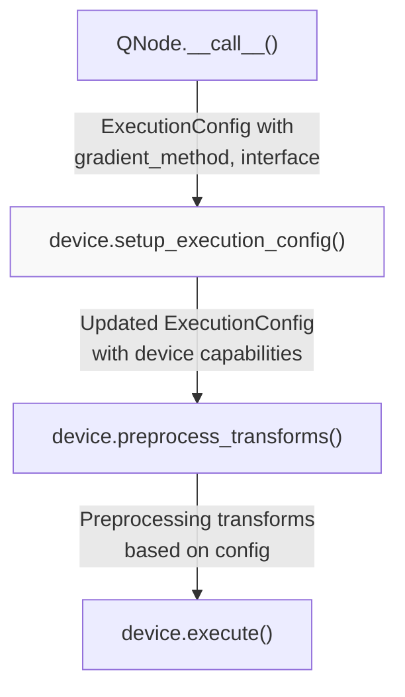
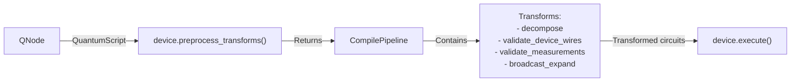
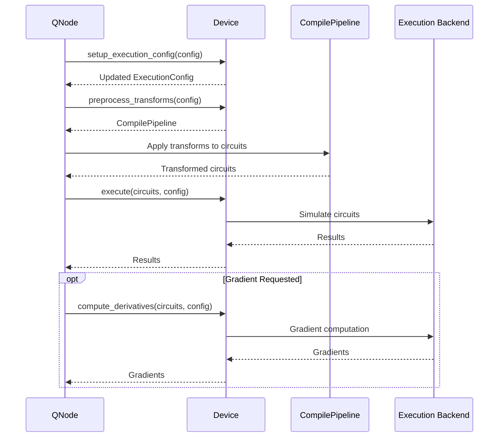
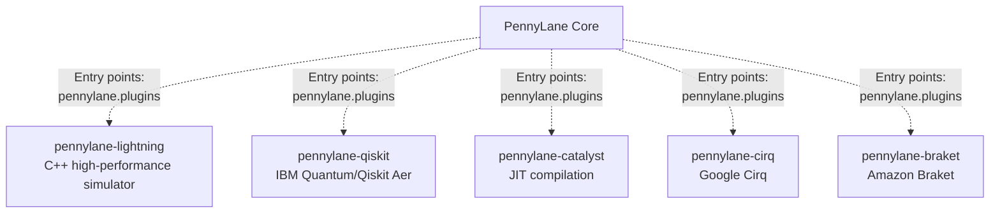

<!-- source: DeepWiki mcp.deepwiki.com · repo PennyLaneAI/pennylane · page 4.1 Device Architecture and Plugin System · fetched 2026-10-21 -->

# Device Architecture and Plugin System

<details>
<summary>Relevant source files</summary>

The following files were used as context for generating this wiki page:

- [.github/CHANGELOG.md](.github/CHANGELOG.md)
- [.pylintrc](.pylintrc)
- [doc/code/qml.rst](doc/code/qml.rst)
- [doc/development/guide/documentation.rst](doc/development/guide/documentation.rst)
- [doc/development/guide/installation.rst](doc/development/guide/installation.rst)
- [doc/introduction/compiling_workflows.rst](doc/introduction/compiling_workflows.rst)
- [doc/introduction/operations.rst](doc/introduction/operations.rst)
- [doc/requirements.txt](doc/requirements.txt)
- [pennylane/compiler/__init__.py](pennylane/compiler/__init__.py)
- [pennylane/compiler/compiler.py](pennylane/compiler/compiler.py)
- [pennylane/devices/default_mixed.py](pennylane/devices/default_mixed.py)
- [pennylane/devices/default_qubit.py](pennylane/devices/default_qubit.py)
- [pennylane/devices/tests/test_gates.py](pennylane/devices/tests/test_gates.py)
- [pennylane/numpy/random.py](pennylane/numpy/random.py)
- [pennylane/ops/qubit/__init__.py](pennylane/ops/qubit/__init__.py)
- [pyproject.toml](pyproject.toml)
- [setup.py](setup.py)
- [tests/.pylintrc](tests/.pylintrc)
- [tests/devices/test_default_mixed.py](tests/devices/test_default_mixed.py)
- [tests/gate_data.py](tests/gate_data.py)

</details>


## Purpose and Scope

This document describes PennyLane's device architecture, the abstract `Device` API, and the plugin system that enables third-party device integration. It covers how devices are registered via entry points, discovered at runtime, and integrated into the execution workflow. For details on specific built-in devices like `default.qubit` and `default.mixed`, see [DefaultQubit and DefaultMixed Devices](#4.2). For continuous-variable devices, see [Continuous Variable Devices](#4.3). For JIT compilation integration, see [JIT Compilation with Catalyst](#4.4).

---

## Device Base Class

The `Device` class defines the abstract interface that all PennyLane devices must implement. This interface standardizes how quantum circuits are preprocessed, executed, and differentiated across different backends.

### Core Device Interface



**Sources:** [pennylane/devices/default_qubit.py:368-879](), [pennylane/devices/default_mixed.py:177-376]()

### Key Device Methods

| Method | Purpose | Required |
|--------|---------|----------|
| `name` | Device identifier string | Yes |
| `preprocess()` or `preprocess_transforms()` | Returns preprocessing pipeline and execution config | Yes |
| `execute(circuits, execution_config)` | Executes batch of quantum circuits | Yes |
| `setup_execution_config(config, circuit)` | Resolves and fills in execution configuration | No |
| `supports_derivatives(execution_config, circuit)` | Checks if derivatives are available | No |
| `compute_derivatives(circuits, execution_config)` | Computes Jacobian | No |
| `compute_vjp(circuits, dy, execution_config)` | Computes vector-Jacobian product | No |
| `compute_jvp(circuits, tangents, execution_config)` | Computes Jacobian-vector product | No |

**Sources:** [pennylane/devices/default_qubit.py:368-515](), [pennylane/devices/default_mixed.py:177-283]()

---

## Entry Points System

PennyLane uses Python's entry points mechanism to discover and load device plugins at runtime. Devices register themselves under the `pennylane.plugins` group in their package metadata.

### Entry Point Configuration

In `pyproject.toml`, devices are registered as follows:

```toml
[project.entry-points."pennylane.plugins"]
"default.qubit" = "pennylane.devices:DefaultQubit"
"default.gaussian" = "pennylane.devices:DefaultGaussian"
"default.mixed" = "pennylane.devices.default_mixed:DefaultMixed"
"reference.qubit" = "pennylane.devices.reference_qubit:ReferenceQubit"
"null.qubit" = "pennylane.devices.null_qubit:NullQubit"
"default.qutrit" = "pennylane.devices.default_qutrit:DefaultQutrit"
"default.clifford" = "pennylane.devices.default_clifford:DefaultClifford"
"default.qutrit.mixed" = "pennylane.devices.default_qutrit_mixed:DefaultQutritMixed"
"default.tensor" = "pennylane.devices.default_tensor:DefaultTensor"
```

Each entry point maps a device short name (e.g., `"default.qubit"`) to the full import path of the device class.

**Sources:** [pyproject.toml:161-170]()

### Device Discovery Flow



This pattern is similar to the compiler plugin system, which also uses entry points under the `pennylane.compilers` group.

**Sources:** [pyproject.toml:161-170](), [pennylane/compiler/compiler.py:70-94]()

---

## Device Capabilities and ExecutionConfig

Devices communicate their capabilities through the `ExecutionConfig` dataclass and various capability methods. This allows the QNode execution workflow to adapt based on what the device supports.

### ExecutionConfig Resolution



**Sources:** [pennylane/devices/default_qubit.py:707-770](), [pennylane/devices/default_mixed.py:284-315]()

### Device Capability Methods

| Method | Purpose | Example |
|--------|---------|---------|
| `supports_derivatives()` | Check if device can compute derivatives | Checks for backprop/adjoint support |
| `supports_jvp()` | Check if device provides JVP | Used for forward-mode differentiation |
| `supports_vjp()` | Check if device provides VJP | Used for reverse-mode differentiation |

**Example from `DefaultQubit`:**

```python
def supports_derivatives(self, execution_config=None, circuit=None):
    """DefaultQubit supports backpropagation derivatives with analytic results,
    as well as adjoint differentiation."""
    if execution_config is None:
        return True
    
    if execution_config.gradient_method in {"backprop", "best"} and no_max_workers:
        if circuit is None:
            return True
        return not circuit.shots and not any(
            isinstance(m.obs, ops.SparseHamiltonian) for m in circuit.measurements
        )
    
    if execution_config.gradient_method in {"adjoint", "best"}:
        return _supports_adjoint(circuit, device_wires=self.wires, device_name=self.name)
    return False
```

**Sources:** [pennylane/devices/default_qubit.py:581-615](), [pennylane/devices/default_mixed.py:242-262]()

---

## Device Preprocessing Pipeline

Devices define preprocessing pipelines that transform quantum circuits into a form the device can execute. This is done via the `CompilePipeline` class.

### Preprocessing Architecture



**Example from `DefaultQubit`:**

The `preprocess_transforms()` method builds a device-specific pipeline:

1. **MCM handling**: Applies `defer_measurements` or allows mid-circuit measurements
2. **Decomposition**: Decomposes operations to device-supported gate set
3. **Validation**: Validates wires, measurements, and observables
4. **Gradient-specific**: Adds transforms for adjoint/backprop differentiation

**Sources:** [pennylane/devices/default_qubit.py:632-705]()

### Device-Specific Gate Sets

Devices define stopping conditions for decomposition based on their native gate sets:

```python
# From default_qubit.py
_BASE_DQ_GATE_SET = {
    "CNOT", "CRX", "CRY", "CRZ", "CRot", "CSWAP", "CY", "CZ",
    "ControlledPhaseShift", "GlobalPhase", "Hadamard", "ISWAP",
    "Identity", "IsingXX", "IsingXY", "IsingYY", "IsingZZ",
    "MultiControlledX", "MultiRZ", "PSWAP", "PauliX", "PauliY",
    "PauliZ", "PhaseShift", "RX", "RY", "RZ", "S", "SWAP", "SX",
    "T", "Toffoli"
}

ALL_DQ_GATES = GateSet(_BASE_DQ_GATE_SET | {f"C({gate})" for gate in _BASE_DQ_GATE_SET} | ...)

def stopping_condition(op: Operator, allow_mcms=True) -> bool:
    """Specify whether or not an Operator object is supported by the device."""
    if constraint := _special_operator_support.get(op.name):
        return constraint(op)
    if isinstance(op, MidMeasure):
        return allow_mcms
    return op.has_matrix or op.has_sparse_matrix
```

**Sources:** [pennylane/devices/default_qubit.py:88-162]()

---

## Device Execution Workflow

The execution workflow integrates device preprocessing, execution, and optional differentiation.

### Complete Execution Sequence



**Sources:** [pennylane/devices/default_qubit.py:811-878]()

### Parallel Execution Support

`DefaultQubit` supports parallel execution via the `max_workers` option:

```python
def execute(self, circuits, execution_config=None):
    max_workers = execution_config.device_options.get("max_workers", self._max_workers)
    
    if max_workers is None:
        # Serial execution
        return tuple(_simulate_wrapper(c, {...}) for c in circuits)
    
    # Parallel execution
    vanilla_circuits = convert_to_numpy_parameters(circuits)[0]
    with execution_config.executor_backend(max_workers=max_workers) as executor:
        exec_map = executor.map(_simulate_wrapper, vanilla_circuits, simulate_kwargs)
        results = tuple(exec_map)
    
    return results
```

**Sources:** [pennylane/devices/default_qubit.py:811-878]()

---

## Device Options and Configuration

Devices can define custom options that are passed through `device_options` in `ExecutionConfig`.

### Device Options Pattern

```python
class DefaultQubit(Device):
    _device_options = ("max_workers", "rng", "prng_key")
    
    def __init__(self, wires=None, shots=None, seed="global", max_workers=None):
        super().__init__(wires=wires, shots=shots)
        self._max_workers = max_workers
        self._rng = np.random.default_rng(seed)
        # ...
    
    def setup_execution_config(self, config=None, circuit=None):
        updated_values = {}
        updated_values["device_options"] = dict(config.device_options)
        
        for option in self._device_options:
            if option not in updated_values["device_options"]:
                updated_values["device_options"][option] = getattr(self, f"_{option}")
        
        return replace(config, **updated_values)
```

**Sources:** [pennylane/devices/default_qubit.py:554-770]()

### Common Device Options

| Option | Used By | Purpose |
|--------|---------|---------|
| `max_workers` | DefaultQubit | Enable parallel circuit execution |
| `rng` | DefaultQubit, DefaultMixed | NumPy random number generator |
| `prng_key` | DefaultQubit, DefaultMixed | JAX PRNG key for JAX interface |

**Sources:** [pennylane/devices/default_qubit.py:554-578](), [pennylane/devices/default_mixed.py:199-240]()

---

## Creating a Custom Device

To create a custom device plugin, follow these steps:

### 1. Implement the Device Interface

```python
from pennylane.devices import Device
from pennylane.transforms.core import CompilePipeline

class MyCustomDevice(Device):
    @property
    def name(self):
        return "my.custom.device"
    
    def preprocess(self, execution_config=None):
        """Build preprocessing pipeline."""
        config = self._setup_execution_config(execution_config or ExecutionConfig())
        pipeline = CompilePipeline()
        
        # Add your transforms
        pipeline.add_transform(decompose, stopping_condition=my_stopping_condition)
        pipeline.add_transform(validate_device_wires, self.wires, name=self.name)
        
        return pipeline, config
    
    def execute(self, circuits, execution_config=None):
        """Execute circuits and return results."""
        results = []
        for circuit in circuits:
            result = self._simulate_circuit(circuit)
            results.append(result)
        return tuple(results)
```

### 2. Register via Entry Points

In your package's `pyproject.toml`:

```toml
[project.entry-points."pennylane.plugins"]
"my.custom.device" = "my_package.devices:MyCustomDevice"
```

### 3. Install and Use

```bash
pip install my-pennylane-device
```

```python
import pennylane as qml

dev = qml.device("my.custom.device", wires=2)

@qml.qnode(dev)
def circuit(x):
    qml.RX(x, wires=0)
    return qml.expval(qml.Z(0))
```

**Sources:** [pyproject.toml:161-170](), [doc/development/guide/installation.rst:70-76]()

---

## Built-in vs Plugin Devices

### Built-in Devices

Built-in devices are included in the core PennyLane package:

| Device | Module | Purpose |
|--------|--------|---------|
| `default.qubit` | `pennylane.devices.DefaultQubit` | State vector simulation |
| `default.mixed` | `pennylane.devices.default_mixed.DefaultMixed` | Density matrix simulation |
| `default.gaussian` | `pennylane.devices.DefaultGaussian` | Continuous-variable simulation |
| `default.clifford` | `pennylane.devices.default_clifford.DefaultClifford` | Stabilizer simulation |
| `default.tensor` | `pennylane.devices.default_tensor.DefaultTensor` | Tensor network simulation |
| `default.qutrit` | `pennylane.devices.default_qutrit.DefaultQutrit` | Qutrit simulation |

**Sources:** [pyproject.toml:161-170]()

### Plugin Devices

Plugin devices are distributed as separate packages:



Plugin devices register themselves using the same entry points mechanism. When a user installs a plugin package, its devices automatically become available to PennyLane.

**Sources:** [pyproject.toml:161-170](), [doc/development/guide/installation.rst:70-76]()

---

## Device Testing Suite

PennyLane provides a device test suite to validate plugin devices implement the interface correctly.

### Running Device Tests

```python
# In your plugin's test suite
from pennylane.devices.tests import test_gates

class TestMyDevice:
    """Test gate support for my custom device."""
    
    @pytest.fixture
    def device_kwargs(self):
        return {"name": "my.custom.device"}
```

The test suite covers:
- All standard gate operations
- State preparation
- Measurement types
- Probability computations
- Batch execution
- Derivative support

**Sources:** [pennylane/devices/tests/test_gates.py:354-619]()

---

## Summary

The PennyLane device architecture provides:

1. **Abstract Device Interface**: Standardized API via the `Device` base class
2. **Plugin System**: Entry points mechanism for device discovery and registration
3. **Preprocessing Pipeline**: `CompilePipeline` for circuit transformation
4. **Execution Configuration**: `ExecutionConfig` for device capabilities and options
5. **Differentiation Support**: Optional device-provided gradient computation
6. **Parallel Execution**: Multi-worker support for batch circuit execution

This architecture enables PennyLane to support diverse quantum backends—from simulators to real hardware—through a unified interface while maintaining flexibility for device-specific optimizations.

**Sources:** [pennylane/devices/default_qubit.py:1-1463](), [pennylane/devices/default_mixed.py:1-376](), [pyproject.toml:161-170]()

---

