<!-- source: DeepWiki mcp.deepwiki.com · repo PennyLaneAI/pennylane · page 4.2 DefaultQubit and DefaultMixed Devices · fetched 2026-10-21 -->

# DefaultQubit and DefaultMixed Devices

<details>
<summary>Relevant source files</summary>

The following files were used as context for generating this wiki page:

- [.github/CHANGELOG.md](.github/CHANGELOG.md)
- [doc/introduction/operations.rst](doc/introduction/operations.rst)
- [pennylane/devices/default_mixed.py](pennylane/devices/default_mixed.py)
- [pennylane/devices/default_qubit.py](pennylane/devices/default_qubit.py)
- [pennylane/devices/tests/test_gates.py](pennylane/devices/tests/test_gates.py)
- [pennylane/ops/qubit/__init__.py](pennylane/ops/qubit/__init__.py)
- [tests/devices/test_default_mixed.py](tests/devices/test_default_mixed.py)
- [tests/gate_data.py](tests/gate_data.py)

</details>


## Purpose and Scope

This document describes the two primary built-in quantum simulators in PennyLane: `default.qubit` and `default.mixed`. These devices provide pure Python implementations of quantum circuit simulation using state vectors and density matrices respectively. For information about the abstract device interface that these implement, see [Device Architecture and Plugin System](#4.1). For information about other simulators (CV, Clifford, etc.), see [Continuous Variable Devices](#4.3).

---

## Overview

PennyLane provides two main qubit simulators with different simulation approaches:

| Device | Representation | Use Case | Differentiation |
|--------|---------------|----------|-----------------|
| `default.qubit` | State vector (pure states) | General quantum circuits, fast simulation, gradient computation | Backpropagation, Adjoint |
| `default.mixed` | Density matrix (mixed states) | Noisy quantum circuits, decoherence modeling | Backpropagation only |

**DefaultQubit** is the recommended default device for most quantum machine learning workflows. It supports efficient gradient computation through both backpropagation and adjoint differentiation methods, and can execute circuits in parallel.

**DefaultMixed** is used when modeling noise and decoherence is required. It represents quantum states as density matrices, enabling simulation of non-unitary operations like amplitude damping and depolarizing channels.

**Sources:** [pennylane/devices/default_qubit.py:1-60](), [pennylane/devices/default_mixed.py:1-50]()

---

## DefaultQubit Device

### Architecture and Components

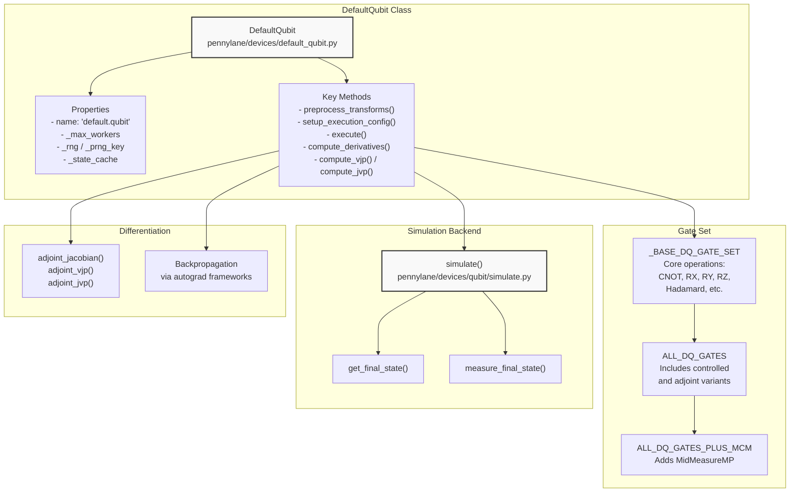

**DefaultQubit Device Architecture**

The `DefaultQubit` class at [pennylane/devices/default_qubit.py:368-1473]() implements a state vector quantum simulator. It inherits from the abstract `Device` class and is decorated with `@simulator_tracking` and `@single_tape_support`.

**Sources:** [pennylane/devices/default_qubit.py:88-158](), [pennylane/devices/default_qubit.py:366-515]()

### Supported Operations and Gate Set

DefaultQubit defines its supported operations through gate sets and stopping conditions:

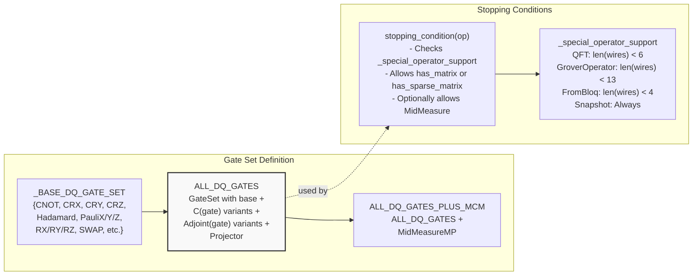

**Gate Set Structure**

The gate set hierarchy is defined at [pennylane/devices/default_qubit.py:88-135](). The base set contains 22 fundamental operations, which are expanded to include all controlled and adjoint variants through the `GateSet` class.

**Sources:** [pennylane/devices/default_qubit.py:88-162](), [pennylane/devices/default_qubit.py:137-146]()

### Preprocessing Pipeline

DefaultQubit's preprocessing transforms circuits into a form suitable for simulation:

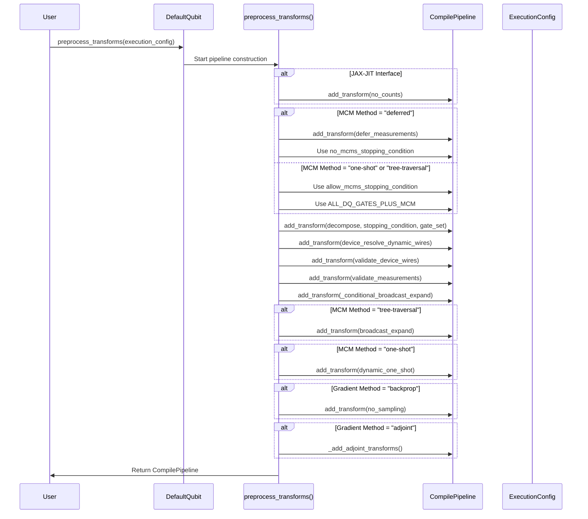

**DefaultQubit Preprocessing Pipeline**

The preprocessing pipeline is constructed in `preprocess_transforms()` at [pennylane/devices/default_qubit.py:632-705](). The pipeline varies based on the execution configuration, particularly the interface (JAX-JIT), MCM method, and gradient method.

**Key Transforms:**
- **decompose**: Breaks down operations to the target gate set using the stopping condition
- **defer_measurements**: Converts mid-circuit measurements to conditional operations (when mcm_method="deferred")
- **dynamic_one_shot**: Implements one-shot MCM simulation (when mcm_method="one-shot")
- **validate_measurements**: Ensures measurements are compatible with the device
- **_conditional_broadcast_expand**: Handles parameter broadcasting for shadow operations

**Sources:** [pennylane/devices/default_qubit.py:632-705]()

### Execution Configuration Setup

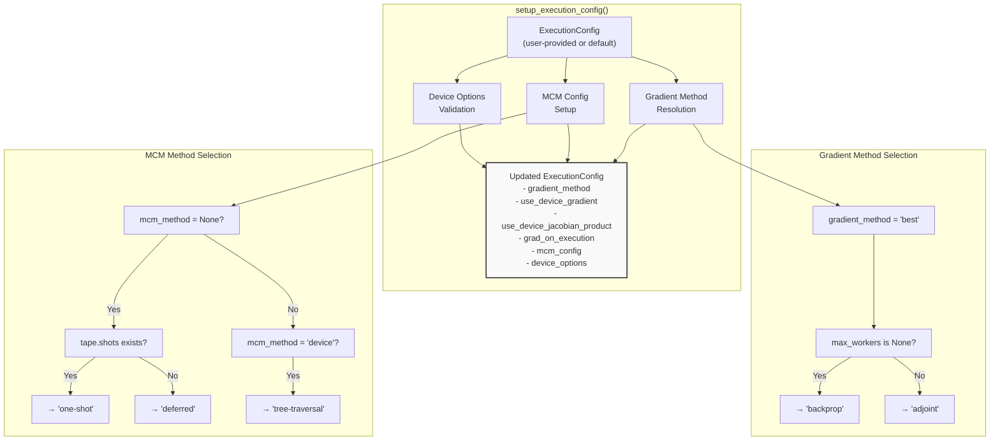

**ExecutionConfig Resolution**

The `setup_execution_config()` method at [pennylane/devices/default_qubit.py:707-770]() resolves configuration details:

1. **Gradient Method**: If "best", chooses "backprop" when `max_workers=None`, otherwise "adjoint"
2. **MCM Method**: Defaults to "one-shot" with shots, "deferred" without shots
3. **Device Options**: Validates and fills in device-specific options (max_workers, rng, prng_key)
4. **Conversion Flags**: Sets `convert_to_numpy` based on interface and gradient method

**Sources:** [pennylane/devices/default_qubit.py:707-794]()

### Mid-Circuit Measurement (MCM) Handling

DefaultQubit supports three MCM methods:

| Method | Description | Use Case |
|--------|-------------|----------|
| `"deferred"` | Measurements deferred to end via `defer_measurements` transform | Analytic simulation, no shots |
| `"one-shot"` | Dynamic one-shot simulation using `dynamic_one_shot` transform | Finite shots, realistic sampling |
| `"tree-traversal"` | Tree-based exploration of measurement branches | All measurement branches explored |

The MCM configuration is set up in `_setup_mcm_config()` at [pennylane/devices/default_qubit.py:772-794]().

**Sources:** [pennylane/devices/default_qubit.py:772-809]()

### Differentiation Support

DefaultQubit supports two differentiation methods:

#### Backpropagation

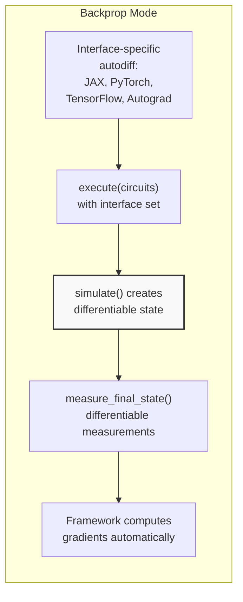

**Backpropagation Differentiation**

When `gradient_method="backprop"`, the device:
- Passes the interface to `simulate()` at [pennylane/devices/default_qubit.py:812-878]()
- Requires `max_workers=None` (no parallelization)
- Cannot be used with finite shots (enforced by `no_sampling` transform)
- Allows automatic differentiation through the entire simulation

#### Adjoint Differentiation

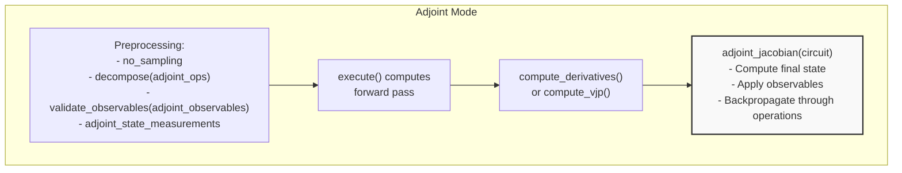

**Adjoint Differentiation**

The adjoint method is implemented at [pennylane/devices/qubit/adjoint_jacobian.py](). Key transforms are added by `_add_adjoint_transforms()` at [pennylane/devices/default_qubit.py:329-364]():

- **adjoint_ops**: Stopping condition that allows only non-trainable ops or single-parameter ops with generators
- **adjoint_observables**: Requires observables to have matrix representations
- **adjoint_state_measurements**: Converts measurements to state measurements for differentiation

The adjoint method:
- Works with finite shots
- Can use parallel execution (`max_workers > 0`)
- Computes gradients via backpropagation through the reversed circuit
- Supports VJP (Vector-Jacobian Product) and JVP (Jacobian-Vector Product)

**Sources:** [pennylane/devices/default_qubit.py:296-364](), [pennylane/devices/default_qubit.py:880-1003]()

### Execution Modes

DefaultQubit supports serial and parallel execution:

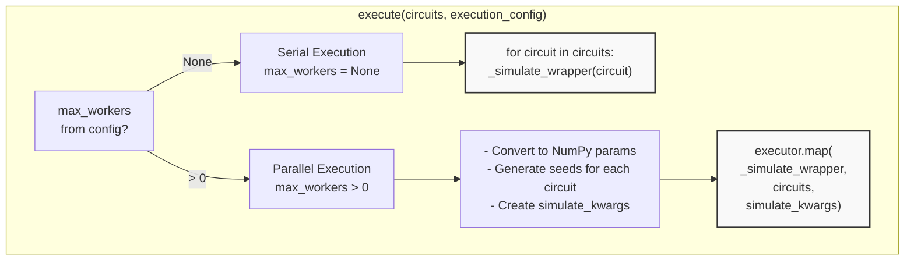

**Execution Flow**

The `execute()` method at [pennylane/devices/default_qubit.py:811-878]() handles both modes:

**Serial Mode** (`max_workers=None`):
- Calls `_simulate_wrapper()` directly for each circuit
- Supports backpropagation with interface tracking
- Can use state caching for adjoint differentiation

**Parallel Mode** (`max_workers > 0`):
- Converts parameters to NumPy (not differentiable)
- Uses `execution_config.executor_backend()` context manager
- Maps `_simulate_wrapper` across circuits with separate RNG seeds
- Only supports adjoint differentiation

**Sources:** [pennylane/devices/default_qubit.py:811-878]()

### Random Number Generation

DefaultQubit supports both NumPy and JAX RNG:

```python
# NumPy RNG (default)
dev = qml.device("default.qubit", seed=42)

# JAX PRNG (for end-to-end JIT)
import jax
dev = qml.device("default.qubit", seed=jax.random.PRNGKey(0))
```

When a JAX `PRNGKey` is provided:
- The device uses `jax.random.split()` for key management via `get_prng_keys()` at [pennylane/devices/default_qubit.py:521-542]()
- Enables end-to-end JAX JIT compilation (disables `convert_to_numpy`)
- Each circuit execution consumes a new key split

**Sources:** [pennylane/devices/default_qubit.py:559-578](), [pennylane/devices/default_qubit.py:521-546]()

---

## DefaultMixed Device

### Architecture and Components

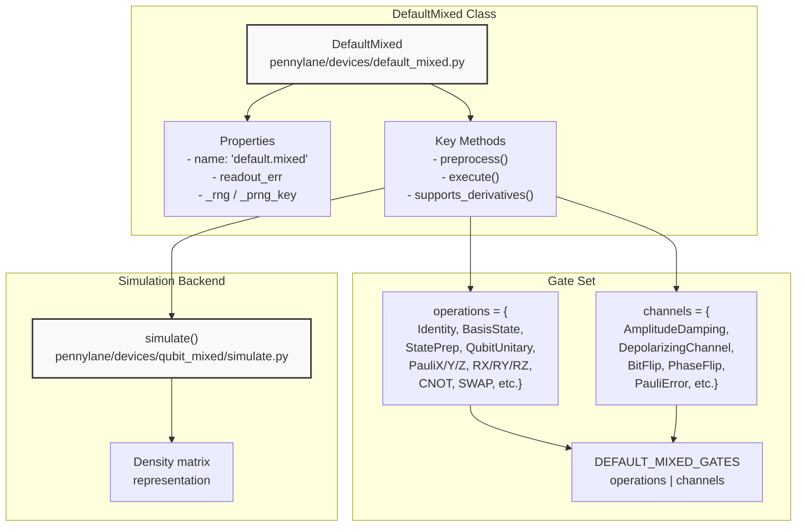

**DefaultMixed Device Architecture**

The `DefaultMixed` class at [pennylane/devices/default_mixed.py:177-376]() implements a density matrix quantum simulator. Unlike DefaultQubit, it can represent mixed states and apply noisy quantum channels.

**Sources:** [pennylane/devices/default_mixed.py:51-152](), [pennylane/devices/default_mixed.py:175-241]()

### Supported Operations

DefaultMixed supports all standard qubit operations plus quantum channels:

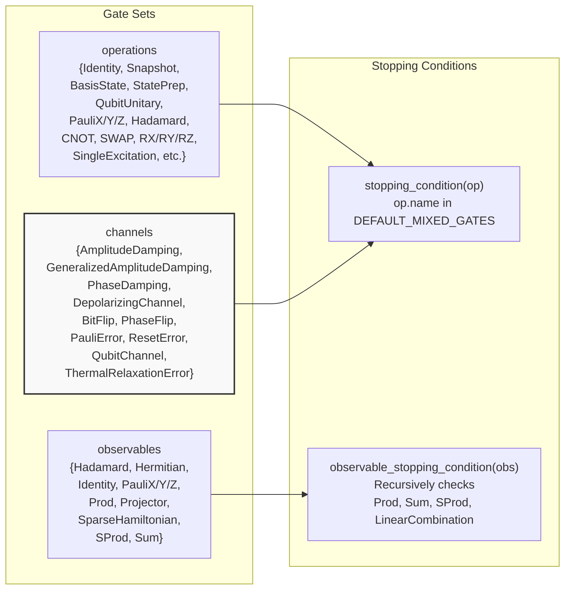

**Supported Operations**

The supported operations are defined at [pennylane/devices/default_mixed.py:51-152](). The key distinction from DefaultQubit is the inclusion of quantum channels (imported from `pennylane.ops.channel.__qubit_channels__`).

**Sources:** [pennylane/devices/default_mixed.py:51-152]()

### Preprocessing Pipeline

DefaultMixed has a simpler preprocessing pipeline than DefaultQubit:

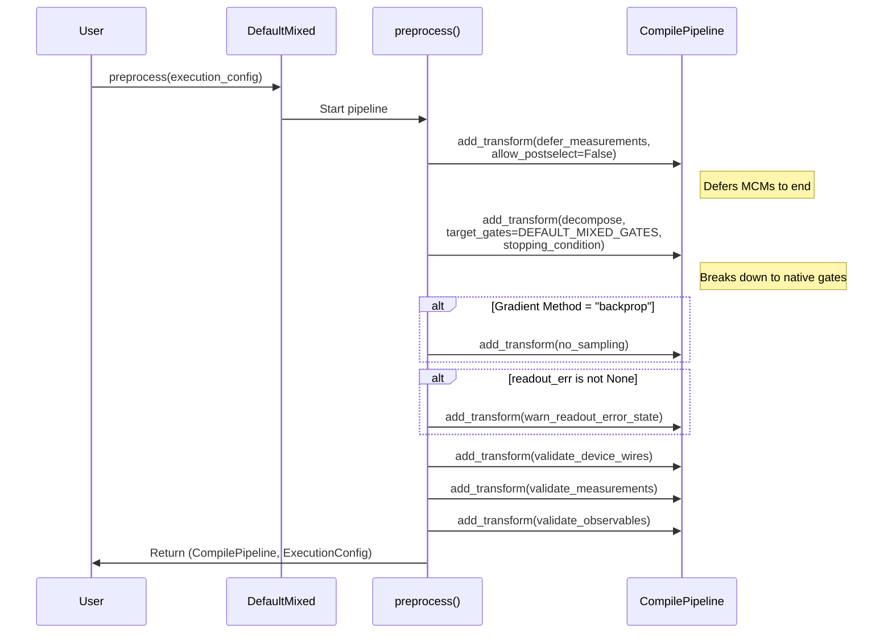

**DefaultMixed Preprocessing**

The preprocessing is defined in `preprocess()` at [pennylane/devices/default_mixed.py:317-375](). Key differences from DefaultQubit:

- Always uses `defer_measurements` (no dynamic MCM methods)
- Does not support parallel execution
- Has readout error validation via `warn_readout_error_state`

**Sources:** [pennylane/devices/default_mixed.py:317-375]()

### Readout Error Simulation

DefaultMixed can simulate readout errors on measurement outcomes:

```python
# Create device with 10% readout error
dev = qml.device("default.mixed", wires=2, readout_prob=0.1)
```

The `readout_prob` parameter (validated at [pennylane/devices/default_mixed.py:220-228]()) specifies the probability of bit-flip errors during measurement. This error is applied in the simulation backend when sampling.

**Note:** Readout error does not affect analytic state measurements, triggering a warning via `warn_readout_error_state` at [pennylane/devices/default_mixed.py:154-172]().

**Sources:** [pennylane/devices/default_mixed.py:206-241](), [pennylane/devices/default_mixed.py:154-172]()

### Differentiation Support

DefaultMixed only supports backpropagation:

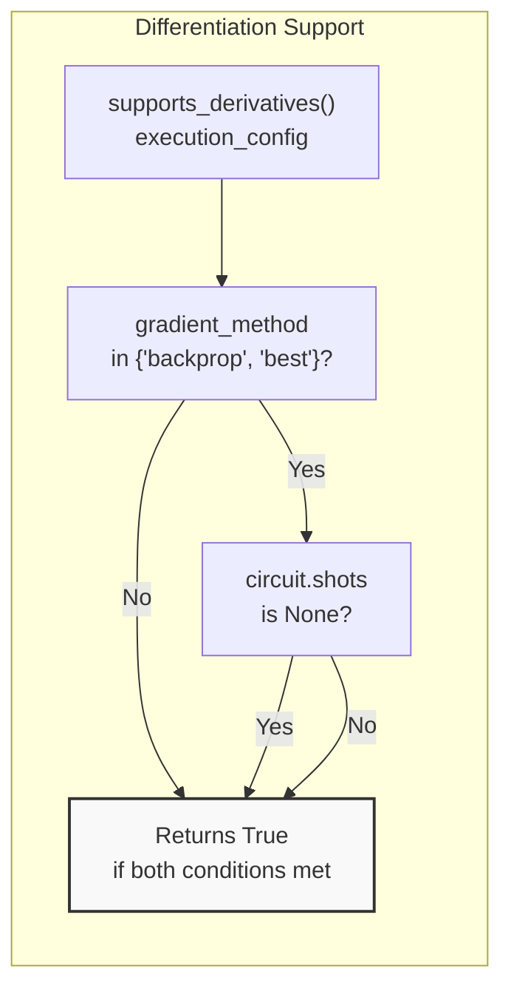

**Backpropagation Only**

The `supports_derivatives()` method at [pennylane/devices/default_mixed.py:242-262]() indicates that DefaultMixed:

- Only supports `gradient_method="backprop"` or `gradient_method="best"` (which resolves to backprop)
- Requires analytic mode (no shots)
- Does not support adjoint differentiation (density matrices are more complex)

**Sources:** [pennylane/devices/default_mixed.py:242-262](), [pennylane/devices/default_mixed.py:284-315]()

### Execution

DefaultMixed execution is simpler than DefaultQubit:

```python
def execute(self, circuits, execution_config=None):
    execution_config = execution_config or ExecutionConfig()
    return tuple(
        simulate(
            c,
            rng=self._rng,
            prng_key=self._prng_key,
            debugger=self._debugger,
            interface=execution_config.interface,
            readout_errors=self.readout_err,
        )
        for c in circuits
    )
```

The `execute()` method at [pennylane/devices/default_mixed.py:264-282]():
- Always executes serially (no parallel execution support)
- Calls `simulate()` from `pennylane.devices.qubit_mixed`
- Passes readout error probability to the simulator

**Sources:** [pennylane/devices/default_mixed.py:264-282]()

---

## Device Comparison

### Feature Matrix

| Feature | DefaultQubit | DefaultMixed |
|---------|--------------|--------------|
| **State Representation** | State vector (2^n complex amplitudes) | Density matrix (2^n × 2^n matrix) |
| **Memory Scaling** | O(2^n) | O(2^(2n)) |
| **Qubit Limit** | ~30 qubits (hardware dependent) | ~23 qubits max (hardcoded) |
| **Quantum Channels** | ❌ No | ✅ Yes |
| **Backpropagation** | ✅ Yes | ✅ Yes |
| **Adjoint Differentiation** | ✅ Yes | ❌ No |
| **Parallel Execution** | ✅ Yes (max_workers) | ❌ No |
| **MCM Methods** | deferred, one-shot, tree-traversal | deferred only |
| **Readout Error** | ❌ No | ✅ Yes |
| **JAX PRNGKey** | ✅ Yes | ✅ Yes |
| **Default Device** | ✅ Yes | ❌ No |

**Sources:** [pennylane/devices/default_qubit.py:366-515](), [pennylane/devices/default_mixed.py:177-241]()

### When to Use Each Device

**Use DefaultQubit when:**
- Simulating pure quantum states without noise
- Need gradient computation (especially adjoint method)
- Require parallel execution for large batches
- Working with deep quantum circuits (memory efficient)
- Using any interface (JAX, PyTorch, TensorFlow, Autograd)

**Use DefaultMixed when:**
- Modeling decoherence and noise
- Simulating open quantum systems
- Studying mixed states and entanglement with environment
- Need readout error simulation
- Working with quantum channels (AmplitudeDamping, DepolarizingChannel, etc.)

**Sources:** [pennylane/devices/default_qubit.py:369-514](), [pennylane/devices/default_mixed.py:177-197]()

---

## Key Implementation Details

### State Caching for Adjoint Differentiation

DefaultQubit implements state caching to optimize adjoint differentiation:

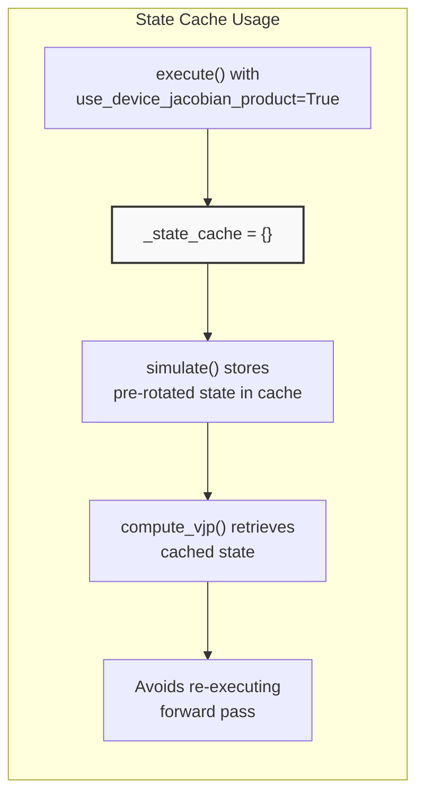

At [pennylane/devices/default_qubit.py:821](), the device initializes `_state_cache = {}` when `use_device_jacobian_product=True`. This cache stores intermediate states during forward execution, which are then reused during VJP computation to avoid redundant circuit execution.

**Sources:** [pennylane/devices/default_qubit.py:548-552](), [pennylane/devices/default_qubit.py:821]()

### Special Operator Support

Both devices implement special handling for certain operators:

```python
_special_operator_support = {
    "QFT": lambda op: len(op.wires) < 6,
    "GroverOperator": lambda op: len(op.wires) < 13,
    "FromBloq": lambda op: len(op.wires) < 4 and op.has_matrix,
    "IQP": lambda op: len(op.wires) < 6,
    "Snapshot": lambda _: True,
    "Allocate": lambda _: True,
    "Deallocate": lambda _: True,
}
```

This dictionary at [pennylane/devices/default_qubit.py:137-146]() maps operation names to functions that determine whether the operation is natively supported. The lambda functions check wire counts to prevent performance degradation or memory issues with large quantum operations.

**Sources:** [pennylane/devices/default_qubit.py:137-158]()

### Device Options

Both devices support device-specific options:

**DefaultQubit Options** (at [pennylane/devices/default_qubit.py:554]()):
- `max_workers`: Number of parallel worker processes
- `rng`: NumPy random number generator
- `prng_key`: JAX PRNGKey for random sampling

**DefaultMixed Options** (at [pennylane/devices/default_mixed.py:199]()):
- `rng`: NumPy random number generator  
- `prng_key`: JAX PRNGKey for random sampling

These options are validated in `setup_execution_config()` (DefaultQubit) or `_setup_execution_config()` (DefaultMixed), raising `DeviceError` if unknown options are provided.

**Sources:** [pennylane/devices/default_qubit.py:554](), [pennylane/devices/default_qubit.py:736-738](), [pennylane/devices/default_mixed.py:199](), [pennylane/devices/default_mixed.py:308-310]()

### Wire Limits

DefaultMixed enforces a hard limit on the number of wires:

```python
if isinstance(wires, int) and wires > 23:
    raise ValueError(
        "This device does not currently support computations on more than 23 wires"
    )
```

At [pennylane/devices/default_mixed.py:215-218](), this check prevents memory issues since density matrices scale as 2^(2n). With 23 qubits, the density matrix requires ~70 billion complex numbers (~1.1 TB of memory).

DefaultQubit has no such hard limit but is practically limited by available memory (state vectors scale as 2^n).

**Sources:** [pennylane/devices/default_mixed.py:215-218]()

### Integration with Simulation Backends

Both devices delegate actual simulation to backend modules:

- **DefaultQubit**: Uses `pennylane.devices.qubit.simulate` at [pennylane/devices/default_qubit.py:75]()
  - `simulate(circuit, ...)` - Main simulation function
  - `get_final_state(circuit, ...)` - Returns final state vector
  - `measure_final_state(circuit, state, ...)` - Performs measurements

- **DefaultMixed**: Uses `pennylane.devices.qubit_mixed.simulate` at [pennylane/devices/default_mixed.py:27]()
  - `simulate(circuit, ...)` - Density matrix simulation

These backend modules handle the actual quantum state evolution and measurement, while the device classes manage preprocessing, configuration, and differentiation.

**Sources:** [pennylane/devices/default_qubit.py:75](), [pennylane/devices/default_mixed.py:27](), [pennylane/devices/default_qubit.py:844-856](), [pennylane/devices/default_mixed.py:272-282]()

---

