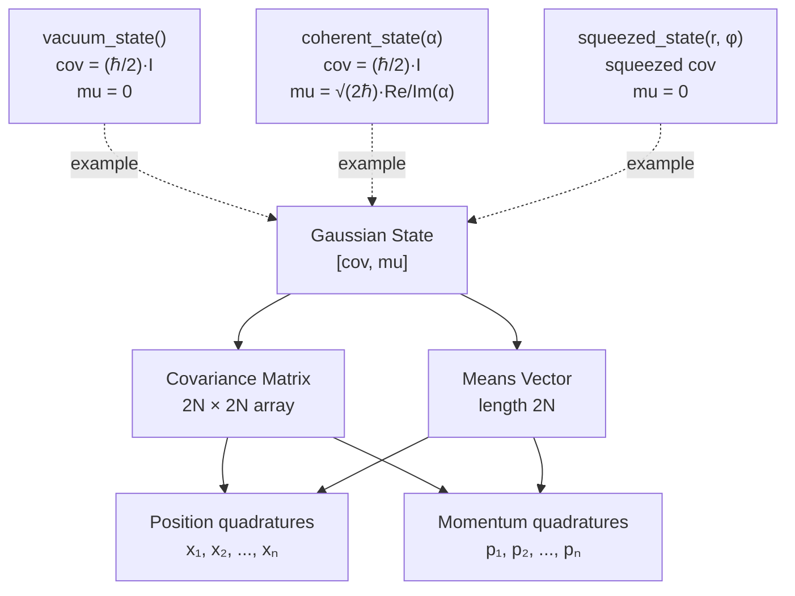
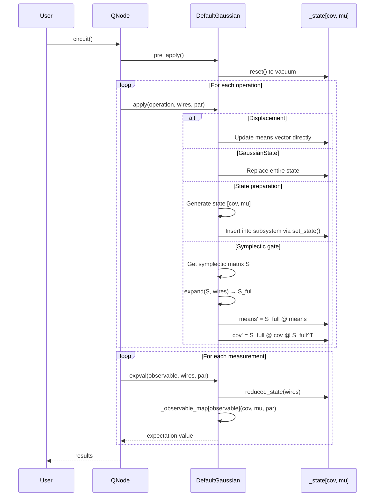

<!-- source: DeepWiki mcp.deepwiki.com · repo PennyLaneAI/pennylane · page 4.3 Continuous Variable Devices · fetched 2026-10-21 -->

# Continuous Variable Devices

<details>
<summary>Relevant source files</summary>

The following files were used as context for generating this wiki page:

- [.github/workflows/docker.yml](.github/workflows/docker.yml)
- [doc/development/release_notes.md](doc/development/release_notes.md)
- [doc/news/program_capture_sharp_bits.rst](doc/news/program_capture_sharp_bits.rst)
- [doc/releases/changelog-0.42.1.md](doc/releases/changelog-0.42.1.md)
- [doc/releases/changelog-0.42.2.md](doc/releases/changelog-0.42.2.md)
- [doc/releases/changelog-0.42.3.md](doc/releases/changelog-0.42.3.md)
- [doc/releases/changelog-0.43.0.md](doc/releases/changelog-0.43.0.md)
- [docker/interfaces/gpu-cuda/cuda-base.dockerfile](docker/interfaces/gpu-cuda/cuda-base.dockerfile)
- [docker/pennylane.dockerfile](docker/pennylane.dockerfile)
- [pennylane/_version.py](pennylane/_version.py)
- [pennylane/devices/default_gaussian.py](pennylane/devices/default_gaussian.py)
- [tests/devices/test_default_gaussian.py](tests/devices/test_default_gaussian.py)

</details>


This page documents PennyLane's continuous variable (CV) quantum device infrastructure, with a focus on the `default.gaussian` device. This device simulates Gaussian quantum states using covariance matrices and means vectors, implementing CV operations through symplectic transformations.

For discrete variable (qubit-based) devices, see [DefaultQubit and DefaultMixed Devices](#4.2). For the general device architecture, see [Device Architecture and Plugin System](#4.1).

---

## Overview and Purpose

The `default.gaussian` device provides a simulator for continuous-variable quantum computations that can be described by Gaussian states. Unlike qubit-based devices that operate on discrete quantum systems, CV devices model quantum systems with continuous degrees of freedom, such as the position and momentum quadratures of light modes.

**Key characteristics:**
- Simulates Gaussian states using covariance matrices and means vectors
- Implements CV gates via symplectic transformations
- Supports homodyne measurements and photon number statistics
- Provides exact (analytic) simulation when `shots=None`
- Can estimate expectation values with finite shots

The device is implemented in the `DefaultGaussian` class at [pennylane/devices/default_gaussian.py:635-899]().

**Sources:** [pennylane/devices/default_gaussian.py:15-23]()

---

## Gaussian State Representation

The fundamental state representation in `default.gaussian` uses two components to fully describe a Gaussian quantum state:

| Component | Type | Description | Ordering |
|-----------|------|-------------|----------|
| Covariance matrix | `(2N, 2N)` array | Contains variances and covariances | `(x₁, x₂, ..., xₙ, p₁, p₂, ..., pₙ)` |
| Means vector | `(2N,)` array | Contains expectation values | `(⟨x₁⟩, ⟨x₂⟩, ..., ⟨xₙ⟩, ⟨p₁⟩, ⟨p₂⟩, ..., ⟨pₙ⟩)` |

where `N` is the number of modes (wires).



**Diagram: Gaussian State Structure**

The internal state `self._state` is stored as a tuple `[cov, means]` where ordering follows the pattern `(x, p)` for each mode. The commutation relation `[x̂, p̂] = iℏ` is parameterized by `hbar` (default value 2).

**Sources:** [pennylane/devices/default_gaussian.py:351-464](), [pennylane/devices/default_gaussian.py:685-692]()

---

## Device Architecture

The `DefaultGaussian` class inherits from the legacy `Device` base class and implements the CV device interface through several key components:

```mermaid
graph TB
    subgraph "DefaultGaussian Class"
        State["_state: [cov, mu]<br/>Internal Gaussian state"]
        Hbar["hbar: float<br/>Commutation parameter"]
        
        OpMap["_operation_map<br/>Dict[str → function]"]
        ObsMap["_observable_map<br/>Dict[str → function]"]
    end
    
    subgraph "Operation Functions"
        Displacement["displacement(state, wire, α)"]
        Squeezing["squeezing(r, φ)"]
        Beamsplitter["beamsplitter(θ, φ)"]
        Rotation["rotation(φ)"]
        TwoModeSqueezing["two_mode_squeezing(r, φ)"]
        ControlledAddition["controlled_addition(s)"]
        ControlledPhase["controlled_phase(s)"]
        QuadraticPhase["quadratic_phase(s)"]
        InterferometerUnitary["interferometer_unitary(U)"]
    end
    
    subgraph "State Preparation"
        VacuumState["vacuum_state(wires)"]
        CoherentState["coherent_state(a, φ)"]
        SqueezedState["squeezed_state(r, φ)"]
        DisplacedSqueezedState["displaced_squeezed_state(...)"]
        ThermalState["thermal_state(nbar)"]
        GaussianState["gaussian_state(cov, mu)"]
    end
    
    subgraph "Observable Functions"
        PhotonNumber["photon_number(cov, mu)"]
        Homodyne["homodyne(φ)"]
        PolyQuadExpectations["poly_quad_expectations(...)"]
        FockExpectation["fock_expectation(cov, mu)"]
    end
    
    OpMap --> Displacement
    OpMap --> Squeezing
    OpMap --> Beamsplitter
    OpMap --> Rotation
    OpMap --> TwoModeSqueezing
    OpMap --> ControlledAddition
    OpMap --> ControlledPhase
    OpMap --> QuadraticPhase
    OpMap --> InterferometerUnitary
    OpMap --> VacuumState
    OpMap --> CoherentState
    OpMap --> SqueezedState
    OpMap --> DisplacedSqueezedState
    OpMap --> ThermalState
    OpMap --> GaussianState
    
    ObsMap --> PhotonNumber
    ObsMap --> Homodyne
    ObsMap --> PolyQuadExpectations
    ObsMap --> FockExpectation
```



**Diagram: DefaultGaussian Architecture**

### Operation and Observable Maps

The device maintains two dictionaries that map operation/observable names to their implementation functions:

- **`_operation_map`** at [pennylane/devices/default_gaussian.py:654-671](): Maps CV gate names to symplectic transformation functions or state preparation functions
- **`_observable_map`** at [pennylane/devices/default_gaussian.py:673-681](): Maps observable names to expectation value calculation functions

**Sources:** [pennylane/devices/default_gaussian.py:635-704]()

---

## Supported Operations

### Symplectic Gate Operations

All unitary CV gates are represented as symplectic transformations applied to the covariance matrix and means vector:

| Operation | Parameters | Symplectic Matrix Size | Function |
|-----------|-----------|------------------------|----------|
| `Rotation` | `φ` | 2×2 | [rotation(φ)]() |
| `Squeezing` | `r, φ` | 2×2 | [squeezing(r, φ)]() |
| `QuadraticPhase` | `s` | 2×2 | [quadratic_phase(s)]() |
| `Beamsplitter` | `θ, φ` | 4×4 | [beamsplitter(θ, φ)]() |
| `TwoModeSqueezing` | `r, φ` | 4×4 | [two_mode_squeezing(r, φ)]() |
| `ControlledAddition` | `s` | 4×4 | [controlled_addition(s)]() |
| `ControlledPhase` | `s` | 4×4 | [controlled_phase(s)]() |
| `InterferometerUnitary` | `U` | 2N×2N | [interferometer_unitary(U)]() |

### State Preparation Operations

State preparation operations initialize subsystems to specific Gaussian states:

| State | Parameters | Function |
|-------|-----------|----------|
| `CoherentState` | `a, φ` | [coherent_state(a, φ)]() |
| `SqueezedState` | `r, φ` | [squeezed_state(r, φ)]() |
| `DisplacedSqueezedState` | `a, φ_a, r, φ_r` | [displaced_squeezed_state(...)]() |
| `ThermalState` | `nbar` | [thermal_state(nbar)]() |
| `GaussianState` | `cov, mu` | [gaussian_state(cov, mu)]() |

The special `Displacement` operation at [pennylane/devices/default_gaussian.py:182-196]() modifies the means vector directly without requiring a symplectic transformation.

**Sources:** [pennylane/devices/default_gaussian.py:170-326](), [pennylane/devices/default_gaussian.py:333-464]()

---

## Execution Flow

The execution flow for operations in `DefaultGaussian` follows this sequence:



**Diagram: DefaultGaussian Execution Flow**

### Key Methods

**`apply(operation, wires, par)`** at [pennylane/devices/default_gaussian.py:708-751]():
- Translates wire labels to device wires
- Handles special cases: `Displacement`, `GaussianState`, `Snapshot`, state preparations
- For symplectic gates: obtains transformation matrix and applies via `expand()`

**`expand(S, wires)`** at [pennylane/devices/default_gaussian.py:753-781]():
- Expands a local symplectic matrix to act on the full system
- Handles wire ordering `(x₁, x₂, ..., p₁, p₂, ...)` correctly

**`reduced_state(wires)`** at [pennylane/devices/default_gaussian.py:857-879]():
- Extracts the covariance matrix and means for a subset of wires
- Required for computing expectations on specific modes

**Sources:** [pennylane/devices/default_gaussian.py:705-782](), [pennylane/devices/default_gaussian.py:857-879]()

---

## Measurement and Observables

### Observable Types

The device supports several types of CV observables:

```mermaid
graph LR
    subgraph "Quadrature Observables"
        QuadX["QuadX<br/>homodyne(0)"]
        QuadP["QuadP<br/>homodyne(π/2)"]
        QuadOperator["QuadOperator<br/>homodyne(φ)"]
    end
    
    subgraph "Photon Number"
        NumberOperator["NumberOperator<br/>photon_number()"]
        FockStateProjector["FockStateProjector<br/>fock_expectation()"]
    end
    
    subgraph "Polynomial Observables"
        PolyXP["PolyXP<br/>poly_quad_expectations()"]
    end
    
    subgraph "Identity"
        Identity["Identity<br/>identity()"]
    end
    
    QuadX --> HomodyneImpl["Homodyne Implementation<br/>rotates state, returns cov[0,0]"]
    QuadP --> HomodyneImpl
    QuadOperator --> HomodyneImpl
    
    NumberOperator --> PhotonImpl["Photon Number Calculation<br/>Tr(cov) + mu^T·mu"]
    FockStateProjector --> FockImpl["Fock Probability<br/>fock_prob(cov, mu, event)"]
    
    PolyXP --> PolyImpl["Polynomial Quadrature<br/>Heisenberg representation"]
```

**Diagram: Observable Types in default.gaussian**

### Homodyne Measurements

The homodyne measurement at angle `φ` is implemented via the `homodyne()` factory function at [pennylane/devices/default_gaussian.py:520-545](). It returns:
- **Expectation:** `μ_φ = (cos φ, sin φ)^T @ μ`
- **Variance:** `σ²_φ = (cos φ, sin φ)^T @ cov @ (cos φ, sin φ)`

### Photon Number Statistics

The photon number observable at [pennylane/devices/default_gaussian.py:501-517]() calculates:
- **Expectation:** `⟨n⟩ = (Tr(cov) + μ^T·μ)/(2ℏ) - 1/2`
- **Variance:** `Var[n] = (Tr(cov·cov) + 2μ^T·cov·μ)/(2ℏ²) - 1/4`

### Fock State Probabilities

The `fock_prob()` function at [pennylane/devices/default_gaussian.py:85-162]() computes the probability of detecting a specific Fock state using the Q-function representation and partition methods, following algorithms from Kruse et al. and Hamilton et al.

### Sampling

The `sample()` method at [pennylane/devices/default_gaussian.py:812-850]() only supports homodyne measurements (`QuadX`, `QuadP`, `QuadOperator`). It:
1. Computes the reduced state for the measured wire
2. Rotates to the measurement basis
3. Samples from `Normal(mean_φ, std_φ)` distribution

**Sources:** [pennylane/devices/default_gaussian.py:500-598](), [pennylane/devices/default_gaussian.py:783-850]()

---

## Mathematical Foundation: Symplectic Transformations

### Symplectic Matrices

A symplectic matrix `S` satisfies: `S @ Ω @ S^T = Ω`, where `Ω` is the symplectic form:

```
Ω = [[ 0,  I],
     [-I,  0]]
```

All Gaussian unitary operations correspond to symplectic transformations on the phase space.

### State Evolution

When a symplectic operation `S` acts on a Gaussian state:
- **Covariance:** `cov' = S @ cov @ S^T`
- **Means:** `μ' = S @ μ`

### Example Transformations

**Rotation** at [pennylane/devices/default_gaussian.py:170-179]():
```python
S = [[cos φ, -sin φ],
     [sin φ,  cos φ]]
```

**Squeezing** at [pennylane/devices/default_gaussian.py:199-213]():
```python
S = [[cosh r - cos φ sinh r,  -sin φ sinh r    ],
     [-sin φ sinh r,           cosh r + cos φ sinh r]]
```

**Beamsplitter** at [pennylane/devices/default_gaussian.py:228-252]():
4×4 matrix acting on two modes with transmissivity `cos θ` and reflectivity `exp(iφ) sin θ`.

**Sources:** [pennylane/devices/default_gaussian.py:170-307]()

---

## Device Capabilities and Limitations

### Capabilities

The device declares its capabilities via the `capabilities()` method at [pennylane/devices/default_gaussian.py:693-703]():

| Capability | Value |
|-----------|-------|
| `model` | `"cv"` |
| `supports_analytic_computation` | `True` |
| `supports_finite_shots` | `True` |
| `returns_probs` | `False` |
| `returns_state` | `False` |

### Limitations

1. **Single measurements only:** The `execute()` method at [pennylane/devices/default_gaussian.py:890-893]() raises `QuantumFunctionError` if more than one observable is measured.

2. **Gaussian operations only:** The device only supports operations in `_operation_map`. Non-Gaussian operations (e.g., `CubicPhase`, `Kerr`) are not supported.

3. **Homodyne sampling only:** The `sample()` method only supports homodyne measurements. Sampling from `NumberOperator` or other observables raises `NotImplementedError`.

4. **Legacy device:** This device inherits from the deprecated `_legacy_device.Device` class at [pennylane/devices/default_gaussian.py:36](), not the modern `Device` API.

**Sources:** [pennylane/devices/default_gaussian.py:693-703](), [pennylane/devices/default_gaussian.py:890-899]()

---

## Usage Examples

### Basic Circuit

```python
import pennylane as qml
import numpy as np

dev = qml.device("default.gaussian", wires=2, hbar=2)

@qml.qnode(dev)
def circuit(alpha, r, theta):
    qml.Displacement(alpha, 0.0, wires=0)
    qml.Squeezing(r, 0.0, wires=1)
    qml.Beamsplitter(theta, 0.0, wires=[0, 1])
    return qml.expval(qml.NumberOperator(0))
```

### State Preparation

```python
@qml.qnode(dev)
def prepare_state(a, phi_a, r, phi_r):
    # Prepare a displaced squeezed state
    qml.DisplacedSqueezedState(a, phi_a, r, phi_r, wires=0)
    # Prepare a thermal state
    qml.ThermalState(nbar=0.5, wires=1)
    return qml.expval(qml.QuadX(0))
```

### Custom Gaussian State

```python
import numpy as np

cov = np.array([[0.5, 0.0, 0.0, 0.0],
                [0.0, 0.5, 0.0, 0.0],
                [0.0, 0.0, 0.5, 0.0],
                [0.0, 0.0, 0.0, 0.5]])
mu = np.array([0.1, 0.2, 0.3, 0.4])

@qml.qnode(dev)
def custom_gaussian():
    qml.GaussianState(cov, mu, wires=[0, 1])
    return qml.expval(qml.NumberOperator(0))
```

**Sources:** [tests/devices/test_default_gaussian.py:758-784]()

---

## Integration with PennyLane

### Device Registration

The `default.gaussian` device is registered as a built-in PennyLane device with:
- **Short name:** `"default.gaussian"` at [pennylane/devices/default_gaussian.py:649]()
- **Version:** Matches PennyLane version via `__version__` at [pennylane/devices/default_gaussian.py:650-651]()

### QNode Integration

The device integrates with the QNode execution workflow by implementing:
- `pre_apply()`: Resets state to vacuum at [pennylane/devices/default_gaussian.py:705-706]()
- `apply()`: Applies operations at [pennylane/devices/default_gaussian.py:708-751]()
- `expval()`: Computes expectation values at [pennylane/devices/default_gaussian.py:783-799]()
- `var()`: Computes variances at [pennylane/devices/default_gaussian.py:801-810]()
- `sample()`: Samples from distributions at [pennylane/devices/default_gaussian.py:812-850]()

### Batch Execution

The `batch_execute()` method at [pennylane/devices/default_gaussian.py:895-898]() squeezes results to ensure consistent output shapes.

**Sources:** [pennylane/devices/default_gaussian.py:635-899](), [tests/devices/test_default_gaussian.py:724-794]()

---

