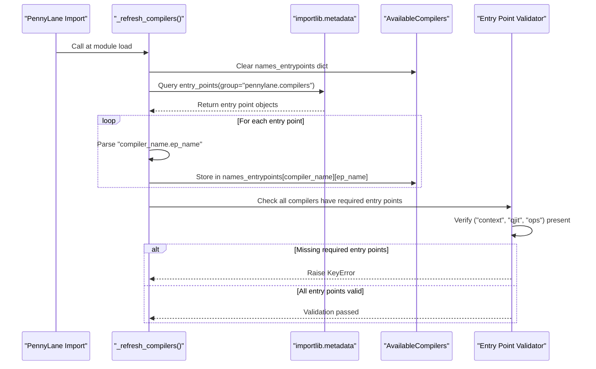
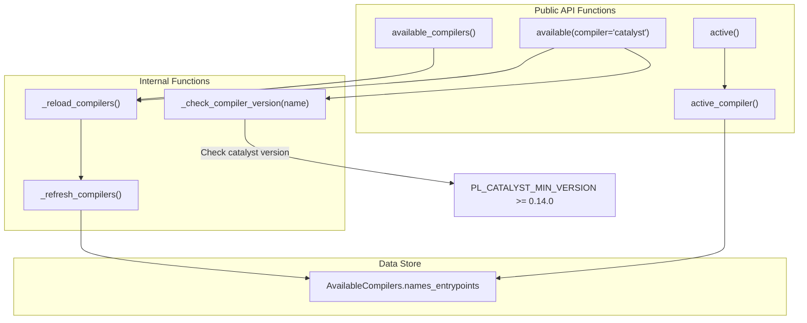
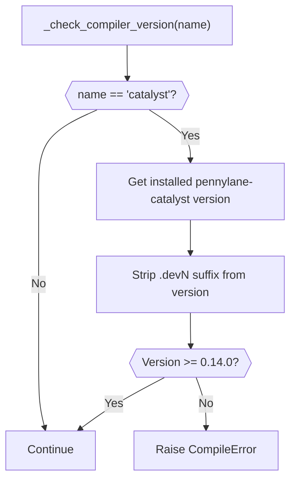
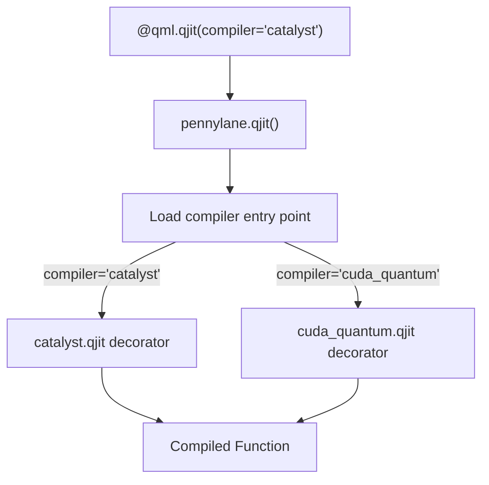
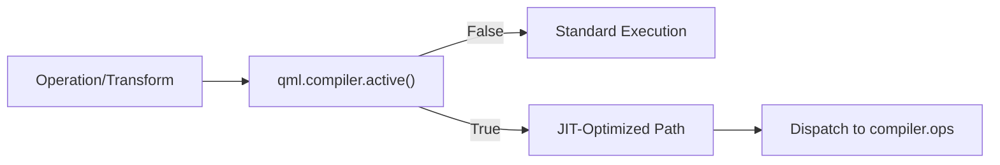
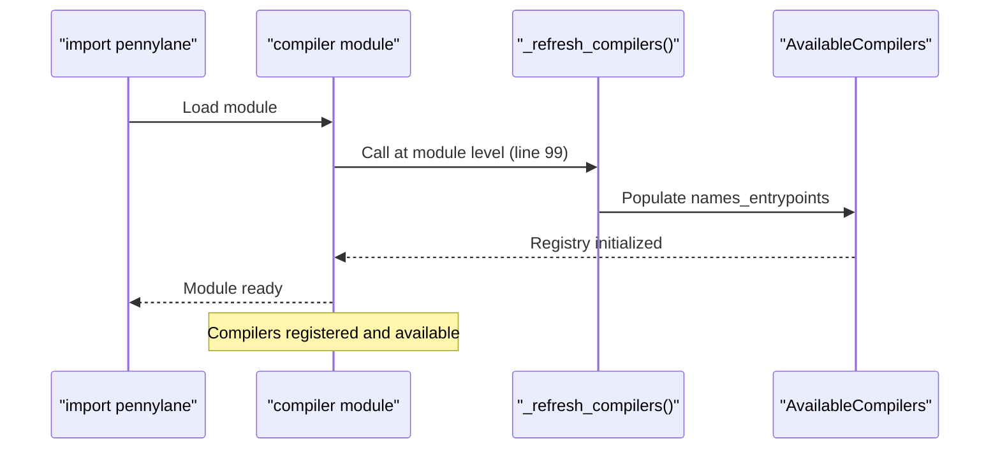

<!-- source: DeepWiki mcp.deepwiki.com · repo PennyLaneAI/pennylane · page 4.4 JIT Compilation with Catalyst · fetched 2026-10-21 -->

# JIT Compilation with Catalyst

<details>
<summary>Relevant source files</summary>

The following files were used as context for generating this wiki page:

- [.pylintrc](.pylintrc)
- [doc/code/qml.rst](doc/code/qml.rst)
- [doc/development/guide/documentation.rst](doc/development/guide/documentation.rst)
- [doc/development/guide/installation.rst](doc/development/guide/installation.rst)
- [doc/introduction/compiling_workflows.rst](doc/introduction/compiling_workflows.rst)
- [doc/requirements.txt](doc/requirements.txt)
- [pennylane/compiler/__init__.py](pennylane/compiler/__init__.py)
- [pennylane/compiler/compiler.py](pennylane/compiler/compiler.py)
- [pennylane/numpy/random.py](pennylane/numpy/random.py)
- [pyproject.toml](pyproject.toml)
- [setup.py](setup.py)
- [tests/.pylintrc](tests/.pylintrc)

</details>


## Purpose and Scope

This document describes PennyLane's compiler plugin system, which enables just-in-time (JIT) compilation of hybrid quantum-classical workflows. The system provides infrastructure for integrating external compilers through a standardized entry points interface, with Catalyst as the primary supported compiler and CUDA Quantum as an alternative.

For information about quantum circuit transformations (compile-time optimizations without JIT), see section [3](#3). For device-specific compilation features, see section [4.1](#4.1).

**Sources:** [pennylane/compiler/__init__.py:1-259](), [doc/introduction/compiling_workflows.rst:1-181]()

---

## Compiler Plugin Architecture

### Entry Points Registration System

PennyLane discovers compiler packages through Python's `entry_points` metadata system. Compiler packages must register themselves under the `pennylane.compilers` group with three required entry points:

| Entry Point | Purpose | Example Path |
|------------|---------|--------------|
| `compiler_name.context` | Compilation evaluation context manager with `is_tracing()` method | `catalyst.context` |
| `compiler_name.qjit` | JIT decorator function with signature `qjit(fn, *args, **kwargs)` | `catalyst.qjit` |
| `compiler_name.ops` | Compiler-specific operations module (e.g., `cond`, `measure`, `adjoint`) | `catalyst.ops` |

**Sources:** [pennylane/compiler/__init__.py:193-214](), [pennylane/compiler/compiler.py:30-48]()

### Entry Points Discovery Flow



**Sources:** [pennylane/compiler/compiler.py:62-99]()

---

## AvailableCompilers Data Structure

The `AvailableCompilers` dataclass serves as the central registry for installed compiler packages:

```mermaid
classDiagram
    class AvailableCompilers {
        +tuple entrypoints_interface
        +defaultdict names_entrypoints
    }
    
    class EntryPointStructure {
        <<dict>>
        "catalyst": {"context": EntryPoint, "qjit": EntryPoint, "ops": EntryPoint}
        "cuda_quantum": {"context": EntryPoint, "qjit": EntryPoint, "ops": EntryPoint}
    }
    
    AvailableCompilers --> EntryPointStructure : stores
    
    note for AvailableCompilers "entrypoints_interface = ('context', 'qjit', 'ops')"
```

The `names_entrypoints` dictionary maps compiler names to their entry points:
- **Key:** Compiler name (e.g., `"catalyst"`, `"cuda_quantum"`)
- **Value:** Dictionary mapping entry point names to `EntryPoint` objects

**Sources:** [pennylane/compiler/compiler.py:30-48]()

---

## Compiler Detection Functions

### Compiler Discovery and Availability

PennyLane provides four public functions for compiler detection and management:



**Sources:** [pennylane/compiler/compiler.py:114-248]()

### Function Details

#### `available_compilers() -> list[str]`

Returns a list of installed and compatible compiler names. This function triggers a full reload of the metadata system.

```python
# Example usage
>>> qml.compiler.available_compilers()
['catalyst']
```

**Implementation:** Calls `_reload_compilers()` to refresh package discovery, then returns keys from `AvailableCompilers.names_entrypoints`.

**Sources:** [pennylane/compiler/compiler.py:114-133]()

---

#### `available(compiler="catalyst") -> bool`

Checks if a specific compiler is available. Only reloads metadata if the compiler is not already in the registry (lazy loading).

```python
# Example usage
>>> qml.compiler.available("catalyst")
True
>>> qml.compiler.available("nonexistent_compiler")
False
```

**Implementation:** Checks if `compiler` exists in `AvailableCompilers.names_entrypoints`. If not found, calls `_reload_compilers()` before returning result.

**Sources:** [pennylane/compiler/compiler.py:136-167]()

---

#### `active_compiler() -> str | None`

Determines which compiler is currently active in a JIT evaluation context by checking each registered compiler's tracing status.

```python
# Example usage
@qml.qjit
def circuit(x):
    compiler_name = qml.compiler.active_compiler()
    # Returns "catalyst" inside qjit context
    return x
```

**Implementation:** Iterates through registered compilers, loads their `context` entry point, and calls `is_tracing()`. Returns the first compiler name where `is_tracing()` returns `True`, or `None` if no compiler is active.

**Sources:** [pennylane/compiler/compiler.py:169-213]()

---

#### `active() -> bool`

Returns `True` if any compiler is currently active. Convenience wrapper around `active_compiler()`.

```python
# Example usage
@qml.qjit
def circuit(x):
    if qml.compiler.active():
        # Execution path when JIT compiled
        pass
    return x
```

**Sources:** [pennylane/compiler/compiler.py:215-248]()

---

## Version Management

### Catalyst Version Requirements

PennyLane enforces minimum version requirements for installed compilers. For Catalyst, the minimum version is defined as:

```python
PL_CATALYST_MIN_VERSION = Version("0.14.0")
```

**Version Checking Process:**



The version check is performed in `_check_compiler_version()` and raises a `CompileError` if the installed version is below the minimum requirement.

**Sources:** [pennylane/compiler/compiler.py:50-60](), [pennylane/compiler/compiler.py:27]()

---

## The qjit Decorator

The `qjit` decorator is the user-facing API for JIT compilation. PennyLane provides a wrapper that routes to the appropriate compiler implementation.

### Decorator Routing Mechanism



**Implementation Requirements:** The actual `qjit` decorator is provided by the compiler package (e.g., `pennylane-catalyst`). Each compiler's `qjit` implementation must support being called with or without a function argument to enable both usage patterns:

```python
@qml.qjit
def circuit(x):
    ...

@qml.qjit(autograph=True, compiler="catalyst")
def circuit(x):
    ...
```

**Sources:** [pennylane/compiler/__init__.py:229-254]()

---

## Supported Compilers

### Catalyst

**Primary Compiler:** Catalyst is the main hybrid quantum-classical compiler supported by PennyLane. It provides:

- Full workflow JIT compilation (quantum + classical)
- Support for complex control flow (if statements, loops)
- Measurement feedback support
- End-to-end autodifferentiation
- AutoGraph for capturing imperative Python control flow

**Supported Devices:**
- `lightning.qubit`
- `lightning.kokkos`
- `lightning.gpu`
- `braket.aws.qubit`

**Not supported:** `default.qubit`

**Installation:**
```bash
pip install pennylane-catalyst
```

**Entry Points Registered:**
- `catalyst.context`
- `catalyst.qjit`
- `catalyst.ops`

**Sources:** [pennylane/compiler/__init__.py:25-38](), [doc/introduction/compiling_workflows.rst:20-37]()

---

### CUDA Quantum

**Alternative Compiler:** CUDA Quantum is NVIDIA's hybrid compiler toolchain with GPU acceleration support.

**Supported Devices:**
- `softwareq.qpp` (C++ statevector simulator)
- `nvidia.custatevec` (GPU simulator with multi-GPU support)
- `nvidia.cutensornet` (GPU tensor network simulator with MPS support)

**Limitations:** CUDA Quantum compilation has reduced feature parity compared to Catalyst:
- No AutoGraph support
- No control flow support
- No differentiation support
- Limited measurement statistics (no probabilities or variance)

**Installation:**
```bash
pip install pennylane-catalyst cuda_quantum
```

**Usage:**
```python
dev = qml.device("softwareq.qpp", wires=2)

@qml.qjit(compiler="cuda_quantum")
@qml.qnode(dev)
def circuit(x):
    qml.RX(x[0], wires=0)
    qml.CNOT(wires=[0, 1])
    return qml.expval(qml.Y(0))
```

**Sources:** [doc/introduction/compiling_workflows.rst:128-168](), [pennylane/compiler/__init__.py:84-85]()

---

## Compiler Package Requirements

### Creating a Compatible Compiler

To create a compiler compatible with PennyLane, package maintainers must:

1. **Define entry points** in `pyproject.toml` or `setup.py` under group `pennylane.compilers`:

```toml
[project.entry-points."pennylane.compilers"]
"mycompiler.context" = "mycompiler.context:EvaluationContext"
"mycompiler.qjit" = "mycompiler.api:qjit"
"mycompiler.ops" = "mycompiler.operations"
```

2. **Implement context manager** with `is_tracing()` method:

```python
class EvaluationContext:
    @staticmethod
    def is_tracing() -> bool:
        # Return True if inside compilation context
        ...
```

3. **Implement qjit decorator** with proper signature:

```python
def qjit(fn=None, **kwargs):
    if fn is not None:
        return compile_fn(fn, **kwargs)
    
    def wrapper_fn(fn):
        return compile_fn(fn, **kwargs)
    
    return wrapper_fn
```

4. **Provide operations module** with compiler-specific implementations of operations like `cond`, `measure`, `adjoint`.

**Sources:** [pennylane/compiler/__init__.py:186-254]()

---

## Integration with PennyLane Workflow

### Compiler Context Detection

PennyLane components can detect JIT compilation context to modify behavior:



Operations can use `qml.compiler.active()` or `qml.compiler.active_compiler()` to branch between standard and JIT-optimized code paths. This enables compiler-specific optimizations without breaking compatibility with non-JIT execution.

**Example use case:** Conditional branching that needs runtime vs. compile-time evaluation:

```python
def operation():
    if qml.compiler.active_compiler() == "catalyst":
        # Use Catalyst-specific implementation
        return catalyst_optimized_path()
    # Standard PennyLane implementation
    return standard_path()
```

**Sources:** [pennylane/compiler/compiler.py:169-213](), [pennylane/compiler/__init__.py:169-203]()

---

## Dependencies and Configuration

### Core Dependencies

The compiler module requires:
- `packaging>=0.0`: For version comparison (`Version`, `SpecifierSet`)
- `importlib.metadata`: For entry points discovery (standard library Python 3.11+)

**Sources:** [pennylane/compiler/compiler.py:16-23](), [pyproject.toml:10-27]()

### Python Version Compatibility

The entry points discovery system handles Python version differences:
- **Python 3.9:** Uses `defaultdict(dict, metadata.entry_points())["pennylane.compilers"]`
- **Python 3.10+:** Uses `metadata.entry_points(group="pennylane.compilers")`

This compatibility layer is implemented in `_refresh_compilers()`.

**Sources:** [pennylane/compiler/compiler.py:70-75]()

---

## Internal Implementation Details

### Reload vs Refresh Distinction

PennyLane maintains two internal functions for compiler discovery:

**`_refresh_compilers()`:**
- Scans installed packages for entry points
- Updates `AvailableCompilers.names_entrypoints`
- Validates entry point interface
- Called during module import

**`_reload_compilers()`:**
- Reloads `importlib.metadata` module (expensive operation)
- Then calls `_refresh_compilers()`
- Used when checking for newly installed compilers

**Performance Note:** Reloading metadata can be slow on systems with many installed packages, so `available()` uses lazy loading to minimize reload frequency.

**Sources:** [pennylane/compiler/compiler.py:62-112]()

### Initialization Sequence



The `_refresh_compilers()` function is called at module load time to populate the registry with currently installed compilers.

**Sources:** [pennylane/compiler/compiler.py:97-99]()

---

