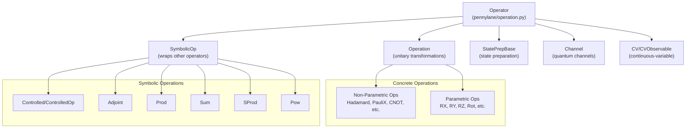
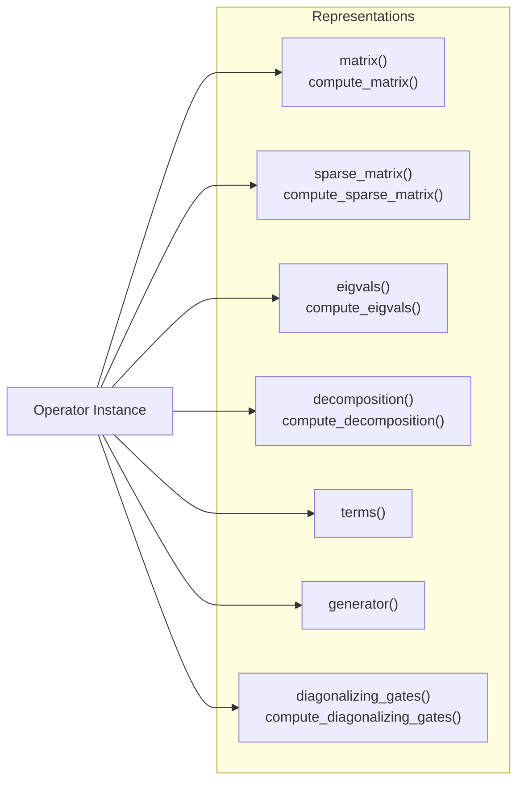
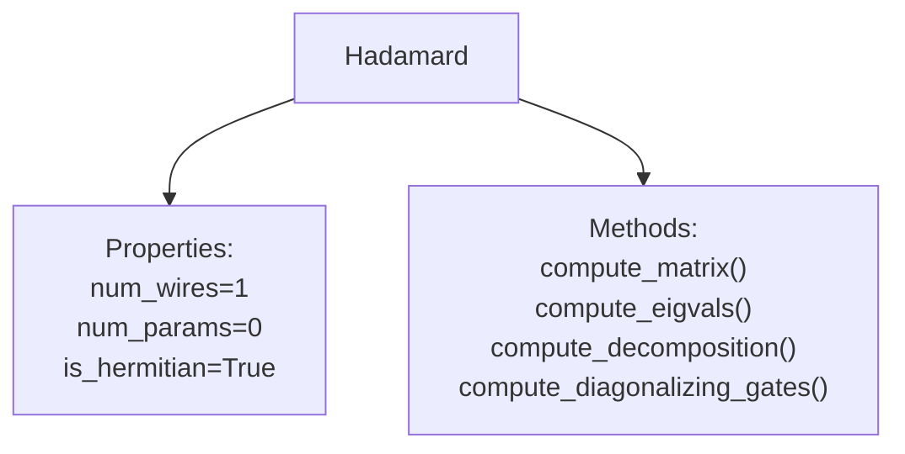
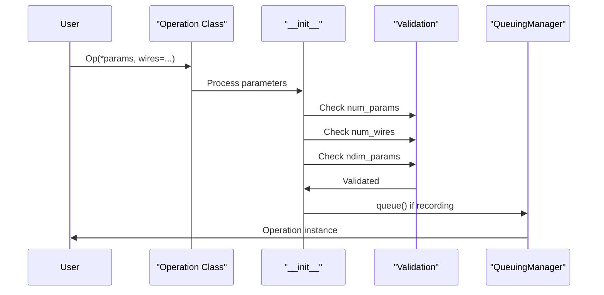
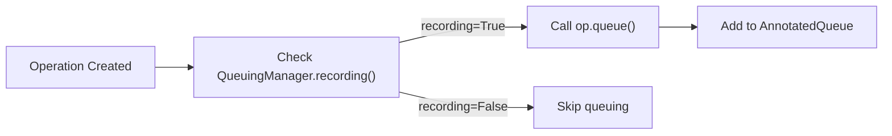
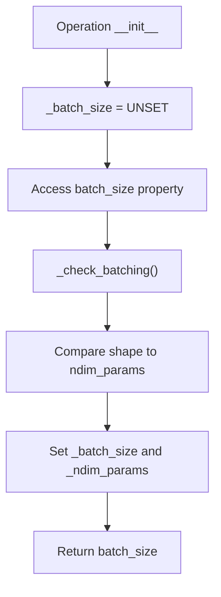
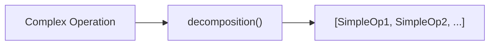
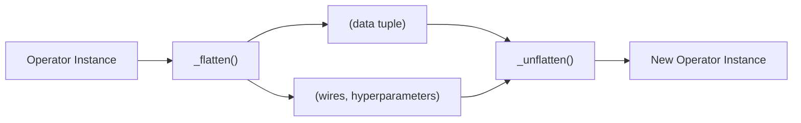
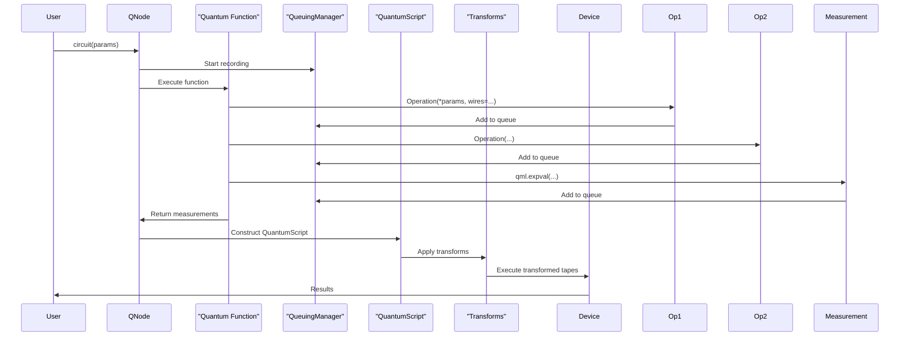

<!-- source: DeepWiki mcp.deepwiki.com · repo PennyLaneAI/pennylane · page 5 Quantum Operations · fetched 2026-10-21 -->

# Quantum Operations

<details>
<summary>Relevant source files</summary>

The following files were used as context for generating this wiki page:

- [doc/development/deprecations.rst](doc/development/deprecations.rst)
- [doc/releases/changelog-dev.md](doc/releases/changelog-dev.md)
- [pennylane/__init__.py](pennylane/__init__.py)
- [pennylane/operation.py](pennylane/operation.py)
- [pennylane/ops/identity.py](pennylane/ops/identity.py)
- [pennylane/ops/op_math/adjoint.py](pennylane/ops/op_math/adjoint.py)
- [pennylane/ops/op_math/controlled.py](pennylane/ops/op_math/controlled.py)
- [pennylane/ops/op_math/controlled_decompositions.py](pennylane/ops/op_math/controlled_decompositions.py)
- [pennylane/ops/op_math/controlled_ops.py](pennylane/ops/op_math/controlled_ops.py)
- [pennylane/ops/qubit/attributes.py](pennylane/ops/qubit/attributes.py)
- [pennylane/ops/qubit/non_parametric_ops.py](pennylane/ops/qubit/non_parametric_ops.py)
- [pennylane/ops/qubit/parametric_ops_multi_qubit.py](pennylane/ops/qubit/parametric_ops_multi_qubit.py)
- [pennylane/ops/qubit/parametric_ops_single_qubit.py](pennylane/ops/qubit/parametric_ops_single_qubit.py)
- [pennylane/ops/qubit/special_unitary.py](pennylane/ops/qubit/special_unitary.py)
- [pennylane/workflow/__init__.py](pennylane/workflow/__init__.py)
- [pennylane/workflow/_setup_transform_program.py](pennylane/workflow/_setup_transform_program.py)
- [pennylane/workflow/construct_execution_config.py](pennylane/workflow/construct_execution_config.py)
- [pennylane/workflow/execution.py](pennylane/workflow/execution.py)
- [pennylane/workflow/get_compile_pipeline.py](pennylane/workflow/get_compile_pipeline.py)
- [pennylane/workflow/qnode.py](pennylane/workflow/qnode.py)
- [pennylane/workflow/resolution.py](pennylane/workflow/resolution.py)
- [tests/ops/op_math/test_adjoint.py](tests/ops/op_math/test_adjoint.py)
- [tests/ops/op_math/test_controlled.py](tests/ops/op_math/test_controlled.py)
- [tests/ops/op_math/test_controlled_decompositions.py](tests/ops/op_math/test_controlled_decompositions.py)
- [tests/ops/op_math/test_controlled_ops.py](tests/ops/op_math/test_controlled_ops.py)
- [tests/ops/qubit/test_attributes.py](tests/ops/qubit/test_attributes.py)
- [tests/ops/qubit/test_non_parametric_ops.py](tests/ops/qubit/test_non_parametric_ops.py)
- [tests/ops/qubit/test_parametric_ops.py](tests/ops/qubit/test_parametric_ops.py)
- [tests/ops/qubit/test_special_unitary.py](tests/ops/qubit/test_special_unitary.py)
- [tests/ops/test_identity.py](tests/ops/test_identity.py)
- [tests/test_operation.py](tests/test_operation.py)
- [tests/test_qnode.py](tests/test_qnode.py)
- [tests/test_qnode_legacy.py](tests/test_qnode_legacy.py)
- [tests/workflow/interfaces/execute/test_execute.py](tests/workflow/interfaces/execute/test_execute.py)
- [tests/workflow/test_get_compile_pipeline.py](tests/workflow/test_get_compile_pipeline.py)
- [tests/workflow/test_resolve_execution_config.py](tests/workflow/test_resolve_execution_config.py)

</details>


## Purpose and Scope

This document describes PennyLane's quantum operations system, which provides the fundamental building blocks for constructing quantum circuits. It covers the `Operator` and `Operation` base classes, the categories of quantum operations (non-parametric, parametric, and symbolic), and how operations interact with the queuing system and circuit execution pipeline.

For information about:
- How operations are used within QNode execution workflows, see [QNode System and Execution Workflow](#2.3)
- Circuit-level transformations and decomposition strategies, see [Transform and Compilation System](#3)
- Symbolic operator composition and arithmetic, see [Operator Arithmetic](#5.3) and [Symbolic Operations and Composition](#5.4)
- Resource tracking for operations, see [Resource Estimation](#5.5)

---

## Operator Class Hierarchy

PennyLane's operation system is built on a two-level class hierarchy rooted in the `Operator` base class.



**Sources:** [pennylane/operation.py:393-676](), [pennylane/ops/qubit/non_parametric_ops.py:1-50](), [pennylane/ops/op_math/controlled.py:15-174]()

---

## The Operator Base Class

The `Operator` class serves as the foundation for all quantum operations in PennyLane. It defines the interface and common functionality for representing quantum operations, observables, and channels.

### Core Properties

| Property | Type | Description |
|----------|------|-------------|
| `wires` | `Wires` | Wire labels the operator acts on |
| `data` | `tuple` | Trainable parameters as tensors |
| `parameters` | `list` | Alias for `data` |
| `hyperparameters` | `dict` | Non-trainable configuration parameters |
| `num_params` | `int` | Expected number of parameters |
| `num_wires` | `int or None` | Expected number of wires (None = any) |
| `ndim_params` | `tuple` | Expected dimensionality of each parameter |
| `batch_size` | `int or None` | Broadcasting batch size |

### Operator Representations

Operators can be represented in multiple ways, each with a static `compute_*` method and an instance method:



**Sources:** [pennylane/operation.py:393-676](), [pennylane/operation.py:1100-1450]()

### The Operation Subclass

`Operation` inherits from `Operator` and represents unitary quantum operations (gates). It adds functionality specific to quantum gates:

- **Gradient support**: `grad_method` property indicates differentiation capability (`"A"` for analytic, `"F"` for finite-difference, `None` for non-differentiable)
- **Control and adjoint**: Methods to create controlled and adjoint versions
- **Single-qubit rotations**: `single_qubit_rot_angles()` for conversion to rotation basis
- **Power operations**: `pow(z)` for integer/fractional powers

**Sources:** [pennylane/operation.py:1850-2150]()

---

## Categories of Operations

### Non-Parametric Operations

Non-parametric operations have no trainable parameters and include fundamental gates:

| Operation Class | Matrix Size | Wires | Description |
|----------------|-------------|-------|-------------|
| `Hadamard` (alias `H`) | 2×2 | 1 | Hadamard gate |
| `PauliX` (alias `X`) | 2×2 | 1 | Pauli-X gate |
| `PauliY` (alias `Y`) | 2×2 | 1 | Pauli-Y gate |
| `PauliZ` (alias `Z`) | 2×2 | 1 | Pauli-Z gate |
| `S` | 2×2 | 1 | Phase gate |
| `T` | 2×2 | 1 | T gate |
| `CNOT` | 4×4 | 2 | Controlled-NOT |
| `SWAP` | 4×4 | 2 | SWAP gate |
| `Toffoli` | 8×8 | 3 | Toffoli (CCNOT) gate |
| `CSWAP` | 8×8 | 3 | Controlled-SWAP |

These operations are defined in [pennylane/ops/qubit/non_parametric_ops.py:50-800]() and provide static matrix definitions, decompositions, and diagonalizing gates.

**Example structure:**



**Sources:** [pennylane/ops/qubit/non_parametric_ops.py:50-220]()

### Parametric Operations

Parametric operations depend on one or more trainable parameters:

| Operation Class | Parameters | Wires | Description |
|----------------|-----------|-------|-------------|
| `RX` | `phi` (rotation angle) | 1 | X-rotation |
| `RY` | `phi` | 1 | Y-rotation |
| `RZ` | `phi` | 1 | Z-rotation |
| `Rot` | `phi, theta, omega` | 1 | General single-qubit rotation |
| `PhaseShift` | `phi` | 1 | Phase shift |
| `IsingXX` | `phi` | 2 | XX Ising coupling |
| `IsingYY` | `phi` | 2 | YY Ising coupling |
| `IsingZZ` | `phi` | 2 | ZZ Ising coupling |
| `CRX`, `CRY`, `CRZ` | `phi` | 2 | Controlled rotations |
| `MultiRZ` | `theta` | N | Multi-qubit Z-rotation |

These operations support:
- **Parameter broadcasting**: Batch execution with multiple parameter values
- **Gradient computation**: Analytic or finite-difference gradients
- **Generator representation**: For parameter-shift rules

**Sources:** [pennylane/ops/qubit/parametric_ops_single_qubit.py:1-1500](), [pennylane/ops/qubit/parametric_ops_multi_qubit.py:1-500]()

### Symbolic Operations

Symbolic operations wrap and modify other operators without immediate evaluation. See [Symbolic Operations and Composition](#5.4) for details.

**Sources:** [pennylane/ops/op_math/controlled.py:48-174](), [pennylane/ops/op_math/adjoint.py:32-46]()

---

## Operation Initialization and Queuing

### Initialization Process

When an operation is instantiated, the following steps occur:



**Key validation checks:**
1. **Parameter count**: Must match `num_params` if specified
2. **Wire count**: Must match `num_wires` if specified  
3. **Parameter dimensions**: Must match `ndim_params` if specified
4. **Unique wires**: No duplicate wires allowed

**Sources:** [pennylane/operation.py:704-800](), [pennylane/operation.py:850-950]()

### Queuing System Integration

Operations are automatically added to the active `QueuingManager` context when instantiated:



Operations can be explicitly removed from the queue using `QueuingManager.remove(op)`. This is commonly done when operations are composed into symbolic operations.

**Sources:** [pennylane/operation.py:970-1020](), [pennylane/queuing.py:1-200]()

---

## Parameter Broadcasting

Operations support parameter broadcasting for efficient batch execution. When parameters have an extra leading dimension, the operation processes multiple parameter sets simultaneously.

### Broadcasting Properties

| Property | Description |
|----------|-------------|
| `batch_size` | Size of the broadcasting dimension (None if not broadcasted) |
| `ndim_params` | Expected number of dimensions per parameter (without broadcasting) |
| `_ndim_params` | Actual number of dimensions (with broadcasting if applicable) |

### Broadcasting Detection



### Example Broadcasting Usage

For an operation with `ndim_params = (0,)` (scalar parameter):
- Non-broadcast: `RX(0.5, wires=0)` → `batch_size = None`
- Broadcast: `RX([0.1, 0.2, 0.3], wires=0)` → `batch_size = 3`

Matrix representations automatically handle the broadcasting dimension:
- Non-broadcast matrix shape: `(2, 2)` for single qubit
- Broadcast matrix shape: `(batch_size, 2, 2)`

**Sources:** [pennylane/operation.py:344-420](), [pennylane/operation.py:1700-1850]()

---

## Operator Representations and Methods

### Matrix Computation

Operations provide matrix representations through two methods:

```python
# Static method (no wire information)
matrix = Op.compute_matrix(*parameters, **hyperparameters)

# Instance method (accounts for global wire order)
matrix = op.matrix(wire_order=global_wires)
```

The instance method uses `qml.math.expand_matrix()` to place the operator's matrix in the correct position within the full Hilbert space.

**Sources:** [pennylane/operation.py:1100-1250]()

### Decomposition

Decompositions express an operation as a sequence of simpler operations:



Decompositions are used by:
- **Devices**: To execute operations they don't natively support
- **Transforms**: For circuit simplification and optimization
- **Resource estimation**: To count primitive gate operations

The graph-based decomposition system (see [Circuit Decomposition](#3.3)) provides advanced decomposition strategies with resource tracking.

**Sources:** [pennylane/operation.py:1350-1450]()

### Adjoint and Controlled Variants

Operations can generate modified versions:

```python
# Create adjoint (inverse) operation
adj_op = op.adjoint()

# Create controlled operation
ctrl_op = op.ctrl(control_wires=[...], control_values=[...])

# Or using functions
adj_op = qml.adjoint(op)
ctrl_op = qml.ctrl(op, control=[...])
```

Some operations provide custom implementations for efficiency, while others use default decomposition-based approaches.

**Sources:** [pennylane/operation.py:1550-1700](), [pennylane/ops/op_math/controlled.py:48-174](), [pennylane/ops/op_math/adjoint.py:32-80]()

---

## Operator Pytree Structure

Operations are registered as JAX pytrees, enabling:
- Automatic differentiation through operation parameters
- Compatibility with JAX transformations (`jit`, `vmap`, `grad`)
- Serialization and deserialization

### Flatten and Unflatten



The default implementation:
- **Data (leaves)**: Trainable parameters from `op.data`
- **Metadata (structure)**: Wires and hyperparameters as hashable tuples

Custom operators can override `_flatten` and `_unflatten` for specialized serialization.

**Sources:** [pennylane/operation.py:361-389](), [pennylane/pytrees.py:1-200]()

---

## Operation Lifecycle in QNode Execution



Operations flow through the execution pipeline where they may be:
1. **Validated**: Checked for compatibility with device and diff_method
2. **Transformed**: Decomposed or modified by transform passes
3. **Executed**: Applied by the device backend

**Sources:** [pennylane/workflow/qnode.py:400-600](), [pennylane/tape/qscript.py:1-300]()

---

## Key Files and Code Locations

| Component | File Path |
|-----------|-----------|
| Operator base class | [pennylane/operation.py:393-2200]() |
| Non-parametric operations | [pennylane/ops/qubit/non_parametric_ops.py:1-3000]() |
| Single-qubit parametric ops | [pennylane/ops/qubit/parametric_ops_single_qubit.py:1-2000]() |
| Multi-qubit parametric ops | [pennylane/ops/qubit/parametric_ops_multi_qubit.py:1-3000]() |
| Controlled operations | [pennylane/ops/op_math/controlled.py:1-1000]() |
| Adjoint operations | [pennylane/ops/op_math/adjoint.py:1-500]() |
| Identity operation | [pennylane/ops/identity.py:1-200]() |
| Operation attributes | [pennylane/ops/qubit/attributes.py:1-300]() |

**Sources:** [pennylane/__init__.py:94-96](), [pennylane/ops/__init__.py:1-100]()

---

