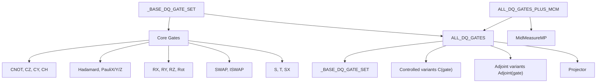
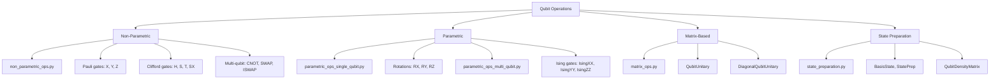
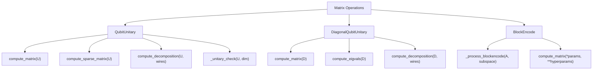
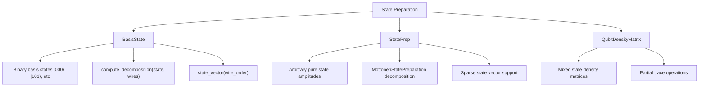
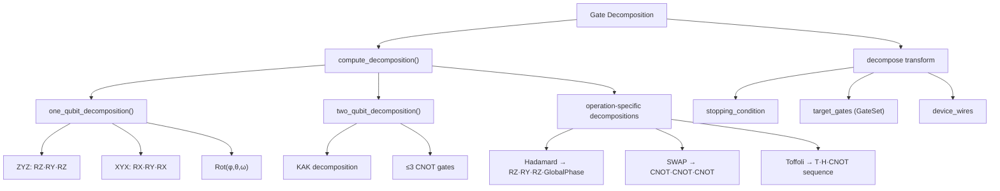
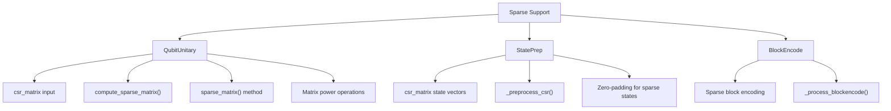
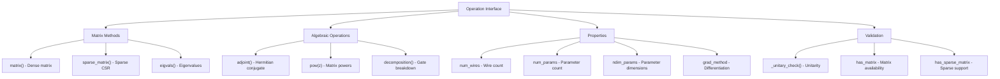
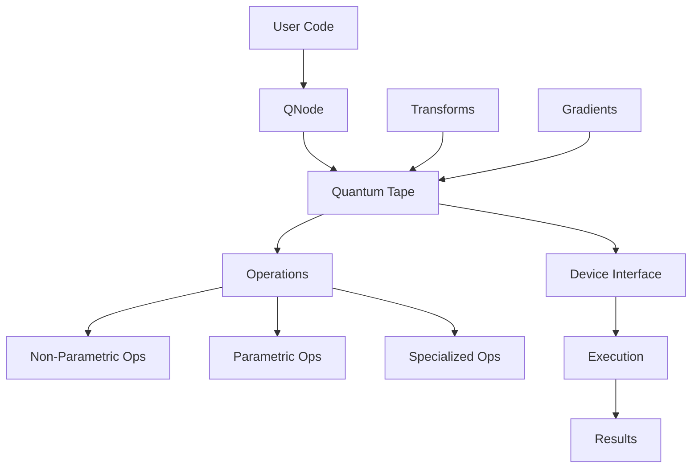

<!-- source: DeepWiki mcp.deepwiki.com · repo PennyLaneAI/pennylane · page 5.1 Basic Qubit Operations · fetched 2026-10-21 -->

# Basic Qubit Operations

<details>
<summary>Relevant source files</summary>

The following files were used as context for generating this wiki page:

- [.github/CHANGELOG.md](.github/CHANGELOG.md)
- [doc/introduction/operations.rst](doc/introduction/operations.rst)
- [pennylane/devices/default_mixed.py](pennylane/devices/default_mixed.py)
- [pennylane/devices/default_qubit.py](pennylane/devices/default_qubit.py)
- [pennylane/devices/tests/test_gates.py](pennylane/devices/tests/test_gates.py)
- [pennylane/ops/qubit/__init__.py](pennylane/ops/qubit/__init__.py)
- [tests/devices/test_default_mixed.py](tests/devices/test_default_mixed.py)
- [tests/gate_data.py](tests/gate_data.py)

</details>


This page documents the standard gate sets and fundamental qubit operations in PennyLane. These operations are organized into non-parametric gates (fixed operations) and parametric gates (operations that take numerical parameters). Understanding these basic operations is essential for building quantum circuits.

For controlled versions of these operations, see page 5.2. For operator arithmetic and symbolic operations, see page 5.3.

## Standard Gate Sets in PennyLane

PennyLane devices define standard gate sets that specify which operations are natively supported. The `default.qubit` device uses a base gate set that other operations decompose into.

**DefaultQubit Gate Set Hierarchy**


Sources: [pennylane/devices/default_qubit.py:89-135]()

The base gate set `_BASE_DQ_GATE_SET` contains 22 fundamental operations that `default.qubit` implements natively. The complete gate set `ALL_DQ_GATES` includes controlled and adjoint variants of all base gates.

**Base Gate Set Definition**

| Category | Gates |
|----------|-------|
| Single-qubit non-parametric | `Hadamard`, `PauliX`, `PauliY`, `PauliZ`, `S`, `T`, `SX`, `Identity` |
| Single-qubit parametric | `RX`, `RY`, `RZ`, `PhaseShift`, `GlobalPhase` |
| Two-qubit non-parametric | `CNOT`, `CZ`, `CY`, `SWAP`, `ISWAP` |
| Two-qubit parametric | `CRX`, `CRY`, `CRZ`, `CRot`, `ControlledPhaseShift`, `IsingXX`, `IsingXY`, `IsingYY`, `IsingZZ`, `PSWAP` |
| Multi-qubit | `CSWAP`, `Toffoli`, `MultiControlledX`, `MultiRZ` |

Sources: [pennylane/devices/default_qubit.py:89-122](), [pennylane/ops/qubit/__init__.py:88-147]()

## Operation Categories

Qubit operations in PennyLane are organized into distinct categories based on their functionality and parameter requirements.

**Operation Organization**


Sources: [pennylane/ops/qubit/__init__.py:15-30](), [pennylane/devices/tests/test_gates.py:40-119]()

## Matrix Operations

Matrix operations allow applying arbitrary unitary transformations and are fundamental to quantum computing implementations.

**Matrix Operation Types**


Sources: [pennylane/ops/qubit/matrix_ops.py:89-343](), [pennylane/ops/qubit/matrix_ops.py:412-636](), [pennylane/ops/qubit/matrix_ops.py:684-875]()

### QubitUnitary

The `QubitUnitary` class applies arbitrary unitary matrices to qubits and supports both dense and sparse matrix representations.

| Method | Description |
|--------|-------------|
| `compute_matrix(U)` | Returns the unitary matrix U as canonical matrix |
| `compute_sparse_matrix(U)` | Returns sparse matrix representation for large matrices |
| `compute_decomposition(U, wires)` | Decomposes unitary into elementary gates |
| `_unitary_check(U, dim)` | Validates unitarity of input matrix |

**Key Features:**
- Supports dense and sparse matrices via `scipy.sparse.csr_matrix`
- Automatic decomposition for 1-qubit (uses Euler rotations) and 2-qubit unitaries
- Unitary validation with configurable tolerance
- Matrix power operations via `pow(z)` method

```python
# Apply custom 2x2 unitary matrix
U = np.array([[0.98877108+0.j, 0.-0.14943813j], 
              [0.-0.14943813j, 0.98877108+0.j]])
qml.QubitUnitary(U, wires=0)

# Sparse matrix for large systems
sparse_U = csr_matrix(np.eye(1024))  # 10-qubit identity
qml.QubitUnitary(sparse_U, wires=range(10))
```

Sources: [pennylane/ops/qubit/matrix_ops.py:89-343](), [tests/ops/qubit/test_matrix_ops.py:35-221]()

### DiagonalQubitUnitary

The `DiagonalQubitUnitary` class efficiently represents diagonal unitary matrices using only the diagonal entries.

| Method | Description |
|--------|-------------|
| `compute_matrix(D)` | Constructs full matrix from diagonal entries |
| `compute_eigvals(D)` | Returns eigenvalues (same as diagonal) |
| `compute_decomposition(D, wires)` | Decomposes into `SelectPauliRot` and `RZ` gates |

**Implementation Details:**
- Stores only diagonal elements, reducing memory for large systems
- Automatic decomposition using Shende et al. algorithm
- Recursive decomposition: n-qubit diagonal → (n-1)-qubit diagonal + `SelectPauliRot`

```python
# Create diagonal unitary from phase array
phases = np.exp(1j * np.array([0.4, 2.1, 0.5, 1.8]))
qml.DiagonalQubitUnitary(phases, wires=[0, 1])
```

Sources: [pennylane/ops/qubit/matrix_ops.py:412-636](), [tests/ops/qubit/test_matrix_ops.py:35-95]()

### BlockEncode

The `BlockEncode` operation constructs a unitary that encodes an arbitrary matrix in its top-left block.

**Block Encoding Structure:**
```
U(A) = [[A,              √(I-AA†)    ],
        [√(I-A†A),       -A†         ]]
```

| Method | Description |
|--------|-------------|
| `compute_matrix(*params, **hyperparams)` | Constructs the full block-encoded matrix |
| `compute_sparse_matrix(*params, **hyperparams)` | Sparse version for large matrices |

Sources: [pennylane/ops/qubit/matrix_ops.py:684-875]()

## State Preparation Operations

State preparation operations initialize qubits in specific quantum states and are essential for quantum algorithm implementation.

**State Preparation Hierarchy**


Sources: [pennylane/ops/qubit/state_preparation.py:40-187](), [pennylane/ops/qubit/state_preparation.py:216-598](), [pennylane/ops/qubit/state_preparation.py:601-650]()

### BasisState

The `BasisState` operation prepares computational basis states using binary arrays or integers.

| Method | Description |
|--------|-------------|
| `compute_decomposition(state, wires)` | Decomposes into `PauliX` gates for |1⟩ qubits |
| `state_vector(wire_order)` | Returns statevector representation |

**Input Formats:**
- Binary array: `[0, 1, 0]` for |010⟩
- Integer: `5` for |101⟩ (binary representation)

```python
# Prepare |110⟩ state using binary array
qml.BasisState([1, 1, 0], wires=[0, 1, 2])

# Prepare |5⟩ = |101⟩ state using integer
qml.BasisState(5, wires=[0, 1, 2])
```

Sources: [pennylane/ops/qubit/state_preparation.py:40-187](), [tests/ops/qubit/test_state_prep.py:78-160]()

### StatePrep

The `StatePrep` operation prepares arbitrary pure state amplitudes and supports both dense and sparse representations.

| Method | Description |
|--------|-------------|
| `compute_decomposition(state, wires)` | Uses `MottonenStatePreparation` decomposition |
| `_preprocess(state, wires, ...)` | Validates and normalizes state vector |
| `_preprocess_csr(state, wires, ...)` | Preprocessing for sparse states |

**Key Features:**
- Automatic normalization via `normalize=True` parameter
- Padding support via `pad_with` parameter  
- Sparse matrix support using `scipy.sparse.csr_matrix`
- Differentiable in most ML frameworks

```python
# Prepare equal superposition state
state = [0.5, 0.5, 0.5, 0.5]
qml.StatePrep(state, wires=[0, 1])

# Prepare sparse state vector
sparse_state = sp.sparse.csr_matrix([0, 0, 1, 0])
qml.StatePrep(sparse_state, wires=[0, 1])
```

Sources: [pennylane/ops/qubit/state_preparation.py:216-598](), [tests/ops/qubit/test_state_prep.py:162-521]()

## Non-Parametric Gates

Non-parametric gates are fixed operations that do not take numerical parameters. These gates are defined in `pennylane/ops/qubit/non_parametric_ops.py` and form the Clifford gate set and basic two-qubit gates.

**Single-Qubit Non-Parametric Gates**

| Gate Class | Aliases | Matrix | Description |
|------------|---------|--------|-------------|
| `PauliX` | `X` | [[0, 1], [1, 0]] | Bit-flip gate (quantum NOT) |
| `PauliY` | `Y` | [[0, -i], [i, 0]] | Y Pauli operator |  
| `PauliZ` | `Z` | [[1, 0], [0, -1]] | Phase-flip gate |
| `Hadamard` | `H` | (1/√2)[[1, 1], [1, -1]] | Hadamard gate (creates superposition) |
| `S` | - | [[1, 0], [0, i]] | Phase gate (π/2 rotation) |
| `T` | - | [[1, 0], [0, e^(iπ/4)]] | T gate (π/4 rotation) |
| `SX` | - | 0.5[[1+i, 1-i], [1-i, 1+i]] | √X gate |
| `Identity` | `I` | [[1, 0], [0, 1]] | Identity operation |

Sources: [pennylane/ops/qubit/non_parametric_ops.py](), [tests/gate_data.py:11-44]()

**Two-Qubit Non-Parametric Gates**

| Gate Class | Matrix Size | Description |
|------------|-------------|-------------|
| `CNOT` | 4×4 | Controlled-NOT gate |
| `CZ` | 4×4 | Controlled-Z gate |
| `CY` | 4×4 | Controlled-Y gate |
| `CH` | 4×4 | Controlled-Hadamard gate |
| `SWAP` | 4×4 | Swap two qubit states |
| `ISWAP` | 4×4 | i-SWAP gate |
| `ECR` | 4×4 | Echoed cross-resonance gate |
| `SISWAP` | 4×4 | Square root of iSWAP (also `SQISW`) |

**Three-Qubit Non-Parametric Gates**

| Gate Class | Matrix Size | Description |
|------------|-------------|-------------|
| `Toffoli` | 8×8 | Controlled-controlled-NOT (CCNOT) |
| `CSWAP` | 8×8 | Controlled-SWAP (Fredkin gate) |
| `CCZ` | 8×8 | Controlled-controlled-Z |

Sources: [pennylane/devices/tests/test_gates.py:40-119](), [tests/gate_data.py:28-80]()

## Parametric Gates

Parametric gates take one or more numerical parameters and include rotation gates essential for variational quantum algorithms.

**Single-Qubit Parametric Gates**

| Gate Class | Parameters | Matrix Form | Description |
|------------|-----------|-------------|-------------|
| `RX(θ)` | 1 | exp(-iθX/2) | X-axis rotation |
| `RY(θ)` | 1 | exp(-iθY/2) | Y-axis rotation |
| `RZ(θ)` | 1 | exp(-iθZ/2) | Z-axis rotation |
| `PhaseShift(φ)` | 1 | diag(1, e^(iφ)) | Phase shift on \|1⟩ |
| `Rot(φ,θ,ω)` | 3 | RZ(ω)RY(θ)RZ(φ) | General single-qubit rotation |
| `U1(φ)` | 1 | diag(1, e^(iφ)) | IBM U1 gate (equivalent to `PhaseShift`) |
| `U2(φ,δ)` | 2 | IBM-style gate | Hadamard-like rotation |
| `U3(θ,φ,δ)` | 3 | IBM-style gate | Arbitrary single-qubit unitary |

Sources: [pennylane/ops/qubit/parametric_ops_single_qubit.py](), [tests/gate_data.py:152-281]()

**Two-Qubit Parametric Gates**

| Gate Class | Parameters | Description |
|------------|-----------|-------------|
| `CRX(θ)` | 1 | Controlled X-rotation |
| `CRY(θ)` | 1 | Controlled Y-rotation |
| `CRZ(θ)` | 1 | Controlled Z-rotation |
| `CRot(φ,θ,ω)` | 3 | Controlled general rotation |
| `IsingXX(φ)` | 1 | XX Ising coupling gate |
| `IsingYY(φ)` | 1 | YY Ising coupling gate |
| `IsingZZ(φ)` | 1 | ZZ Ising coupling gate |
| `IsingXY(φ)` | 1 | XY Ising coupling gate |
| `PSWAP(φ)` | 1 | Parametric SWAP gate |
| `ControlledPhaseShift(φ)` | 1 | Controlled phase shift |
| `CPhaseShift00(φ)` | 1 | Phase shift on \|00⟩ |
| `CPhaseShift01(φ)` | 1 | Phase shift on \|01⟩ |
| `CPhaseShift10(φ)` | 1 | Phase shift on \|10⟩ |

**Multi-Qubit Parametric Gates**

| Gate Class | Parameters | Description |
|------------|-----------|-------------|
| `MultiRZ(θ)` | 1 | Multi-qubit Z rotation |
| `PauliRot(θ, pauli_word)` | 1 + word | Rotation generated by Pauli string |
| `GlobalPhase(φ)` | 1 | Global phase (acts on all qubits) |

Sources: [pennylane/ops/qubit/parametric_ops_multi_qubit.py](), [pennylane/devices/tests/test_gates.py:40-119]()

## Quantum Chemistry Gates

PennyLane includes specialized gates for quantum chemistry applications, implementing fermionic excitation operators.

**Chemistry Gate Set**

| Gate Class | Parameters | Qubits | Description |
|------------|-----------|--------|-------------|
| `SingleExcitation(θ)` | 1 | 2 | Single excitation rotation |
| `SingleExcitationPlus(θ)` | 1 | 2 | Single excitation with positive phase |
| `SingleExcitationMinus(θ)` | 1 | 2 | Single excitation with negative phase |
| `DoubleExcitation(θ)` | 1 | 4 | Double excitation rotation |
| `DoubleExcitationPlus(θ)` | 1 | 4 | Double excitation with positive phase |
| `DoubleExcitationMinus(θ)` | 1 | 4 | Double excitation with negative phase |
| `OrbitalRotation(θ)` | 1 | 4 | Quantum number preserving rotation |
| `FermionicSWAP(θ)` | 1 | 2 | Fermionic SWAP operation |

Sources: [pennylane/ops/qubit/qchem_ops.py](), [tests/gate_data.py:528-719]()

## Gate Decompositions

PennyLane provides automatic decomposition of complex gates into elementary operations. The decomposition system is crucial for transpiling circuits to device-specific gate sets.

**Decomposition System Architecture**


Sources: [pennylane/ops/op_math/decompositions/unitary_decompositions.py](), [pennylane/transforms/decompose.py]()

### Decomposition Methods

The decomposition system uses several key components:

| Component | Purpose | Location |
|-----------|---------|----------|
| `compute_decomposition()` | Method on operations returning gate sequence | Individual operation classes |
| `one_qubit_decomposition()` | Decomposes arbitrary 1-qubit unitaries | `pennylane/ops/op_math/decompositions/unitary_decompositions.py` |
| `two_qubit_decomposition()` | Decomposes 2-qubit unitaries using KAK | `pennylane/ops/op_math/decompositions/unitary_decompositions.py` |
| `decompose` transform | Recursively decomposes to target gate set | `pennylane/transforms/decompose.py` |
| `stopping_condition()` | Determines when to stop decomposing | Device-specific, e.g., [pennylane/devices/default_qubit.py:149-158]() |

**DefaultQubit Stopping Condition**

The `stopping_condition` function in `default.qubit` determines which operations are natively supported:

```python
def stopping_condition(op: Operator, allow_mcms=True) -> bool:
    """Specify whether or not an Operator object is supported by the device."""
    if constraint := _special_operator_support.get(op.name):
        return constraint(op)
    if op.__class__.__name__[:3] == "Pow" and any(math.requires_grad(d) for d in op.data):
        return False
    if isinstance(op, MidMeasure):
        return allow_mcms
    return op.has_matrix or op.has_sparse_matrix
```

Sources: [pennylane/devices/default_qubit.py:149-158]()

### Single-Qubit Decompositions

Any single-qubit unitary U ∈ SU(2) can be decomposed into three rotations using Euler angles.

**Available Rotational Decompositions:**

| Scheme | Form | Usage |
|--------|------|-------|
| `"ZYZ"` | RZ(α) RY(β) RZ(γ) | Default for many gates |
| `"XYX"` | RX(α) RY(β) RX(γ) | Alternative parametrization |
| `"ZXZ"` | RZ(α) RX(β) RZ(γ) | Alternative parametrization |
| `"Rot"` | Rot(α, β, γ) | Single composite gate |

For gates with native decompositions, `compute_decomposition()` returns the optimal sequence:

**Example Decompositions:**

| Gate | Decomposition |
|------|---------------|
| `Hadamard` | `RZ(π)`, `RY(π/2)`, `RZ(0)`, `GlobalPhase(-π/2)` |
| `S` | `PhaseShift(π/2)` |
| `T` | `PhaseShift(π/4)` |
| `SX` | `RZ(-π/2)`, `RY(π/2)`, `RZ(π/2)`, `GlobalPhase(π/4)` |

Sources: [pennylane/ops/op_math/decompositions/unitary_decompositions.py](), [tests/ops/op_math/test_decompositions.py:142-147]()

### Multi-Qubit Decompositions  

Multi-qubit unitaries decompose using recursive algorithms.

**Two-Qubit Decomposition (KAK)**

The KAK decomposition theorem states any 2-qubit unitary can be written as:
```
U = (A₁ ⊗ A₂) · exp(i(aXX + bYY + cZZ)) · (A₃ ⊗ A₄)
```
where A₁, A₂, A₃, A₄ are single-qubit unitaries and a, b, c are real parameters.

This requires at most **3 CNOT gates** plus single-qubit rotations.

**Multi-Qubit Decomposition**

For n-qubit unitaries (n > 2), PennyLane uses:
- **Cosine-Sine Decomposition (CSD)**: Recursively breaks down into smaller unitaries
- **Quantum Shannon Decomposition**: General algorithm with O(4ⁿ) gate complexity

Sources: [pennylane/ops/op_math/decompositions/unitary_decompositions.py](), [tests/ops/qubit/test_matrix_ops.py:562-614]()

### Using the Decompose Transform

The `decompose` transform applies recursive decomposition to circuits:

```python
# Decompose circuit to specific gate set
from pennylane.transforms import decompose

@decompose(stopping_condition=lambda op: op.name in {"RX", "RY", "RZ", "CNOT"})
@qml.qnode(dev)
def circuit():
    qml.Hadamard(wires=0)
    qml.Toffoli(wires=[0, 1, 2])
    return qml.expval(qml.PauliZ(0))
```

The transform recursively decomposes operations until the `stopping_condition` returns `True` or the operation has no further decomposition.

Sources: [pennylane/transforms/decompose.py](), [pennylane/devices/default_qubit.py:664-670]()

## Sparse Matrix Support

PennyLane supports efficient sparse matrix representations for large quantum systems through integration with `scipy.sparse`.

**Sparse Matrix Operations**


Sources: [tests/ops/qubit/test_matrix_ops.py:35-221](), [tests/ops/qubit/test_state_prep.py:483-587]()

### Sparse QubitUnitary

Large unitary matrices can be represented efficiently using sparse formats.

**Key Features:**
- Supports `scipy.sparse.csr_matrix`, `csc_matrix`, `coo_matrix` 
- Automatic conversion to CSR format for internal operations
- Memory-efficient for matrices with few non-zero elements
- Limited decomposition support (single-qubit only for sparse)

```python
# Sparse identity for 10-qubit system  
from scipy.sparse import csr_matrix
sparse_I = csr_matrix(np.eye(1024))  # 2^10 x 2^10
qml.QubitUnitary(sparse_I, wires=range(10))

# Sparse matrix with specific pattern
rows, cols = [0, 512], [512, 0]  # Swap |0000000000⟩ ↔ |1000000000⟩
data = [1.0, 1.0]
sparse_swap = csr_matrix((data, (rows, cols)), shape=(1024, 1024))
qml.QubitUnitary(sparse_swap, wires=range(10))
```

### Sparse State Preparation

The `StatePrep` operation supports sparse state vectors for large systems.

**Sparse State Features:**
- CSR matrix input for state vectors
- Automatic zero-padding to full Hilbert space
- Memory savings for states with few non-zero amplitudes
- No batching support for sparse states

```python
# Sparse state preparation
import scipy.sparse as sp
sparse_state = sp.csr_matrix([0, 0, 1, 0])  # |10⟩ state
qml.StatePrep(sparse_state, wires=[0, 1])

# Large sparse state (only one amplitude non-zero)  
large_sparse = sp.csr_matrix(([1.0], ([42], [0])), shape=(1, 1024))
qml.StatePrep(large_sparse, wires=range(10))
```

Sources: [tests/ops/qubit/test_matrix_ops.py:70-194](), [tests/ops/qubit/test_state_prep.py:483-587]()

## Implementation Methods and Properties  

Basic qubit operations provide a consistent interface through standardized methods and properties.

**Core Operation Interface**


### Matrix and Representation Methods

| Method | Description | Return Type |
|--------|-------------|-------------|
| `matrix()` | Dense matrix representation | `numpy.ndarray` |
| `sparse_matrix()` | Sparse matrix representation | `scipy.sparse.csr_matrix` |
| `eigvals()` | Eigenvalues of the operation | `numpy.ndarray` |
| `compute_matrix()` | Static method for matrix computation | `numpy.ndarray` |

```python
# Get matrix representations
op = qml.RX(0.5, wires=0)
dense_matrix = op.matrix()          # 2x2 numpy array
sparse_matrix = op.sparse_matrix()  # CSR sparse matrix
eigenvalues = op.eigvals()          # [exp(-0.25i), exp(0.25i)]
```

### Algebraic Operations

| Method | Description | Usage |
|--------|-------------|-------|
| `adjoint()` | Hermitian conjugate | `op.adjoint()` |
| `pow(z)` | Matrix power | `op.pow(2)` for op² |
| `decomposition()` | Gate sequence breakdown | `op.decomposition()` |

```python
# Algebraic operations
RZ_op = qml.RZ(0.3, wires=0)
RZ_adjoint = RZ_op.adjoint()        # Equivalent to RZ(-0.3)
RZ_squared = RZ_op.pow(2)[0]        # RZ(0.6)
H_decomp = qml.Hadamard(0).decomposition()  # [RZ(π), RY(π/2), RZ(0)]
```

### Properties and Metadata

| Property | Type | Description |
|----------|------|-------------|
| `num_wires` | `int` | Number of qubits operated on |
| `num_params` | `int` | Number of parameters required |
| `ndim_params` | `tuple` | Dimensions of each parameter |
| `grad_method` | `str or None` | Gradient computation method |

```python
# Operation properties  
op = qml.Rot(0.1, 0.2, 0.3, wires=0)
print(op.num_wires)      # 1
print(op.num_params)     # 3  
print(op.ndim_params)    # (0, 0, 0) - scalar parameters
print(op.grad_method)    # 'A' for parameter-shift rule
```

Sources: [tests/ops/qubit/test_parametric_ops.py:144-194](), [tests/ops/qubit/test_matrix_ops.py:648-667](), [pennylane/ops/qubit/matrix_ops.py:187-306]()

## Common Usage Patterns

Qubit operations can be used in various ways in PennyLane circuits:

### Basic Circuit Construction

```python
@qml.qnode(dev)
def circuit(params):
    qml.RX(params[0], wires=0)
    qml.RY(params[1], wires=0)
    qml.CNOT(wires=[0, 1])
    return qml.expval(qml.PauliZ(1))
```

### Operation Decomposition

Many operations can be decomposed into more basic operations:

```python
# Get decomposition of Hadamard
decomp = qml.Hadamard(0).decomposition()
print(decomp)
# [PhaseShift(1.5707963267948966, wires=[0]), 
#  RX(1.5707963267948966, wires=[0]), 
#  PhaseShift(1.5707963267948966, wires=[0])]
```

Sources: [tests/ops/qubit/test_non_parametric_ops.py:145-272](), [tests/ops/qubit/test_parametric_ops.py:268-680]()

### Matrix Representation

All operations provide their matrix representation:

```python
# Matrix of Hadamard gate
H_matrix = qml.Hadamard(0).matrix()
print(H_matrix)
# [[0.70710678, 0.70710678], 
#  [0.70710678, -0.70710678]]

# Matrix of RX gate
RX_matrix = qml.RX(np.pi/2, wires=0).matrix()
print(RX_matrix)
# [[0.70710678+0.j, 0.0-0.70710678j],
#  [0.0-0.70710678j, 0.70710678+0.j]]
```

Sources: [tests/ops/qubit/test_non_parametric_ops.py:130-137](), [tests/ops/qubit/test_parametric_ops.py:705-844]()

### Broadcasting Parameters

Many parametric operations support broadcasting, allowing batched execution:

```python
# Apply three different X rotations in a single operation
angles = np.array([0.1, 0.2, 0.3])
qml.RX(angles, wires=0)
```

Sources: [tests/ops/qubit/test_parametric_ops.py:71-106]()

### Operation Adjoint and Powers

Operations can be conjugated or raised to powers:

```python
# Get the adjoint of an RZ gate
RZ_adjoint = qml.RZ(0.5, wires=0).adjoint()
# Equivalent to qml.RZ(-0.5, wires=0)

# Get the square root of X
X_sqrt = qml.PauliX(0).pow(0.5)[0]
# Equivalent to qml.SX(wires=0)
```

Sources: [tests/ops/qubit/test_non_parametric_ops.py:555-582](), [tests/ops/qubit/test_parametric_ops.py:187-193]()

## Integration with PennyLane Framework

Qubit operations integrate with the broader PennyLane framework through these key components:

1. **QNode** - Operations are added to quantum circuits via QNodes
2. **Devices** - Operations are executed on quantum devices
3. **Gradients** - Operations support automatic differentiation for optimization
4. **Transforms** - Operations can be transformed for circuit optimization



Sources: [tests/ops/qubit/test_parametric_ops.py:32-106](), [tests/ops/qubit/test_non_parametric_ops.py:42-67]()

This covers the fundamental qubit operations available in PennyLane, their properties, and how to use them in quantum circuits.

---

