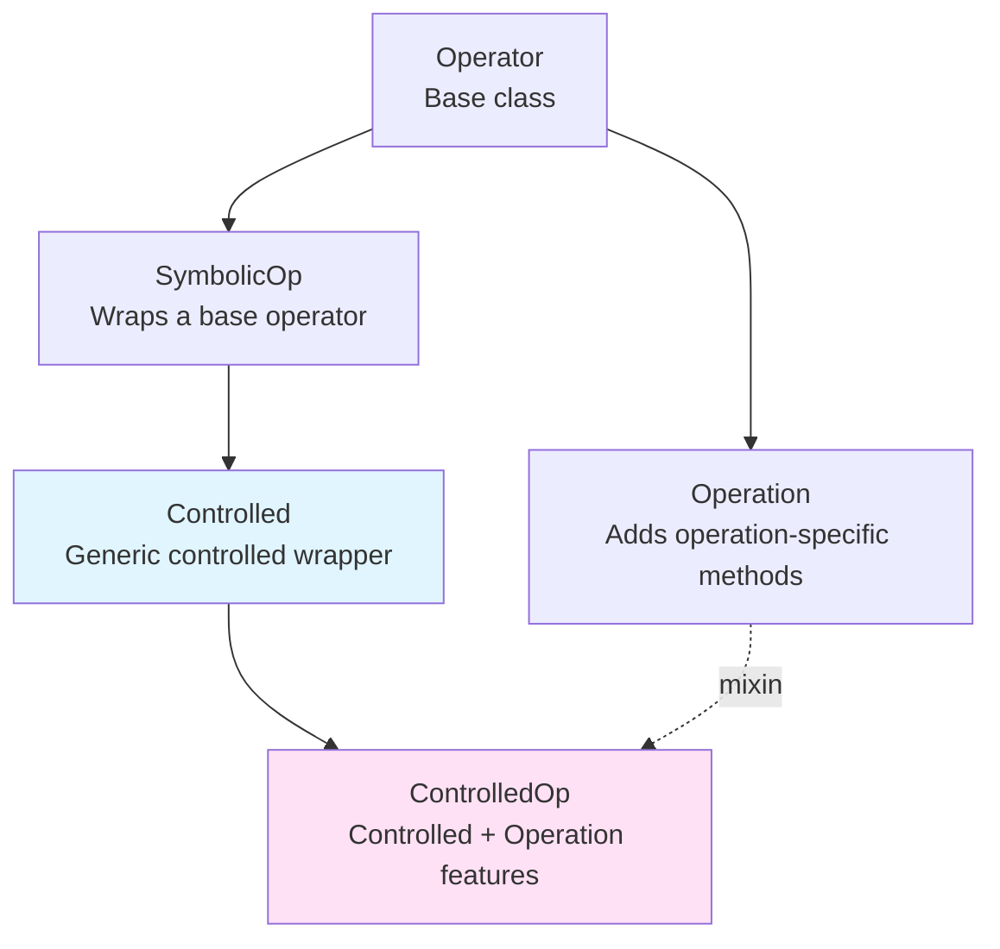
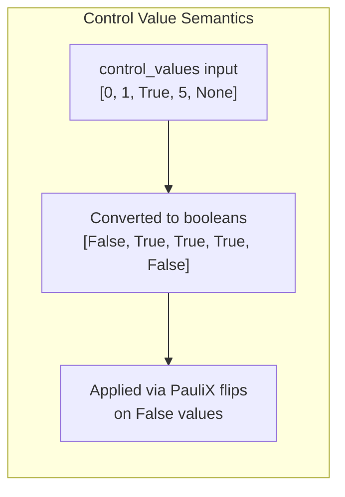
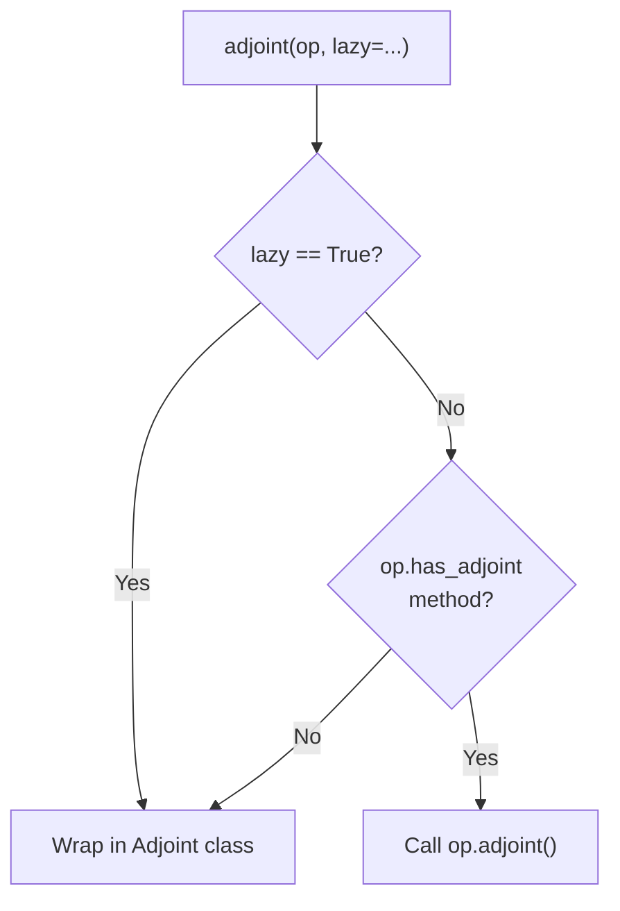
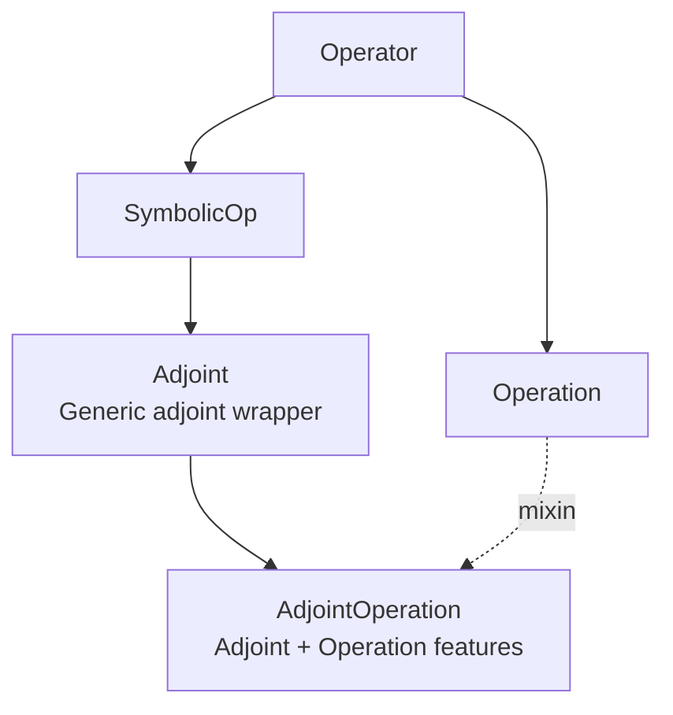
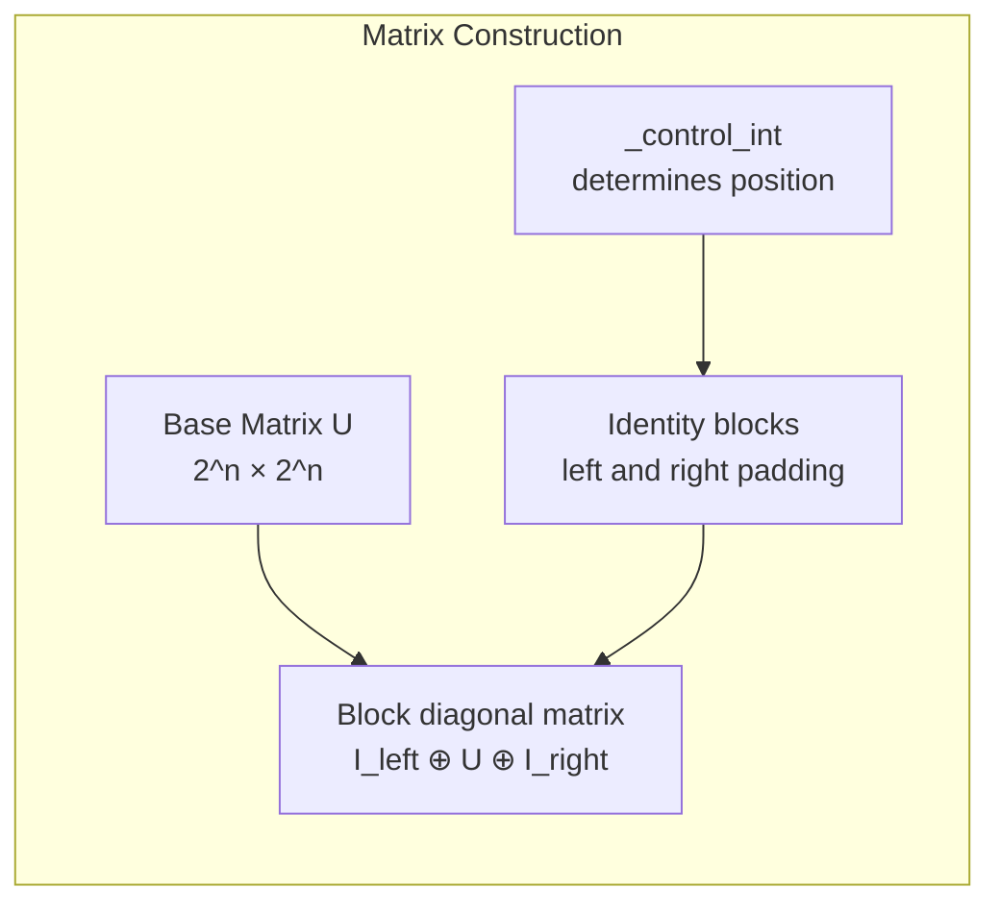
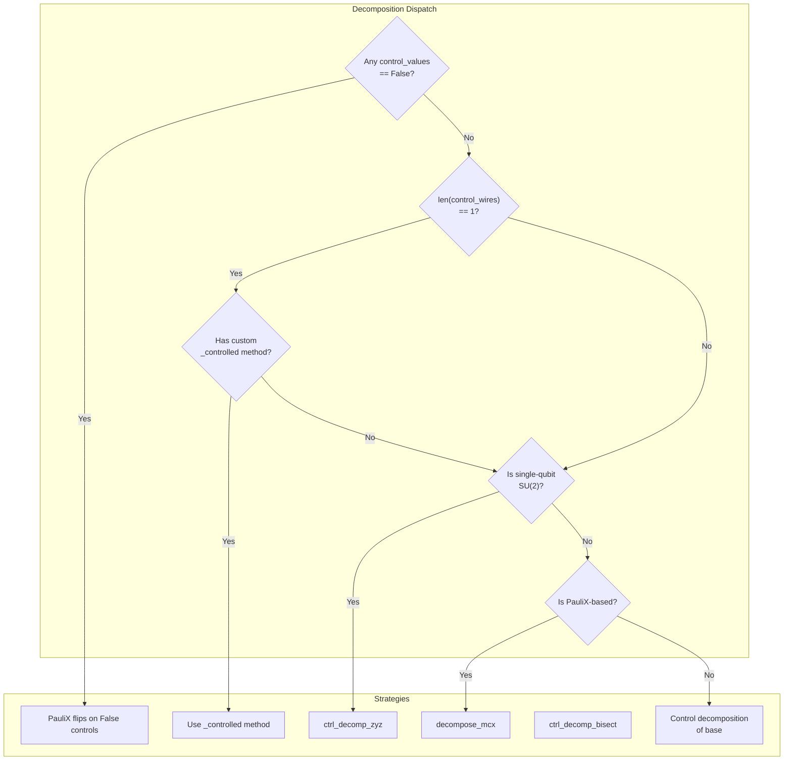
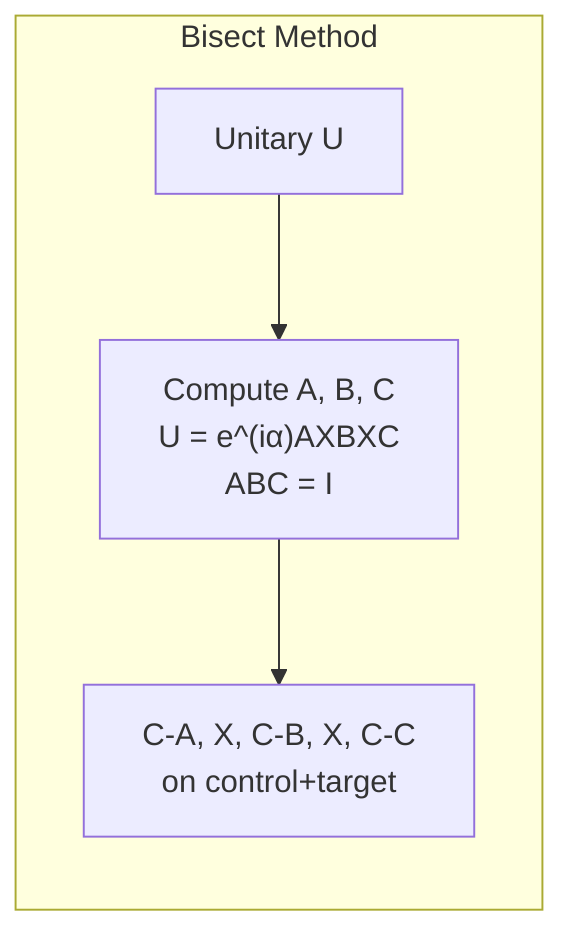
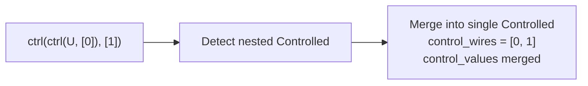

<!-- source: DeepWiki mcp.deepwiki.com · repo PennyLaneAI/pennylane · page 5.2 Controlled and Adjoint Operations · fetched 2026-10-21 -->

# Controlled and Adjoint Operations

<details>
<summary>Relevant source files</summary>

The following files were used as context for generating this wiki page:

- [pennylane/ops/identity.py](pennylane/ops/identity.py)
- [pennylane/ops/op_math/adjoint.py](pennylane/ops/op_math/adjoint.py)
- [pennylane/ops/op_math/controlled.py](pennylane/ops/op_math/controlled.py)
- [pennylane/ops/op_math/controlled_decompositions.py](pennylane/ops/op_math/controlled_decompositions.py)
- [pennylane/ops/op_math/controlled_ops.py](pennylane/ops/op_math/controlled_ops.py)
- [pennylane/ops/qubit/attributes.py](pennylane/ops/qubit/attributes.py)
- [pennylane/ops/qubit/non_parametric_ops.py](pennylane/ops/qubit/non_parametric_ops.py)
- [pennylane/ops/qubit/parametric_ops_multi_qubit.py](pennylane/ops/qubit/parametric_ops_multi_qubit.py)
- [pennylane/ops/qubit/parametric_ops_single_qubit.py](pennylane/ops/qubit/parametric_ops_single_qubit.py)
- [pennylane/ops/qubit/special_unitary.py](pennylane/ops/qubit/special_unitary.py)
- [tests/ops/op_math/test_adjoint.py](tests/ops/op_math/test_adjoint.py)
- [tests/ops/op_math/test_controlled.py](tests/ops/op_math/test_controlled.py)
- [tests/ops/op_math/test_controlled_decompositions.py](tests/ops/op_math/test_controlled_decompositions.py)
- [tests/ops/op_math/test_controlled_ops.py](tests/ops/op_math/test_controlled_ops.py)
- [tests/ops/qubit/test_attributes.py](tests/ops/qubit/test_attributes.py)
- [tests/ops/qubit/test_non_parametric_ops.py](tests/ops/qubit/test_non_parametric_ops.py)
- [tests/ops/qubit/test_parametric_ops.py](tests/ops/qubit/test_parametric_ops.py)
- [tests/ops/qubit/test_special_unitary.py](tests/ops/qubit/test_special_unitary.py)
- [tests/ops/test_identity.py](tests/ops/test_identity.py)

</details>


This document describes PennyLane's system for creating controlled and adjoint versions of quantum operations. These are fundamental quantum computing primitives that enable conditional execution (controlled operations) and unitary inversion (adjoint operations).

**Scope**: This page covers the `ctrl` and `adjoint` functions, the `Controlled`/`ControlledOp` and `Adjoint`/`AdjointOperation` symbolic operator classes, control value semantics, work wire management, and decomposition strategies. For basic quantum operations, see [Basic Qubit Operations](#5.1). For operator arithmetic composition, see [Operator Arithmetic](#5.3).

---

## System Architecture

The controlled and adjoint operations system is built on PennyLane's symbolic operator framework, allowing operations to be wrapped and transformed without immediate evaluation.

```mermaid
graph TB
    subgraph "User Interface"
        ctrl_func["ctrl(op, control, ...)"]
        adjoint_func["adjoint(op, lazy=...)"]
    end
    
    subgraph "Symbolic Operators"
        SymbolicOp["SymbolicOp<br/>Base class"]
        Controlled["Controlled<br/>Wraps any Operator"]
        ControlledOp["ControlledOp<br/>Wraps Operation"]
        Adjoint["Adjoint<br/>Wraps any Operator"]
        AdjointOperation["AdjointOperation<br/>Wraps Operation"]
    end
    
    subgraph "Core Properties"
        control_wires["control_wires"]
        target_wires["target_wires"]
        control_values["control_values<br/>[True, False, ...]"]
        work_wires["work_wires<br/>auxiliary wires"]
        work_wire_type["work_wire_type<br/>'zeroed' or 'borrowed'"]
    end
    
    subgraph "Decomposition System"
        ctrl_decomp_zyz["ctrl_decomp_zyz<br/>Single-qubit SU(2)"]
        ctrl_decomp_bisect["ctrl_decomp_bisect<br/>General unitary"]
        decompose_mcx["decompose_mcx<br/>Multi-controlled X"]
    end
    
    ctrl_func --> Controlled
    ctrl_func --> ControlledOp
    adjoint_func --> Adjoint
    adjoint_func --> AdjointOperation
    
    SymbolicOp --> Controlled
    SymbolicOp --> Adjoint
    Controlled --> ControlledOp
    Adjoint --> AdjointOperation
    
    Controlled --> control_wires
    Controlled --> target_wires
    Controlled --> control_values
    Controlled --> work_wires
    Controlled --> work_wire_type
    
    Controlled --> ctrl_decomp_zyz
    Controlled --> ctrl_decomp_bisect
    Controlled --> decompose_mcx
```



**Sources**: [pennylane/ops/op_math/controlled.py:1-1519](), [pennylane/ops/op_math/adjoint.py:1-433](), [pennylane/ops/op_math/symbolicop.py]()

---

## The `ctrl` Function

The `ctrl` function creates controlled versions of operators or quantum functions. It is the primary user-facing interface for controlled operations.

### Function Signatures

```python
# For operators
ctrl(op: Operator, control, control_values=None, 
     work_wires=None, work_wire_type="borrowed") -> Operator

# For callables (quantum functions)
ctrl(op: Callable, control, control_values=None,
     work_wires=None, work_wire_type="borrowed") -> Callable
```

### Key Implementation Logic

[pennylane/ops/op_math/controlled.py:64-173]() implements the main dispatch logic:

1. **Compiler dispatch**: If a JIT compiler is active (e.g., Catalyst), delegates to compiler-specific implementation
2. **Abstract values**: If `op` is abstract (e.g., during tracing), returns `Controlled` wrapper
3. **Concrete implementation**: Calls `create_controlled_op` for concrete operators/functions

**Sources**: [pennylane/ops/op_math/controlled.py:48-174]()

---

## Controlled Operation Classes

### Class Hierarchy



The `Controlled` class uses dynamic `__new__` to return `ControlledOp` when the base is an `Operation`:

[pennylane/ops/op_math/controlled.py:562-566]()
```python
def __new__(cls, base, *_, **__):
    """If base is an ``Operation``, then a ``ControlledOp`` should be used instead."""
    if isinstance(base, Operation):
        return object.__new__(ControlledOp)
    return object.__new__(Controlled)
```

**Sources**: [pennylane/ops/op_math/controlled.py:433-947](), [tests/ops/op_math/test_controlled.py:81-121]()

---

## Control Values and Wire Management

### Control Wires and Target Wires

Controlled operations distinguish between control wires and target wires:

| Property | Description | Example |
|----------|-------------|---------|
| `control_wires` | Wires that determine if operation executes | `Wires([0, 1])` |
| `target_wires` | Wires the base operation acts on | `Wires([2])` |
| `wires` | Combined: `control_wires + target_wires` | `Wires([0, 1, 2])` |

[pennylane/ops/op_math/controlled.py:693-715]()

### Control Values

Control values specify which state each control wire must be in:

- `control_values=[True, False, True]` - control on `|1⟩`, `|0⟩`, `|1⟩` respectively
- `control_values` defaults to all `True` (control on all `|1⟩` states)
- Integers are converted to booleans: `0 → False`, `1 → True`



Implementation at [pennylane/ops/op_math/controlled.py:604-614]():
```python
control_values = (
    [bool(control_values)]
    if isinstance(control_values, int)
    else [bool(control_value) for control_value in control_values]
)
```

**Sources**: [pennylane/ops/op_math/controlled.py:680-689](), [tests/ops/op_math/test_controlled.py:156-180]()

### Work Wires

Work wires are auxiliary wires used during decomposition but not modified by the operation:

| Parameter | Values | Description |
|-----------|--------|-------------|
| `work_wires` | `Wires` or iterable | Auxiliary wires available for decomposition |
| `work_wire_type` | `"zeroed"` or `"borrowed"` | State assumption for work wires |

- **`"zeroed"`**: Work wires are in `|0⟩` state and returned to `|0⟩`
- **`"borrowed"`**: Work wires can be in any state and are returned unchanged (default)

[pennylane/ops/op_math/controlled.py:704-711]()

**Sources**: [pennylane/ops/op_math/controlled.py:442-448](), [tests/ops/op_math/test_controlled.py:370-384]()

---

## The `adjoint` Function

The `adjoint` function creates the adjoint (conjugate transpose) of operators or quantum functions.

### Function Signatures

```python
# For operators
adjoint(fn: Operator, lazy=True) -> Operator

# For callables (quantum functions)  
adjoint(fn: Callable, lazy=True) -> Callable
```

### Lazy vs Eager Evaluation

The `lazy` parameter controls evaluation strategy:

| Mode | Behavior | Use Case |
|------|----------|----------|
| `lazy=True` | Always wraps in `Adjoint` class | Defers evaluation, enables symbolic manipulation |
| `lazy=False` | Attempts operation-specific adjoint first | Immediate decomposition when available |



[pennylane/ops/op_math/adjoint.py:176-198]()

**Sources**: [pennylane/ops/op_math/adjoint.py:32-175](), [tests/ops/op_math/test_adjoint.py:1-700]()

---

## Adjoint Operation Classes

### Class Structure



Like `Controlled`, the `Adjoint` class uses dynamic `__new__` [pennylane/ops/op_math/adjoint.py:262-267]():

```python
def __new__(cls, base=None):
    if isinstance(base, Operation):
        return object.__new__(AdjointOperation)
    return object.__new__(Adjoint)
```

**Sources**: [pennylane/ops/op_math/adjoint.py:240-433](), [tests/ops/op_math/test_adjoint.py:38-86]()

---

## Matrix Computation for Controlled Operations

### Control Matrix Construction

Controlled operations construct their matrix by padding the base operation's matrix with identity blocks:



Implementation at [pennylane/ops/op_math/controlled.py:756-778]():

```python
def _compute_matrix_from_base(self):
    base_matrix = self.base.matrix()
    
    num_target_states = 2 ** len(self.target_wires)
    num_control_states = 2 ** len(self.control_wires)
    total_matrix_size = num_control_states * num_target_states
    
    padding_left = self._control_int * num_target_states
    padding_right = total_matrix_size - padding_left - num_target_states
    
    # Create identity padding
    left_pad = math.eye(padding_left, like=interface)
    right_pad = math.eye(padding_right, like=interface)
    
    return math.block_diag([left_pad, base_matrix, right_pad])
```

The `_control_int` property converts boolean control values to an integer index [pennylane/ops/op_math/controlled.py:687-689]():

```python
@property
def _control_int(self):
    return sum(2**i for i, val in enumerate(reversed(self.control_values)) if val)
```

**Sources**: [pennylane/ops/op_math/controlled.py:756-816](), [tests/ops/op_math/test_controlled.py:833-874]()

---

## Decomposition Strategies for Controlled Operations

### Overview of Decomposition Methods



**Sources**: [pennylane/ops/op_math/controlled.py:836-878](), [pennylane/ops/op_math/controlled.py:977-1018]()

### ZYZ Decomposition for Single-Qubit SU(2)

The `ctrl_decomp_zyz` function decomposes controlled single-qubit special unitary operations using the ZYZ Euler angle representation:

**Key equation**: For any single-qubit SU(2) operation `U`, there exist angles `α, β, γ, δ` such that:
```
U = e^(iα) RZ(β) RY(γ) RZ(δ)
```

For a controlled version:
1. Decompose base into ZYZ form
2. Apply multi-controlled RZ and RY gates

[pennylane/ops/op_math/decompositions/controlled_decompositions.py:1-100]() contains the implementation.

**Sources**: [pennylane/ops/op_math/controlled_decompositions.py:30-32](), [tests/ops/op_math/test_controlled_decompositions.py:104-156]()

### Bisect Decomposition for General Unitaries

The `ctrl_decomp_bisect` function decomposes controlled general unitary operations by finding matrices `A, B` such that `U = e^(iα) AXBXC` where `ABC = I`:



Implementation at [pennylane/ops/op_math/decompositions/controlled_decompositions.py:100-200]().

**Sources**: [pennylane/ops/op_math/controlled_decompositions.py:1-80](), [tests/ops/op_math/test_controlled_decompositions.py:200-300]()

### Multi-Controlled X Decomposition

The `decompose_mcx` function provides multiple strategies based on available work wires:

| Work Wires | Strategy | Reference |
|------------|----------|-----------|
| 0 | Recursive decomposition | Lemma 7.5 Barenco et al. |
| 1 | Single worker explicit | KG24 or B95 methods |
| 2 | Two workers explicit | Old method |
| ≥ n-2 | Many workers explicit | Lemma 7.2 Barenco et al. |

[pennylane/ops/op_math/controlled_decompositions.py:41-80]()

**Sources**: [pennylane/ops/op_math/controlled_decompositions.py:1-115](), [pennylane/ops/op_math/decompositions/controlled_decompositions.py:400-800](), [tests/ops/op_math/test_controlled_decompositions.py:400-600]()

---

## Special Controlled Operations

### Built-in Controlled Operations

PennyLane provides optimized implementations for common controlled operations:

| Class | Description | Wires |
|-------|-------------|-------|
| `CH` | Controlled Hadamard | 2 |
| `CNOT` | Controlled-X | 2 |
| `CY` | Controlled-Y | 2 |
| `CZ` | Controlled-Z | 2 |
| `CRX`, `CRY`, `CRZ` | Controlled rotations | 2 |
| `CRot` | Controlled general rotation | 2 |
| `Toffoli` | Double-controlled X | 3 |
| `CSWAP` | Controlled-SWAP | 3 |
| `MultiControlledX` | Multi-controlled X | Any |
| `ControlledQubitUnitary` | Controlled arbitrary unitary | Any |

These are implemented in [pennylane/ops/op_math/controlled_ops.py:1-1500]().

### Custom Controlled Operation Mapping

The `base_to_custom_ctrl_op` function maintains a registry of custom controlled operations [pennylane/ops/op_math/controlled.py:1429-1519]():

```python
@lru_cache
def base_to_custom_ctrl_op():
    return {
        (qml.RX, 1): qml.CRX,
        (qml.RY, 1): qml.CRY,
        (qml.RZ, 1): qml.CRZ,
        (qml.Rot, 1): qml.CRot,
        (qml.PhaseShift, 1): qml.ControlledPhaseShift,
        # ... more mappings
    }
```

**Sources**: [pennylane/ops/op_math/controlled_ops.py:1-1500](), [pennylane/ops/op_math/controlled.py:1429-1519]()

---

## Flattening Nested Controlled Operations

When a controlled operation is applied to another controlled operation, they are flattened into a single multi-controlled operation:



Implementation at [pennylane/ops/op_math/controlled.py:214-226]():

```python
if isinstance(op, Controlled):
    work_wire_type = resolve_work_wire_type(
        op.work_wires, op.work_wire_type, work_wires, work_wire_type
    )
    qml.QueuingManager.remove(op)
    return ctrl(
        op.base,
        control=control + op.control_wires,
        control_values=control_values + op.control_values,
        work_wires=work_wires + op.work_wires,
        work_wire_type=work_wire_type,
    )
```

**Sources**: [pennylane/ops/op_math/controlled.py:212-226](), [tests/ops/op_math/test_controlled.py:600-650]()

---

## Integration with Transforms and Compilation

### Transform Integration

Both `ctrl` and `adjoint` can be applied to quantum functions, not just operators:

```python
def my_circuit(theta):
    qml.RX(theta, wires=0)
    qml.RY(theta, wires=1)

# Apply control to entire function
ctrl_circuit = qml.ctrl(my_circuit, control=2)

# Apply adjoint to entire function
adj_circuit = qml.adjoint(my_circuit)
```

Implementation uses higher-order primitives [pennylane/ops/op_math/controlled.py:285-348]() for capture-compatible transformation.

### Compiler Support

When a compiler (e.g., Catalyst) is active, `ctrl` and `adjoint` dispatch to compiler-specific implementations:

[pennylane/ops/op_math/controlled.py:155-158]()
```python
if active_jit := compiler.active_compiler():
    available_eps = compiler.AvailableCompilers.names_entrypoints
    ops_loader = available_eps[active_jit]["ops"].load()
    return ops_loader.ctrl(op, control, control_values=control_values, work_wires=work_wires)
```

**Sources**: [pennylane/ops/op_math/controlled.py:155-173](), [pennylane/ops/op_math/adjoint.py:170-174]()

---

## Generator and Differentiation

### Generator for Controlled Operations

For controlled parametric operations, the generator is the tensor product of projectors on control qubits and the base generator:

[pennylane/ops/op_math/controlled.py:885-892]()
```python
def generator(self):
    sub_gen = self.base.generator()
    projectors = (
        qml.Projector([val], wires=w) 
        for val, w in zip(self.control_values, self.control_wires)
    )
    return qml.prod(*projectors, sub_gen)
```

This enables parameter-shift differentiation for controlled gates.

### Adjoint for Differentiation

The adjoint operation is central to adjoint differentiation methods. The `Adjoint` class provides:

- Matrix computation via conjugate transpose [pennylane/ops/op_math/adjoint.py:350-360]()
- Generator reversal (negation) [pennylane/ops/op_math/adjoint.py:368-370]()
- Eigenvalue conjugation [pennylane/ops/op_math/adjoint.py:362-366]()

**Sources**: [pennylane/ops/op_math/controlled.py:881-892](), [pennylane/ops/op_math/adjoint.py:350-380]()

---

## Common Patterns and Examples

### Creating Multi-Controlled Operations

```python
# Single control
qml.ctrl(qml.RX(0.5, wires=0), control=1)

# Multiple controls with mixed control values
qml.ctrl(qml.RX(0.5, wires=0), control=[1, 2, 3], 
         control_values=[True, False, True])

# With work wires for decomposition
qml.ctrl(qml.RX(0.5, wires=0), control=[1, 2, 3], 
         work_wires=[4, 5], work_wire_type="zeroed")
```

### Adjoint and Controlled Composition

Operations can be composed with both control and adjoint:

```python
# Adjoint of controlled operation
op = qml.adjoint(qml.ctrl(qml.RX(0.5, wires=0), control=1))

# Control of adjoint operation  
op = qml.ctrl(qml.adjoint(qml.RY(0.3, wires=0)), control=1)

# These commute for unitary operations
```

[pennylane/ops/op_math/controlled.py:898-905]()

**Sources**: [pennylane/ops/op_math/controlled.py:64-252](), [pennylane/ops/op_math/adjoint.py:36-174](), [tests/ops/op_math/test_controlled.py:1-1500]()

---

## Resource Estimation

Both `Controlled` and `Adjoint` support resource estimation through `resource_params`:

### Controlled Operation Resources

[pennylane/ops/op_math/controlled.py:733-741]()
```python
@property
def resource_params(self):
    return {
        "base_class": type(self.base),
        "base_params": self.base.resource_params,
        "num_control_wires": len(self.control_wires),
        "num_zero_control_values": len([val for val in self.control_values if not val]),
        "num_work_wires": len(self.work_wires),
        "work_wire_type": self.work_wire_type,
    }
```

### Adjoint Operation Resources

Adjoint operations typically have the same resource requirements as their base operation.

**Sources**: [pennylane/ops/op_math/controlled.py:520-527](), [pennylane/ops/op_math/controlled.py:733-741](), [pennylane/ops/op_math/adjoint.py:300-310]()

---

