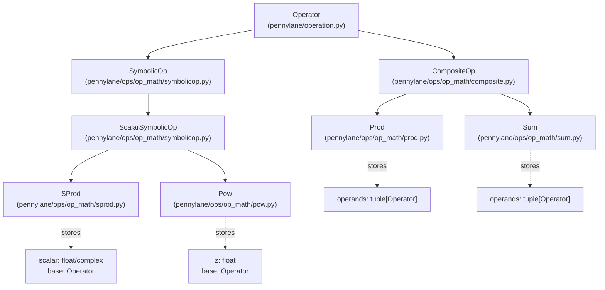
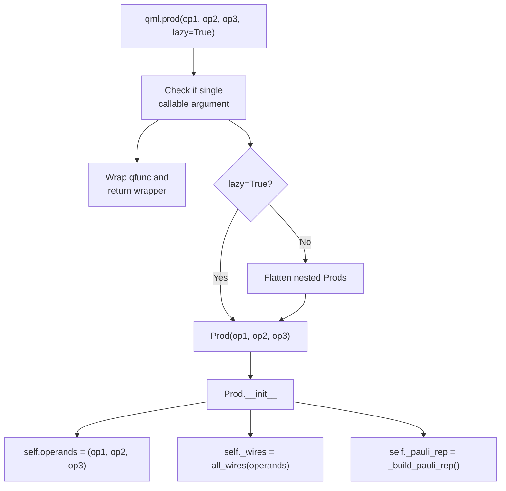
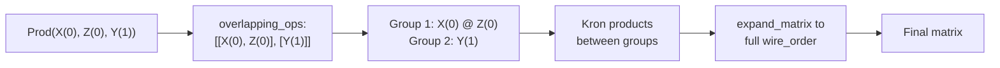
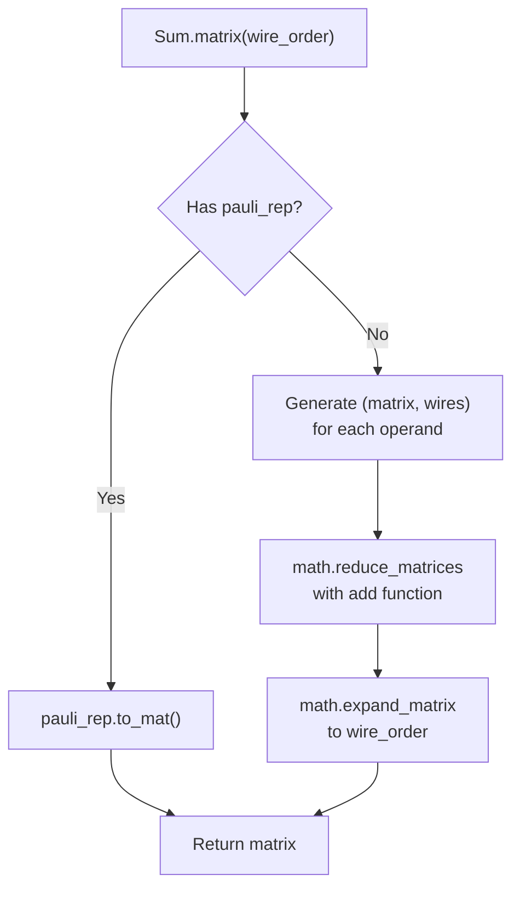
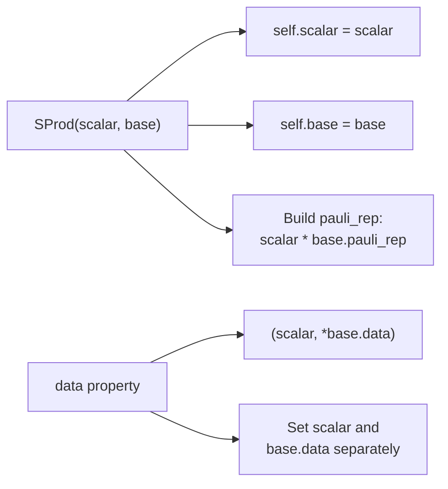
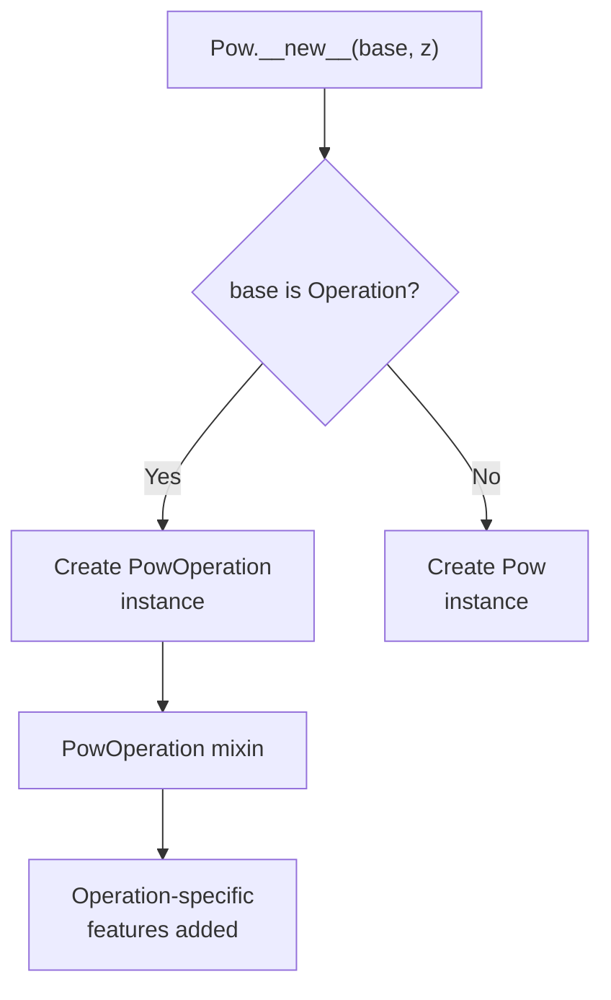
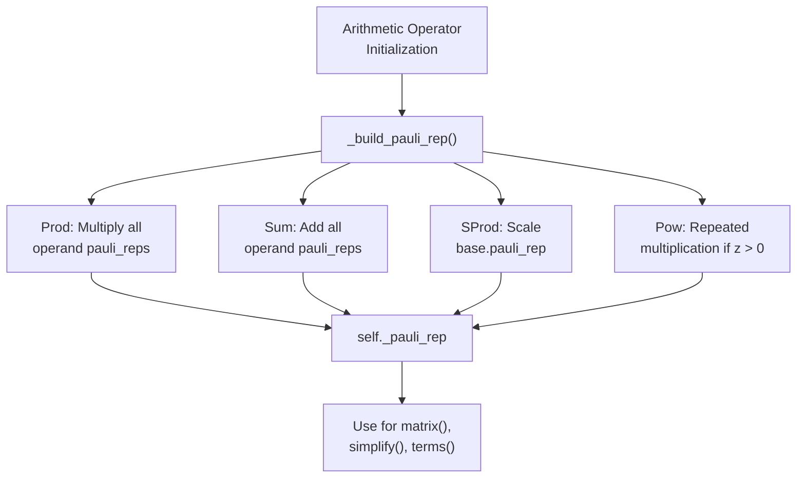
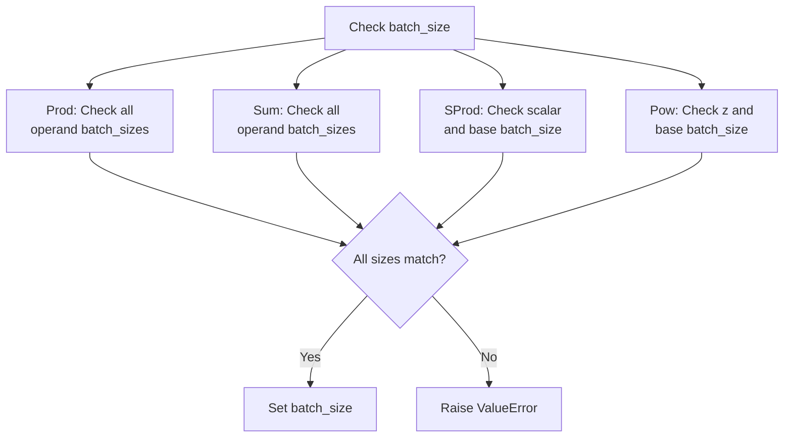

<!-- source: DeepWiki mcp.deepwiki.com · repo PennyLaneAI/pennylane · page 5.3 Operator Arithmetic · fetched 2026-10-21 -->

# Operator Arithmetic

<details>
<summary>Relevant source files</summary>

The following files were used as context for generating this wiki page:

- [pennylane/ops/op_math/composite.py](pennylane/ops/op_math/composite.py)
- [pennylane/ops/op_math/pow.py](pennylane/ops/op_math/pow.py)
- [pennylane/ops/op_math/prod.py](pennylane/ops/op_math/prod.py)
- [pennylane/ops/op_math/sprod.py](pennylane/ops/op_math/sprod.py)
- [pennylane/ops/op_math/sum.py](pennylane/ops/op_math/sum.py)
- [pennylane/ops/op_math/symbolicop.py](pennylane/ops/op_math/symbolicop.py)
- [tests/ops/op_math/test_composite.py](tests/ops/op_math/test_composite.py)
- [tests/ops/op_math/test_pow_op.py](tests/ops/op_math/test_pow_op.py)
- [tests/ops/op_math/test_prod.py](tests/ops/op_math/test_prod.py)
- [tests/ops/op_math/test_sprod.py](tests/ops/op_math/test_sprod.py)
- [tests/ops/op_math/test_sum.py](tests/ops/op_math/test_sum.py)
- [tests/ops/op_math/test_symbolic_op.py](tests/ops/op_math/test_symbolic_op.py)

</details>


## Purpose and Scope

This page documents PennyLane's operator arithmetic system, which provides symbolic operators for algebraic composition of quantum operations. The four main classes—`Prod`, `Sum`, `SProd`, and `Pow`—enable mathematical expressions over operators without immediate evaluation.

For information about the base classes that these operators inherit from (`SymbolicOp`, `CompositeOp`, `ScalarSymbolicOp`), see [Symbolic Operations and Composition](#5.4). For controlled and adjoint operations, see [Controlled and Adjoint Operations](#5.2).

**Sources**: [pennylane/ops/op_math/prod.py:1-695](), [pennylane/ops/op_math/sum.py:1-611](), [pennylane/ops/op_math/sprod.py:1-329](), [pennylane/ops/op_math/pow.py:1-408]()

---

## Operator Arithmetic Classes Overview

PennyLane provides four primary operator arithmetic classes:

| Class | Symbol | Function | Purpose | Base Class |
|-------|--------|----------|---------|------------|
| `Prod` | `@` | `qml.prod()` | Product/composition of operators | `CompositeOp` |
| `Sum` | `+` | `qml.sum()` | Linear combination of operators | `CompositeOp` |
| `SProd` | `*` | `qml.s_prod()` | Scalar multiplication | `ScalarSymbolicOp` |
| `Pow` | `**` | `qml.pow()` | Operator exponentiation | `ScalarSymbolicOp` |

Each class supports both a constructor (e.g., `Prod(...)`) and a convenience function (e.g., `qml.prod(...)`). The convenience functions provide additional features like lazy evaluation control.

**Sources**: [pennylane/ops/op_math/prod.py:45-148](), [pennylane/ops/op_math/sum.py:33-122](), [pennylane/ops/op_math/sprod.py:32-79](), [pennylane/ops/op_math/pow.py:39-109]()

---

## Operator Arithmetic Class Hierarchy



**Sources**: [pennylane/ops/op_math/composite.py:49-75](), [pennylane/ops/op_math/symbolicop.py:32-167](), [pennylane/ops/op_math/prod.py:150-244](), [pennylane/ops/op_math/sum.py:124-213](), [pennylane/ops/op_math/sprod.py:81-157](), [pennylane/ops/op_math/pow.py:111-195]()

---

## Product Operator (Prod)

### Overview

The `Prod` class represents the generalized product of operators, combining both tensor products and matrix composition based on wire relationships.

```python
# Basic usage
prod_op = qml.prod(qml.X(0), qml.Z(1))  # Tensor product (different wires)
prod_op = qml.prod(qml.X(0), qml.Z(0))  # Matrix composition (same wires)

# The prod function provides lazy evaluation control
prod_op = qml.prod(qml.X(0), qml.Y(0), lazy=False)  # Immediately simplifies
```

**Key Properties**:
- **Symbol**: `@`
- **Operands**: Tuple of operators stored in `operands` attribute
- **Application Order**: Operators are applied in reverse order (right to left)
- **Decomposition**: Returns factors in reversed order [pennylane/ops/op_math/prod.py:276-285]()

**Sources**: [pennylane/ops/op_math/prod.py:45-148](), [pennylane/ops/op_math/prod.py:150-244]()

### Product Initialization and Data Flow



**Sources**: [pennylane/ops/op_math/prod.py:45-148](), [pennylane/ops/op_math/composite.py:77-93]()

### Matrix Computation for Prod

The `Prod.matrix()` method computes the product matrix by:
1. Grouping operators with overlapping wires
2. Computing matrix products within each group
3. Computing tensor products between groups



**Implementation**: The matrix computation uses `math.reduce_matrices()` for overlapping operators and `math.kron()` for tensor products [pennylane/ops/op_math/prod.py:288-316]().

**Sources**: [pennylane/ops/op_math/prod.py:288-316](), [pennylane/ops/op_math/composite.py:220-255]()

### Product Simplification

The `Prod.simplify()` method performs algebraic simplification:

1. **Pauli Simplification**: If all operands have Pauli representations, use `pauli_rep` [pennylane/ops/op_math/prod.py:395-398]()
2. **Factor Grouping**: Group identical factors and Pauli operators [pennylane/ops/op_math/prod.py:373-386]()
3. **Expansion**: Expand nested `Sum` and `SProd` operands [pennylane/ops/op_math/prod.py:400-413]()

The `_ProductFactorsGrouping` class handles factor grouping logic:

| Method | Purpose |
|--------|---------|
| `add(factor)` | Add factor, grouping with existing factors |
| `_add_pauli_factor()` | Group Pauli operators on same wire using multiplication table |
| `_add_non_pauli_factor()` | Group identical non-Pauli operators |
| `remove_factors()` | Extract final grouped factors |

**Sources**: [pennylane/ops/op_math/prod.py:373-414](), [pennylane/ops/op_math/prod.py:532-695]()

---

## Sum Operator (Sum)

### Overview

The `Sum` class represents a linear combination of operators. It supports observable grouping for efficient measurement.

```python
# Basic usage
sum_op = qml.sum(qml.X(0), qml.Z(0))

# With grouping for measurement optimization
sum_op = qml.sum(qml.X(0), qml.X(1), qml.Z(0), grouping_type="qwc")
print(sum_op.grouping_indices)  # ((0, 1), (2,))
```

**Key Properties**:
- **Symbol**: `+`
- **Operands**: Tuple of operators stored in `operands` attribute
- **Hermitianity**: Hermitian if all summands are Hermitian [pennylane/ops/op_math/sum.py:308-318]()
- **Grouping**: Optional grouping for commuting observables [pennylane/ops/op_math/sum.py:483-529]()

**Sources**: [pennylane/ops/op_math/sum.py:33-122](), [pennylane/ops/op_math/sum.py:124-213]()

### Sum Matrix and Sparse Matrix Computation



The matrix computation adds operator matrices after expanding them to a common wire space [pennylane/ops/op_math/sum.py:326-355]().

**Sources**: [pennylane/ops/op_math/sum.py:326-375]()

### Sum Simplification and Terms

The `Sum.simplify()` method:
1. Uses Pauli representation if available [pennylane/ops/op_math/sum.py:426-429]()
2. Flattens nested `Sum` operators [pennylane/ops/op_math/sum.py:395-422]()
3. Groups identical summands with coefficient accumulation [pennylane/ops/op_math/sum.py:569-611]()

The `_SumSummandsGrouping` class tracks summands:

```python
# Internal structure
class _SumSummandsGrouping:
    def __init__(self):
        self.queue = {}  # {hash: [coeff, summand]}
    
    def add(self, summand, coeff=1):
        # Accumulates coefficients for identical operators
        if isinstance(summand, SProd):
            coeff *= summand.scalar
            summand = summand.base
        if summand.hash in self.queue:
            self.queue[summand.hash][0] += coeff
        else:
            self.queue[summand.hash] = [coeff, summand]
```

**Sources**: [pennylane/ops/op_math/sum.py:424-481](), [pennylane/ops/op_math/sum.py:569-611]()

---

## Scalar Product (SProd)

### Overview

The `SProd` class represents scalar multiplication of an operator.

```python
# Basic usage
sprod_op = qml.s_prod(2.5, qml.X(0))
sprod_op = 2.5 * qml.X(0)  # Equivalent using operator overloading

# Supports complex scalars
sprod_op = qml.s_prod(1j, qml.Z(0))
```

**Key Properties**:
- **Symbol**: `*`
- **Scalar**: Stored in `scalar` attribute (can be batched)
- **Base**: Single operator stored in `base` attribute
- **Data**: Tuple `(scalar, *base.data)` [pennylane/ops/op_math/sprod.py:210-218]()
- **Hermitianity**: Hermitian if base is Hermitian and scalar is real [pennylane/ops/op_math/sprod.py:200-205]()

**Sources**: [pennylane/ops/op_math/sprod.py:32-79](), [pennylane/ops/op_math/sprod.py:81-157]()

### SProd Data Management



**Sources**: [pennylane/ops/op_math/sprod.py:138-151](), [pennylane/ops/op_math/symbolicop.py:209-218]()

### SProd Matrix Computation

The matrix is computed as `scalar * base.matrix()` with batching support:

```python
# Simplified implementation
@staticmethod
def _matrix(scalar, mat):
    return scalar * mat

def matrix(self, wire_order=None):
    base_mat = self.base.matrix(wire_order=wire_order)
    
    if self.batch_size is None:
        return self._matrix(self.scalar, base_mat)
    
    # Handle batching of scalar, base, or both
    # Returns batched matrices
```

**Batching Support**:
- Scalar can be batched: `qml.s_prod([1, 2, 3], qml.X(0))`
- Base can be batched: `qml.s_prod(2, qml.RX([1, 2, 3], 0))`
- Both can be batched: `qml.s_prod([1, 2, 3], qml.RX([1, 2, 3], 0))`

**Sources**: [pennylane/ops/op_math/sprod.py:280-284](), [pennylane/ops/op_math/symbolicop.py:248-291]()

### SProd Decomposition

SProd has limited decomposition support:
- **Unit norm scalars**: Decomposed as `GlobalPhase` + base [pennylane/ops/op_math/sprod.py:314-333]()
- **Non-unit norm**: No decomposition (raises `DecompositionUndefinedError`) [pennylane/ops/op_math/sprod.py:349-355]()

```python
# Example: 1j * X(0)
op = qml.s_prod(1j, qml.X(0))
decomp = op.decomposition()
# [GlobalPhase(-π/2), X(0)]
```

**Sources**: [pennylane/ops/op_math/sprod.py:314-355]()

---

## Power Operator (Pow)

### Overview

The `Pow` class represents an operator raised to a power.

```python
# Basic usage
pow_op = qml.pow(qml.X(0), 0.5)  # Square root of X
pow_op = qml.X(0) ** 0.5  # Equivalent

# Integer powers decompose to repeated application
pow_op = qml.pow(qml.RX(1.2, 0), 3, lazy=False)  # Decomposes to product
```

**Key Properties**:
- **Symbol**: `**`
- **Exponent**: Stored in `z` hyperparameter (can be batched)
- **Base**: Single operator stored in `base` attribute
- **Name**: Constructed as `f"{base.name}**{z}"` [pennylane/ops/op_math/pow.py:172]()

**Sources**: [pennylane/ops/op_math/pow.py:39-109](), [pennylane/ops/op_math/pow.py:111-195]()

### Pow Inheritance Structure

The `Pow` class uses dynamic inheritance to add operation-specific mixins:



This allows `Pow(qml.RX(...))` to have `Operation` methods while `Pow(Observable(...))` does not [pennylane/ops/op_math/pow.py:144-168]().

**Sources**: [pennylane/ops/op_math/pow.py:144-168]()

### Pow Matrix Computation

Matrix computation depends on exponent type:

```python
@staticmethod
def _matrix(scalar, mat):
    if isinstance(scalar, int):
        # For integer powers, use matrix_power
        return qmlmath.linalg.matrix_power(mat, scalar)
    
    # For fractional powers, use scipy
    return fractional_matrix_power(mat, scalar)
```

**Sparse Matrix**: Only supported for integer exponents [pennylane/ops/op_math/pow.py:256-266]()

**Sources**: [pennylane/ops/op_math/pow.py:229-253](), [pennylane/ops/op_math/pow.py:256-266]()

### Pow Decomposition

Decomposition strategies:

1. **Integer powers ≥ 1**: Decompose as repeated application [pennylane/ops/op_math/pow.py:283-294]()
2. **Base defines pow()**: Use `base.pow(z)` method [pennylane/ops/op_math/pow.py:295-304]()
3. **Otherwise**: No decomposition available [pennylane/ops/op_math/pow.py:269-282]()

```python
# Example decompositions
qml.pow(qml.X(0), 2).decomposition()  # [X(0), X(0)]
qml.pow(qml.RX(1.2, 0), 0.5).decomposition()  # Uses RX.pow(0.5)
qml.pow(qml.Hadamard(0), 0.7).decomposition()  # Raises error
```

**Sources**: [pennylane/ops/op_math/pow.py:269-310]()

---

## Pauli Representation Integration

All arithmetic operators integrate with PennyLane's Pauli representation system (`PauliSentence` and `PauliWord`).

### Pauli Representation Construction



**Pauli Representation Benefits**:
- Efficient matrix computation via `pauli_rep.to_mat()` [pennylane/ops/op_math/prod.py:290-291]()
- Automatic simplification of Pauli algebra [pennylane/ops/op_math/prod.py:395-398]()
- Efficient sparse matrix support [pennylane/ops/op_math/prod.py:320-321]()

**Sources**: [pennylane/ops/op_math/prod.py:367-371](), [pennylane/ops/op_math/sum.py:384-393](), [pennylane/ops/op_math/sprod.py:138-150](), [pennylane/ops/op_math/pow.py:176-187]()

### Pauli Multiplication Table (Prod)

The `_ProductFactorsGrouping` class uses a Pauli multiplication table for simplification:

```python
_pauli_mult = {
    "Identity": {
        "Identity": (1.0, "Identity"),
        "PauliX": (1.0, "PauliX"),
        "PauliY": (1.0, "PauliY"),
        "PauliZ": (1.0, "PauliZ"),
    },
    "PauliX": {
        "Identity": (1.0, "PauliX"),
        "PauliX": (1.0, "Identity"),
        "PauliY": (1.0j, "PauliZ"),
        "PauliZ": (-1.0j, "PauliY"),
    },
    # ... Y and Z maps
}
```

This enables automatic simplification like `X @ Y → iZ` [pennylane/ops/op_math/prod.py:535-608]().

**Sources**: [pennylane/ops/op_math/prod.py:532-608]()

---

## Terms Representation

The `terms()` method returns a linear combination representation: `O = Σ c_i O_i`

### Terms Implementation by Class

| Class | `terms()` Behavior |
|-------|-------------------|
| `Prod` | Expands products of sums into sum of products [pennylane/ops/op_math/prod.py:444-486]() |
| `Sum` | Flattens nested sums, groups identical terms [pennylane/ops/op_math/sum.py:437-481]() |
| `SProd` | Multiplies base terms by scalar [pennylane/ops/op_math/sprod.py:182-198]() |
| `Pow` | Not defined (raises `TermsUndefinedError`) |

### Terms Example Flow

```python
# Example: X(0) @ (Y(0) + Z(1))
op = qml.prod(qml.X(0), qml.sum(qml.Y(0), qml.Z(1)))

# terms() expansion:
# Step 1: Simplify factors → [[X(0)], [Y(0), Z(1)]]
# Step 2: Cartesian product → [X(0)@Y(0), X(0)@Z(1)]
# Step 3: Simplify products → [1j*Z(0), X(0)@Z(1)]
# Result: ([1j, 1.0], [Z(0), X(0)@Z(1)])

coeffs, ops = op.terms()
# coeffs = [1j, 1.0]
# ops = [Z(0), Prod(X(0), Z(1))]
```

**Sources**: [pennylane/ops/op_math/prod.py:444-486](), [pennylane/ops/op_math/sum.py:437-481](), [pennylane/ops/op_math/sprod.py:182-198]()

---

## Batching Support

All arithmetic operators support batching of parameters and/or coefficients.

### Batch Size Resolution



**Batch Size Rules**:
- All batched components must have the same batch size
- Non-batched components are broadcast to batch size
- Mismatch raises `ValueError` [pennylane/ops/op_math/composite.py:94-102]()

**Examples**:
```python
# SProd batching
qml.s_prod([1, 2, 3], qml.X(0)).batch_size  # 3
qml.s_prod(2, qml.RX([1, 2, 3], 0)).batch_size  # 3

# Prod batching
qml.prod(qml.RX([1, 2, 3], 0), qml.RY([4, 5, 6], 1)).batch_size  # 3

# Invalid batching
qml.prod(qml.RX([1, 2], 0), qml.RY([4, 5, 6], 1))  # ValueError
```

**Sources**: [pennylane/ops/op_math/composite.py:94-102](), [pennylane/ops/op_math/symbolicop.py:190-207]()

---

## Lazy vs Eager Evaluation

Arithmetic functions support both lazy and eager evaluation modes:

### Lazy Mode (Default)

```python
# Lazy mode: wraps in symbolic operator
op = qml.prod(qml.X(0), qml.Y(0), lazy=True)  # Prod(X(0), Y(0))
op = qml.sum(qml.X(0), qml.X(0), lazy=True)   # Sum(X(0), X(0))
```

### Eager Mode

```python
# Eager mode: attempts simplification
op = qml.prod(qml.X(0), qml.Y(0), lazy=False)  # Simplifies to 1j*Z(0)
op = qml.sum(qml.X(0), qml.X(0), lazy=False)   # Simplifies to 2*X(0)
op = qml.pow(qml.X(0), 2, lazy=False)          # Simplifies to Identity(0)
```

### Lazy Parameter Effects

| Function | `lazy=True` | `lazy=False` |
|----------|-------------|--------------|
| `qml.prod()` | Returns `Prod` | Flattens nested `Prod` instances [pennylane/ops/op_math/prod.py:136-147]() |
| `qml.sum()` | Returns `Sum` | Flattens nested `Sum` instances [pennylane/ops/op_math/sum.py:108-121]() |
| `qml.s_prod()` | Returns `SProd` | Combines with nested `SProd` scalar [pennylane/ops/op_math/sprod.py:73-78]() |
| `qml.pow()` | Returns `Pow` | Calls `base.pow(z)` if available [pennylane/ops/op_math/pow.py:92-108]() |

**Sources**: [pennylane/ops/op_math/prod.py:136-147](), [pennylane/ops/op_math/sum.py:108-121](), [pennylane/ops/op_math/sprod.py:73-78](), [pennylane/ops/op_math/pow.py:92-108]()

---

## Recursion Protection

Deep nesting of arithmetic operators can cause `RecursionError`. The codebase includes protection via the `handle_recursion_error` decorator:

```python
def handle_recursion_error(func):
    @wraps(func)
    def wrapper(*args, **kwargs):
        try:
            return func(*args, **kwargs)
        except RecursionError as e:
            raise RuntimeError(
                "Maximum recursion depth reached! This is likely due to nesting too many levels "
                "of composite operators. Try setting lazy=False when calling qml.sum, qml.prod, "
                "and qml.s_prod, or use the +, @, and * operators instead. Alternatively, you "
                "can periodically call qml.simplify on your operators."
            ) from e
    return wrapper
```

**Protected Methods**:
- `matrix()`, `sparse_matrix()`, `eigvals()` [pennylane/ops/op_math/composite.py:31-46]()
- `simplify()`, `terms()` [pennylane/ops/op_math/prod.py:388]()
- Property getters like `hash`, `data`, `num_params` [pennylane/ops/op_math/composite.py:94]()

**Sources**: [pennylane/ops/op_math/composite.py:31-46]()

---

## Usage Examples

### Combining Multiple Arithmetic Operations

```python
import pennylane as qml

# Build complex observable
H = (
    0.5 * qml.prod(qml.X(0), qml.Y(1))  # SProd(Prod)
    + 0.3 * qml.Z(2)                     # Sum(SProd)
    + qml.pow(qml.X(3), 0.5)            # Sum(Pow)
)

# Access structure
print(H.operands)  # (SProd(...), SProd(...), Pow(...))

# Simplify
H_simplified = H.simplify()

# Get terms
coeffs, ops = H.terms()
```

### Qfunc Initialization (Prod)

```python
# Define operator via quantum function
def my_circuit(x):
    qml.RX(x, 0)
    qml.CNOT([0, 1])
    qml.RZ(1.1, 1)

# Create product from qfunc
prod_op = qml.prod(my_circuit)(2.3)
# Equivalent to: prod(RZ(1.1, 1), CNOT([0,1]), RX(2.3, 0))
```

**Sources**: [pennylane/ops/op_math/prod.py:417-489](), [tests/ops/op_math/test_prod.py:417-430]()

### Observable Grouping (Sum)

```python
# Create sum with grouping
obs = [qml.X(0), qml.prod(qml.X(0), qml.X(1)), qml.Z(0)]
coeffs = [1.0, 2.0, 3.0]
H = qml.dot(coeffs, obs)

# Compute qubit-wise commuting groups
H.compute_grouping(grouping_type="qwc")
print(H.grouping_indices)  # ((0, 1), (2,))
# Group 0: X(0) and X(0)@X(1) commute
# Group 1: Z(0) separate
```

**Sources**: [pennylane/ops/op_math/sum.py:483-529](), [tests/ops/op_math/test_sum.py:501-520]()

---

